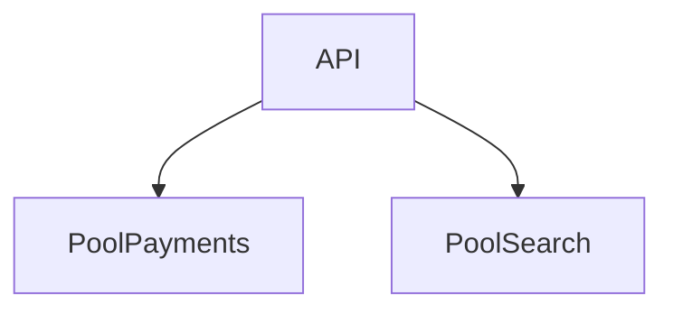

# D15-T024 — Bulkheads

Topic ID: `D15-T024`
Domain: Distributed Systems
Subdomain: Bulkheads
Importance: core
Complexity: advanced
Dependencies: `D15-T023`, `D15-T001`, `D03-T001`, `D03-T002`, `D04-T001`, `D04-T002`
Execution status of the code in section F: unexecuted

## A. Topic Overview

Bulkheads isolate resource pools (threads, connections) per dependency so one slow service cannot exhaust all workers.

## B. First-Principles Explanation

Sized from traffic mix and SLO; monitor queue depth. Bulkheads isolate resource pools (threads, connections) per dependency so one slow service cannot exhaust all workers.

## C. Internal Working and Architecture

Separate executor per downstream; limit queue length. Components interact through RPC, replication logs, and coordination services.

## D. Diagrams and Visual Models



Read the diagram as a causal flow from client action to stored or observed outcome, including failure branches.

## E. Examples and Analogies

Tomcat connector threads vs dedicated async pool for reports.

## F. Code Examples

File: `examples/d15_t024_bulkhead.py`

Dependencies: Python 3 standard library only.

```python
def acquire(pool_free: int) -> bool:
    return pool_free > 0
```

The snippet models control flow you would embed in a service or test harness. It is not a production client library.

## G. Practical Backend Application

Reject fast when pool saturated instead of hanging all users.

## H. Advantages, Limitations and Trade-offs

| Choice | Benefit | Cost | Choose when | Avoid when |
| --- | --- | --- | --- | --- |
| Dedicated pool | Isolation | Idle capacity | Mixed workloads | Uniform microservice | | | | |

Under load, the cheap choice on paper becomes the choice that amplifies retries, stale reads, or operator toil. Measure p99 latency and error budgets, not only happy-path throughput.

## I. Common Mistakes and Misconceptions

- One giant pool for all HTTP clients.
- Unbounded queues.

A weak interview answer names a buzzword without a failure story. A strong answer names what breaks, what users see, and what invariant you still enforce.

## J. Debugging and Troubleshooting

Thread dump shows all blocked on same downstream.

## K. Interview Preparation
### Beginner
#### Q1. What is Bulkheads?

**Answer:** Bulkheads isolate resource pools (threads, connections) per dependency so one slow service cannot exhaust all workers. Interviewers want a precise definition tied to resource isolation bulkheads, not a slogan. In production, the failure mode matters more than the slogan: measure timeouts, error budgets, and client-visible symptoms before you rename the problem. In production, the failure mode matters more than the slogan: measure timeouts, error budgets, and client-visible symptoms before you rename the problem.
#### Q2. Why does Bulkheads matter in backends?

**Answer:** Bulkheads isolate resource pools (threads, connections) per dependency so one slow service cannot exhaust all workers. Production systems fail one hop at a time; users still expect coherent behavior. In production, the failure mode matters more than the slogan: measure timeouts, error budgets, and client-visible symptoms before you rename the problem. In production, the failure mode matters more than the slogan: measure timeouts, error budgets, and client-visible symptoms before you rename the problem.
#### Q3. Give a one-line example of resource isolation bulkheads.

**Answer:** Bulkheads isolate resource pools (threads, connections) per dependency so one slow service cannot exhaust all workers. Name a concrete multi-service flow where the issue appears. In production, the failure mode matters more than the slogan: measure timeouts, error budgets, and client-visible symptoms before you rename the problem. In production, the failure mode matters more than the slogan: measure timeouts, error budgets, and client-visible symptoms before you rename the problem.
#### Q4. Is Bulkheads about hardware or software policy?

**Answer:** Bulkheads isolate resource pools (threads, connections) per dependency so one slow service cannot exhaust all workers. Mostly policy and protocols on top of unreliable networks. In production, the failure mode matters more than the slogan: measure timeouts, error budgets, and client-visible symptoms before you rename the problem. In production, the failure mode matters more than the slogan: measure timeouts, error budgets, and client-visible symptoms before you rename the problem.
#### Q5. What is a common myth about Bulkheads?

**Answer:** Bulkheads isolate resource pools (threads, connections) per dependency so one slow service cannot exhaust all workers. Buzzword definitions that ignore partitions, retries, or consistency definitions. In production, the failure mode matters more than the slogan: measure timeouts, error budgets, and client-visible symptoms before you rename the problem. In production, the failure mode matters more than the slogan: measure timeouts, error budgets, and client-visible symptoms before you rename the problem.
### Intermediate
#### Q1. How do timeouts interact with resource isolation bulkheads?

**Answer:** Bulkheads isolate resource pools (threads, connections) per dependency so one slow service cannot exhaust all workers. Timeouts create unknown outcomes; retries amplify load unless idempotent. In production, the failure mode matters more than the slogan: measure timeouts, error budgets, and client-visible symptoms before you rename the problem. In production, the failure mode matters more than the slogan: measure timeouts, error budgets, and client-visible symptoms before you rename the problem.
#### Q2. How do replicas interact with resource isolation bulkheads?

**Answer:** Bulkheads isolate resource pools (threads, connections) per dependency so one slow service cannot exhaust all workers. Replication lag makes stale reads a normal case unless you pay for stronger reads. In production, the failure mode matters more than the slogan: measure timeouts, error budgets, and client-visible symptoms before you rename the problem. In production, the failure mode matters more than the slogan: measure timeouts, error budgets, and client-visible symptoms before you rename the problem.
#### Q3. How do idempotency keys help resource isolation bulkheads?

**Answer:** Bulkheads isolate resource pools (threads, connections) per dependency so one slow service cannot exhaust all workers. They make at-least-once delivery safe for business side effects. In production, the failure mode matters more than the slogan: measure timeouts, error budgets, and client-visible symptoms before you rename the problem. In production, the failure mode matters more than the slogan: measure timeouts, error budgets, and client-visible symptoms before you rename the problem.
#### Q4. What metrics expose resource isolation bulkheads?

**Answer:** Bulkheads isolate resource pools (threads, connections) per dependency so one slow service cannot exhaust all workers. Error rate by dependency, lag histograms, reconciliation queue depth. In production, the failure mode matters more than the slogan: measure timeouts, error budgets, and client-visible symptoms before you rename the problem. In production, the failure mode matters more than the slogan: measure timeouts, error budgets, and client-visible symptoms before you rename the problem.
#### Q5. How does Bulkheads relate to user-visible SLAs?

**Answer:** Bulkheads isolate resource pools (threads, connections) per dependency so one slow service cannot exhaust all workers. SLAs must state behavior during degradation, not only median latency. In production, the failure mode matters more than the slogan: measure timeouts, error budgets, and client-visible symptoms before you rename the problem. In production, the failure mode matters more than the slogan: measure timeouts, error budgets, and client-visible symptoms before you rename the problem.
### Advanced
#### Q1. How would you test resource isolation bulkheads?

**Answer:** Bulkheads isolate resource pools (threads, connections) per dependency so one slow service cannot exhaust all workers. Fault injection: delay, drop, partition links; assert invariants and recovery. In production, the failure mode matters more than the slogan: measure timeouts, error budgets, and client-visible symptoms before you rename the problem. In production, the failure mode matters more than the slogan: measure timeouts, error budgets, and client-visible symptoms before you rename the problem.
#### Q2. How does Bulkheads differ from a single-machine failure?

**Answer:** Bulkheads isolate resource pools (threads, connections) per dependency so one slow service cannot exhaust all workers. Partial failure leaves other paths alive, producing ambiguous global state. In production, the failure mode matters more than the slogan: measure timeouts, error budgets, and client-visible symptoms before you rename the problem. In production, the failure mode matters more than the slogan: measure timeouts, error budgets, and client-visible symptoms before you rename the problem.
#### Q3. What documentation should teams publish about Bulkheads?

**Answer:** Bulkheads isolate resource pools (threads, connections) per dependency so one slow service cannot exhaust all workers. Failure modes, consistency guarantees per endpoint, and runbooks for unknown outcomes. In production, the failure mode matters more than the slogan: measure timeouts, error budgets, and client-visible symptoms before you rename the problem. In production, the failure mode matters more than the slogan: measure timeouts, error budgets, and client-visible symptoms before you rename the problem.
#### Q4. When is strong consistency worth the latency for resource isolation bulkheads?

**Answer:** Bulkheads isolate resource pools (threads, connections) per dependency so one slow service cannot exhaust all workers. When invariants involve money, inventory, or safety; not for best-effort feeds. In production, the failure mode matters more than the slogan: measure timeouts, error budgets, and client-visible symptoms before you rename the problem. In production, the failure mode matters more than the slogan: measure timeouts, error budgets, and client-visible symptoms before you rename the problem.
#### Q5. How do circuit breakers relate to resource isolation bulkheads?

**Answer:** Bulkheads isolate resource pools (threads, connections) per dependency so one slow service cannot exhaust all workers. They stop retry storms but do not fix correctness; they protect capacity. In production, the failure mode matters more than the slogan: measure timeouts, error budgets, and client-visible symptoms before you rename the problem. In production, the failure mode matters more than the slogan: measure timeouts, error budgets, and client-visible symptoms before you rename the problem.
### Scenarios
#### Q1. Incident: errors spike after deploy touching Bulkheads. First checks?

**Answer:** Bulkheads isolate resource pools (threads, connections) per dependency so one slow service cannot exhaust all workers. Roll forward/rollback decision, feature flag, canary metrics, dependency health. In production, the failure mode matters more than the slogan: measure timeouts, error budgets, and client-visible symptoms before you rename the problem. In production, the failure mode matters more than the slogan: measure timeouts, error budgets, and client-visible symptoms before you rename the problem.
#### Q2. Incident: customers report inconsistent reads around resource isolation bulkheads. Diagnosis?

**Answer:** Bulkheads isolate resource pools (threads, connections) per dependency so one slow service cannot exhaust all workers. Check replica lag, routing, cache TTL, and read-your-writes settings. In production, the failure mode matters more than the slogan: measure timeouts, error budgets, and client-visible symptoms before you rename the problem. In production, the failure mode matters more than the slogan: measure timeouts, error budgets, and client-visible symptoms before you rename the problem.
#### Q3. Incident: reconciliation backlog grows for resource isolation bulkheads. Why?

**Answer:** Bulkheads isolate resource pools (threads, connections) per dependency so one slow service cannot exhaust all workers. Downstream was slow; retries duplicated work; missing idempotency. In production, the failure mode matters more than the slogan: measure timeouts, error budgets, and client-visible symptoms before you rename the problem. In production, the failure mode matters more than the slogan: measure timeouts, error budgets, and client-visible symptoms before you rename the problem.
#### Q4. Design review challenges your Bulkheads approach. What do you defend?

**Answer:** Bulkheads isolate resource pools (threads, connections) per dependency so one slow service cannot exhaust all workers. State invariants, failure model, and measured trade-offs with PACELC/CAP precision. In production, the failure mode matters more than the slogan: measure timeouts, error budgets, and client-visible symptoms before you rename the problem. In production, the failure mode matters more than the slogan: measure timeouts, error budgets, and client-visible symptoms before you rename the problem.
#### Q5. Finance audit questions resource isolation bulkheads after duplicate charges. Response?

**Answer:** Bulkheads isolate resource pools (threads, connections) per dependency so one slow service cannot exhaust all workers. Show idempotency keys, ledger reconciliation, and provider correlation IDs. In production, the failure mode matters more than the slogan: measure timeouts, error budgets, and client-visible symptoms before you rename the problem. In production, the failure mode matters more than the slogan: measure timeouts, error budgets, and client-visible symptoms before you rename the problem.
### Follow-ups
#### Q1. How does Bulkheads connect to `D15-T001`?

**Answer:** Bulkheads isolate resource pools (threads, connections) per dependency so one slow service cannot exhaust all workers. Fundamentals frame partial failure and message passing assumptions. In production, the failure mode matters more than the slogan: measure timeouts, error budgets, and client-visible symptoms before you rename the problem. In production, the failure mode matters more than the slogan: measure timeouts, error budgets, and client-visible symptoms before you rename the problem.
#### Q2. How does Bulkheads connect to databases (`D07-T012`)?

**Answer:** Bulkheads isolate resource pools (threads, connections) per dependency so one slow service cannot exhaust all workers. Transactions are local unless you add distributed protocols or sagas. In production, the failure mode matters more than the slogan: measure timeouts, error budgets, and client-visible symptoms before you rename the problem. In production, the failure mode matters more than the slogan: measure timeouts, error budgets, and client-visible symptoms before you rename the problem.
#### Q3. How does Bulkheads connect to messaging (`D14-T031`)?

**Answer:** Bulkheads isolate resource pools (threads, connections) per dependency so one slow service cannot exhaust all workers. Brokers provide at-least-once unless you engineer exactly-once effects. In production, the failure mode matters more than the slogan: measure timeouts, error budgets, and client-visible symptoms before you rename the problem. In production, the failure mode matters more than the slogan: measure timeouts, error budgets, and client-visible symptoms before you rename the problem.

## L. Practical Exercises

Solutions are in `EXERCISES/solutions/D15-T024.md`. Try these before opening that file.

### Exercise 1 — implementation

Size pool given p99 latency and arrival rate.

### Exercise 2 — debugging

All threads blocked on search—bulkhead fix?

### Exercise 3 — trade-off

Bulkhead vs rate limit.

## M. Revision Notes

- Bulkheads
- Bulkheads isolate resource pools (threads, connections) per dependency so one slow service cannot exhaust all workers.
- Measure lag, errors, and reconciliation—not only CPU.
- Document behavior during partition and during normal load.

Flashcards:

- What is Bulkheads? See focus paragraph in overview.
- Common mistake: One giant pool for all HTTP clients.

## N. Related Topics

Understand this before: `D15-T023`, `D15-T001`, `D03-T001`, `D03-T002`, `D04-T001`, `D04-T002`.

This topic supports: `D15-T023`, `D13-T024`.

Often confused with: `D15-T023`, `D05-T023`.

Interviewers combine this with replication (`D15-T009`), partial failure (`D15-T002`), and API idempotency (`D06-T011`).

## O. Completion Criteria

- Define Bulkheads without buzzwords.
- Draw the mermaid model for D15-T024.
- Explain one mistake and its safer alternative.
