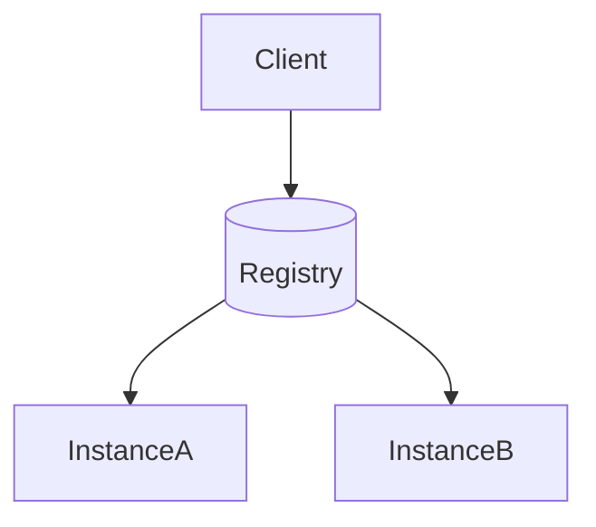

# D15-T026 — Service discovery

Topic ID: `D15-T026`
Domain: Distributed Systems
Subdomain: Service discovery
Importance: core
Complexity: advanced
Dependencies: `D15-T025`, `D15-T001`, `D03-T001`, `D03-T002`, `D04-T001`, `D04-T002`
Execution status of the code in section F: unexecuted

## A. Topic Overview

Service discovery maps logical names to current instance endpoints. Client-side (smart client) vs server-side (proxy/LB) discovery trades agility vs central control.

## B. First-Principles Explanation

Health-aware routing; cache TTL causes stale endpoints after crash. Service discovery maps logical names to current instance endpoints. Client-side (smart client) vs server-side (proxy/LB) discovery trades agility vs central control.

## C. Internal Working and Architecture

Consul/etcd/Kubernetes DNS; sidecars push updates. Components interact through RPC, replication logs, and coordination services.

## D. Diagrams and Visual Models



Read the diagram as a causal flow from client action to stored or observed outcome, including failure branches.

## E. Examples and Analogies

Kubernetes ClusterIP + Endpoints watch.

## F. Code Examples

File: `examples/d15_t026_discover.py`

Dependencies: Python 3 standard library only.

```python
def pick_instance(instances: list[str], healthy: set[str]) -> str | None:
    live = [i for i in instances if i in healthy]
    return live[0] if live else None
```

The snippet models control flow you would embed in a service or test harness. It is not a production client library.

## G. Practical Backend Application

Combine discovery with retries and breakers; drain instances before kill.

## H. Advantages, Limitations and Trade-offs

| Choice | Benefit | Cost | Choose when | Avoid when |
| --- | --- | --- | --- | --- |
| Client-side discovery | Low proxy hop | Library coupling | gRPC mesh | Simple public REST | | | | |

Under load, the cheap choice on paper becomes the choice that amplifies retries, stale reads, or operator toil. Measure p99 latency and error budgets, not only happy-path throughput.

## I. Common Mistakes and Misconceptions

- Hard-coded IPs in config.
- Ignoring zone affinity.

A weak interview answer names a buzzword without a failure story. A strong answer names what breaks, what users see, and what invariant you still enforce.

## J. Debugging and Troubleshooting

Compare registry view vs actual listening ports.

## K. Interview Preparation
### Beginner
#### Q1. What is Service discovery?

**Answer:** Service discovery maps logical names to current instance endpoints. Client-side (smart client) vs server-side (proxy/LB) discovery trades agility vs central control. Interviewers want a precise definition tied to service discovery patterns, not a slogan. In production, the failure mode matters more than the slogan: measure timeouts, error budgets, and client-visible symptoms before you rename the problem.
#### Q2. Why does Service discovery matter in backends?

**Answer:** Service discovery maps logical names to current instance endpoints. Client-side (smart client) vs server-side (proxy/LB) discovery trades agility vs central control. Production systems fail one hop at a time; users still expect coherent behavior. In production, the failure mode matters more than the slogan: measure timeouts, error budgets, and client-visible symptoms before you rename the problem.
#### Q3. Give a one-line example of service discovery patterns.

**Answer:** Service discovery maps logical names to current instance endpoints. Client-side (smart client) vs server-side (proxy/LB) discovery trades agility vs central control. Name a concrete multi-service flow where the issue appears. In production, the failure mode matters more than the slogan: measure timeouts, error budgets, and client-visible symptoms before you rename the problem.
#### Q4. Is Service discovery about hardware or software policy?

**Answer:** Service discovery maps logical names to current instance endpoints. Client-side (smart client) vs server-side (proxy/LB) discovery trades agility vs central control. Mostly policy and protocols on top of unreliable networks. In production, the failure mode matters more than the slogan: measure timeouts, error budgets, and client-visible symptoms before you rename the problem.
#### Q5. What is a common myth about Service discovery?

**Answer:** Service discovery maps logical names to current instance endpoints. Client-side (smart client) vs server-side (proxy/LB) discovery trades agility vs central control. Buzzword definitions that ignore partitions, retries, or consistency definitions. In production, the failure mode matters more than the slogan: measure timeouts, error budgets, and client-visible symptoms before you rename the problem.
### Intermediate
#### Q1. How do timeouts interact with service discovery patterns?

**Answer:** Service discovery maps logical names to current instance endpoints. Client-side (smart client) vs server-side (proxy/LB) discovery trades agility vs central control. Timeouts create unknown outcomes; retries amplify load unless idempotent. In production, the failure mode matters more than the slogan: measure timeouts, error budgets, and client-visible symptoms before you rename the problem.
#### Q2. How do replicas interact with service discovery patterns?

**Answer:** Service discovery maps logical names to current instance endpoints. Client-side (smart client) vs server-side (proxy/LB) discovery trades agility vs central control. Replication lag makes stale reads a normal case unless you pay for stronger reads. In production, the failure mode matters more than the slogan: measure timeouts, error budgets, and client-visible symptoms before you rename the problem.
#### Q3. How do idempotency keys help service discovery patterns?

**Answer:** Service discovery maps logical names to current instance endpoints. Client-side (smart client) vs server-side (proxy/LB) discovery trades agility vs central control. They make at-least-once delivery safe for business side effects. In production, the failure mode matters more than the slogan: measure timeouts, error budgets, and client-visible symptoms before you rename the problem.
#### Q4. What metrics expose service discovery patterns?

**Answer:** Service discovery maps logical names to current instance endpoints. Client-side (smart client) vs server-side (proxy/LB) discovery trades agility vs central control. Error rate by dependency, lag histograms, reconciliation queue depth. In production, the failure mode matters more than the slogan: measure timeouts, error budgets, and client-visible symptoms before you rename the problem.
#### Q5. How does Service discovery relate to user-visible SLAs?

**Answer:** Service discovery maps logical names to current instance endpoints. Client-side (smart client) vs server-side (proxy/LB) discovery trades agility vs central control. SLAs must state behavior during degradation, not only median latency. In production, the failure mode matters more than the slogan: measure timeouts, error budgets, and client-visible symptoms before you rename the problem.
### Advanced
#### Q1. How would you test service discovery patterns?

**Answer:** Service discovery maps logical names to current instance endpoints. Client-side (smart client) vs server-side (proxy/LB) discovery trades agility vs central control. Fault injection: delay, drop, partition links; assert invariants and recovery. In production, the failure mode matters more than the slogan: measure timeouts, error budgets, and client-visible symptoms before you rename the problem.
#### Q2. How does Service discovery differ from a single-machine failure?

**Answer:** Service discovery maps logical names to current instance endpoints. Client-side (smart client) vs server-side (proxy/LB) discovery trades agility vs central control. Partial failure leaves other paths alive, producing ambiguous global state. In production, the failure mode matters more than the slogan: measure timeouts, error budgets, and client-visible symptoms before you rename the problem.
#### Q3. What documentation should teams publish about Service discovery?

**Answer:** Service discovery maps logical names to current instance endpoints. Client-side (smart client) vs server-side (proxy/LB) discovery trades agility vs central control. Failure modes, consistency guarantees per endpoint, and runbooks for unknown outcomes. In production, the failure mode matters more than the slogan: measure timeouts, error budgets, and client-visible symptoms before you rename the problem.
#### Q4. When is strong consistency worth the latency for service discovery patterns?

**Answer:** Service discovery maps logical names to current instance endpoints. Client-side (smart client) vs server-side (proxy/LB) discovery trades agility vs central control. When invariants involve money, inventory, or safety; not for best-effort feeds. In production, the failure mode matters more than the slogan: measure timeouts, error budgets, and client-visible symptoms before you rename the problem.
#### Q5. How do circuit breakers relate to service discovery patterns?

**Answer:** Service discovery maps logical names to current instance endpoints. Client-side (smart client) vs server-side (proxy/LB) discovery trades agility vs central control. They stop retry storms but do not fix correctness; they protect capacity. In production, the failure mode matters more than the slogan: measure timeouts, error budgets, and client-visible symptoms before you rename the problem.
### Scenarios
#### Q1. Incident: errors spike after deploy touching Service discovery. First checks?

**Answer:** Service discovery maps logical names to current instance endpoints. Client-side (smart client) vs server-side (proxy/LB) discovery trades agility vs central control. Roll forward/rollback decision, feature flag, canary metrics, dependency health. In production, the failure mode matters more than the slogan: measure timeouts, error budgets, and client-visible symptoms before you rename the problem.
#### Q2. Incident: customers report inconsistent reads around service discovery patterns. Diagnosis?

**Answer:** Service discovery maps logical names to current instance endpoints. Client-side (smart client) vs server-side (proxy/LB) discovery trades agility vs central control. Check replica lag, routing, cache TTL, and read-your-writes settings. In production, the failure mode matters more than the slogan: measure timeouts, error budgets, and client-visible symptoms before you rename the problem.
#### Q3. Incident: reconciliation backlog grows for service discovery patterns. Why?

**Answer:** Service discovery maps logical names to current instance endpoints. Client-side (smart client) vs server-side (proxy/LB) discovery trades agility vs central control. Downstream was slow; retries duplicated work; missing idempotency. In production, the failure mode matters more than the slogan: measure timeouts, error budgets, and client-visible symptoms before you rename the problem.
#### Q4. Design review challenges your Service discovery approach. What do you defend?

**Answer:** Service discovery maps logical names to current instance endpoints. Client-side (smart client) vs server-side (proxy/LB) discovery trades agility vs central control. State invariants, failure model, and measured trade-offs with PACELC/CAP precision. In production, the failure mode matters more than the slogan: measure timeouts, error budgets, and client-visible symptoms before you rename the problem.
#### Q5. Finance audit questions service discovery patterns after duplicate charges. Response?

**Answer:** Service discovery maps logical names to current instance endpoints. Client-side (smart client) vs server-side (proxy/LB) discovery trades agility vs central control. Show idempotency keys, ledger reconciliation, and provider correlation IDs. In production, the failure mode matters more than the slogan: measure timeouts, error budgets, and client-visible symptoms before you rename the problem.
### Follow-ups
#### Q1. How does Service discovery connect to `D15-T001`?

**Answer:** Service discovery maps logical names to current instance endpoints. Client-side (smart client) vs server-side (proxy/LB) discovery trades agility vs central control. Fundamentals frame partial failure and message passing assumptions. In production, the failure mode matters more than the slogan: measure timeouts, error budgets, and client-visible symptoms before you rename the problem.
#### Q2. How does Service discovery connect to databases (`D07-T012`)?

**Answer:** Service discovery maps logical names to current instance endpoints. Client-side (smart client) vs server-side (proxy/LB) discovery trades agility vs central control. Transactions are local unless you add distributed protocols or sagas. In production, the failure mode matters more than the slogan: measure timeouts, error budgets, and client-visible symptoms before you rename the problem.
#### Q3. How does Service discovery connect to messaging (`D14-T031`)?

**Answer:** Service discovery maps logical names to current instance endpoints. Client-side (smart client) vs server-side (proxy/LB) discovery trades agility vs central control. Brokers provide at-least-once unless you engineer exactly-once effects. In production, the failure mode matters more than the slogan: measure timeouts, error budgets, and client-visible symptoms before you rename the problem.

## L. Practical Exercises

Solutions are in `EXERCISES/solutions/D15-T026.md`. Try these before opening that file.

### Exercise 1 — implementation

Implement pick_instance skipping unhealthy.

### Exercise 2 — debugging

Calls fail after deploy until TTL—why?

### Exercise 3 — trade-off

Service mesh vs DNS discovery.

## M. Revision Notes

- Service discovery
- Service discovery maps logical names to current instance endpoints.
- Measure lag, errors, and reconciliation—not only CPU.
- Document behavior during partition and during normal load.

Flashcards:

- What is Service discovery? See focus paragraph in overview.
- Common mistake: Hard-coded IPs in config.

## N. Related Topics

Understand this before: `D15-T025`, `D15-T001`, `D03-T001`, `D03-T002`, `D04-T001`, `D04-T002`.

This topic supports: `D15-T027`, `D04-T014`.

Often confused with: `D04-T014`, `D16-T018`.

Interviewers combine this with replication (`D15-T009`), partial failure (`D15-T002`), and API idempotency (`D06-T011`).

## O. Completion Criteria

- Define Service discovery without buzzwords.
- Draw the mermaid model for D15-T026.
- Explain one mistake and its safer alternative.
