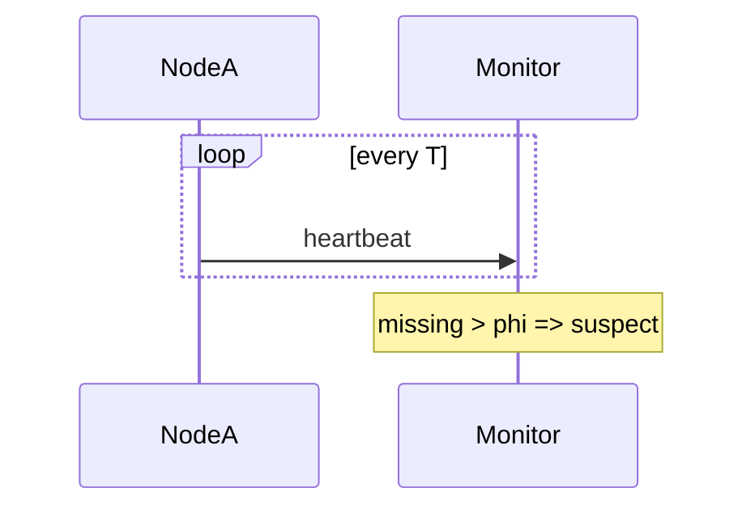

# D15-T027 — Heartbeats and failure detection

Topic ID: `D15-T027`
Domain: Distributed Systems
Subdomain: Heartbeats and failure detection
Importance: core
Complexity: advanced
Dependencies: `D15-T026`, `D15-T001`, `D03-T001`, `D03-T002`, `D04-T001`, `D04-T002`
Execution status of the code in section F: unexecuted

## A. Topic Overview

Heartbeats are periodic signals proving liveness. Failure detection declares a node dead after missed beats within timeout φ. False positives cause unnecessary failover.

## B. First-Principles Explanation

Phi-accrual and adaptive timeouts reduce misdetection under GC. Heartbeats are periodic signals proving liveness. Failure detection declares a node dead after missed beats within timeout φ. False positives cause unnecessary failover.

## C. Internal Working and Architecture

Separate liveness (restart) from readiness (accept traffic). Components interact through RPC, replication logs, and coordination services.

## D. Diagrams and Visual Models



Read the diagram as a causal flow from client action to stored or observed outcome, including failure branches.

## E. Examples and Analogies

Kubernetes liveness vs readiness probes.

## F. Code Examples

File: `examples/d15_t027_heartbeat.py`

Dependencies: Python 3 standard library only.

```python
def is_suspect(missed: int, allowed: int) -> bool:
    return missed > allowed
```

The snippet models control flow you would embed in a service or test harness. It is not a production client library.

## G. Practical Backend Application

Tune timeouts > p99 GC pause; use readiness for dependency failures.

## H. Advantages, Limitations and Trade-offs

| Choice | Benefit | Cost | Choose when | Avoid when |
| --- | --- | --- | --- | --- |
| Long timeout | Few false fails | Slow detection | Large nodes | Fast failover needs | | | | |

Under load, the cheap choice on paper becomes the choice that amplifies retries, stale reads, or operator toil. Measure p99 latency and error budgets, not only happy-path throughput.

## I. Common Mistakes and Misconceptions

- Same probe for liveness and readiness.
- Too aggressive timeouts.

A weak interview answer names a buzzword without a failure story. A strong answer names what breaks, what users see, and what invariant you still enforce.

## J. Debugging and Troubleshooting

Correlate suspect events with GC logs.

## K. Interview Preparation
### Beginner
#### Q1. What is Heartbeats and failure detection?

**Answer:** Heartbeats are periodic signals proving liveness. Failure detection declares a node dead after missed beats within timeout φ. False positives cause unnecessary failover. Interviewers want a precise definition tied to heartbeat failure detection, not a slogan.
#### Q2. Why does Heartbeats and failure detection matter in backends?

**Answer:** Heartbeats are periodic signals proving liveness. Failure detection declares a node dead after missed beats within timeout φ. False positives cause unnecessary failover. Production systems fail one hop at a time; users still expect coherent behavior.
#### Q3. Give a one-line example of heartbeat failure detection.

**Answer:** Heartbeats are periodic signals proving liveness. Failure detection declares a node dead after missed beats within timeout φ. False positives cause unnecessary failover. Name a concrete multi-service flow where the issue appears.
#### Q4. Is Heartbeats and failure detection about hardware or software policy?

**Answer:** Heartbeats are periodic signals proving liveness. Failure detection declares a node dead after missed beats within timeout φ. False positives cause unnecessary failover. Mostly policy and protocols on top of unreliable networks.
#### Q5. What is a common myth about Heartbeats and failure detection?

**Answer:** Heartbeats are periodic signals proving liveness. Failure detection declares a node dead after missed beats within timeout φ. False positives cause unnecessary failover. Buzzword definitions that ignore partitions, retries, or consistency definitions.
### Intermediate
#### Q1. How do timeouts interact with heartbeat failure detection?

**Answer:** Heartbeats are periodic signals proving liveness. Failure detection declares a node dead after missed beats within timeout φ. False positives cause unnecessary failover. Timeouts create unknown outcomes; retries amplify load unless idempotent.
#### Q2. How do replicas interact with heartbeat failure detection?

**Answer:** Heartbeats are periodic signals proving liveness. Failure detection declares a node dead after missed beats within timeout φ. False positives cause unnecessary failover. Replication lag makes stale reads a normal case unless you pay for stronger reads.
#### Q3. How do idempotency keys help heartbeat failure detection?

**Answer:** Heartbeats are periodic signals proving liveness. Failure detection declares a node dead after missed beats within timeout φ. False positives cause unnecessary failover. They make at-least-once delivery safe for business side effects.
#### Q4. What metrics expose heartbeat failure detection?

**Answer:** Heartbeats are periodic signals proving liveness. Failure detection declares a node dead after missed beats within timeout φ. False positives cause unnecessary failover. Error rate by dependency, lag histograms, reconciliation queue depth.
#### Q5. How does Heartbeats and failure detection relate to user-visible SLAs?

**Answer:** Heartbeats are periodic signals proving liveness. Failure detection declares a node dead after missed beats within timeout φ. False positives cause unnecessary failover. SLAs must state behavior during degradation, not only median latency.
### Advanced
#### Q1. How would you test heartbeat failure detection?

**Answer:** Heartbeats are periodic signals proving liveness. Failure detection declares a node dead after missed beats within timeout φ. False positives cause unnecessary failover. Fault injection: delay, drop, partition links; assert invariants and recovery.
#### Q2. How does Heartbeats and failure detection differ from a single-machine failure?

**Answer:** Heartbeats are periodic signals proving liveness. Failure detection declares a node dead after missed beats within timeout φ. False positives cause unnecessary failover. Partial failure leaves other paths alive, producing ambiguous global state.
#### Q3. What documentation should teams publish about Heartbeats and failure detection?

**Answer:** Heartbeats are periodic signals proving liveness. Failure detection declares a node dead after missed beats within timeout φ. False positives cause unnecessary failover. Failure modes, consistency guarantees per endpoint, and runbooks for unknown outcomes.
#### Q4. When is strong consistency worth the latency for heartbeat failure detection?

**Answer:** Heartbeats are periodic signals proving liveness. Failure detection declares a node dead after missed beats within timeout φ. False positives cause unnecessary failover. When invariants involve money, inventory, or safety; not for best-effort feeds.
#### Q5. How do circuit breakers relate to heartbeat failure detection?

**Answer:** Heartbeats are periodic signals proving liveness. Failure detection declares a node dead after missed beats within timeout φ. False positives cause unnecessary failover. They stop retry storms but do not fix correctness; they protect capacity.
### Scenarios
#### Q1. Incident: errors spike after deploy touching Heartbeats and failure detection. First checks?

**Answer:** Heartbeats are periodic signals proving liveness. Failure detection declares a node dead after missed beats within timeout φ. False positives cause unnecessary failover. Roll forward/rollback decision, feature flag, canary metrics, dependency health.
#### Q2. Incident: customers report inconsistent reads around heartbeat failure detection. Diagnosis?

**Answer:** Heartbeats are periodic signals proving liveness. Failure detection declares a node dead after missed beats within timeout φ. False positives cause unnecessary failover. Check replica lag, routing, cache TTL, and read-your-writes settings.
#### Q3. Incident: reconciliation backlog grows for heartbeat failure detection. Why?

**Answer:** Heartbeats are periodic signals proving liveness. Failure detection declares a node dead after missed beats within timeout φ. False positives cause unnecessary failover. Downstream was slow; retries duplicated work; missing idempotency.
#### Q4. Design review challenges your Heartbeats and failure detection approach. What do you defend?

**Answer:** Heartbeats are periodic signals proving liveness. Failure detection declares a node dead after missed beats within timeout φ. False positives cause unnecessary failover. State invariants, failure model, and measured trade-offs with PACELC/CAP precision.
#### Q5. Finance audit questions heartbeat failure detection after duplicate charges. Response?

**Answer:** Heartbeats are periodic signals proving liveness. Failure detection declares a node dead after missed beats within timeout φ. False positives cause unnecessary failover. Show idempotency keys, ledger reconciliation, and provider correlation IDs.
### Follow-ups
#### Q1. How does Heartbeats and failure detection connect to `D15-T001`?

**Answer:** Heartbeats are periodic signals proving liveness. Failure detection declares a node dead after missed beats within timeout φ. False positives cause unnecessary failover. Fundamentals frame partial failure and message passing assumptions.
#### Q2. How does Heartbeats and failure detection connect to databases (`D07-T012`)?

**Answer:** Heartbeats are periodic signals proving liveness. Failure detection declares a node dead after missed beats within timeout φ. False positives cause unnecessary failover. Transactions are local unless you add distributed protocols or sagas.
#### Q3. How does Heartbeats and failure detection connect to messaging (`D14-T031`)?

**Answer:** Heartbeats are periodic signals proving liveness. Failure detection declares a node dead after missed beats within timeout φ. False positives cause unnecessary failover. Brokers provide at-least-once unless you engineer exactly-once effects.

## L. Practical Exercises

Solutions are in `EXERCISES/solutions/D15-T027.md`. Try these before opening that file.

### Exercise 1 — implementation

Implement is_suspect.

### Exercise 2 — debugging

Node killed by liveness but dependencies down—fix?

### Exercise 3 — trade-off

Gossip vs centralized failure detector.

## M. Revision Notes

- Heartbeats and failure detection
- Heartbeats are periodic signals proving liveness.
- Measure lag, errors, and reconciliation—not only CPU.
- Document behavior during partition and during normal load.

Flashcards:

- What is Heartbeats and failure detection? See focus paragraph in overview.
- Common mistake: Same probe for liveness and readiness.

## N. Related Topics

Understand this before: `D15-T026`, `D15-T001`, `D03-T001`, `D03-T002`, `D04-T001`, `D04-T002`.

This topic supports: `D15-T011`, `D15-T025`.

Often confused with: `D05-T023`, `D15-T026`.

Interviewers combine this with replication (`D15-T009`), partial failure (`D15-T002`), and API idempotency (`D06-T011`).

## O. Completion Criteria

- Define Heartbeats and failure detection without buzzwords.
- Draw the mermaid model for D15-T027.
- Explain one mistake and its safer alternative.
