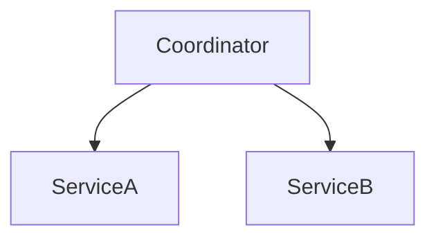

# D15-T028 — Distributed transactions

Topic ID: `D15-T028`
Domain: Distributed Systems
Subdomain: Distributed transactions
Importance: core
Complexity: advanced
Dependencies: `D15-T027`, `D15-T001`, `D03-T001`, `D03-T002`, `D04-T001`, `D04-T002`
Execution status of the code in section F: unexecuted

## A. Topic Overview

A distributed transaction coordinates commits across multiple services or databases. Without a single log, you need protocols (2PC) or application-level sagas; latency and availability suffer under faults.

## B. First-Principles Explanation

Prefer single-service transactions; split only when domain requires. A distributed transaction coordinates commits across multiple services or databases. Without a single log, you need protocols (2PC) or application-level sagas; latency and availability suffer under faults.

## C. Internal Working and Architecture

Orchestrator vs choreography; compensating actions. Components interact through RPC, replication logs, and coordination services.

## D. Diagrams and Visual Models



Read the diagram as a causal flow from client action to stored or observed outcome, including failure branches.

## E. Examples and Analogies

Order + payment + inventory crossing three DBs.

## F. Code Examples

File: `examples/d15_t028_steps.py`

Dependencies: Python 3 standard library only.

```python
def workflow(done: list[str], required: list[str]) -> str:
    return "complete" if all(s in done for s in required) else "pending"
```

The snippet models control flow you would embed in a service or test harness. It is not a production client library.

## G. Practical Backend Application

Model business invariants; avoid XA unless you accept ops pain.

## H. Advantages, Limitations and Trade-offs

| Choice | Benefit | Cost | Choose when | Avoid when |
| --- | --- | --- | --- | --- |
| 2PC | Atomic commit | Blocking | Homogeneous participants | Heterogeneous SaaS | | | | |

Under load, the cheap choice on paper becomes the choice that amplifies retries, stale reads, or operator toil. Measure p99 latency and error budgets, not only happy-path throughput.

## I. Common Mistakes and Misconceptions

- Distributed TX for every microservice call.
- No compensation path.

A weak interview answer names a buzzword without a failure story. A strong answer names what breaks, what users see, and what invariant you still enforce.

## J. Debugging and Troubleshooting

Trace global transaction id across services.

## K. Interview Preparation
### Beginner
#### Q1. What is Distributed transactions?

**Answer:** A distributed transaction coordinates commits across multiple services or databases. Without a single log, you need protocols (2PC) or application-level sagas; latency and availability suffer under faults. Interviewers want a precise definition tied to distributed transaction alternatives, not a slogan. In production, the failure mode matters more than the slogan: measure timeouts, error budgets, and client-visible symptoms before you rename the problem.
#### Q2. Why does Distributed transactions matter in backends?

**Answer:** A distributed transaction coordinates commits across multiple services or databases. Without a single log, you need protocols (2PC) or application-level sagas; latency and availability suffer under faults. Production systems fail one hop at a time; users still expect coherent behavior. In production, the failure mode matters more than the slogan: measure timeouts, error budgets, and client-visible symptoms before you rename the problem.
#### Q3. Give a one-line example of distributed transaction alternatives.

**Answer:** A distributed transaction coordinates commits across multiple services or databases. Without a single log, you need protocols (2PC) or application-level sagas; latency and availability suffer under faults. Name a concrete multi-service flow where the issue appears. In production, the failure mode matters more than the slogan: measure timeouts, error budgets, and client-visible symptoms before you rename the problem.
#### Q4. Is Distributed transactions about hardware or software policy?

**Answer:** A distributed transaction coordinates commits across multiple services or databases. Without a single log, you need protocols (2PC) or application-level sagas; latency and availability suffer under faults. Mostly policy and protocols on top of unreliable networks. In production, the failure mode matters more than the slogan: measure timeouts, error budgets, and client-visible symptoms before you rename the problem.
#### Q5. What is a common myth about Distributed transactions?

**Answer:** A distributed transaction coordinates commits across multiple services or databases. Without a single log, you need protocols (2PC) or application-level sagas; latency and availability suffer under faults. Buzzword definitions that ignore partitions, retries, or consistency definitions. In production, the failure mode matters more than the slogan: measure timeouts, error budgets, and client-visible symptoms before you rename the problem.
### Intermediate
#### Q1. How do timeouts interact with distributed transaction alternatives?

**Answer:** A distributed transaction coordinates commits across multiple services or databases. Without a single log, you need protocols (2PC) or application-level sagas; latency and availability suffer under faults. Timeouts create unknown outcomes; retries amplify load unless idempotent. In production, the failure mode matters more than the slogan: measure timeouts, error budgets, and client-visible symptoms before you rename the problem.
#### Q2. How do replicas interact with distributed transaction alternatives?

**Answer:** A distributed transaction coordinates commits across multiple services or databases. Without a single log, you need protocols (2PC) or application-level sagas; latency and availability suffer under faults. Replication lag makes stale reads a normal case unless you pay for stronger reads. In production, the failure mode matters more than the slogan: measure timeouts, error budgets, and client-visible symptoms before you rename the problem.
#### Q3. How do idempotency keys help distributed transaction alternatives?

**Answer:** A distributed transaction coordinates commits across multiple services or databases. Without a single log, you need protocols (2PC) or application-level sagas; latency and availability suffer under faults. They make at-least-once delivery safe for business side effects. In production, the failure mode matters more than the slogan: measure timeouts, error budgets, and client-visible symptoms before you rename the problem.
#### Q4. What metrics expose distributed transaction alternatives?

**Answer:** A distributed transaction coordinates commits across multiple services or databases. Without a single log, you need protocols (2PC) or application-level sagas; latency and availability suffer under faults. Error rate by dependency, lag histograms, reconciliation queue depth. In production, the failure mode matters more than the slogan: measure timeouts, error budgets, and client-visible symptoms before you rename the problem.
#### Q5. How does Distributed transactions relate to user-visible SLAs?

**Answer:** A distributed transaction coordinates commits across multiple services or databases. Without a single log, you need protocols (2PC) or application-level sagas; latency and availability suffer under faults. SLAs must state behavior during degradation, not only median latency. In production, the failure mode matters more than the slogan: measure timeouts, error budgets, and client-visible symptoms before you rename the problem.
### Advanced
#### Q1. How would you test distributed transaction alternatives?

**Answer:** A distributed transaction coordinates commits across multiple services or databases. Without a single log, you need protocols (2PC) or application-level sagas; latency and availability suffer under faults. Fault injection: delay, drop, partition links; assert invariants and recovery. In production, the failure mode matters more than the slogan: measure timeouts, error budgets, and client-visible symptoms before you rename the problem.
#### Q2. How does Distributed transactions differ from a single-machine failure?

**Answer:** A distributed transaction coordinates commits across multiple services or databases. Without a single log, you need protocols (2PC) or application-level sagas; latency and availability suffer under faults. Partial failure leaves other paths alive, producing ambiguous global state. In production, the failure mode matters more than the slogan: measure timeouts, error budgets, and client-visible symptoms before you rename the problem.
#### Q3. What documentation should teams publish about Distributed transactions?

**Answer:** A distributed transaction coordinates commits across multiple services or databases. Without a single log, you need protocols (2PC) or application-level sagas; latency and availability suffer under faults. Failure modes, consistency guarantees per endpoint, and runbooks for unknown outcomes. In production, the failure mode matters more than the slogan: measure timeouts, error budgets, and client-visible symptoms before you rename the problem.
#### Q4. When is strong consistency worth the latency for distributed transaction alternatives?

**Answer:** A distributed transaction coordinates commits across multiple services or databases. Without a single log, you need protocols (2PC) or application-level sagas; latency and availability suffer under faults. When invariants involve money, inventory, or safety; not for best-effort feeds. In production, the failure mode matters more than the slogan: measure timeouts, error budgets, and client-visible symptoms before you rename the problem.
#### Q5. How do circuit breakers relate to distributed transaction alternatives?

**Answer:** A distributed transaction coordinates commits across multiple services or databases. Without a single log, you need protocols (2PC) or application-level sagas; latency and availability suffer under faults. They stop retry storms but do not fix correctness; they protect capacity. In production, the failure mode matters more than the slogan: measure timeouts, error budgets, and client-visible symptoms before you rename the problem.
### Scenarios
#### Q1. Incident: errors spike after deploy touching Distributed transactions. First checks?

**Answer:** A distributed transaction coordinates commits across multiple services or databases. Without a single log, you need protocols (2PC) or application-level sagas; latency and availability suffer under faults. Roll forward/rollback decision, feature flag, canary metrics, dependency health. In production, the failure mode matters more than the slogan: measure timeouts, error budgets, and client-visible symptoms before you rename the problem.
#### Q2. Incident: customers report inconsistent reads around distributed transaction alternatives. Diagnosis?

**Answer:** A distributed transaction coordinates commits across multiple services or databases. Without a single log, you need protocols (2PC) or application-level sagas; latency and availability suffer under faults. Check replica lag, routing, cache TTL, and read-your-writes settings. In production, the failure mode matters more than the slogan: measure timeouts, error budgets, and client-visible symptoms before you rename the problem.
#### Q3. Incident: reconciliation backlog grows for distributed transaction alternatives. Why?

**Answer:** A distributed transaction coordinates commits across multiple services or databases. Without a single log, you need protocols (2PC) or application-level sagas; latency and availability suffer under faults. Downstream was slow; retries duplicated work; missing idempotency. In production, the failure mode matters more than the slogan: measure timeouts, error budgets, and client-visible symptoms before you rename the problem.
#### Q4. Design review challenges your Distributed transactions approach. What do you defend?

**Answer:** A distributed transaction coordinates commits across multiple services or databases. Without a single log, you need protocols (2PC) or application-level sagas; latency and availability suffer under faults. State invariants, failure model, and measured trade-offs with PACELC/CAP precision. In production, the failure mode matters more than the slogan: measure timeouts, error budgets, and client-visible symptoms before you rename the problem.
#### Q5. Finance audit questions distributed transaction alternatives after duplicate charges. Response?

**Answer:** A distributed transaction coordinates commits across multiple services or databases. Without a single log, you need protocols (2PC) or application-level sagas; latency and availability suffer under faults. Show idempotency keys, ledger reconciliation, and provider correlation IDs. In production, the failure mode matters more than the slogan: measure timeouts, error budgets, and client-visible symptoms before you rename the problem.
### Follow-ups
#### Q1. How does Distributed transactions connect to `D15-T001`?

**Answer:** A distributed transaction coordinates commits across multiple services or databases. Without a single log, you need protocols (2PC) or application-level sagas; latency and availability suffer under faults. Fundamentals frame partial failure and message passing assumptions. In production, the failure mode matters more than the slogan: measure timeouts, error budgets, and client-visible symptoms before you rename the problem.
#### Q2. How does Distributed transactions connect to databases (`D07-T012`)?

**Answer:** A distributed transaction coordinates commits across multiple services or databases. Without a single log, you need protocols (2PC) or application-level sagas; latency and availability suffer under faults. Transactions are local unless you add distributed protocols or sagas. In production, the failure mode matters more than the slogan: measure timeouts, error budgets, and client-visible symptoms before you rename the problem.
#### Q3. How does Distributed transactions connect to messaging (`D14-T031`)?

**Answer:** A distributed transaction coordinates commits across multiple services or databases. Without a single log, you need protocols (2PC) or application-level sagas; latency and availability suffer under faults. Brokers provide at-least-once unless you engineer exactly-once effects. In production, the failure mode matters more than the slogan: measure timeouts, error budgets, and client-visible symptoms before you rename the problem.

## L. Practical Exercises

Solutions are in `EXERCISES/solutions/D15-T028.md`. Try these before opening that file.

### Exercise 1 — implementation

Track workflow state with required steps.

### Exercise 2 — debugging

When local TX per service enough?

### Exercise 3 — trade-off

Saga vs 2PC availability.

## M. Revision Notes

- Distributed transactions
- A distributed transaction coordinates commits across multiple services or databases.
- Measure lag, errors, and reconciliation—not only CPU.
- Document behavior during partition and during normal load.

Flashcards:

- What is Distributed transactions? See focus paragraph in overview.
- Common mistake: Distributed TX for every microservice call.

## N. Related Topics

Understand this before: `D15-T027`, `D15-T001`, `D03-T001`, `D03-T002`, `D04-T001`, `D04-T002`.

This topic supports: `D15-T029`, `D15-T030`.

Often confused with: `D07-T012`, `D15-T029`.

Interviewers combine this with replication (`D15-T009`), partial failure (`D15-T002`), and API idempotency (`D06-T011`).

## O. Completion Criteria

- Define Distributed transactions without buzzwords.
- Draw the mermaid model for D15-T028.
- Explain one mistake and its safer alternative.
