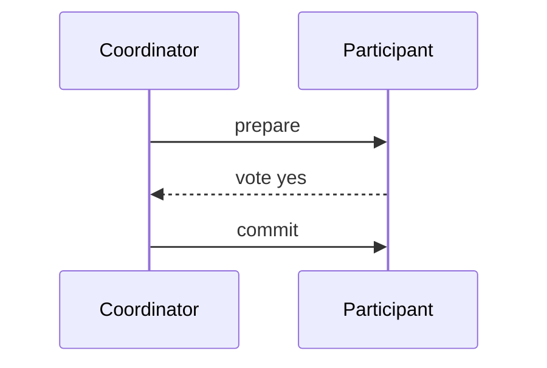

# D15-T029 — Two-phase commit

Topic ID: `D15-T029`
Domain: Distributed Systems
Subdomain: Two-phase commit
Importance: advanced
Complexity: advanced
Dependencies: `D15-T028`, `D15-T001`, `D03-T001`, `D03-T002`, `D04-T001`, `D04-T002`
Execution status of the code in section F: unexecuted

## A. Topic Overview

Two-phase commit (2PC) has prepare then commit phases coordinated by a transaction manager. If all participants vote yes in prepare, coordinator sends commit; otherwise abort. 2PC is blocking if coordinator fails after prepare—participants hold locks until decision. It does not magically provide exactly-once across arbitrary external systems.

## B. First-Principles Explanation

XA transactions use 2PC; cloud-native stacks often avoid it. Two-phase commit (2PC) has prepare then commit phases coordinated by a transaction manager. If all participants vote yes in prepare, coordinator sends commit; otherwise abort. 2PC is blocking if coordinator fails after prepare—participants hold locks until decision. It does not magically provide exactly-once across arbitrary external systems.

## C. Internal Working and Architecture

Write-ahead log at coordinator; presumed abort on timeout. Components interact through RPC, replication logs, and coordination services.

## D. Diagrams and Visual Models



Read the diagram as a causal flow from client action to stored or observed outcome, including failure branches.

## E. Examples and Analogies

Classic DB XA; rare in modern microservices.

## F. Code Examples

File: `examples/d15_t029_2pc.py`

Dependencies: Python 3 standard library only.

```python
def decide(votes: list[str]) -> str:
    return "commit" if all(v == "yes" for v in votes) else "abort"
```

The snippet models control flow you would embed in a service or test harness. It is not a production client library.

## G. Practical Backend Application

Use only when all participants support prepare and ops accepts blocking risk.

## H. Advantages, Limitations and Trade-offs

| Choice | Benefit | Cost | Choose when | Avoid when |
| --- | --- | --- | --- | --- |
| 2PC | All-or-nothing | Block/avail | Single cluster | Multi-SaaS checkout | | | | |

Under load, the cheap choice on paper becomes the choice that amplifies retries, stale reads, or operator toil. Measure p99 latency and error budgets, not only happy-path throughput.

## I. Common Mistakes and Misconceptions

- 2PC across HTTP microservices without prepare support.
- Ignoring coordinator SPOF.

A weak interview answer names a buzzword without a failure story. A strong answer names what breaks, what users see, and what invariant you still enforce.

## J. Debugging and Troubleshooting

Find in-doubt transactions after coordinator crash.

## K. Interview Preparation
### Beginner
#### Q1. What is Two-phase commit?

**Answer:** Two-phase commit (2PC) has prepare then commit phases coordinated by a transaction manager. If all participants vote yes in prepare, coordinator sends commit; otherwise abort. 2PC is blocking if coordinator fails after prepare—participants hold locks until decision. It does not magically provide exactly-once across arbitrary external systems. Interviewers want a precise definition tied to 2PC prepare commit blocking, not a slogan.
#### Q2. Why does Two-phase commit matter in backends?

**Answer:** Two-phase commit (2PC) has prepare then commit phases coordinated by a transaction manager. If all participants vote yes in prepare, coordinator sends commit; otherwise abort. 2PC is blocking if coordinator fails after prepare—participants hold locks until decision. It does not magically provide exactly-once across arbitrary external systems. Production systems fail one hop at a time; users still expect coherent behavior.
#### Q3. Give a one-line example of 2PC prepare commit blocking.

**Answer:** Two-phase commit (2PC) has prepare then commit phases coordinated by a transaction manager. If all participants vote yes in prepare, coordinator sends commit; otherwise abort. 2PC is blocking if coordinator fails after prepare—participants hold locks until decision. It does not magically provide exactly-once across arbitrary external systems. Name a concrete multi-service flow where the issue appears.
#### Q4. Is Two-phase commit about hardware or software policy?

**Answer:** Two-phase commit (2PC) has prepare then commit phases coordinated by a transaction manager. If all participants vote yes in prepare, coordinator sends commit; otherwise abort. 2PC is blocking if coordinator fails after prepare—participants hold locks until decision. It does not magically provide exactly-once across arbitrary external systems. Mostly policy and protocols on top of unreliable networks.
#### Q5. What is a common myth about Two-phase commit?

**Answer:** Two-phase commit (2PC) has prepare then commit phases coordinated by a transaction manager. If all participants vote yes in prepare, coordinator sends commit; otherwise abort. 2PC is blocking if coordinator fails after prepare—participants hold locks until decision. It does not magically provide exactly-once across arbitrary external systems. Buzzword definitions that ignore partitions, retries, or consistency definitions.
### Intermediate
#### Q1. How do timeouts interact with 2PC prepare commit blocking?

**Answer:** Two-phase commit (2PC) has prepare then commit phases coordinated by a transaction manager. If all participants vote yes in prepare, coordinator sends commit; otherwise abort. 2PC is blocking if coordinator fails after prepare—participants hold locks until decision. It does not magically provide exactly-once across arbitrary external systems. Timeouts create unknown outcomes; retries amplify load unless idempotent.
#### Q2. How do replicas interact with 2PC prepare commit blocking?

**Answer:** Two-phase commit (2PC) has prepare then commit phases coordinated by a transaction manager. If all participants vote yes in prepare, coordinator sends commit; otherwise abort. 2PC is blocking if coordinator fails after prepare—participants hold locks until decision. It does not magically provide exactly-once across arbitrary external systems. Replication lag makes stale reads a normal case unless you pay for stronger reads.
#### Q3. How do idempotency keys help 2PC prepare commit blocking?

**Answer:** Two-phase commit (2PC) has prepare then commit phases coordinated by a transaction manager. If all participants vote yes in prepare, coordinator sends commit; otherwise abort. 2PC is blocking if coordinator fails after prepare—participants hold locks until decision. It does not magically provide exactly-once across arbitrary external systems. They make at-least-once delivery safe for business side effects.
#### Q4. What metrics expose 2PC prepare commit blocking?

**Answer:** Two-phase commit (2PC) has prepare then commit phases coordinated by a transaction manager. If all participants vote yes in prepare, coordinator sends commit; otherwise abort. 2PC is blocking if coordinator fails after prepare—participants hold locks until decision. It does not magically provide exactly-once across arbitrary external systems. Error rate by dependency, lag histograms, reconciliation queue depth.
#### Q5. How does Two-phase commit relate to user-visible SLAs?

**Answer:** Two-phase commit (2PC) has prepare then commit phases coordinated by a transaction manager. If all participants vote yes in prepare, coordinator sends commit; otherwise abort. 2PC is blocking if coordinator fails after prepare—participants hold locks until decision. It does not magically provide exactly-once across arbitrary external systems. SLAs must state behavior during degradation, not only median latency.
### Advanced
#### Q1. How would you test 2PC prepare commit blocking?

**Answer:** Two-phase commit (2PC) has prepare then commit phases coordinated by a transaction manager. If all participants vote yes in prepare, coordinator sends commit; otherwise abort. 2PC is blocking if coordinator fails after prepare—participants hold locks until decision. It does not magically provide exactly-once across arbitrary external systems. Fault injection: delay, drop, partition links; assert invariants and recovery.
#### Q2. How does Two-phase commit differ from a single-machine failure?

**Answer:** Two-phase commit (2PC) has prepare then commit phases coordinated by a transaction manager. If all participants vote yes in prepare, coordinator sends commit; otherwise abort. 2PC is blocking if coordinator fails after prepare—participants hold locks until decision. It does not magically provide exactly-once across arbitrary external systems. Partial failure leaves other paths alive, producing ambiguous global state.
#### Q3. What documentation should teams publish about Two-phase commit?

**Answer:** Two-phase commit (2PC) has prepare then commit phases coordinated by a transaction manager. If all participants vote yes in prepare, coordinator sends commit; otherwise abort. 2PC is blocking if coordinator fails after prepare—participants hold locks until decision. It does not magically provide exactly-once across arbitrary external systems. Failure modes, consistency guarantees per endpoint, and runbooks for unknown outcomes.
#### Q4. When is strong consistency worth the latency for 2PC prepare commit blocking?

**Answer:** Two-phase commit (2PC) has prepare then commit phases coordinated by a transaction manager. If all participants vote yes in prepare, coordinator sends commit; otherwise abort. 2PC is blocking if coordinator fails after prepare—participants hold locks until decision. It does not magically provide exactly-once across arbitrary external systems. When invariants involve money, inventory, or safety; not for best-effort feeds.
#### Q5. How do circuit breakers relate to 2PC prepare commit blocking?

**Answer:** Two-phase commit (2PC) has prepare then commit phases coordinated by a transaction manager. If all participants vote yes in prepare, coordinator sends commit; otherwise abort. 2PC is blocking if coordinator fails after prepare—participants hold locks until decision. It does not magically provide exactly-once across arbitrary external systems. They stop retry storms but do not fix correctness; they protect capacity.
### Scenarios
#### Q1. Incident: errors spike after deploy touching Two-phase commit. First checks?

**Answer:** Two-phase commit (2PC) has prepare then commit phases coordinated by a transaction manager. If all participants vote yes in prepare, coordinator sends commit; otherwise abort. 2PC is blocking if coordinator fails after prepare—participants hold locks until decision. It does not magically provide exactly-once across arbitrary external systems. Roll forward/rollback decision, feature flag, canary metrics, dependency health.
#### Q2. Incident: customers report inconsistent reads around 2PC prepare commit blocking. Diagnosis?

**Answer:** Two-phase commit (2PC) has prepare then commit phases coordinated by a transaction manager. If all participants vote yes in prepare, coordinator sends commit; otherwise abort. 2PC is blocking if coordinator fails after prepare—participants hold locks until decision. It does not magically provide exactly-once across arbitrary external systems. Check replica lag, routing, cache TTL, and read-your-writes settings.
#### Q3. Incident: reconciliation backlog grows for 2PC prepare commit blocking. Why?

**Answer:** Two-phase commit (2PC) has prepare then commit phases coordinated by a transaction manager. If all participants vote yes in prepare, coordinator sends commit; otherwise abort. 2PC is blocking if coordinator fails after prepare—participants hold locks until decision. It does not magically provide exactly-once across arbitrary external systems. Downstream was slow; retries duplicated work; missing idempotency.
#### Q4. Design review challenges your Two-phase commit approach. What do you defend?

**Answer:** Two-phase commit (2PC) has prepare then commit phases coordinated by a transaction manager. If all participants vote yes in prepare, coordinator sends commit; otherwise abort. 2PC is blocking if coordinator fails after prepare—participants hold locks until decision. It does not magically provide exactly-once across arbitrary external systems. State invariants, failure model, and measured trade-offs with PACELC/CAP precision.
#### Q5. Finance audit questions 2PC prepare commit blocking after duplicate charges. Response?

**Answer:** Two-phase commit (2PC) has prepare then commit phases coordinated by a transaction manager. If all participants vote yes in prepare, coordinator sends commit; otherwise abort. 2PC is blocking if coordinator fails after prepare—participants hold locks until decision. It does not magically provide exactly-once across arbitrary external systems. Show idempotency keys, ledger reconciliation, and provider correlation IDs.
### Follow-ups
#### Q1. How does Two-phase commit connect to `D15-T001`?

**Answer:** Two-phase commit (2PC) has prepare then commit phases coordinated by a transaction manager. If all participants vote yes in prepare, coordinator sends commit; otherwise abort. 2PC is blocking if coordinator fails after prepare—participants hold locks until decision. It does not magically provide exactly-once across arbitrary external systems. Fundamentals frame partial failure and message passing assumptions.
#### Q2. How does Two-phase commit connect to databases (`D07-T012`)?

**Answer:** Two-phase commit (2PC) has prepare then commit phases coordinated by a transaction manager. If all participants vote yes in prepare, coordinator sends commit; otherwise abort. 2PC is blocking if coordinator fails after prepare—participants hold locks until decision. It does not magically provide exactly-once across arbitrary external systems. Transactions are local unless you add distributed protocols or sagas.
#### Q3. How does Two-phase commit connect to messaging (`D14-T031`)?

**Answer:** Two-phase commit (2PC) has prepare then commit phases coordinated by a transaction manager. If all participants vote yes in prepare, coordinator sends commit; otherwise abort. 2PC is blocking if coordinator fails after prepare—participants hold locks until decision. It does not magically provide exactly-once across arbitrary external systems. Brokers provide at-least-once unless you engineer exactly-once effects.

## L. Practical Exercises

Solutions are in `EXERCISES/solutions/D15-T029.md`. Try these before opening that file.

### Exercise 1 — implementation

Implement decide on votes.

### Exercise 2 — debugging

Coordinator dies after all yes—participant state?

### Exercise 3 — trade-off

Why Spanner/sagas instead of 2PC everywhere.

## M. Revision Notes

- Two-phase commit
- Two-phase commit (2PC) has prepare then commit phases coordinated by a transaction manager.
- Measure lag, errors, and reconciliation—not only CPU.
- Document behavior during partition and during normal load.

Flashcards:

- What is Two-phase commit? See focus paragraph in overview.
- Common mistake: 2PC across HTTP microservices without prepare support.

## N. Related Topics

Understand this before: `D15-T028`, `D15-T001`, `D03-T001`, `D03-T002`, `D04-T001`, `D04-T002`.

This topic supports: `D15-T030`, `D15-T014`.

Often confused with: `D15-T030`, `D15-T014`.

Interviewers combine this with replication (`D15-T009`), partial failure (`D15-T002`), and API idempotency (`D06-T011`).

## O. Completion Criteria

- Define Two-phase commit without buzzwords.
- Draw the mermaid model for D15-T029.
- Explain one mistake and its safer alternative.
