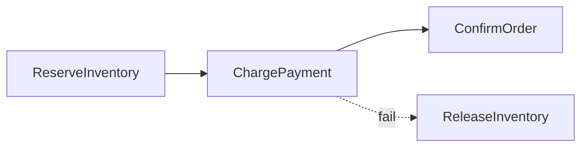

# D15-T030 — Sagas

Topic ID: `D15-T030`
Domain: Distributed Systems
Subdomain: Sagas
Importance: core
Complexity: advanced
Dependencies: `D15-T029`, `D15-T001`, `D03-T001`, `D03-T002`, `D04-T001`, `D04-T002`
Execution status of the code in section F: unexecuted

## A. Topic Overview

Sagas are sequences of local transactions with compensating transactions to undo prior steps on failure. Choreography uses events; orchestration uses a central coordinator. They trade strong atomicity for availability and long-running workflows.

## B. First-Principles Explanation

Compensations must be business-valid (cannot un-send email; send correction). Sagas are sequences of local transactions with compensating transactions to undo prior steps on failure. Choreography uses events; orchestration uses a central coordinator. They trade strong atomicity for availability and long-running workflows.

## C. Internal Working and Architecture

Persist saga state; idempotent forward and compensate handlers. Components interact through RPC, replication logs, and coordination services.

## D. Diagrams and Visual Models



Read the diagram as a causal flow from client action to stored or observed outcome, including failure branches.

## E. Examples and Analogies

Temporal/Camunda orchestrated sagas; outbox events for choreography.

## F. Code Examples

File: `examples/d15_t030_saga.py`

Dependencies: Python 3 standard library only.

```python
def next_step(state: str, ok: bool) -> str:
    if state == "reserved" and ok:
        return "paid"
    if state == "reserved" and not ok:
        return "compensate_inventory"
    return state
```

The snippet models control flow you would embed in a service or test harness. It is not a production client library.

## G. Practical Backend Application

Design compensations first; test duplicate events.

## H. Advantages, Limitations and Trade-offs

| Choice | Benefit | Cost | Choose when | Avoid when |
| --- | --- | --- | --- | --- |
| Orchestrated saga | Clear flow | Coordinator SPOF | Complex checkout | Single DB TX enough | | | | |

Under load, the cheap choice on paper becomes the choice that amplifies retries, stale reads, or operator toil. Measure p99 latency and error budgets, not only happy-path throughput.

## I. Common Mistakes and Misconceptions

- Compensation that itself is not idempotent.
- No timeout on stuck saga.

A weak interview answer names a buzzword without a failure story. A strong answer names what breaks, what users see, and what invariant you still enforce.

## J. Debugging and Troubleshooting

Saga table shows step stuck; replay with same idempotency key.

## K. Interview Preparation
### Beginner
#### Q1. What is Sagas?

**Answer:** Sagas are sequences of local transactions with compensating transactions to undo prior steps on failure. Choreography uses events; orchestration uses a central coordinator. They trade strong atomicity for availability and long-running workflows. Interviewers want a precise definition tied to saga compensating transactions, not a slogan.
#### Q2. Why does Sagas matter in backends?

**Answer:** Sagas are sequences of local transactions with compensating transactions to undo prior steps on failure. Choreography uses events; orchestration uses a central coordinator. They trade strong atomicity for availability and long-running workflows. Production systems fail one hop at a time; users still expect coherent behavior.
#### Q3. Give a one-line example of saga compensating transactions.

**Answer:** Sagas are sequences of local transactions with compensating transactions to undo prior steps on failure. Choreography uses events; orchestration uses a central coordinator. They trade strong atomicity for availability and long-running workflows. Name a concrete multi-service flow where the issue appears.
#### Q4. Is Sagas about hardware or software policy?

**Answer:** Sagas are sequences of local transactions with compensating transactions to undo prior steps on failure. Choreography uses events; orchestration uses a central coordinator. They trade strong atomicity for availability and long-running workflows. Mostly policy and protocols on top of unreliable networks.
#### Q5. What is a common myth about Sagas?

**Answer:** Sagas are sequences of local transactions with compensating transactions to undo prior steps on failure. Choreography uses events; orchestration uses a central coordinator. They trade strong atomicity for availability and long-running workflows. Buzzword definitions that ignore partitions, retries, or consistency definitions.
### Intermediate
#### Q1. How do timeouts interact with saga compensating transactions?

**Answer:** Sagas are sequences of local transactions with compensating transactions to undo prior steps on failure. Choreography uses events; orchestration uses a central coordinator. They trade strong atomicity for availability and long-running workflows. Timeouts create unknown outcomes; retries amplify load unless idempotent.
#### Q2. How do replicas interact with saga compensating transactions?

**Answer:** Sagas are sequences of local transactions with compensating transactions to undo prior steps on failure. Choreography uses events; orchestration uses a central coordinator. They trade strong atomicity for availability and long-running workflows. Replication lag makes stale reads a normal case unless you pay for stronger reads.
#### Q3. How do idempotency keys help saga compensating transactions?

**Answer:** Sagas are sequences of local transactions with compensating transactions to undo prior steps on failure. Choreography uses events; orchestration uses a central coordinator. They trade strong atomicity for availability and long-running workflows. They make at-least-once delivery safe for business side effects.
#### Q4. What metrics expose saga compensating transactions?

**Answer:** Sagas are sequences of local transactions with compensating transactions to undo prior steps on failure. Choreography uses events; orchestration uses a central coordinator. They trade strong atomicity for availability and long-running workflows. Error rate by dependency, lag histograms, reconciliation queue depth.
#### Q5. How does Sagas relate to user-visible SLAs?

**Answer:** Sagas are sequences of local transactions with compensating transactions to undo prior steps on failure. Choreography uses events; orchestration uses a central coordinator. They trade strong atomicity for availability and long-running workflows. SLAs must state behavior during degradation, not only median latency.
### Advanced
#### Q1. How would you test saga compensating transactions?

**Answer:** Sagas are sequences of local transactions with compensating transactions to undo prior steps on failure. Choreography uses events; orchestration uses a central coordinator. They trade strong atomicity for availability and long-running workflows. Fault injection: delay, drop, partition links; assert invariants and recovery.
#### Q2. How does Sagas differ from a single-machine failure?

**Answer:** Sagas are sequences of local transactions with compensating transactions to undo prior steps on failure. Choreography uses events; orchestration uses a central coordinator. They trade strong atomicity for availability and long-running workflows. Partial failure leaves other paths alive, producing ambiguous global state.
#### Q3. What documentation should teams publish about Sagas?

**Answer:** Sagas are sequences of local transactions with compensating transactions to undo prior steps on failure. Choreography uses events; orchestration uses a central coordinator. They trade strong atomicity for availability and long-running workflows. Failure modes, consistency guarantees per endpoint, and runbooks for unknown outcomes.
#### Q4. When is strong consistency worth the latency for saga compensating transactions?

**Answer:** Sagas are sequences of local transactions with compensating transactions to undo prior steps on failure. Choreography uses events; orchestration uses a central coordinator. They trade strong atomicity for availability and long-running workflows. When invariants involve money, inventory, or safety; not for best-effort feeds.
#### Q5. How do circuit breakers relate to saga compensating transactions?

**Answer:** Sagas are sequences of local transactions with compensating transactions to undo prior steps on failure. Choreography uses events; orchestration uses a central coordinator. They trade strong atomicity for availability and long-running workflows. They stop retry storms but do not fix correctness; they protect capacity.
### Scenarios
#### Q1. Incident: errors spike after deploy touching Sagas. First checks?

**Answer:** Sagas are sequences of local transactions with compensating transactions to undo prior steps on failure. Choreography uses events; orchestration uses a central coordinator. They trade strong atomicity for availability and long-running workflows. Roll forward/rollback decision, feature flag, canary metrics, dependency health.
#### Q2. Incident: customers report inconsistent reads around saga compensating transactions. Diagnosis?

**Answer:** Sagas are sequences of local transactions with compensating transactions to undo prior steps on failure. Choreography uses events; orchestration uses a central coordinator. They trade strong atomicity for availability and long-running workflows. Check replica lag, routing, cache TTL, and read-your-writes settings.
#### Q3. Incident: reconciliation backlog grows for saga compensating transactions. Why?

**Answer:** Sagas are sequences of local transactions with compensating transactions to undo prior steps on failure. Choreography uses events; orchestration uses a central coordinator. They trade strong atomicity for availability and long-running workflows. Downstream was slow; retries duplicated work; missing idempotency.
#### Q4. Design review challenges your Sagas approach. What do you defend?

**Answer:** Sagas are sequences of local transactions with compensating transactions to undo prior steps on failure. Choreography uses events; orchestration uses a central coordinator. They trade strong atomicity for availability and long-running workflows. State invariants, failure model, and measured trade-offs with PACELC/CAP precision.
#### Q5. Finance audit questions saga compensating transactions after duplicate charges. Response?

**Answer:** Sagas are sequences of local transactions with compensating transactions to undo prior steps on failure. Choreography uses events; orchestration uses a central coordinator. They trade strong atomicity for availability and long-running workflows. Show idempotency keys, ledger reconciliation, and provider correlation IDs.
### Follow-ups
#### Q1. How does Sagas connect to `D15-T001`?

**Answer:** Sagas are sequences of local transactions with compensating transactions to undo prior steps on failure. Choreography uses events; orchestration uses a central coordinator. They trade strong atomicity for availability and long-running workflows. Fundamentals frame partial failure and message passing assumptions.
#### Q2. How does Sagas connect to databases (`D07-T012`)?

**Answer:** Sagas are sequences of local transactions with compensating transactions to undo prior steps on failure. Choreography uses events; orchestration uses a central coordinator. They trade strong atomicity for availability and long-running workflows. Transactions are local unless you add distributed protocols or sagas.
#### Q3. How does Sagas connect to messaging (`D14-T031`)?

**Answer:** Sagas are sequences of local transactions with compensating transactions to undo prior steps on failure. Choreography uses events; orchestration uses a central coordinator. They trade strong atomicity for availability and long-running workflows. Brokers provide at-least-once unless you engineer exactly-once effects.

## L. Practical Exercises

Solutions are in `EXERCISES/solutions/D15-T030.md`. Try these before opening that file.

### Exercise 1 — implementation

Model states for reserve/pay/compensate.

### Exercise 2 — debugging

Payment succeeded but order cancel—saga path?

### Exercise 3 — trade-off

Choreography vs orchestration pick.

## M. Revision Notes

- Sagas
- Sagas are sequences of local transactions with compensating transactions to undo prior steps on failure.
- Measure lag, errors, and reconciliation—not only CPU.
- Document behavior during partition and during normal load.

Flashcards:

- What is Sagas? See focus paragraph in overview.
- Common mistake: Compensation that itself is not idempotent.

## N. Related Topics

Understand this before: `D15-T029`, `D15-T001`, `D03-T001`, `D03-T002`, `D04-T001`, `D04-T002`.

This topic supports: `D15-T019`, `D15-T028`.

Often confused with: `D15-T029`, `D15-T020`.

Interviewers combine this with replication (`D15-T009`), partial failure (`D15-T002`), and API idempotency (`D06-T011`).

## O. Completion Criteria

- Define Sagas without buzzwords.
- Draw the mermaid model for D15-T030.
- Explain one mistake and its safer alternative.
