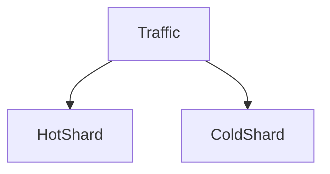

# D15-T032 — Hotspots and load skew

Topic ID: `D15-T032`
Domain: Distributed Systems
Subdomain: Hotspots and load skew
Importance: core
Complexity: advanced
Dependencies: `D15-T031`, `D15-T001`, `D03-T001`, `D03-T002`, `D04-T001`, `D04-T002`
Execution status of the code in section F: unexecuted

## A. Topic Overview

Hotspots concentrate traffic on one shard, partition, or leader. Skew breaks horizontal scale assumptions. Mitigations: salting keys, caching, split hot ranges, async aggregation.

## B. First-Principles Explanation

Measure per-key QPS; celebrity accounts are classic hotspots. Hotspots concentrate traffic on one shard, partition, or leader. Skew breaks horizontal scale assumptions. Mitigations: salting keys, caching, split hot ranges, async aggregation.

## C. Internal Working and Architecture

Write sharding with random suffix; read merge. Components interact through RPC, replication logs, and coordination services.

## D. Diagrams and Visual Models



Read the diagram as a causal flow from client action to stored or observed outcome, including failure branches.

## E. Examples and Analogies

Viral post likes hammer one Redis key.

## F. Code Examples

File: `examples/d15_t032_salt.py`

Dependencies: Python 3 standard library only.

```python
def spread_keys(entity_id: str, salts: int) -> list[str]:
    return [f"{entity_id}:{i}" for i in range(salts)]
```

The snippet models control flow you would embed in a service or test harness. It is not a production client library.

## G. Practical Backend Application

Autoscale cannot fix wrong partition key; redesign or cache hot path.

## H. Advantages, Limitations and Trade-offs

| Choice | Benefit | Cost | Choose when | Avoid when |
| --- | --- | --- | --- | --- |
| Key salting | Spread writes | Complex reads | Counter shards | Low traffic uniform | | | | |

Under load, the cheap choice on paper becomes the choice that amplifies retries, stale reads, or operator toil. Measure p99 latency and error budgets, not only happy-path throughput.

## I. Common Mistakes and Misconceptions

- Partitioning by country with one huge country.
- Ignoring leader hotspot in Kafka single partition.

A weak interview answer names a buzzword without a failure story. A strong answer names what breaks, what users see, and what invariant you still enforce.

## J. Debugging and Troubleshooting

Top keys by QPS; shard heatmap.

## K. Interview Preparation
### Beginner
#### Q1. What is Hotspots and load skew?

**Answer:** Hotspots concentrate traffic on one shard, partition, or leader. Skew breaks horizontal scale assumptions. Mitigations: salting keys, caching, split hot ranges, async aggregation. Interviewers want a precise definition tied to hotspot mitigation, not a slogan.
#### Q2. Why does Hotspots and load skew matter in backends?

**Answer:** Hotspots concentrate traffic on one shard, partition, or leader. Skew breaks horizontal scale assumptions. Mitigations: salting keys, caching, split hot ranges, async aggregation. Production systems fail one hop at a time; users still expect coherent behavior.
#### Q3. Give a one-line example of hotspot mitigation.

**Answer:** Hotspots concentrate traffic on one shard, partition, or leader. Skew breaks horizontal scale assumptions. Mitigations: salting keys, caching, split hot ranges, async aggregation. Name a concrete multi-service flow where the issue appears.
#### Q4. Is Hotspots and load skew about hardware or software policy?

**Answer:** Hotspots concentrate traffic on one shard, partition, or leader. Skew breaks horizontal scale assumptions. Mitigations: salting keys, caching, split hot ranges, async aggregation. Mostly policy and protocols on top of unreliable networks.
#### Q5. What is a common myth about Hotspots and load skew?

**Answer:** Hotspots concentrate traffic on one shard, partition, or leader. Skew breaks horizontal scale assumptions. Mitigations: salting keys, caching, split hot ranges, async aggregation. Buzzword definitions that ignore partitions, retries, or consistency definitions.
### Intermediate
#### Q1. How do timeouts interact with hotspot mitigation?

**Answer:** Hotspots concentrate traffic on one shard, partition, or leader. Skew breaks horizontal scale assumptions. Mitigations: salting keys, caching, split hot ranges, async aggregation. Timeouts create unknown outcomes; retries amplify load unless idempotent.
#### Q2. How do replicas interact with hotspot mitigation?

**Answer:** Hotspots concentrate traffic on one shard, partition, or leader. Skew breaks horizontal scale assumptions. Mitigations: salting keys, caching, split hot ranges, async aggregation. Replication lag makes stale reads a normal case unless you pay for stronger reads.
#### Q3. How do idempotency keys help hotspot mitigation?

**Answer:** Hotspots concentrate traffic on one shard, partition, or leader. Skew breaks horizontal scale assumptions. Mitigations: salting keys, caching, split hot ranges, async aggregation. They make at-least-once delivery safe for business side effects.
#### Q4. What metrics expose hotspot mitigation?

**Answer:** Hotspots concentrate traffic on one shard, partition, or leader. Skew breaks horizontal scale assumptions. Mitigations: salting keys, caching, split hot ranges, async aggregation. Error rate by dependency, lag histograms, reconciliation queue depth.
#### Q5. How does Hotspots and load skew relate to user-visible SLAs?

**Answer:** Hotspots concentrate traffic on one shard, partition, or leader. Skew breaks horizontal scale assumptions. Mitigations: salting keys, caching, split hot ranges, async aggregation. SLAs must state behavior during degradation, not only median latency.
### Advanced
#### Q1. How would you test hotspot mitigation?

**Answer:** Hotspots concentrate traffic on one shard, partition, or leader. Skew breaks horizontal scale assumptions. Mitigations: salting keys, caching, split hot ranges, async aggregation. Fault injection: delay, drop, partition links; assert invariants and recovery.
#### Q2. How does Hotspots and load skew differ from a single-machine failure?

**Answer:** Hotspots concentrate traffic on one shard, partition, or leader. Skew breaks horizontal scale assumptions. Mitigations: salting keys, caching, split hot ranges, async aggregation. Partial failure leaves other paths alive, producing ambiguous global state.
#### Q3. What documentation should teams publish about Hotspots and load skew?

**Answer:** Hotspots concentrate traffic on one shard, partition, or leader. Skew breaks horizontal scale assumptions. Mitigations: salting keys, caching, split hot ranges, async aggregation. Failure modes, consistency guarantees per endpoint, and runbooks for unknown outcomes.
#### Q4. When is strong consistency worth the latency for hotspot mitigation?

**Answer:** Hotspots concentrate traffic on one shard, partition, or leader. Skew breaks horizontal scale assumptions. Mitigations: salting keys, caching, split hot ranges, async aggregation. When invariants involve money, inventory, or safety; not for best-effort feeds.
#### Q5. How do circuit breakers relate to hotspot mitigation?

**Answer:** Hotspots concentrate traffic on one shard, partition, or leader. Skew breaks horizontal scale assumptions. Mitigations: salting keys, caching, split hot ranges, async aggregation. They stop retry storms but do not fix correctness; they protect capacity.
### Scenarios
#### Q1. Incident: errors spike after deploy touching Hotspots and load skew. First checks?

**Answer:** Hotspots concentrate traffic on one shard, partition, or leader. Skew breaks horizontal scale assumptions. Mitigations: salting keys, caching, split hot ranges, async aggregation. Roll forward/rollback decision, feature flag, canary metrics, dependency health.
#### Q2. Incident: customers report inconsistent reads around hotspot mitigation. Diagnosis?

**Answer:** Hotspots concentrate traffic on one shard, partition, or leader. Skew breaks horizontal scale assumptions. Mitigations: salting keys, caching, split hot ranges, async aggregation. Check replica lag, routing, cache TTL, and read-your-writes settings.
#### Q3. Incident: reconciliation backlog grows for hotspot mitigation. Why?

**Answer:** Hotspots concentrate traffic on one shard, partition, or leader. Skew breaks horizontal scale assumptions. Mitigations: salting keys, caching, split hot ranges, async aggregation. Downstream was slow; retries duplicated work; missing idempotency.
#### Q4. Design review challenges your Hotspots and load skew approach. What do you defend?

**Answer:** Hotspots concentrate traffic on one shard, partition, or leader. Skew breaks horizontal scale assumptions. Mitigations: salting keys, caching, split hot ranges, async aggregation. State invariants, failure model, and measured trade-offs with PACELC/CAP precision.
#### Q5. Finance audit questions hotspot mitigation after duplicate charges. Response?

**Answer:** Hotspots concentrate traffic on one shard, partition, or leader. Skew breaks horizontal scale assumptions. Mitigations: salting keys, caching, split hot ranges, async aggregation. Show idempotency keys, ledger reconciliation, and provider correlation IDs.
### Follow-ups
#### Q1. How does Hotspots and load skew connect to `D15-T001`?

**Answer:** Hotspots concentrate traffic on one shard, partition, or leader. Skew breaks horizontal scale assumptions. Mitigations: salting keys, caching, split hot ranges, async aggregation. Fundamentals frame partial failure and message passing assumptions.
#### Q2. How does Hotspots and load skew connect to databases (`D07-T012`)?

**Answer:** Hotspots concentrate traffic on one shard, partition, or leader. Skew breaks horizontal scale assumptions. Mitigations: salting keys, caching, split hot ranges, async aggregation. Transactions are local unless you add distributed protocols or sagas.
#### Q3. How does Hotspots and load skew connect to messaging (`D14-T031`)?

**Answer:** Hotspots concentrate traffic on one shard, partition, or leader. Skew breaks horizontal scale assumptions. Mitigations: salting keys, caching, split hot ranges, async aggregation. Brokers provide at-least-once unless you engineer exactly-once effects.

## L. Practical Exercises

Solutions are in `EXERCISES/solutions/D15-T032.md`. Try these before opening that file.

### Exercise 1 — implementation

Generate spread_keys for counter shards.

### Exercise 2 — debugging

One Kafka partition lagging—cause?

### Exercise 3 — trade-off

Cache vs shard split for hot key.

## M. Revision Notes

- Hotspots and load skew
- Hotspots concentrate traffic on one shard, partition, or leader.
- Measure lag, errors, and reconciliation—not only CPU.
- Document behavior during partition and during normal load.

Flashcards:

- What is Hotspots and load skew? See focus paragraph in overview.
- Common mistake: Partitioning by country with one huge country.

## N. Related Topics

Understand this before: `D15-T031`, `D15-T001`, `D03-T001`, `D03-T002`, `D04-T001`, `D04-T002`.

This topic supports: `D15-T031`, `D16-T017`.

Often confused with: `D15-T031`, `D13-T024`.

Interviewers combine this with replication (`D15-T009`), partial failure (`D15-T002`), and API idempotency (`D06-T011`).

## O. Completion Criteria

- Define Hotspots and load skew without buzzwords.
- Draw the mermaid model for D15-T032.
- Explain one mistake and its safer alternative.
