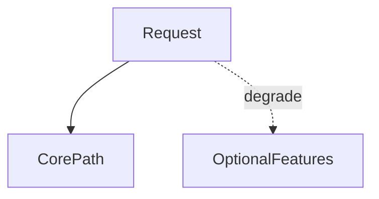

# D15-T034 — Graceful degradation

Topic ID: `D15-T034`
Domain: Distributed Systems
Subdomain: Graceful degradation
Importance: core
Complexity: advanced
Dependencies: `D15-T033`, `D15-T001`, `D03-T001`, `D03-T002`, `D04-T001`, `D04-T002`
Execution status of the code in section F: unexecuted

## A. Topic Overview

Graceful degradation reduces optional features while keeping core path alive under stress. It pairs with timeouts, breakers, and cached fallbacks. Users should see honest partial functionality, not opaque failures.

## B. First-Principles Explanation

Define feature tiers before incident; automate toggles on SLO burn. Graceful degradation reduces optional features while keeping core path alive under stress. It pairs with timeouts, breakers, and cached fallbacks. Users should see honest partial functionality, not opaque failures.

## C. Internal Working and Architecture

Feature flags, static fallbacks, read-only mode. Components interact through RPC, replication logs, and coordination services.

## D. Diagrams and Visual Models



Read the diagram as a causal flow from client action to stored or observed outcome, including failure branches.

## E. Examples and Analogies

Show cached recommendations when personalization service down.

## F. Code Examples

File: `examples/d15_t034_degrade.py`

Dependencies: Python 3 standard library only.

```python
def respond(core_ok: bool, optional_ok: bool) -> dict:
    body = {"items": []}
    if core_ok:
        body["items"] = ["product"]
    if optional_ok:
        body["recommendations"] = ["a", "b"]
    return body
```

The snippet models control flow you would embed in a service or test harness. It is not a production client library.

## G. Practical Backend Application

Monitor degraded mode rate; exit when dependencies healthy.

## H. Advantages, Limitations and Trade-offs

| Choice | Benefit | Cost | Choose when | Avoid when |
| --- | --- | --- | --- | --- |
| Cached fallback | Keeps UX | Stale/wrong risk | Recommendations | Payment authorization | | | | |

Under load, the cheap choice on paper becomes the choice that amplifies retries, stale reads, or operator toil. Measure p99 latency and error budgets, not only happy-path throughput.

## I. Common Mistakes and Misconceptions

- Degrading security checks.
- Silent wrong prices in fallback cache.

A weak interview answer names a buzzword without a failure story. A strong answer names what breaks, what users see, and what invariant you still enforce.

## J. Debugging and Troubleshooting

Flag in response or header when degraded.

## K. Interview Preparation
### Beginner
#### Q1. What is Graceful degradation?

**Answer:** Graceful degradation reduces optional features while keeping core path alive under stress. It pairs with timeouts, breakers, and cached fallbacks. Users should see honest partial functionality, not opaque failures. Interviewers want a precise definition tied to graceful degradation tiers, not a slogan.
#### Q2. Why does Graceful degradation matter in backends?

**Answer:** Graceful degradation reduces optional features while keeping core path alive under stress. It pairs with timeouts, breakers, and cached fallbacks. Users should see honest partial functionality, not opaque failures. Production systems fail one hop at a time; users still expect coherent behavior.
#### Q3. Give a one-line example of graceful degradation tiers.

**Answer:** Graceful degradation reduces optional features while keeping core path alive under stress. It pairs with timeouts, breakers, and cached fallbacks. Users should see honest partial functionality, not opaque failures. Name a concrete multi-service flow where the issue appears.
#### Q4. Is Graceful degradation about hardware or software policy?

**Answer:** Graceful degradation reduces optional features while keeping core path alive under stress. It pairs with timeouts, breakers, and cached fallbacks. Users should see honest partial functionality, not opaque failures. Mostly policy and protocols on top of unreliable networks.
#### Q5. What is a common myth about Graceful degradation?

**Answer:** Graceful degradation reduces optional features while keeping core path alive under stress. It pairs with timeouts, breakers, and cached fallbacks. Users should see honest partial functionality, not opaque failures. Buzzword definitions that ignore partitions, retries, or consistency definitions.
### Intermediate
#### Q1. How do timeouts interact with graceful degradation tiers?

**Answer:** Graceful degradation reduces optional features while keeping core path alive under stress. It pairs with timeouts, breakers, and cached fallbacks. Users should see honest partial functionality, not opaque failures. Timeouts create unknown outcomes; retries amplify load unless idempotent.
#### Q2. How do replicas interact with graceful degradation tiers?

**Answer:** Graceful degradation reduces optional features while keeping core path alive under stress. It pairs with timeouts, breakers, and cached fallbacks. Users should see honest partial functionality, not opaque failures. Replication lag makes stale reads a normal case unless you pay for stronger reads.
#### Q3. How do idempotency keys help graceful degradation tiers?

**Answer:** Graceful degradation reduces optional features while keeping core path alive under stress. It pairs with timeouts, breakers, and cached fallbacks. Users should see honest partial functionality, not opaque failures. They make at-least-once delivery safe for business side effects.
#### Q4. What metrics expose graceful degradation tiers?

**Answer:** Graceful degradation reduces optional features while keeping core path alive under stress. It pairs with timeouts, breakers, and cached fallbacks. Users should see honest partial functionality, not opaque failures. Error rate by dependency, lag histograms, reconciliation queue depth.
#### Q5. How does Graceful degradation relate to user-visible SLAs?

**Answer:** Graceful degradation reduces optional features while keeping core path alive under stress. It pairs with timeouts, breakers, and cached fallbacks. Users should see honest partial functionality, not opaque failures. SLAs must state behavior during degradation, not only median latency.
### Advanced
#### Q1. How would you test graceful degradation tiers?

**Answer:** Graceful degradation reduces optional features while keeping core path alive under stress. It pairs with timeouts, breakers, and cached fallbacks. Users should see honest partial functionality, not opaque failures. Fault injection: delay, drop, partition links; assert invariants and recovery.
#### Q2. How does Graceful degradation differ from a single-machine failure?

**Answer:** Graceful degradation reduces optional features while keeping core path alive under stress. It pairs with timeouts, breakers, and cached fallbacks. Users should see honest partial functionality, not opaque failures. Partial failure leaves other paths alive, producing ambiguous global state.
#### Q3. What documentation should teams publish about Graceful degradation?

**Answer:** Graceful degradation reduces optional features while keeping core path alive under stress. It pairs with timeouts, breakers, and cached fallbacks. Users should see honest partial functionality, not opaque failures. Failure modes, consistency guarantees per endpoint, and runbooks for unknown outcomes.
#### Q4. When is strong consistency worth the latency for graceful degradation tiers?

**Answer:** Graceful degradation reduces optional features while keeping core path alive under stress. It pairs with timeouts, breakers, and cached fallbacks. Users should see honest partial functionality, not opaque failures. When invariants involve money, inventory, or safety; not for best-effort feeds.
#### Q5. How do circuit breakers relate to graceful degradation tiers?

**Answer:** Graceful degradation reduces optional features while keeping core path alive under stress. It pairs with timeouts, breakers, and cached fallbacks. Users should see honest partial functionality, not opaque failures. They stop retry storms but do not fix correctness; they protect capacity.
### Scenarios
#### Q1. Incident: errors spike after deploy touching Graceful degradation. First checks?

**Answer:** Graceful degradation reduces optional features while keeping core path alive under stress. It pairs with timeouts, breakers, and cached fallbacks. Users should see honest partial functionality, not opaque failures. Roll forward/rollback decision, feature flag, canary metrics, dependency health.
#### Q2. Incident: customers report inconsistent reads around graceful degradation tiers. Diagnosis?

**Answer:** Graceful degradation reduces optional features while keeping core path alive under stress. It pairs with timeouts, breakers, and cached fallbacks. Users should see honest partial functionality, not opaque failures. Check replica lag, routing, cache TTL, and read-your-writes settings.
#### Q3. Incident: reconciliation backlog grows for graceful degradation tiers. Why?

**Answer:** Graceful degradation reduces optional features while keeping core path alive under stress. It pairs with timeouts, breakers, and cached fallbacks. Users should see honest partial functionality, not opaque failures. Downstream was slow; retries duplicated work; missing idempotency.
#### Q4. Design review challenges your Graceful degradation approach. What do you defend?

**Answer:** Graceful degradation reduces optional features while keeping core path alive under stress. It pairs with timeouts, breakers, and cached fallbacks. Users should see honest partial functionality, not opaque failures. State invariants, failure model, and measured trade-offs with PACELC/CAP precision.
#### Q5. Finance audit questions graceful degradation tiers after duplicate charges. Response?

**Answer:** Graceful degradation reduces optional features while keeping core path alive under stress. It pairs with timeouts, breakers, and cached fallbacks. Users should see honest partial functionality, not opaque failures. Show idempotency keys, ledger reconciliation, and provider correlation IDs.
### Follow-ups
#### Q1. How does Graceful degradation connect to `D15-T001`?

**Answer:** Graceful degradation reduces optional features while keeping core path alive under stress. It pairs with timeouts, breakers, and cached fallbacks. Users should see honest partial functionality, not opaque failures. Fundamentals frame partial failure and message passing assumptions.
#### Q2. How does Graceful degradation connect to databases (`D07-T012`)?

**Answer:** Graceful degradation reduces optional features while keeping core path alive under stress. It pairs with timeouts, breakers, and cached fallbacks. Users should see honest partial functionality, not opaque failures. Transactions are local unless you add distributed protocols or sagas.
#### Q3. How does Graceful degradation connect to messaging (`D14-T031`)?

**Answer:** Graceful degradation reduces optional features while keeping core path alive under stress. It pairs with timeouts, breakers, and cached fallbacks. Users should see honest partial functionality, not opaque failures. Brokers provide at-least-once unless you engineer exactly-once effects.

## L. Practical Exercises

Solutions are in `EXERCISES/solutions/D15-T034.md`. Try these before opening that file.

### Exercise 1 — implementation

Return partial JSON when optional fails.

### Exercise 2 — debugging

What must never degrade?

### Exercise 3 — trade-off

Degradation vs circuit breaker interaction.

## M. Revision Notes

- Graceful degradation
- Graceful degradation reduces optional features while keeping core path alive under stress.
- Measure lag, errors, and reconciliation—not only CPU.
- Document behavior during partition and during normal load.

Flashcards:

- What is Graceful degradation? See focus paragraph in overview.
- Common mistake: Degrading security checks.

## N. Related Topics

Understand this before: `D15-T033`, `D15-T001`, `D03-T001`, `D03-T002`, `D04-T001`, `D04-T002`.

This topic supports: `D05-T024`, `D15-T023`.

Often confused with: `D05-T024`, `D15-T008`.

Interviewers combine this with replication (`D15-T009`), partial failure (`D15-T002`), and API idempotency (`D06-T011`).

## O. Completion Criteria

- Define Graceful degradation without buzzwords.
- Draw the mermaid model for D15-T034.
- Explain one mistake and its safer alternative.
