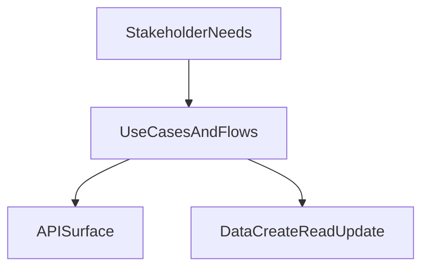

# D16-T001 — Functional requirements

Topic ID: `D16-T001`
Domain: System Design Fundamentals
Subdomain: Functional requirements
Importance: core
Complexity: intermediate
Dependencies: `D05-T001`, `D05-T002`, `D06-T001`, `D06-T002`, `D07-T001`, `D07-T002`
Execution status of the code in section F: unexecuted (illustrative sizing script)

## A. Topic Overview

**Functional requirements** is the discipline of addressing **what the system must do for users and operators** when designing backend systems.

Teams that treat functional requirements as optional rework architecture under fire during incidents and launch weeks.

In system design interviews, you connect functional requirements to diagrams, formulas, and trade-offs.

Prerequisites: `D05-T002`, `D06-T001`. Next in this track: `D16-T002`.

## B. First-Principles Explanation

Functional requirements is the practice of making what the system must do for users and operators explicit before choosing databases, queues, or instance counts.

Start from user-visible behavior and measurable outcomes, then derive components. Components exist to satisfy requirements, not the reverse.

In interviews, write assumptions in the corner of the whiteboard and update them when the interviewer gives new facts.

### Capacity estimation hooks (state assumptions)

Use a **hypothetical** product unless the interviewer gives numbers. Never invent measured QPS for a real company.

| Symbol | Meaning |
| --- | --- |
| U | Registered users (assumed) |
| p | Daily active fraction (e.g. 0.1 means 10% DAU/U) |
| DAU | Daily active users = p × U |
| A | Meaningful actions per active user per day |
| K_peak | Peak multiplier on average traffic (state value, often 3–10) |
| B_req | Average request payload size (bytes) |
| B_row | Average stored record size (bytes) |

**Average request rate (actions treated as requests):**

Q_avg = (DAU × A) / 86,400 seconds/day

**Peak request rate:**

Q_peak = Q_avg × K_peak

**Egress bandwidth (approximate):**

BW_egress ≈ Q_peak × B_resp (add B_req for ingress if uploads matter)

**Net new storage per day (append-only events):**

Storage_day ≈ DAU × A × B_row (multiply by retention days for total disk)

**Cache RAM (order of magnitude):**

RAM_cache ≈ hot_key_count × B_value × replica_factor

Round aggressively, then double the bottleneck you will provision first (usually DB writes or hot partition).

Functional scope drives A (actions/day). If each use case maps to k API calls, multiply: Q_avg ≈ (DAU × A × k) / 86,400.

## C. Internal Working and Architecture

Inputs: stakeholder goals, constraints, and existing systems. Output for Functional requirements: a decision or artifact the team can implement and test.

Process: enumerate options, compare against requirements, pick the smallest design that meets NFRs with known risks documented.

Feedback loop: production metrics and incidents should refine the original decision; architecture is iterative, not a one-shot diagram.

## D. Diagrams and Visual Models




## E. Examples and Analogies

Analogy: Functional requirements is like agreeing on the recipe before buying kitchen equipment. The oven size matters, but only after you know you are baking bread versus steaming dumplings.

Worked example: for a hypothetical URL shortener, what the system must do for users and operators might force you to prioritize low-latency redirects and global uniqueness before debating SQL versus NoSQL.

## F. Code Examples

File: `examples/d16_t001_functional_req.py`

Dependencies: Python 3 standard library only. Numbers are hypothetical assumptions for interview practice.

```python
"""Hypothetical sizing helper for D16-T001 — interview practice only."""

SECONDS_PER_DAY = 86_400


def qps_from_assumptions(
    registered_users: int,
    dau_fraction: float,
    actions_per_dau_per_day: float,
    peak_multiplier: float,
) -> tuple[float, float]:
    """Return (q_avg, q_peak) using stated assumptions."""
    dau = registered_users * dau_fraction
    q_avg = (dau * actions_per_dau_per_day) / SECONDS_PER_DAY
    q_peak = q_avg * peak_multiplier
    return q_avg, q_peak


def storage_per_day(dau: float, actions_per_dau: float, bytes_per_row: int) -> int:
    return int(dau * actions_per_dau * bytes_per_row)


def describe(focus: str) -> str:
    return f"Topic focus: {focus}"


if __name__ == "__main__":
    # Assumptions (hypothetical product — not a real company)
    U = 2_000_000
    p = 0.15
    A = 12.0
    K = 5.0
    B_row = 512
    q_avg, q_peak = qps_from_assumptions(U, p, A, K)
    dau = U * p
    day_bytes = storage_per_day(dau, A, B_row)
    assert q_avg > 0 and q_peak > q_avg
    print(describe("what the system must do for users and operators"))
    print(f"q_avg={q_avg:.2f} q_peak={q_peak:.2f} storage_day_mb={day_bytes/1_000_000:.2f}")
    print("ok")
```

How to run: `python examples/d16_t001_functional_req.py` from `backend-engineering-knowledge-base/EXERCISES/` (copy or symlink as needed).

Expected output: printed estimates and `ok` when asserts pass.

Important lines: every constant is labeled as an assumption; change U, p, A, and K_peak first in an interview.

This script was not executed in CI; run locally to verify.

## G. Practical Backend Application

In sprint planning, translate functional requirements into acceptance criteria and non-functional checks on each story.

During design reviews, block merges that add components without tracing them to a requirement or an explicit risk acceptance.

## H. Advantages, Limitations and Trade-offs

| Choice | Benefit | Cost | Choose when | Avoid when |
| --- | --- | --- | --- | --- |
| Simple design first | Faster to ship and reason about | May hit scaling ceiling | MVP, unclear load | Known extreme scale day one |
| Over-provision early | Buys time under uncertainty | Higher cloud bill | Launch week, small team | Steady state with good metrics |
| Measure then optimize | Data-driven decisions | Needs instrumentation | Post-MVP | Interview time-box (use estimates) |
| Strong consistency | Easier mental model | Latency and availability cost | Money, inventory | High fan-out read paths |

## I. Common Mistakes and Misconceptions

- Jumping to boxes and arrows before listing what the system must **do** (Functional requirements needs that clarity).
- Quoting capacity numbers without stating U, p, A, and K_peak assumptions aloud.
- Treating non-functional requirements as nice-to-have instead of design drivers.
- Picking technology before workload shape (read-heavy, write-heavy, bursty).
- Ignoring failure modes because "we will add that later" without a migration path.

## J. Debugging and Troubleshooting

Symptom: architecture debates never converge. Often the team skipped functional requirements and is arguing about favorite technologies.

Mitigation: time-box clarification, write assumptions, assign an owner to validate the riskiest assumption with a spike or load test.

## K. Interview Preparation

### Beginner

#### Q1. What is Functional requirements in a system design interview?

**Answer:** Functional requirements is how you make what the system must do for users and operators explicit so the design can be judged against measurable goals. Without it, you risk building the wrong system that is fast but incorrect, or correct but unusably slow. Interviewers listen for whether you write user stories, constraints, and success metrics before naming AWS services. Treat it as the contract between product, engineering, and operations for what 'done' means.

#### Q2. Why should Functional requirements come before drawing boxes?

**Answer:** Boxes represent components chosen to satisfy requirements; unnamed requirements make every component optional. Early diagrams cement premature decisions that are painful to undo when load or compliance appears. Ordering shows structured thinking: clarify, estimate, architect, deepen. It also saves time because you avoid deep-diving the wrong subsystem.

#### Q3. Give one example of what the system must do for users and operators.

**Answer:** For a hypothetical chat app, message delivery latency and offline sync behavior are part of the design conversation. You might require read receipts for 1:1 chats but not for large channels to control fan-out write load. Each example should map to an API, a data structure, or a failure behavior you can test. Examples grounded in user journeys beat abstract buzzwords.

#### Q4. How do engineers validate that Functional requirements were met?

**Answer:** Functional requirements become automated tests, contract tests, and manual QA scenarios. Non-functional requirements become load tests, chaos experiments, and SLO dashboards. Validation is continuous: CI for correctness, staging for performance, production for real traffic. Document the mapping from requirement to test so gaps are visible during review.

#### Q5. What is a common beginner mistake about Functional requirements?

**Answer:** Copying a famous company's architecture slide without matching their requirements or scale. Another mistake is listing features without priorities, which makes trade-offs impossible. Interviewers want you to say what you would cut under a one-hour MVP constraint. Mistakes are fixed by writing assumptions and asking clarifying questions.

### Intermediate

#### Q1. How does Functional requirements interact with capacity estimation?

**Answer:** Functional requirements defines what to measure: actions per user, payload sizes, retention, and peak behavior. Estimation turns those into Q_avg, Q_peak, storage, and bandwidth using explicit symbols. If requirements change (e.g., add media uploads), every formula input changes — revisit the estimate. Always state that numbers are hypothetical unless the interviewer supplies them.

#### Q2. How do you prioritize conflicting requirements for what the system must do for users and operators?

**Answer:** Rank by business impact and regulatory cost: legal and safety beat convenience features. Make trade-offs explicit: choose AP versus CP, or strong consistency on money only. Use MoSCoW or a simple P0/P1 list when time-boxed. Document rejected alternatives so the team does not relitigate every sprint.

#### Q3. Where should Functional requirements live in documentation?

**Answer:** Product requirements and engineering design docs cross-link: user stories link to API specs and SLOs. ADRs capture contentious decisions with context and consequences. Runbooks and on-call playbooks reference the NFRs they protect (latency, error rate). Keep a single source of truth per fact to avoid wiki drift.

#### Q4. How does Functional requirements affect API design?

**Answer:** Each user journey becomes resources, methods, idempotency rules, and pagination contracts. Error models and rate limits encode operational NFRs directly in the HTTP surface. Versioning strategy reflects how strictly clients depend on stable behavior. Skipping this step yields REST endpoints that mirror database tables without product meaning.

#### Q5. When is it acceptable to defer part of Functional requirements?

**Answer:** Defer only with explicit risk acceptance: document what might break and the trigger to revisit. Security, privacy, and money correctness are poor candidates for deferral. Cosmetic UX or secondary reports can wait if core journeys work. In interviews, say what you defer for MVP and what you still stub (auth, observability hooks).

### Advanced

#### Q1. How would you evolve Functional requirements as scale grows 10×?

**Answer:** Re-baseline assumptions: U, p, A, and K_peak; identify the first saturated resource. Split bottlenecks by concern: read scaling (cache, replicas), write scaling (sharding, queues). Update SLOs and error budgets if product accepts different UX (eventual consistency). Use ADRs to record why the architecture changed and what was rejected.

#### Q2. What metrics prove success for what the system must do for users and operators?

**Answer:** Pick SLIs aligned to user pain: success rate, latency percentiles, freshness, cost per transaction. Define SLO targets and measure error budget burn. Supplement with business metrics (conversion, retention) tied to technical changes. Avoid vanity metrics that improve while users suffer (average latency hiding tail).

#### Q3. How do organizational constraints shape Functional requirements?

**Answer:** Team topology affects service boundaries: Conway's law means interfaces follow communication lines. Compliance regimes (PCI, HIPAA) harden certain NFRs regardless of traffic. Skill mix may favor managed services versus self-hosted databases. State constraints explicitly instead of pretending a textbook ideal design.

#### Q4. Describe a failure mode when Functional requirements are vague.

**Answer:** Ambiguous durability requirements cause data loss incidents that look like bugs but are specification gaps. Vague latency goals lead to over-built caches or under-provisioned databases discovered only at launch. On-call pays the cost as repeated Sev2s without a clear definition of fixed. Prevention is writing testable statements and reviewing them in architecture sign-off.

#### Q5. How do you reconcile Functional requirements across multiple teams?

**Answer:** Use bounded contexts and published API contracts with versioning policy. Shared platform teams provide paved roads (auth, logging) so product teams do not reinvent. Governance light-weight: architecture review for cross-cutting changes only. Escalate conflicts with data: prototype cost, incident history, projected Q_peak.

### Scenarios

#### Q1. You have 25 minutes left in an interview after clarification. How do you cover Functional requirements quickly?

**Answer:** Spend five minutes confirming top three functional flows and two NFRs with numbers. Spend ten minutes on diagram and estimation using stated U, p, A, K_peak. Spend ten minutes on deep dive the interviewer chooses (storage, cache, or scaling). Keep talking aloud; trade depth for breadth if prompted.

#### Q2. Interviewer doubles traffic and halves latency budget. What do you revisit first?

**Answer:** Recompute Q_peak and check synchronous chain against the new L_target. Identify parallelization, caching, and read replicas before sharding. Question whether functional scope can shrink (drop noncritical features). Update risk list: hot keys, DB connection pools, thundering herd on cache miss.

#### Q3. Product adds a feature that conflicts with an earlier Functional requirements decision. What process do you follow?

**Answer:** Write a new ADR or amend the old one with context, decision, and consequences. Quantify impact on Q_peak, storage, and SLO error budget. Ship behind a flag if possible; measure before full rollout. Communicate to support and on-call what behavior changed.

#### Q4. Stakeholders want 'five nines' on a budget for 'three nines'. How do you respond?

**Answer:** Translate nines to downtime minutes per year and required redundancy cost. Propose tiered availability: critical path higher than analytics. Offer error budget policy instead of impossible SLA promises. Use hypothetical cost model, not a real vendor quote, unless provided.

#### Q5. Design review finds no traceability from tests to Functional requirements. What do you add?

**Answer:** Requirement IDs in test case titles and CI reporting. Contract tests for APIs and performance tests for SLO-critical endpoints. Checklist in PR template linking story to NFR validation. Quarterly audit sampling requirements to tests mapping.

### Follow-ups

#### Q1. How does Functional requirements connect to database schema choices?

**Answer:** Schema encodes invariants implied by requirements: uniqueness, relationships, retention. Migration strategy is a non-functional requirement for zero-downtime deploys. Indexing follows query patterns derived from user journeys. See domain 7 for normalization and indexing depth.

#### Q2. How does Functional requirements connect to distributed systems concerns?

**Answer:** Once Q_peak exceeds one node, you need partitioning, replication, and consistency choices. Distributed tracing and idempotency become functional requirements for async flows. Failure handling must be specified, not assumed. Domain 15 expands algorithms and trade-offs beyond this fundamentals track.

#### Q3. What should you study next after mastering Functional requirements?

**Answer:** Follow the D16 topic sequence: estimation, architecture styles, scaling, caching, and CAP. Practice full mock designs end-to-end with a timer. Read postmortems to see requirements gaps that caused outages. Build a personal checklist you reuse in every interview.


## L. Practical Exercises

Solutions are in `EXERCISES/solutions/D16-T001.md`. Try these before opening that file.

### Exercise 1 — implementation

Write a one-page requirements snippet for a hypothetical ride-hailing dispatch API emphasizing functional requirements. Include at least five functional bullets and three measurable NFRs.

Acceptance: Functional items are testable; NFRs include numbers or targets; no technology names in the first draft.

### Exercise 2 — debugging

Given U=500k, p=0.2, A=8, K_peak=4, compute Q_avg and Q_peak and identify which part of functional requirements would break first if DB write QPS max is 2000.

Acceptance: Show arithmetic; state bottleneck; propose one mitigation tied to the topic.

### Exercise 3 — trade-off

Trade-off: stay monolithic versus split a service for what the system must do for users and operators. List two benefits and two costs and pick one side for an MVP.

Acceptance: Mentions operational complexity, data consistency, and team size; choice matches stated constraints.


## M. Revision Notes

- Functional requirements must be explicit, testable, and prioritized before technology choices.
- State U, p, A, K_peak aloud for every estimation question.
- Tie components on diagrams back to a requirement or risk.
- Document trade-offs and rejected options briefly.

## N. Related Topics

Understand this before: `D05-T002`, `D06-T001`.

This topic supports: `D16-T002` and downstream design topics in domain 16.

Often confused with: feature list versus testable requirements.

Interviewers combine this with `D16-T003` requirement clarification, `D06-T002` resource modeling.

## O. Completion Criteria

- Explain functional requirements without reading this note.
- State explicit assumptions and run a back-of-the-envelope capacity estimate tied to this topic.
- Draw or describe the mermaid flow for the main decision path.
- Answer at least three section K questions aloud with four-sentence depth each.
- Complete the three exercises and compare with the solution file.
