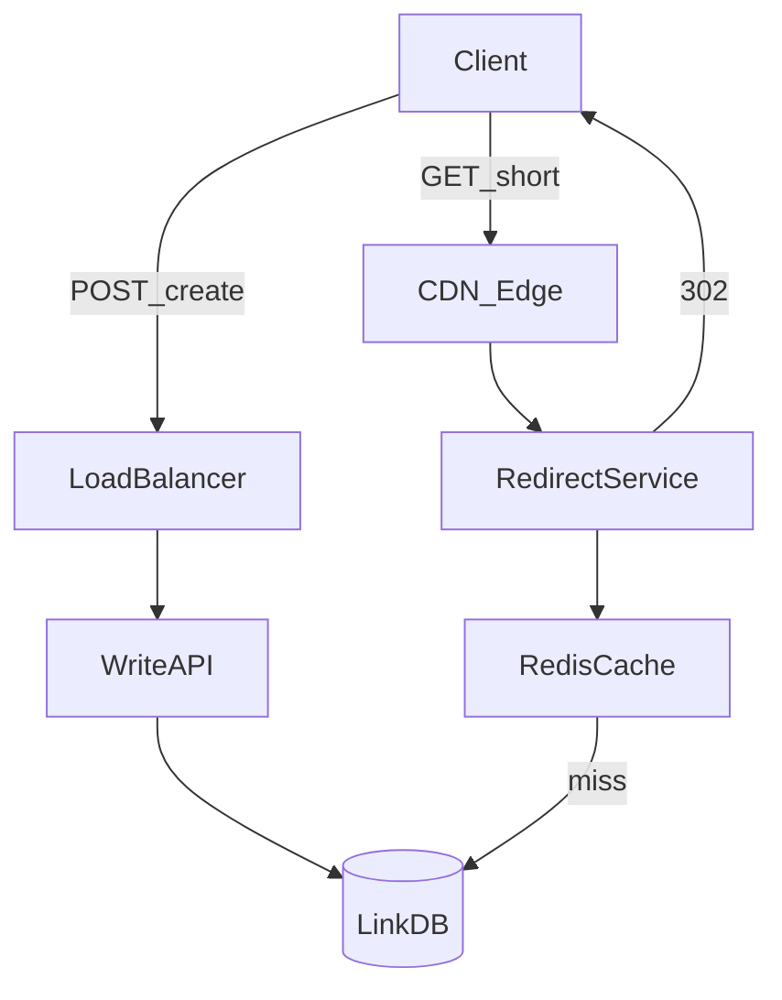

# D17-T001 — URL shortener

Topic ID: `D17-T001`
Domain: Common System Design Problems
Subdomain: URL shortener
Importance: common
Complexity: intermediate
Dependencies: `D16-T001`, `D16-T002`, `D07-T001`, `D07-T002`, `D11-T001`, `D11-T002`
Execution status of the code in section F: unexecuted (capacity sketch)

## A. Topic Overview

A URL shortener maps long HTTPS URLs to short tokens and resolves clicks with fast HTTP redirects. It is the classic read-heavy system design problem: a small write surface and a large, latency-sensitive read path.

Interviewers expect you to separate create APIs from redirect serving, size Redis and CDN from redirect QPS, and discuss cache invalidation, abuse, and analytics without blocking the 302.

Prerequisites: capacity planning and caching (`D16-T001`, `D11-T002`). Pairs naturally with rate limiting (`D17-T002`) and API gateways (`D17-T003`).

## B. First-Principles Explanation

### Functional requirements

- Create a short code for a long URL; optional custom alias and expiry.
- `GET /{code}` returns 302/301 to the long URL; track clicks (async is fine).
- Authenticated owners can list, update, and delete their links.

### Non-functional requirements

- Redirect p99 under 100 ms globally; create API p99 under 300 ms.
- High availability on reads; survive single-region DB failover with cache backing redirects.
- Codes hard to guess; validate destinations to reduce phishing and open redirects.

### Capacity sketch (explicit assumptions)

Assumptions: 100M users, 500M stored URLs, 10:1 read:write ratio.

- Writes: ~3.2 creates/s average; plan **500 creates/s** peak.
- Reads: **5k redirects/s** average; **50k redirects/s** peak.
- Storage: ~500M × ~2 KB metadata ≈ **1 TB** plus indexes.
- Egress: 50k RPS × ~1 KB redirect metadata ≈ **50 MB/s** (excluding follow to origin).

### API sketch

- `POST /v1/links` → `{shortUrl, code, expiresAt}` from `{longUrl, customAlias?, ttlSeconds?}`.
- `GET /{code}` → `302 Location` (edge-friendly).
- `GET /v1/links/{code}` → owner metadata; `DELETE /v1/links/{code}` → 204.

### Data model

- `links(code PK, long_url, owner_id, created_at, expires_at, click_count)`.
- Optional `clicks(click_id, code, ts, geo, referrer)` via async pipeline.
- Redis: `code → {long_url, expires_at, version}` cache-aside.

## C. Internal Working and Architecture

Create path: API validates URL → generates unique code (random base62 or ID encode) → insert DB → return short URL. Redirect path: edge/CDN → redirect service → Redis → on miss, DB → populate cache → 302. Updates delete or bump cache version.

Consistency: creates are strongly consistent in DB; redirects are eventually consistent with TTL cache; click counts are eventual. Use idempotent `POST` with client token for safe retries after failover.

## D. Diagrams and Visual Models



## E. Examples and Analogies

A short code is a nickname in a phone book: many people call the nickname (redirect), few people register new nicknames (create). If you print the wrong number on a sticker (stale cache), every caller goes to the wrong place until you replace the sticker.

## F. Code Examples

```python
WRITES_PEAK = 500
READS_PEAK = WRITES_PEAK * 10 * 10  # 10:1 ratio × headroom
print("planned_read_rps", READS_PEAK)
```

## G. Practical Backend Application

Dashboard cache hit ratio, redirect p99, create error rate, invalidation failures, and hot-code QPS. Alert when hit ratio drops or 5xx on redirect spikes. Run game days: Redis down, DB failover, viral single link.

## H. Advantages, Limitations and Trade-offs

| Choice | Benefit | Cost | Choose when | Avoid when |
| --- | --- | --- | --- | --- |
| 302 redirect | Target can change | Less browser cache | Marketing links | Permanent SEO URLs |
| Redis cache | Fast reads | Invalidation work | Hot redirect path | Strong consistency without TTL checks |
| Random codes | Horizontal ID gen | Collision handling | Public links | Sequential guessable IDs |
| Async analytics | Fast 302 | Stale counts | High click volume | Billing per click in real time |

## I. Common Mistakes and Misconceptions

- Using 301 then wondering why A/B landing pages never update.
- Blocking the redirect on Kafka or DB analytics writes.
- Allowing `//evil.com` open redirects without scheme validation.

## J. Debugging and Troubleshooting

### Bottlenecks

- Single Redis hot key on viral link; DB connection storm on cache miss.
- Unique index contention if codes are too short or sequential.
- CDN caching wrong 302 target after URL edit.

### Failure modes

- Stale cache after update → versioned cache entries and pub/sub invalidation.
- Expired link still redirects → check `expires_at` in redirect tier.
- Lost writes on failover → sync replication or idempotent client retries.

Trace: compare Redis value, DB row, and CDN `Age`/`X-Cache` for a code.

## K. Interview Preparation

### Beginner

#### Q1. What are the core functional requirements of a URL shortener?

**Answer:** Map long URL to short token and resolve with HTTP redirect on GET. Owners need CRUD, expiry, and optional custom aliases. Analytics are usually async so redirects stay fast. Separate write API from read-heavy redirect path in the first minute of the interview.

#### Q2. Why is the read path more important than the write path?

**Answer:** Every click is a read; creates are rare compared to redirects for popular links. Slow redirects hurt all recipients; slow creates hurt one user. Size Redis, CDN, and redirect pools for 10–100× write QPS. Still rate-limit creates to prevent DB abuse.

#### Q3. How long should a short code be?

**Answer:** Length trades collision space vs guessability. Base62 length 7 gives trillions of codes. Use random or encoded IDs with unique constraint and retry. Custom aliases need reserved-word blocks and per-tenant namespaces if you add custom domains.

#### Q4. What HTTP status should redirects use?

**Answer:** 302 when destinations may change; 301 when permanently stable and you want browser/CDN caching. Pick 302 for marketing unless SEO demands 301. Always return absolute HTTPS `Location`. Mention cache implications of 301 in follow-ups.

#### Q5. Where does a CDN help?

**Answer:** Edge reduces RTT for `GET /{code}` worldwide. Origin still serves misses and enforces expiry logic. Cache 404 briefly to absorb scans. Do not cache personalized targets without per-code keys.

### Intermediate

#### Q1. Design the ID generation strategy.

**Answer:** Options: DB sequence + base62, Snowflake-style IDs encoded, or random base62 with unique index retry. Random scales horizontally; monitor collision rate. Batch pre-generated codes if index contention appears. Keep custom aliases in a separate uniqueness namespace.

#### Q2. How do you cache mappings safely?

**Answer:** Cache-aside with TTL; store `expires_at` and version in value. Invalidate on update/delete synchronously or via pub/sub. Use singleflight on hot keys to prevent stampedes. Never redirect without checking expiry even on cache hit.

#### Q3. How would you shard the database?

**Answer:** Shard by `code` hash for point lookups on redirect. `owner_id` listings may need secondary index or separate table. Global code uniqueness is easier with a central ID service than per-shard sequences. Plan resharding cost before you need it.

#### Q4. How do you collect analytics without slowing redirects?

**Answer:** Fire-and-forget click events to Kafka with code and coarse geo. Aggregate counts asynchronously; sample under extreme load if product allows. Never block 302 on persistence. Use idempotent consumers keyed by `click_id`.

#### Q5. What abuse cases must you handle?

**Answer:** Phishing requires blocklists and reporting. Rate-limit creates per IP/account. Block internal network targets and dangerous URL schemes. Return generic 404 for scans to avoid leaking existence of codes.

### Advanced

#### Q1. How do you achieve global low latency?

**Answer:** Multi-region redirect with replicated cache and read replicas. Writes may be regional with async replication if slight create delay is OK. Anycast DNS to nearest POP. Measure replication lag before promising instant global visibility of new links.

#### Q2. Compare SQL vs DynamoDB for mappings.

**Answer:** SQL fits transactional alias uniqueness and owner queries. KV stores excel at massive point reads by partition key `code`. DynamoDB global tables help multi-region at higher cost. Migrate redirect path first when SQL QPS becomes the limit.

#### Q3. Zero-downtime migration from 6-char to 7-char codes?

**Answer:** Store variable-length codes; new links use longer codes; old remain valid. No user-facing migration required. Monitor index size and collision checks. Branding change only if URLs visually change.

#### Q4. What consistency model for click counts?

**Answer:** Eventual consistency is standard; expose approximate counts. Idempotent consumers prevent double increments on retries. Strong per-click consistency is unnecessary for UI badges. Fraud may still need raw event logs.

#### Q5. How do you test redirect correctness at scale?

**Answer:** Contract tests on encode/decode; chaos on Redis outage. Load test mixed hot/cold keys for hit ratio. Property-test expired links never redirect from stale cache. Shadow traffic before cutover.

### Scenarios

#### Q1. Celebrity tweet → 1M RPS on one link.

**Answer:** Redis hot key and DB pool exhaustion break first. Add local LRU on redirect nodes, singleflight to DB, CDN pre-warm. Sample analytics. Pre-replicate hot value to all cache nodes.

#### Q2. Wrong destination after edit.

**Answer:** Stale CDN or Redis after `PATCH`. Invalidate on write; shorten CDN TTL if targets change often. Check if 301 pinned old URL in browsers. Add version field in cache payload.

#### Q3. DB failover loses 30s of writes.

**Answer:** New links may 404 until replication catches up; old links still redirect from cache. Use sync quorum for creates if zero loss is required. Idempotent create tokens for client retries.

#### Q4. Open redirect via `//evil.com`.

**Answer:** Require `https://`, block scheme-relative and `javascript:` URLs. Allowlist for enterprise. Async scan existing links. Automated OWASP redirect tests in CI.

#### Q5. Custom domains per customer.

**Answer:** ACME TLS per host; composite key `(tenant_id, code)`. CDN must terminate per-customer certs. Isolate rate limits and abuse per tenant.

### Follow-ups

#### Q1. Relation to rate limiting (D17-T002)?

**Answer:** Limit creates and redirect floods per IP/API key. Edge WAF for scan traffic. Separate Redis cluster for limits vs mapping cache to reduce contention. Coordinate fail-open/closed policy with product risk.

#### Q2. Application cache vs CDN cache headers?

**Answer:** Redis holds mapping; CDN may cache full 302 response. Short TTL when destinations change. Avoid caching personalized redirects. ETags less common on redirects than static assets.

#### Q3. What metrics would you dashboard?

**Answer:** Redirect QPS, cache hit ratio, p99 latency, create errors, scan rate, replication lag, eviction rate. Alert on hit ratio drop or redirect 5xx. Track top hot codes for drills.

## L. Practical Exercises

Solutions are in `EXERCISES/solutions/D17-T001.md`.

### Exercise 1 — design

Sketch APIs and data model for create + redirect; state read:write ratio assumption.

### Exercise 2 — incident

Viral link causes Redis CPU spike. List three mitigations in rollout order.

### Exercise 3 — trade-off

301 vs 302 for campaigns that change landing pages weekly.

## M. Revision Notes

- Requirements → capacity → API → data → diagram → bottlenecks.
- Redirect path: cache, CDN, invalidation, expiry check.
- Idempotent creates; async analytics.
- 301 vs 302 cache semantics.

## N. Related Topics

`D17-T002`, `D11-T002`, `D16-T001`. Next: `D17-T002`.

## O. Completion Criteria

- Whiteboard architecture and capacity without notes.
- Explain cache invalidation and viral hot-key mitigations.
- Complete section L and compare solutions.
