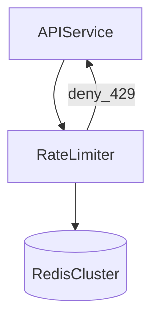

# D17-T002 — Rate limiter

Topic ID: `D17-T002`
Domain: Common System Design Problems
Subdomain: Rate limiter
Importance: common
Complexity: intermediate
Dependencies: `D17-T001`, `D16-T001`, `D16-T002`, `D07-T001`, `D07-T002`, `D11-T001`

## A. Topic Overview

A distributed rate limiter enforces per-key request budgets (user, IP, API key) so services stay available under abuse or flash traffic. It is a control plane for fairness and cost protection, not a substitute for autoscaling.

Interviewers test algorithm choice (token bucket vs sliding window), Redis/Lua atomicity, fail-open vs fail-closed policy, and header contracts (`429`, `Retry-After`).

## B. First-Principles Explanation

### Functional requirements

- Configure limits per scope (route, tenant, key).
- Return allow/deny fast; expose remaining quota to clients.
- Centralized counters with horizontally scaled enforcers.

### Non-functional requirements

- Decision p99 under 5 ms at the gateway or middleware.
- Survive Redis node failure with explicit degradation policy.
- Accurate enough to stop abuse; exactness can relax under load.

### Capacity sketch (explicit assumptions)

50k API RPS, 1M active keys, 1-minute windows. Redis ~64 MB for counters plus overhead. ~50k atomic updates/s peak on the limiter cluster.

### API sketch

- Admin: `POST /v1/policies` define `{scope, limit, windowSec}`.
- Data plane: middleware `allow(key) -> bool` + `X-RateLimit-Remaining`.
- Internal gRPC for low-latency checks at the gateway.

### Data model

- `policies(id, scope, limit, window_sec)`.
- Redis keys `rl:{scope}:{key}:{window}` or token-bucket hash fields.

## C. Internal Working and Architecture

Enforcer extracts key → runs Lua script (INCR + TTL or ZSET sliding window) → returns decision. Policies loaded from config store with watch. Local optional cache for coarse limits only if you accept burst error.

## D. Diagrams and Visual Models



## E. Examples and Analogies

A bouncer counts wristbands per hour: once the bucket is empty, guests wait until refill—unless policy says fire exits stay open (fail-open reads).

## F. Code Examples

```python
print("token_bucket", {"refill_per_sec": 100, "burst": 200})
```

## G. Practical Backend Application

Metric: deny rate, Redis latency, hot-key QPS, policy reload lag. Alert when deny spikes or limiter adds >5 ms p99. Document fail-open vs fail-closed per route class.

## H. Advantages, Limitations and Trade-offs

| Choice | Benefit | Cost | Choose when | Avoid when |
| --- | --- | --- | --- | --- |
| Token bucket | Smooth bursts | Tuneful config | Public APIs | Hard per-minute caps |
| Fixed window | Simple | Boundary spikes | Low stakes | Strict fairness |
| Redis cluster | Shared state | Hot keys | Distributed apps | Single-host tools |
| Fail-closed | Protects money paths | Outage blocks traffic | Payments | Read-only browse |

## I. Common Mistakes and Misconceptions

- Fail-open everywhere during Redis outage on payment APIs.
- Per-IP limits punishing mobile NAT without user-key fallback.
- No idempotency on counted write operations separate from HTTP retries.

## J. Debugging and Troubleshooting

### Bottlenecks

- Redis hot shard for popular API keys.
- Lua script contention; clock skew across enforcers.

### Failure modes

- Redis down → policy must choose open vs closed.
- Mis-set limit of 1 RPS on partner integration.
- Clients ignore `Retry-After` and retry storms.

Trace correlation ID; compare key, window, and counter value in Redis.

## K. Interview Preparation

### Beginner

#### Q1. What is rate limiting?

**Answer:** It caps how many requests a key may perform in a time window. It protects backends and enforces fair use or billing tiers. It runs before expensive work when possible. It returns 429 when exceeded with optional retry guidance.

#### Q2. Why HTTP 429?

**Answer:** 429 signals the client should slow down rather than treating it as server failure. Pair with `Retry-After` seconds or HTTP-date. Distinguish from 503 which indicates server overload. Clients should use exponential backoff with jitter.

#### Q3. Token bucket vs fixed window?

**Answer:** Token bucket allows controlled bursts while refilling steadily. Fixed window resets counters at boundaries causing "double burst" at edges. Sliding window costs more but smooths edges. Pick based on fairness vs Redis cost.

#### Q4. Where to enforce limits?

**Answer:** Edge/gateway stops garbage early; service middleware enforces fine-grained rules. Both may coexist with stricter inner limits. Never only on clients. Coordinate keys across layers to avoid double counting unless intended.

#### Q5. Per user vs per IP?

**Answer:** Authenticated traffic should key on user or API key. IP is fallback for anonymous endpoints. NAT can lump innocent users—combine signals. Enterprise tenants may need per-tenant budgets.

### Intermediate

#### Q1. Distributed counter design?

**Answer:** Central Redis with atomic Lua; avoid app-server memory for global limits. Shard Redis; use hash tags carefully. Consider local token cache with sync for hot keys. Hierarchical limits (global + per user).

#### Q2. Sliding window cost?

**Answer:** ZSET per key storing timestamps is accurate but memory-heavy. Approximate sliding with multiple sub-windows reduces cost. Count-min sketch for huge cardinalities sacrifices exactness. State memory per key in capacity math.

#### Q3. Sync vs async enforcement?

**Answer:** Sync inline before handler for correctness. Async audit-only limits do not protect overload. Payment and auth need sync deny. Analytics sampling can be async.

#### Q4. Headers contract?

**Answer:** Document `X-RateLimit-Limit`, `Remaining`, `Reset`. Align with Stripe/GitHub conventions for SDK ergonomics. Include policy id in logs, not headers, for support. Version changes need changelog.

#### Q5. Testing limits?

**Answer:** Integration tests with Redis flush; load tests verifying 429 ratio. Chaos: Redis pause to validate fail policy. Property tests that counters never go negative.

### Advanced

#### Q1. Global limits across regions?

**Answer:** Global Redis or async sync with lag acceptance. Regional budgets with headroom sum below global cap. CRDT-style counters are rare; prefer single source of truth. Measure cross-region Redis RTT impact on p99.

#### Q2. Admission control vs throttle?

**Answer:** Admission rejects at door; throttle queues or slows. Queues need depth limits to avoid memory bombs. APIs usually hard reject with 429. Background jobs may use queues with delay.

#### Q3. Fairness between tenants?

**Answer:** Weighted fair queuing or separate pools per tier. Noisy neighbor isolation via per-tenant Redis keyspaces. Burst credits for premium tenants. Monitor per-tenant deny rates.

#### Q4. DDoS at edge vs app?

**Answer:** Volumetric attacks need CDN/WAF/scrubbing before app limiter. App limiter handles logical abuse and quotas. SYN floods are network layer. Layer defenses; do not rely on one knob.

#### Q5. Sharding Redis?

**Answer:** Hash slots; avoid hot key without local cache. Replica reads are stale for limits—use primary or accept error. Multi-primary conflicts break exact counts—stick to single writer per key.

### Scenarios

#### Q1. Traffic doubles overnight.

**Answer:** Raise limits or scale backends; check if denies spiked. Autoscale enforcers with API pods. Verify Redis CPU not saturated. Communicate partner limit changes.

#### Q2. Redis failover during sale.

**Answer:** Execute documented fail-closed vs open policy. Use redundant Redis sentinel/cluster. Pre-warm connections. Post-mortem counter drift if open.

#### Q3. Partner limit misconfigured to 1 RPS.

**Answer:** Config audit and validation bounds on policy API. Canary policies before prod. Dashboard per-partner deny rate alerts.

#### Q4. Clients ignore Retry-After.

**Answer:** Exponential backoff docs; block abusive client ids. Server-side max retry budget. Circuit breakers on partners.

#### Q5. Limiter adds 20 ms p99.

**Answer:** Pipeline Redis; colocate enforcer with gateway. Local cache for coarse gate. Reduce Lua complexity; shard hot keys.

### Follow-ups

#### Q1. Link to API gateway?

**Answer:** Gateway plugin order: auth then rate limit then route. Shared Redis cluster or dedicated for isolation. See `D17-T003`.

#### Q2. Relation to quotas?

**Answer:** Quotas are longer horizon (daily spend); limits are per-second/minute. Implement quotas with separate counters and billing sync.

#### Q3. Metrics to alert?

**Answer:** Deny rate, Redis latency, hot keys, policy reload errors. SLO burn on 429 unexpected spikes.

## L. Practical Exercises

Solutions: `EXERCISES/solutions/D17-T002.md`.

1. Design `allow(key)` with sliding window; state Redis key schema.
2. Hot API key saturates one Redis shard—mitigations?
3. Choose fail-open vs fail-closed for payment API.

## M. Revision Notes

- Algorithm, atomicity, fail policy, headers.
- Hot keys and cross-region truth.

## N. Related Topics

`D17-T003`, `D17-T001`. Next: `D17-T003`.

## O. Completion Criteria

- Whiteboard Redis Lua flow and failure policy.
- Complete section L exercises.
