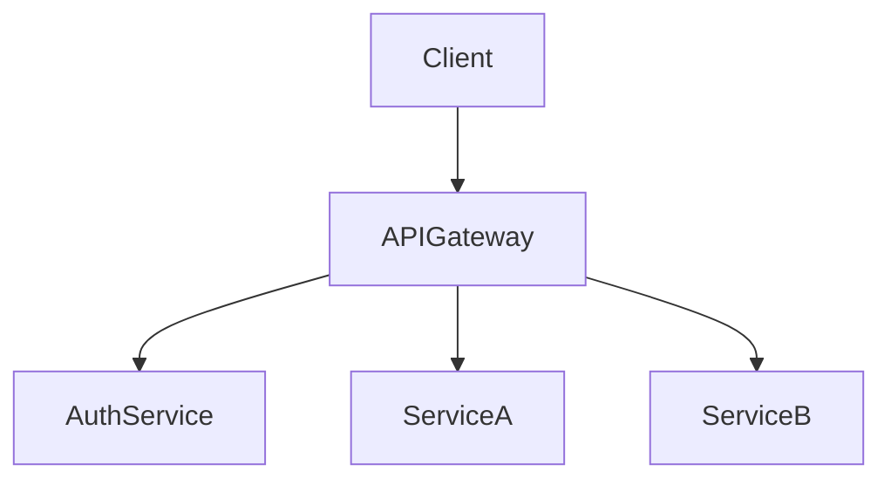

# D17-T003 — API gateway

Topic ID: `D17-T003` | Domain: Common System Design Problems | Importance: common

## A. Topic Overview

An API gateway is the north-south front door: TLS, routing, auth, rate limits, and observability in one place. Interviewers want plugin ordering, config propagation, and failure isolation—not a second monolith.

## B. First-Principles Explanation

### Functional requirements

- Route paths to backend services; support canary weights.
- Terminate TLS; validate JWT/API keys.
- Cross-cutting plugins: rate limit, logging, request size limits.

### Non-functional requirements

- Add under 10 ms p99 vs direct service call.
- 99.99% availability; hot config reload without dropping connections.

### Capacity sketch (explicit assumptions)

100k RPS, 200 routes, ~5 KB avg request → tens of stateless gateway pods; CPU bound on TLS/JWT.

### API sketch

- Proxy: same public REST paths to upstreams.
- Admin: `PUT /routes/{id}` with plugins and timeouts.
- `GET /healthz` for LB.

### Data model

- Config: `routes(path, upstream, timeout_ms, plugins[])`.
- Runtime snapshot in memory; watch from control plane/etcd.

## C. Internal Working and Architecture

Request → match route → plugin chain (auth → limit → transform) → upstream with timeout and circuit breaker → response plugins (headers, logging).

## D. Diagrams and Visual Models



## E. Examples and Analogies

Hotel front desk: one entrance checks ID and sends you to the correct floor.

## F. Code Examples

```python
print("gateway_plugins", ["auth", "ratelimit", "route"])
```

## G. Practical Backend Application

Propagate `traceparent` and tenant headers. Dashboard 5xx by route, upstream latency, config version skew.

## H. Advantages, Limitations and Trade-offs

| Choice | Benefit | Cost | Choose when | Avoid when |
| --- | --- | --- | --- | --- |
| Central gateway | Policy once | Hop latency | Many clients | Simple internal mesh only |
| Canary routes | Safe rollout | Config complexity | Frequent deploys | Tiny teams |
| Sync JWT validate | Strong auth | CPU | Standard OAuth | Ultra-low latency LAN |

## I. Common Mistakes and Misconceptions

- Stale routes after deploy drain incomplete.
- Plugin panic kills worker without isolation.
- No per-route timeouts causing retry storms.

## J. Debugging and Troubleshooting

### Bottlenecks

JWT crypto CPU; large body buffering; config poll delay.

### Failure modes

Bad canary sends 100% to broken version; auth outage blocks all traffic; cascade without bulkheads.

Compare gateway config version with upstream readiness; trace single request across plugins.

## K. Interview Preparation

### Beginner

#### Q1. Why an API gateway?

**Answer:** It centralizes cross-cutting concerns so microservices stay thin. Clients see one base URL and certificate. You change routing without mobile app updates. It is the policy enforcement point at the edge.

#### Q2. Gateway vs load balancer?

**Answer:** LB distributes TCP/HTTP to healthy instances. Gateway understands HTTP paths, auth, and transformations. Many products combine both layers. Use LB for L4, gateway for L7 policy.

#### Q3. TLS termination?

**Answer:** Gateway decrypts HTTPS and may re-encrypt to backends with mTLS. Saves cert management on every pod. Requires trust boundary design. PCI and compliance often mandate edge termination.

#### Q4. What is a route?

**Answer:** A match rule from path/method/host to upstream pool and plugins. Routes version with config releases. Longest-prefix wins in many implementations. Document precedence to avoid shadow routes.

#### Q5. Where does auth live?

**Answer:** At gateway for coarse token validation; services still authorize resource-level actions. Never trust headers without validation. Pass signed internal identity claims downstream.

### Intermediate

#### Q1. Service discovery integration?

**Answer:** Gateway watches K8s endpoints or Consul for upstream IPs. Health checks remove bad pods. Stale discovery causes 502 spikes after deploys. Prefer readiness over liveness for routing.

#### Q2. Circuit breaker config?

**Answer:** Open circuit on error rate/latency to failing upstream. Half-open probes recovery. Prevents thread exhaustion in gateway. Tune per dependency, not one global threshold.

#### Q3. Request transformation?

**Answer:** Strip external paths, add internal headers, map API versions. Keep transforms declarative in config. Test golden requests in CI. Avoid Turing-complete scripts in hot path.

#### Q4. Idempotency at edge?

**Answer:** Forward `Idempotency-Key` to payment services; optionally dedupe at gateway for public POST storms. Gateway dedupe needs shared store and TTL. Do not break legitimate retries.

#### Q5. Versioning strategies?

**Answer:** Path `/v1`, header `Accept-Version`, or separate routes per tenant. Gateway can route by header without code deploy. Deprecate with metrics on old version traffic.

### Advanced

#### Q1. Multi-region gateway?

**Answer:** Deploy gateways per region with geo DNS. Config must replicate consistently. JWT validation uses regional JWKS cache. Failover region absorbs traffic on regional outage.

#### Q2. mTLS to backends?

**Answer:** Gateway presents client cert to services; services verify SPIFFE or CA. Prevents lateral movement inside VPC. Rotation automation required. Adds handshake latency—session reuse helps.

#### Q3. WAF integration?

**Answer:** WAF before gateway for OWASP rules; gateway for app auth. False positives need tuning per route. Log blocked requests with rule id. Do not duplicate limits in both layers blindly.

#### Q4. GraphQL at edge?

**Answer:** Federation gateway composes subgraphs; different from REST reverse proxy. Query cost analysis prevents expensive fan-out. Persisted queries reduce attack surface. Rate limit by query complexity.

#### Q5. Zero-downtime config reload?

**Answer:** Double-buffer config snapshots; atomic pointer swap per worker. Drain old connections gracefully. Validate config schema before apply. Roll back on canary error rate spike.

### Scenarios

#### Q1. Bad deploy routes 100% to canary.

**Answer:** Roll back config; feature flag weights to 0. Compare error dashboards by route tag. Add automatic promotion gates on SLO. Keep last-known-good config snapshot.

#### Q2. Auth outage blocks all traffic.

**Answer:** Cached JWKS and short-lived negative cache reduce blast radius. Document break-glass read-only mode policy. Never fail-open writes without explicit risk acceptance.

#### Q3. Tenant sends 10 MB bodies.

**Answer:** Enforce `client_max_body_size` at gateway. Return 413 early. Protect upstream memory. Per-tenant limits in config.

#### Q4. Clock skew breaks JWT.

**Answer:** Allow small `leeway` seconds; sync NTP on nodes. Monitor `iat`/`exp` failures. Prefer short-lived tokens plus refresh at client.

#### Q5. Per-tenant routing.

**Answer:** Match host header or claim `tenant_id` to dedicated upstream pools. Isolates noisy neighbors. Needed for regulated tenants on dedicated stacks.

### Follow-ups

#### Q1. Gateway + rate limiter?

**Answer:** Rate limit plugin calls shared Redis limiter (`D17-T002`). Order after auth so keys are user-based. Separate budgets per route class.

#### Q2. Observability headers?

**Answer:** Inject/propagate trace and request ids. Return `X-Request-Id` to clients for support. Correlate with access logs.

#### Q3. Service mesh relation?

**Answer:** Mesh handles east-west mTLS and retries; gateway handles north-south. Avoid duplicating retries at both layers. Pick clear ownership per hop.

## L. Practical Exercises

Solutions: `EXERCISES/solutions/D17-T003.md`.

1. Draw plugin chain for auth, rate limit, routing.
2. Canary 5%—what config and metrics?
3. When skip gateway for internal calls?

## M. Revision Notes

Plugin order, config propagation, timeouts, canaries.

## N. Related Topics

`D17-T002`, `D17-T004`. Next: `D17-T004`.

## O. Completion Criteria

Whiteboard gateway architecture, capacity, and failure modes; complete L.
