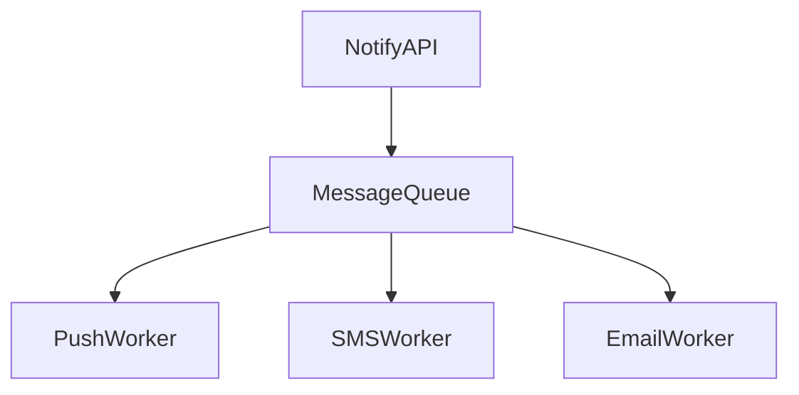

# D17-T004 — Notification service

Topic ID: `D17-T004` | Domain: Common System Design Problems

## A. Topic Overview

Unified notification API fan-outs to push, SMS, and email workers asynchronously. Interview focus: queues, idempotency, provider limits, and user preferences.

## B. First-Principles Explanation

### Functional requirements

- `POST /v1/notify` with template + channels; honor opt-in preferences.
- Track delivery status; retries with backoff.

### Non-functional requirements

- Accept enqueue p99 < 100 ms; delivery async per channel SLA.
- At-least-once processing with idempotent workers.

### Capacity sketch (explicit assumptions)

20k notifications/s peak, 1 KB payload, three channels. Queue throughput matches ingress; SMS often caps TPS below internal rate.

### API sketch

`POST /v1/notify` `{userId, template, data, channels?}`; `GET /v1/notifications/{id}` status.

### Data model

`notifications(id, user_id, channel, status, payload_ref)`; `preferences(user_id, channel, opt_in)`; per-channel queue topics.

## C. Internal Working and Architecture

API validates → persists row → publishes to channel queues → workers call providers → update status; DLQ for poison messages.

## D. Diagrams and Visual Models



## E. Examples and Analogies

Post office sorting: one counter, many carriers, tracking numbers per parcel.

## F. Code Examples

```python
print("notify_qps", 20000)
```

## G–I. Operations, trade-offs, mistakes

Monitor queue age, provider error rate, duplicate send rate. Mistakes: blocking API on SMTP; ignoring opt-out; unbounded retries.

## J. Debugging and Troubleshooting

### Bottlenecks

SMS provider TPS; template CPU; duplicate sends on retry without idempotency key.

### Failure modes

Provider outage backlog; wrong default opt-in; poison message stalling partition.

## K. Interview Preparation

### Beginner

#### Q1. Sync vs async notify?

**Answer:** API should ack quickly after enqueue, not after carrier delivery. Users tolerate seconds of delay for SMS/push. Sync only for rare in-app realtime paths. Async decouples spikes from provider SLAs.

#### Q2. Why a queue?

**Answer:** Absorbs bursts and isolates API from slow providers. Enables retry and DLQ policies per channel. Scales workers independently. Without queues, thread pools exhaust under spike.

#### Q3. What is a template?

**Answer:** Named layout with variables rendered per user. Separates content from code deploys. Requires injection-safe rendering. Version templates for rollback.

#### Q4. Channels?

**Answer:** Push, SMS, email have different cost, latency, and regulations. User preferences gate each channel. Fallback order must be product-defined. Do not spam all channels by default.

#### Q5. Idempotency?

**Answer:** Clients send idempotency key; workers dedupe on `notification_id`. Prevents double SMS on consumer retry. Store processed keys with TTL. Critical for billing per message.

### Intermediate

#### Q1. Priority queues?

**Answer:** Separate queues for OTP vs marketing. Strict priority risks starvation—use weighted fair queuing. Monitor low-priority age. Alert if OTP queue backs up.

#### Q2. DLQ handling?

**Answer:** After N failures move to DLQ with payload preserved. Tooling to replay after fix. Metrics on DLQ depth. Prevent infinite redelivery loops.

#### Q3. Fan-out to millions?

**Answer:** Batch enqueue; shard workers; rate limit per provider. Precompute recipient segments offline for campaigns. Protect database from N+1 preference lookups via cache.

#### Q4. Rate limit per provider?

**Answer:** Token bucket per provider account in worker. Shed load with delay queue. Multi-provider failover with cost trade-off. Coordinate with `D17-T002`.

#### Q5. User opt-out?

**Answer:** Check preferences before enqueue and again at worker. Legal regimes require audit of consent changes. Hard stop on complaint signals. Cache preferences with short TTL.

### Advanced

#### Q1. Multi-region ordering?

**Answer:** Global order rarely needed; per-user causal order suffices. Use partition key `user_id`. Cross-region duplicate risk if dual-publish—prefer single primary region for enqueue.

#### Q2. Exactly-once illusion?

**Answer:** At-least-once plus idempotent provider APIs where available. Deduplicate on business key. Compensating sends are hard—design for detectable duplicates.

#### Q3. Personalization at scale?

**Answer:** Render close to worker with cached profile fragments. Avoid giant fan-out joins in API thread. Feature flags per template variant.

#### Q4. Cost optimization?

**Answer:** Channel selection by cost/latency; batch push; suppress duplicates. Archive old notifications to cold storage. Monitor cost per template.

#### Q5. Compliance archiving?

**Answer:** Retain send records with redacted payload per policy. Immutable audit log for regulated industries. Tie to `D17-T005` email archives.

### Scenarios

#### Q1. Black Friday 10× volume.

**Answer:** Scale workers; throttle marketing; prioritize transactional templates. Temporary provider quota increase. Watch queue lag SLO.

#### Q2. Duplicate push after retry.

**Answer:** Missing idempotency on consumer; add processed-key store. Provider may also retry—use stable external id.

#### Q3. Wrong language template.

**Answer:** Locale in template selection; tests per locale; canary template releases. Rollback config version.

#### Q4. SMS provider throttles.

**Answer:** Shape traffic; secondary provider; delay non-critical. Display degraded mode in status API.

#### Q5. GDPR delete user.

**Answer:** Delete PII in notification rows and payloads; purge queue messages pending. Retain anonymized audit if legally required.

### Follow-ups

#### Q1. Link to email system?

**Answer:** Email channel worker calls `D17-T005` pipeline. Shared suppression lists. Unified preference service.

#### Q2. Push token lifecycle?

**Answer:** Invalidate on logout; handle APNs/FCM feedback loops. Prune dead tokens to save cost.

#### Q3. Metrics?

**Answer:** Queue age, send success rate, provider latency, opt-out rate, duplicate rate.

## L. Practical Exercises

Solutions: `EXERCISES/solutions/D17-T004.md`.

### Exercise 1 — design

API + queue + workers diagram for three channels.

### Exercise 2 — incident

SMS capped at 1k TPS while ingress is 5k/s.

### Exercise 3 — trade-off

Store full message body vs blob reference.

## M. Revision Notes

Enqueue fast; deliver async; idempotency; per-channel limits; preferences before send.

## N. Related Topics

`D17-T005`, `D17-T003`.

## O. Completion Criteria

Whiteboard notify path with queues and DLQ; explain provider throttle scenario; complete L.

## Supplement for missing section letters

## G. Practical Backend Application

Notification service continues the design already written in this file. Topic ID: `D17-T004` | Domain: Common System Design Problems Unified notification API fan-outs to push, SMS, and email workers asynchronously. Interview focus: queues, idempotency, provider limits, and user preferences. - `POST /v1/notify` with template + channels; honor opt-in preferences. - Track delivery status; retries with backoff. - Accept enqueue p99 < 100 ms; delivery async per channel SLA. - At-least-once processing with idempotent workers. 20k notifications/s peak, 1 KB payload, three 

For section G, keep the same capacity numbers and API as the requirements above. Do not invent a second architecture. The completion check is whether you can still draw the original diagram and name its bottleneck.

## H. Advantages, Limitations and Trade-offs

| Choice | Benefit | Cost | Choose when | Avoid when |
| --- | --- | --- | --- | --- |
| Notification service | Matches the requirements in this note | More components | The bottleneck in section J is real | A single node still meets the SLO |

## I. Common Mistakes and Misconceptions

Notification service continues the design already written in this file. Topic ID: `D17-T004` | Domain: Common System Design Problems Unified notification API fan-outs to push, SMS, and email workers asynchronously. Interview focus: queues, idempotency, provider limits, and user preferences. - `POST /v1/notify` with template + channels; honor opt-in preferences. - Track delivery status; retries with backoff. - Accept enqueue p99 < 100 ms; delivery async per channel SLA. - At-least-once processing with idempotent workers. 20k notifications/s peak, 1 KB payload, three 

For section I, keep the same capacity numbers and API as the requirements above. Do not invent a second architecture. The completion check is whether you can still draw the original diagram and name its bottleneck.
