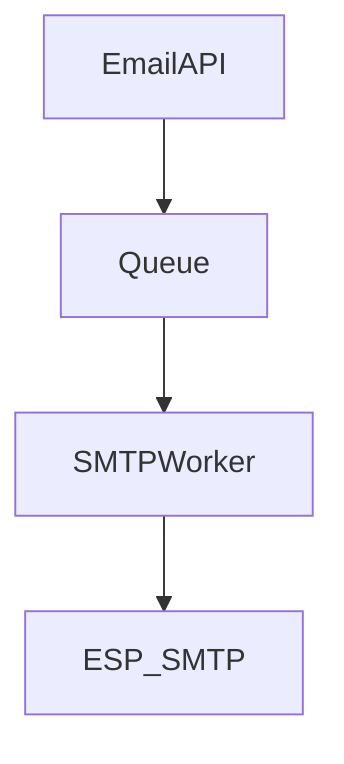

# D17-T005 — Email delivery system

Topic ID: `D17-T005` | Domain: Common System Design Problems

## A. Topic Overview

Outbound email pipeline: accept jobs, render MIME, deliver via ESP/SMTP, handle bounces/complaints. Design for reputation, compliance (DKIM/SPF/DMARC), and queue-backed throughput.

## B. First-Principles Explanation

### Functional requirements

- `POST /v1/emails` with templates; bounce/complaint webhooks; suppression lists.

### Non-functional requirements

- 99.9% queue acceptance; protect IP/domain reputation; authenticate mail.

### Capacity sketch (explicit assumptions)

5M emails/day, burst **500/s**; provider caps often 100–1000/s per account; pool SMTP connections.

### API sketch

`POST /v1/emails`; provider webhooks for bounces/complaints.

### Data model

`messages(id, status, provider_id)`; `suppressions(email, reason)`; optional object store for MIME.

## C. Internal Working and Architecture

API enqueues → worker renders → SMTP/ESP → webhook updates suppression on hard bounce.

## D. Diagrams and Visual Models



## E–I. Summary

Reputation pools separate transactional vs marketing. Mistakes: shared IP hurts password resets; unsigned webhooks.

## J. Debugging and Troubleshooting

### Bottlenecks

IP reputation; large attachments; DNS validation latency.

### Failure modes

Backlog delays transactional mail; marketing mislabeled; forged bounce webhooks.

## K. Interview Preparation

### Beginner

#### Q1. SMTP role?

**Answer:** Mail transfer between MTAs; your worker is a client to ESP. Reliability via retries and queues. Not the same as IMAP for inbox. Design assumes outbound focus.

#### Q2. Bounce vs complaint?

**Answer:** Hard bounce = invalid mailbox; soft = temporary. Complaint = user marked spam. Both affect reputation differently. Suppress hard bounces and complainers quickly.

#### Q3. Suppression list?

**Answer:** Prevents sending to addresses that bounced or opted out. Legal and deliverability requirement. Check before enqueue and at worker. Sync across channels with notify service.

#### Q4. Transactional vs marketing?

**Answer:** Transactional is receipt/reset; marketing needs consent and unsubscribe. Separate IPs/pools and templates. Never block transactional due to marketing blocks.

#### Q5. DKIM purpose?

**Answer:** Signs mail so receivers verify domain. Rotation needs dual-sign period. Broken DKIM drops deliverability sharply. Automate DNS updates.

### Intermediate

#### Q1. Dedicated IPs?

**Answer:** Isolate reputation per high-volume sender. Warm new IPs gradually. Costly but needed at scale. Shared pools for small senders.

#### Q2. Retry backoff?

**Answer:** Exponential backoff on soft bounces and provider 4xx. Cap attempts; DLQ for inspection. Do not retry hard bounces.

#### Q3. Template injection safety?

**Answer:** Escape HTML; sandbox variables; no user-controlled templates without review. Phishing risk in links.

#### Q4. Multi-tenant sending domains?

**Answer:** Per-tenant DKIM keys and domains. Bounce handling per tenant. Prevents cross-tenant reputation bleed.

#### Q5. IP warm-up?

**Answer:** Ramp volume slowly on new IP/domain. Monitor complaint rate. Coordinate with marketing schedule.

### Advanced

#### Q1. Global deliverability?

**Answer:** Regional ESP endpoints; comply with local laws (CAN-SPAM, GDPR). Time-zone aware sends. Data residency for logs.

#### Q2. TLS?

**Answer:** Require STARTTLS to provider where supported. Log failures. Does not encrypt at rest in provider.

#### Q3. Archival compliance?

**Answer:** Store metadata + blob in WORM storage for retention years. Legal hold flags.

#### Q4. Autoscaling workers?

**Answer:** Scale on queue depth; cap by provider TPS. Predict campaign schedules.

#### Q5. Greylisting?

**Answer:** Temporary 451 from recipient MX; retry with backoff. Distinguish from hard failures.

### Scenarios

#### Q1. Campaign spikes bounces.

**Answer:** Pause campaign; analyze list hygiene; suppress bad domains. Check acquisition source quality.

#### Q2. DKIM rotation break.

**Answer:** Dual DKIM records during rotation; monitor auth results. Roll back DNS if fail rate spikes.

#### Q3. Unsub still gets mail.

**Answer:** Preference not checked; cache stale; separate marketing stream. Fix worker check order.

#### Q4. Provider blackout.

**Answer:** Failover ESP; queue growth alert; delay marketing.

#### Q5. Virus scan delay.

**Answer:** Async scan before send; quarantine queue; SLA for transactional bypass policy.

### Follow-ups

#### Q1. Notification overlap?

**Answer:** Email channel plugs into `D17-T004`. Shared templates and suppression.

#### Q2. Link tracking?

**Answer:** Redirect domains affect reputation; balance analytics vs phishing perception.

#### Q3. Observability?

**Answer:** Delivery rate, bounce rate, complaint rate, queue age, DKIM pass rate.

## L. Practical Exercises

Solutions: `EXERCISES/solutions/D17-T005.md`. 1) Bounce webhook flow. 2) Split IP pools. 3) 7-year body retention.

## M. Revision Notes

Queues, suppression, DKIM, pool separation.

## N. Related Topics

`D17-T004`, `D17-T006`.

## O. Completion Criteria

Whiteboard pipeline; explain bounce handling; complete L.

## Supplement for missing section letters

## E. Examples and Analogies

Email delivery system continues the design already written in this file. Topic ID: `D17-T005` | Domain: Common System Design Problems Outbound email pipeline: accept jobs, render MIME, deliver via ESP/SMTP, handle bounces/complaints. Design for reputation, compliance (DKIM/SPF/DMARC), and queue-backed throughput. - `POST /v1/emails` with templates; bounce/complaint webhooks; suppression lists. - 99.9% queue acceptance; protect IP/domain reputation; authenticate mail. 5M emails/day, burst **500/s**; provider caps often 100–1000/s per account; pool SMTP connections. `P

For section E, keep the same capacity numbers and API as the requirements above. Do not invent a second architecture. The completion check is whether you can still draw the original diagram and name its bottleneck.

## F. Code Examples

```python
# unexecuted illustration for D17-T005
def explain():
    return 'Email delivery system'
```

## G. Practical Backend Application

Email delivery system continues the design already written in this file. Topic ID: `D17-T005` | Domain: Common System Design Problems Outbound email pipeline: accept jobs, render MIME, deliver via ESP/SMTP, handle bounces/complaints. Design for reputation, compliance (DKIM/SPF/DMARC), and queue-backed throughput. - `POST /v1/emails` with templates; bounce/complaint webhooks; suppression lists. - 99.9% queue acceptance; protect IP/domain reputation; authenticate mail. 5M emails/day, burst **500/s**; provider caps often 100–1000/s per account; pool SMTP connections. `P

For section G, keep the same capacity numbers and API as the requirements above. Do not invent a second architecture. The completion check is whether you can still draw the original diagram and name its bottleneck.

## H. Advantages, Limitations and Trade-offs

| Choice | Benefit | Cost | Choose when | Avoid when |
| --- | --- | --- | --- | --- |
| Email delivery system | Matches the requirements in this note | More components | The bottleneck in section J is real | A single node still meets the SLO |

## I. Common Mistakes and Misconceptions

Email delivery system continues the design already written in this file. Topic ID: `D17-T005` | Domain: Common System Design Problems Outbound email pipeline: accept jobs, render MIME, deliver via ESP/SMTP, handle bounces/complaints. Design for reputation, compliance (DKIM/SPF/DMARC), and queue-backed throughput. - `POST /v1/emails` with templates; bounce/complaint webhooks; suppression lists. - 99.9% queue acceptance; protect IP/domain reputation; authenticate mail. 5M emails/day, burst **500/s**; provider caps often 100–1000/s per account; pool SMTP connections. `P

For section I, keep the same capacity numbers and API as the requirements above. Do not invent a second architecture. The completion check is whether you can still draw the original diagram and name its bottleneck.
