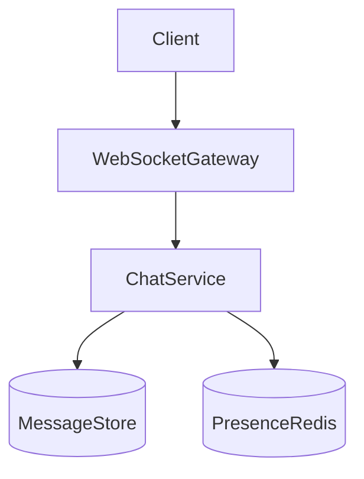

# D17-T006 — Chat application

Topic ID: `D17-T006` | Domain: Common System Design Problems

## A. Topic Overview

Real-time chat: rooms, history, presence, WebSockets. Separate connection tier from storage; sequence numbers for ordering.

## B. First-Principles Explanation

### Functional requirements

- 1:1 and group rooms; message history; optional read receipts and presence.

### Non-functional requirements

- Online delivery p99 < 300 ms; durable history; ~50k concurrent connections per cell.

### Capacity sketch (explicit assumptions)

10M DAU, 100 msg/user/day → ~12k msg/s avg, **120k/s** peak; ~1 KB/msg; WebSocket fan-out dominates.

### API sketch

`POST /rooms/{id}/messages`; WS `SUBSCRIBE`; `GET /history?cursor=`.

### Data model

`messages(room_id, seq, sender, body, ts)`; `memberships`; presence in Redis.

## C. Architecture

WS gateway → chat service → DB; presence in Redis; push for offline (`D17-T004`).

## D. Diagrams



## E–I. Trade-offs

Fan-out cost in large groups; shard by `room_id`; cap group size or use lazy delivery.

## J. Debugging

### Bottlenecks

Large group fan-out; hot room write seq; gateway memory per connection.

### Failure modes

Missed messages without cursor on reconnect; split presence; join thundering herd.

## K. Interview Preparation

### Beginner

#### Q1. WebSocket vs polling?

**Answer:** WS gives server push with one long-lived connection. Polling wastes bandwidth and adds latency. WS needs sticky sessions or shared pub/sub backplane. Fallback to long polling on restrictive networks.

#### Q2. How store messages?

**Answer:** Append-only per room with monotonic `seq`. Index `(room_id, seq)` for pagination. Archive old tiers to cold storage. Media in object store with URL in message.

#### Q3. What is a room?

**Answer:** A channel for ordered messages among members. Membership table enforces ACL. Public vs private rooms change fan-out and moderation needs.

#### Q4. Ordering?

**Answer:** Per-room sequence is the source of truth. Client displays by `seq`, not wall clock. Clock skew makes timestamps secondary.

#### Q5. Presence?

**Answer:** Online/last-seen in Redis with TTL heartbeats. Expensive at huge scale; sample or aggregate. Privacy settings may hide precise presence.

### Intermediate

#### Q1. Shard by room?

**Answer:** Yes for message writes and history queries. Cross-room search is separate index. Hot celebrity rooms may need dedicated shard.

#### Q2. Delivery acks?

**Answer:** Client acks server; server tracks pending for retry. At-least-once may duplicate—dedupe by `msg_id`.

#### Q3. Typing indicators?

**Answer:** Ephemeral events with high rate; throttle broadcasts. Do not persist. Drop under load.

#### Q4. History pagination?

**Answer:** Cursor on `seq` for stable pages. Avoid offset in huge rooms. Cache recent tail per room.

#### Q5. Media messages?

**Answer:** Upload via pre-signed URL; message contains metadata only. Virus scan async before share.

### Advanced

#### Q1. E2EE impact?

**Answer:** Server stores ciphertext; search and moderation harder. Key distribution per device. Backup and multi-device sync complex.

#### Q2. Multi-device sync?

**Answer:** Per-device cursor; fan-out to all devices on new message. Read state synced via separate events.

#### Q3. Cross-region rooms?

**Answer:** Users homed in region; cross-region RTT for global rooms. Prefer regional rooms for latency.

#### Q4. History GC?

**Answer:** Retention policy per product; legal hold exceptions. Compaction jobs.

#### Q5. Slow client backpressure?

**Answer:** Drop low-priority events; disconnect abusive clients; per-connection send buffers with limits.

### Scenarios

#### Q1. 500-member announcement.

**Answer:** Fan-out via internal bus to gateways; batch per gateway. Consider announcement channel separate from chat seq.

#### Q2. Reconnect after 1h.

**Answer:** Client sends last `seq`; server returns gap. WS resume token optional.

#### Q3. Gateway crash.

**Answer:** Clients reconnect to another gateway; sticky less critical if pub/sub backplane. Brief message duplication possible.

#### Q4. Spam flood.

**Answer:** Rate limit per user; mute/ban; captcha for joins. Moderation queue.

#### Q5. Clock skew ordering.

**Answer:** Ignore client timestamps for order; server `seq` only.

### Follow-ups

#### Q1. WhatsApp differences?

**Answer:** See `D17-T007` for mobile offline sync and E2EE discussion.

#### Q2. Push offline?

**Answer:** Notify service with collapse keys per room.

#### Q3. Metrics?

**Answer:** Connections per cell, msg/s, fan-out latency, reconnect rate.

## L. Practical Exercises

Solutions: `EXERCISES/solutions/D17-T006.md`. 1) Per-room seq. 2) 500-member fan-out. 3) Full vs tiered history.

## M–O. Revision; related `D17-T007`; whiteboard WS + storage.

## Supplement for missing section letters

## E. Examples and Analogies

Chat application continues the design already written in this file. Topic ID: `D17-T006` | Domain: Common System Design Problems Real-time chat: rooms, history, presence, WebSockets. Separate connection tier from storage; sequence numbers for ordering. - 1:1 and group rooms; message history; optional read receipts and presence. - Online delivery p99 < 300 ms; durable history; ~50k concurrent connections per cell. 10M DAU, 100 msg/user/day → ~12k msg/s avg, **120k/s** peak; ~1 KB/msg; WebSocket fan-out dominates. `POST /rooms/{id}/messages`; WS `SUBSCRIBE`; `GET 

For section E, keep the same capacity numbers and API as the requirements above. Do not invent a second architecture. The completion check is whether you can still draw the original diagram and name its bottleneck.

## F. Code Examples

```python
# unexecuted illustration for D17-T006
def explain():
    return 'Chat application'
```

## G. Practical Backend Application

Chat application continues the design already written in this file. Topic ID: `D17-T006` | Domain: Common System Design Problems Real-time chat: rooms, history, presence, WebSockets. Separate connection tier from storage; sequence numbers for ordering. - 1:1 and group rooms; message history; optional read receipts and presence. - Online delivery p99 < 300 ms; durable history; ~50k concurrent connections per cell. 10M DAU, 100 msg/user/day → ~12k msg/s avg, **120k/s** peak; ~1 KB/msg; WebSocket fan-out dominates. `POST /rooms/{id}/messages`; WS `SUBSCRIBE`; `GET 

For section G, keep the same capacity numbers and API as the requirements above. Do not invent a second architecture. The completion check is whether you can still draw the original diagram and name its bottleneck.

## H. Advantages, Limitations and Trade-offs

| Choice | Benefit | Cost | Choose when | Avoid when |
| --- | --- | --- | --- | --- |
| Chat application | Matches the requirements in this note | More components | The bottleneck in section J is real | A single node still meets the SLO |

## I. Common Mistakes and Misconceptions

Chat application continues the design already written in this file. Topic ID: `D17-T006` | Domain: Common System Design Problems Real-time chat: rooms, history, presence, WebSockets. Separate connection tier from storage; sequence numbers for ordering. - 1:1 and group rooms; message history; optional read receipts and presence. - Online delivery p99 < 300 ms; durable history; ~50k concurrent connections per cell. 10M DAU, 100 msg/user/day → ~12k msg/s avg, **120k/s** peak; ~1 KB/msg; WebSocket fan-out dominates. `POST /rooms/{id}/messages`; WS `SUBSCRIBE`; `GET 

For section I, keep the same capacity numbers and API as the requirements above. Do not invent a second architecture. The completion check is whether you can still draw the original diagram and name its bottleneck.

## M. Revision Notes

Chat application continues the design already written in this file. Topic ID: `D17-T006` | Domain: Common System Design Problems Real-time chat: rooms, history, presence, WebSockets. Separate connection tier from storage; sequence numbers for ordering. - 1:1 and group rooms; message history; optional read receipts and presence. - Online delivery p99 < 300 ms; durable history; ~50k concurrent connections per cell. 10M DAU, 100 msg/user/day → ~12k msg/s avg, **120k/s** peak; ~1 KB/msg; WebSocket fan-out dominates. `POST /rooms/{id}/messages`; WS `SUBSCRIBE`; `GET 

For section M, keep the same capacity numbers and API as the requirements above. Do not invent a second architecture. The completion check is whether you can still draw the original diagram and name its bottleneck.

## N. Related Topics

Chat application continues the design already written in this file. Topic ID: `D17-T006` | Domain: Common System Design Problems Real-time chat: rooms, history, presence, WebSockets. Separate connection tier from storage; sequence numbers for ordering. - 1:1 and group rooms; message history; optional read receipts and presence. - Online delivery p99 < 300 ms; durable history; ~50k concurrent connections per cell. 10M DAU, 100 msg/user/day → ~12k msg/s avg, **120k/s** peak; ~1 KB/msg; WebSocket fan-out dominates. `POST /rooms/{id}/messages`; WS `SUBSCRIBE`; `GET 

For section N, keep the same capacity numbers and API as the requirements above. Do not invent a second architecture. The completion check is whether you can still draw the original diagram and name its bottleneck.

## O. Completion Criteria

Chat application continues the design already written in this file. Topic ID: `D17-T006` | Domain: Common System Design Problems Real-time chat: rooms, history, presence, WebSockets. Separate connection tier from storage; sequence numbers for ordering. - 1:1 and group rooms; message history; optional read receipts and presence. - Online delivery p99 < 300 ms; durable history; ~50k concurrent connections per cell. 10M DAU, 100 msg/user/day → ~12k msg/s avg, **120k/s** peak; ~1 KB/msg; WebSocket fan-out dominates. `POST /rooms/{id}/messages`; WS `SUBSCRIBE`; `GET 

For section O, keep the same capacity numbers and API as the requirements above. Do not invent a second architecture. The completion check is whether you can still draw the original diagram and name its bottleneck.
