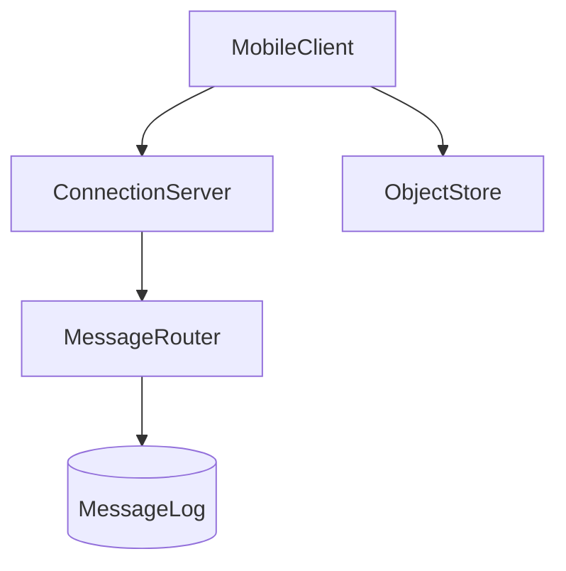

# D17-T007 — WhatsApp/Telegram-like messaging

Topic ID: `D17-T007` | Domain: Common System Design Problems

## A. Topic Overview

Mobile-first messaging at global scale: persistent connections, offline sync, delivery/read states, media, and optional E2EE. Design centers on connection servers, message logs per user/device, and idempotent client message ids.

## B. Requirements and capacity

**Functional:** Mobile 1:1 chat, delivery/read states, offline sync, media, optional E2EE. **NFR:** Low battery/bandwidth; multi-device. **Capacity:** 500M users, 50B msgs/day ≈ **580k msg/s** global; regional connection servers; metadata DB sharded by `user_id`.

**API:** Persistent connection `SEND`/`ACK`/`SYNC`; media via pre-signed HTTPS. **Data model:** `user_devices`, `message_log(user_id, device_id, msg_id, state)`, object store for media.

## C. Internal Working and Architecture

Clients maintain long-lived TLS connections to regional edge servers. Router writes authoritative message log; ACK/SYNC commands advance per-device cursors. Media bypasses chat path via object store pre-signed URLs.

## D. Diagrams and Visual Models



## E. Examples and Analogies

Registered mail with read receipts: the server is the post office tracking delivery, not reading the letter when E2EE is enabled.

## F. Code Examples

```python
print("global_msg_per_sec", 580_000)
```

## G. Practical Backend Application

Monitor connection count per cell, sync backlog depth, media upload failures, and duplicate delivery rate. Scale connection tier horizontally; shard metadata by `user_id`.

## H. Advantages, Limitations and Trade-offs

| Choice | Benefit | Cost | Choose when | Avoid when |
| --- | --- | --- | --- | --- |
| E2EE | Privacy | No server search | Consumer trust | Heavy moderation needs |
| Server plaintext | Search/mod | Compliance risk | Enterprise SaaS chat | High privacy brand |
| Push + sync | Offline UX | Battery/network | Mobile | Desktop-only |

## I. Common Mistakes and Misconceptions

- No client-generated id for dedupe on flaky networks.
- Treating delivery ACK as read receipt.
- Storing media inline in message row.

## J. Debugging and Troubleshooting

### Bottlenecks

**Bottlenecks:** Connection count; sync backlog; media bandwidth. **Failures:** Lost ACK duplicates; key rotation bugs; regional partition.

## K. Interview Preparation

### Beginner

#### Q1. Why persistent connection?

**Answer:** Push delivery without polling saves battery and latency on mobile. TCP/WebSocket or custom binary protocol over TLS. Reconnect with backoff on network change. Heartbeats detect dead connections.

#### Q2. Delivery vs read?

**Answer:** Delivery ACK means server/device received; read means user opened chat. Different ticks for UX. Read receipts are privacy-sensitive and optional. Server routes state to sender devices.

#### Q3. Offline queue?

**Answer:** Server stores pending messages per user/device until ACK. Client syncs gap on reconnect with cursor. TTL and size caps prevent unbounded storage. Push notification wakes app to sync.

#### Q4. Phone numbers as IDs?

**Answer:** Human-meaningful identity; contact graph from address book hashes. Privacy requires careful discovery (not broadcast numbers). Account takeover via SIM swap is a threat model item.

#### Q5. Media path?

**Answer:** Upload encrypted blob to object store; message carries key/url metadata. Thumbnail generation async. CDN for popular public media if not E2EE.

### Intermediate

#### Q1. Multi-device fan-out?

**Answer:** Each device has inbox; send to all active devices until read sync. Device keys for E2EE. Revoke sessions on logout.

#### Q2. Ordering per chat?

**Answer:** Per-conversation sequence or Lamport timestamps; display sort stable. Out-of-order network requires client merge rules.

#### Q3. Presence privacy?

**Answer:** Last-seen granular settings; hide online from non-contacts. Do not leak via side channels in typing events.

#### Q4. Spam reporting?

**Answer:** Rate limits; report flow; block lists; metadata analysis if not E2EE.

#### Q5. Push coalescing?

**Answer:** Collapse multiple msgs per chat into one notification. Respect OS limits. Deep link opens sync.

### Advanced

#### Q1. E2EE server role?

**Answer:** Server routes ciphertext; no content moderation without client reporting. Backup conflicts with E2EE unless client-held keys.

#### Q2. Global routing?

**Answer:** Home region per user; cross-region forwarding adds latency. Data residency laws affect message storage location.

#### Q3. Sharding user pairs?

**Answer:** Shard by user id or chat id; pair chats may live on shard of lower user id for even spread.

#### Q4. Backup messages?

**Answer:** Cloud backup encrypted with user passphrase; separate from server plaintext designs.

#### Q5. Lawful access tension?

**Answer:** Product/legal choice; E2EE limits server visibility. Document threat model clearly in interviews.

### Scenarios

#### Q1. Offline 12h.

**Answer:** Queue on server; push on reconnect; client SYNC from last id; may batch large backlog.

#### Q2. Duplicate message.

**Answer:** Idempotent `client_msg_id`; dedupe at server and receiver.

#### Q3. Video upload stalls.

**Answer:** Background upload; send placeholder message; update when complete.

#### Q4. SIM swap.

**Answer:** Re-verify device; alert user; delay sensitive actions.

#### Q5. Regional DC loss.

**Answer:** DNS failover; queued messages replicate; brief unavailability possible.

### Follow-ups

#### Q1. Slack contrast?

**Answer:** `D17-T008` multi-tenant workspaces vs consumer phone identity.

#### Q2. Chat baseline?

**Answer:** `D17-T006` room/seq model simpler than mobile sync.

#### Q3. CDN for media?

**Answer:** Signed URLs; TTL; E2EE prevents CDN inspection.

## L. Practical Exercises

Solutions: `EXERCISES/solutions/D17-T007.md`.

### Exercise 1 — design

Offline sync protocol sketch.

### Exercise 2 — incident

Duplicate delivery on flaky network.

### Exercise 3 — trade-off

E2EE vs server-side search.

## M. Revision Notes

Persistent connections, SYNC cursors, idempotent client ids, regional scale.

## N. Related Topics

`D17-T006`, `D17-T008`.

## O. Completion Criteria

Whiteboard connection tier + log + media path; explain dedupe and offline SYNC; complete L.
