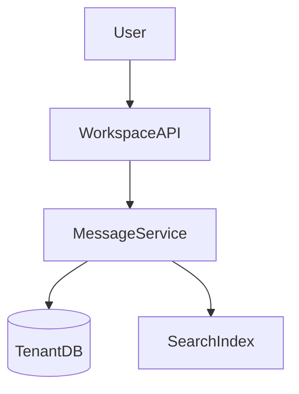

# D17-T008 — Slack-like multi-tenant application

Topic ID: `D17-T008` | Domain: Common System Design Problems

## A. Topic Overview

Multi-tenant workspaces with channels, threads, search, RBAC, and integrations. Tenant isolation is the primary design constraint.

## B. First-Principles Explanation

### Functional requirements

- Workspaces, channels, messages, threads; guests; bots; workspace search.

### Non-functional requirements

- Strong tenant isolation; search p99 < 500 ms; enterprise audit logs.

### Capacity sketch (explicit assumptions)

100k workspaces, 10M users; hot workspace **50 msg/s**; search index per workspace or shared with `workspace_id` filter.

### API sketch

`POST /workspaces/{w}/channels/{c}/messages`; `GET /search?q=` scoped; SCIM optional.

### Data model

`workspaces`, `channels(workspace_id)`, `messages(channel_id, ts)`, ACL tables.

## D. Diagrams



## J. Bottlenecks and failure modes

**Bottlenecks:** Search size; ACL checks; guest leakage risk. **Failures:** Missing `workspace_id` in query; index lag; over-scoped bot tokens.

## K. Interview Preparation

### Beginner

#### Q1. What is multi-tenant?

**Answer:** One app serves many customers (workspaces) with logical isolation. Data and quotas are partitioned by tenant key. Noisy neighbor and data leaks are top risks. Billing often per seat per workspace.

#### Q2. Workspace vs channel?

**Answer:** Workspace is tenant boundary; channel is conversation partition inside. Permissions inherit and override via ACL. Public channels within workspace still require membership rules.

#### Q3. RBAC basics?

**Answer:** Roles (admin/member/guest) map to allowed actions on resources. Enforce in service layer, not only UI. Audit admin actions for enterprise.

#### Q4. Thread model?

**Answer:** Parent message with replies; separate timeline or nested views. Index threads for search carefully to avoid duplicate hits.

#### Q5. Audit logs?

**Answer:** Append-only events for compliance: who accessed what, config changes, exports. Immutable storage with retention policy.

### Intermediate

#### Q1. Row-level security?

**Answer:** DB RLS or mandatory `workspace_id` predicate in every query. Integration tests attempt cross-tenant access. ORM hooks inject tenant from auth context.

#### Q2. Shared vs silo DB?

**Answer:** Pooled DB cheaper; silo for enterprise isolation. Migration path from pool to silo for large customers.

#### Q3. Search tenancy?

**Answer:** Index documents include `workspace_id`; queries always filter. Separate indices per large tenant optional.

#### Q4. Rate limits per workspace?

**Answer:** Prevent one workspace exhausting shared search/API. Fair queuing on background jobs.

#### Q5. Data residency?

**Answer:** Pin workspace to region; replicate metadata accordingly. Cross-region search complexity.

### Advanced

#### Q1. Enterprise KMS?

**Answer:** Customer-managed keys for stored messages/files. Key rotation and revocation flows.

#### Q2. eDiscovery export?

**Answer:** Legal export of workspace data with chain of custody. Async job with encrypted delivery.

#### Q3. Sharding workspaces?

**Answer:** Shard large workspaces by channel; small workspaces co-locate. Rebalance tools required.

#### Q4. Realtime vs search consistency?

**Answer:** Messages realtime via WS; search lags seconds—UI indicator optional.

#### Q5. Compliance retention?

**Answer:** Legal hold prevents delete; TTL jobs respect holds.

### Scenarios

#### Q1. Guest sees private channel.

**Answer:** ACL bug; fix membership checks; audit access logs; rotate tokens.

#### Q2. Search cross-tenant hit.

**Answer:** Missing filter in query; emergency index scan; patch and verify tests.

#### Q3. Large workspace migration.

**Answer:** Dual-write or read-only window; validate message counts per channel.

#### Q4. Leaked API key.

**Answer:** Revoke; scope keys to workspace; short TTL; audit usage.

#### Q5. GDPR delete across backups.

**Answer:** Delete primary + schedule backup compaction; document residual risk window.

### Follow-ups

#### Q1. News feed differences?

**Answer:** `D17-T009` fan-out graph vs workspace channels.

#### Q2. File sharing?

**Answer:** `D17-T010` metadata + object ACL per workspace.

#### Q3. Billing per seat?

**Answer:** Meter active members; sync with identity provider.

## L. Exercises

Solutions: `EXERCISES/solutions/D17-T008.md`. Tenant isolation; search lag; pool vs silo DB.

## C, E–I, M–O

Service layer enforces tenant on every path. Trade-off table: pool vs silo. Mistakes: trusting client-sent workspace id. Completion: whiteboard tenant-safe query.

## Supplement for missing section letters

## C. Internal Working and Architecture

Slack-like multi-tenant application continues the design already written in this file. Topic ID: `D17-T008` | Domain: Common System Design Problems Multi-tenant workspaces with channels, threads, search, RBAC, and integrations. Tenant isolation is the primary design constraint. - Workspaces, channels, messages, threads; guests; bots; workspace search. - Strong tenant isolation; search p99 < 500 ms; enterprise audit logs. 100k workspaces, 10M users; hot workspace **50 msg/s**; search index per workspace or shared with `workspace_id` filter. `POST /workspaces/{w}/channels/{c}/messag

For section C, keep the same capacity numbers and API as the requirements above. Do not invent a second architecture. The completion check is whether you can still draw the original diagram and name its bottleneck.

## E. Examples and Analogies

Slack-like multi-tenant application continues the design already written in this file. Topic ID: `D17-T008` | Domain: Common System Design Problems Multi-tenant workspaces with channels, threads, search, RBAC, and integrations. Tenant isolation is the primary design constraint. - Workspaces, channels, messages, threads; guests; bots; workspace search. - Strong tenant isolation; search p99 < 500 ms; enterprise audit logs. 100k workspaces, 10M users; hot workspace **50 msg/s**; search index per workspace or shared with `workspace_id` filter. `POST /workspaces/{w}/channels/{c}/messag

For section E, keep the same capacity numbers and API as the requirements above. Do not invent a second architecture. The completion check is whether you can still draw the original diagram and name its bottleneck.

## F. Code Examples

```python
# unexecuted illustration for D17-T008
def explain():
    return 'Slack-like multi-tenant application'
```

## G. Practical Backend Application

Slack-like multi-tenant application continues the design already written in this file. Topic ID: `D17-T008` | Domain: Common System Design Problems Multi-tenant workspaces with channels, threads, search, RBAC, and integrations. Tenant isolation is the primary design constraint. - Workspaces, channels, messages, threads; guests; bots; workspace search. - Strong tenant isolation; search p99 < 500 ms; enterprise audit logs. 100k workspaces, 10M users; hot workspace **50 msg/s**; search index per workspace or shared with `workspace_id` filter. `POST /workspaces/{w}/channels/{c}/messag

For section G, keep the same capacity numbers and API as the requirements above. Do not invent a second architecture. The completion check is whether you can still draw the original diagram and name its bottleneck.

## H. Advantages, Limitations and Trade-offs

| Choice | Benefit | Cost | Choose when | Avoid when |
| --- | --- | --- | --- | --- |
| Slack-like multi-tenant application | Matches the requirements in this note | More components | The bottleneck in section J is real | A single node still meets the SLO |

## I. Common Mistakes and Misconceptions

Slack-like multi-tenant application continues the design already written in this file. Topic ID: `D17-T008` | Domain: Common System Design Problems Multi-tenant workspaces with channels, threads, search, RBAC, and integrations. Tenant isolation is the primary design constraint. - Workspaces, channels, messages, threads; guests; bots; workspace search. - Strong tenant isolation; search p99 < 500 ms; enterprise audit logs. 100k workspaces, 10M users; hot workspace **50 msg/s**; search index per workspace or shared with `workspace_id` filter. `POST /workspaces/{w}/channels/{c}/messag

For section I, keep the same capacity numbers and API as the requirements above. Do not invent a second architecture. The completion check is whether you can still draw the original diagram and name its bottleneck.

## M. Revision Notes

Slack-like multi-tenant application continues the design already written in this file. Topic ID: `D17-T008` | Domain: Common System Design Problems Multi-tenant workspaces with channels, threads, search, RBAC, and integrations. Tenant isolation is the primary design constraint. - Workspaces, channels, messages, threads; guests; bots; workspace search. - Strong tenant isolation; search p99 < 500 ms; enterprise audit logs. 100k workspaces, 10M users; hot workspace **50 msg/s**; search index per workspace or shared with `workspace_id` filter. `POST /workspaces/{w}/channels/{c}/messag

For section M, keep the same capacity numbers and API as the requirements above. Do not invent a second architecture. The completion check is whether you can still draw the original diagram and name its bottleneck.

## N. Related Topics

Slack-like multi-tenant application continues the design already written in this file. Topic ID: `D17-T008` | Domain: Common System Design Problems Multi-tenant workspaces with channels, threads, search, RBAC, and integrations. Tenant isolation is the primary design constraint. - Workspaces, channels, messages, threads; guests; bots; workspace search. - Strong tenant isolation; search p99 < 500 ms; enterprise audit logs. 100k workspaces, 10M users; hot workspace **50 msg/s**; search index per workspace or shared with `workspace_id` filter. `POST /workspaces/{w}/channels/{c}/messag

For section N, keep the same capacity numbers and API as the requirements above. Do not invent a second architecture. The completion check is whether you can still draw the original diagram and name its bottleneck.

## O. Completion Criteria

Slack-like multi-tenant application continues the design already written in this file. Topic ID: `D17-T008` | Domain: Common System Design Problems Multi-tenant workspaces with channels, threads, search, RBAC, and integrations. Tenant isolation is the primary design constraint. - Workspaces, channels, messages, threads; guests; bots; workspace search. - Strong tenant isolation; search p99 < 500 ms; enterprise audit logs. 100k workspaces, 10M users; hot workspace **50 msg/s**; search index per workspace or shared with `workspace_id` filter. `POST /workspaces/{w}/channels/{c}/messag

For section O, keep the same capacity numbers and API as the requirements above. Do not invent a second architecture. The completion check is whether you can still draw the original diagram and name its bottleneck.
