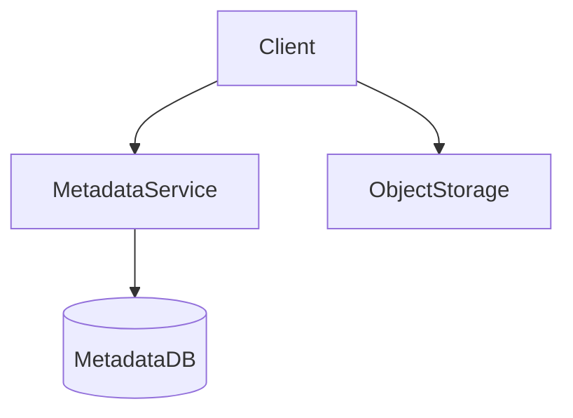

# D17-T010 — File storage / Google Drive

Topic ID: `D17-T010`

## B. Requirements, capacity, API, data

**FR:** Folders, upload/download, sharing, versioning. **NFR:** Resumable large files; durable objects; metadata p99 < 300 ms. **Capacity:** 50M users; multipart **32 MB** chunks; metadata **20k QPS**. **API:** `POST /v1/files/init`, part uploads, `GET download`, `POST /share`. **Data:** `nodes(id, parent_id, owner_id, type, object_key)`, `versions`, ACL.

## D. Architecture



## J. Bottlenecks / failures

Hot folders; large directory list; sync conflicts; orphan multipart uploads; leaked share links.

## K. Interview Preparation

### Beginner

#### Q1. Metadata vs blob?

**Answer:** Metadata DB holds tree, permissions, pointers. Bytes live in object store. Split keeps SQL small and throughput high for downloads.

#### Q2. Multipart why?

**Answer:** Resume failed uploads; parallelize; respect object size limits. Track etags per part.

#### Q3. Permissions model?

**Answer:** ACL on node or inherited; share links are tokens with expiry. Enforce on metadata service every read.

#### Q4. Sync vs backup?

**Answer:** Sync is bidirectional with conflict handling; backup is one-way snapshot.

#### Q5. Deduplication?

**Answer:** Per-user content hash saves space; cross-user dedup has privacy implications.

### Intermediate

#### Q1. Content-hash addressing?

**Answer:** Immutable blobs keyed by hash; metadata points to hash. Enables dedup and integrity.

#### Q2. Locking on edit?

**Answer:** Optional file locks for office integrations; timeouts prevent stuck locks.

#### Q3. Delta sync?

**Answer:** Roll checksums/block diff for large files; reduces bandwidth.

#### Q4. Trash retention?

**Answer:** Soft delete with TTL purge; legal hold exceptions.

#### Q5. Cross-region replication?

**Answer:** Replicate objects async; metadata primary region; RPO/RTO trade-offs.

### Advanced

#### Q1. Client-side encryption?

**Answer:** Server cannot dedup or search; key management on client.

#### Q2. Antivirus pipeline?

**Answer:** Scan on upload complete before share allowed.

#### Q3. Legal hold?

**Answer:** Block delete/purge for litigation.

#### Q4. Bandwidth throttling?

**Answer:** Per-user quotas; CDN for popular public files.

#### Q5. Namespace sharding?

**Answer:** Shard metadata by `owner_id` or top-level folder.

### Scenarios

#### Q1. 100 GB upload.

**Answer:** Multipart parallel; checkpoint; verify etags on complete.

#### Q2. Two-device edit conflict.

**Answer:** Version branches; user merge UI; no silent overwrite.

#### Q3. Share link indexed.

**Answer:** robots noindex; unlisted tokens; short TTL.

#### Q4. Region outage.

**Answer:** Failover read replica; writes paused or queued.

#### Q5. Storage billing shock.

**Answer:** Quotas; lifecycle to cold tier; dedup within tenant.

### Follow-ups

#### Q1. S3 API?

**Answer:** `D17-T011` object-key model vs file tree.

#### Q2. Video?

**Answer:** `D17-T012` segments.

#### Q3. Search in files?

**Answer:** Async indexing pipeline; OCR optional.

## L. Exercises

Solutions: `EXERCISES/solutions/D17-T010.md`. Multipart state machine; sync conflict; dedup scope.

## A, C, E–I, M–O

Drive = catalog + warehouse. Code: `print('chunk_mb', 32)`. Completion: multipart + ACL path.

## Supplement for missing section letters

## A. Topic Overview

File storage / Google Drive continues the design already written in this file. Topic ID: `D17-T010` **FR:** Folders, upload/download, sharing, versioning. **NFR:** Resumable large files; durable objects; metadata p99 < 300 ms. **Capacity:** 50M users; multipart **32 MB** chunks; metadata **20k QPS**. **API:** `POST /v1/files/init`, part uploads, `GET download`, `POST /share`. **Data:** `nodes(id, parent_id, owner_id, type, object_key)`, `versions`, ACL. ```mermaid flowchart TD client[Client] meta[MetadataService] blob[ObjectStorage] client --> meta client --> blob meta -->

For section A, keep the same capacity numbers and API as the requirements above. Do not invent a second architecture. The completion check is whether you can still draw the original diagram and name its bottleneck.

## C. Internal Working and Architecture

File storage / Google Drive continues the design already written in this file. Topic ID: `D17-T010` **FR:** Folders, upload/download, sharing, versioning. **NFR:** Resumable large files; durable objects; metadata p99 < 300 ms. **Capacity:** 50M users; multipart **32 MB** chunks; metadata **20k QPS**. **API:** `POST /v1/files/init`, part uploads, `GET download`, `POST /share`. **Data:** `nodes(id, parent_id, owner_id, type, object_key)`, `versions`, ACL. ```mermaid flowchart TD client[Client] meta[MetadataService] blob[ObjectStorage] client --> meta client --> blob meta -->

For section C, keep the same capacity numbers and API as the requirements above. Do not invent a second architecture. The completion check is whether you can still draw the original diagram and name its bottleneck.

## E. Examples and Analogies

File storage / Google Drive continues the design already written in this file. Topic ID: `D17-T010` **FR:** Folders, upload/download, sharing, versioning. **NFR:** Resumable large files; durable objects; metadata p99 < 300 ms. **Capacity:** 50M users; multipart **32 MB** chunks; metadata **20k QPS**. **API:** `POST /v1/files/init`, part uploads, `GET download`, `POST /share`. **Data:** `nodes(id, parent_id, owner_id, type, object_key)`, `versions`, ACL. ```mermaid flowchart TD client[Client] meta[MetadataService] blob[ObjectStorage] client --> meta client --> blob meta -->

For section E, keep the same capacity numbers and API as the requirements above. Do not invent a second architecture. The completion check is whether you can still draw the original diagram and name its bottleneck.

## F. Code Examples

```python
# unexecuted illustration for D17-T010
def explain():
    return 'File storage / Google Drive'
```

## G. Practical Backend Application

File storage / Google Drive continues the design already written in this file. Topic ID: `D17-T010` **FR:** Folders, upload/download, sharing, versioning. **NFR:** Resumable large files; durable objects; metadata p99 < 300 ms. **Capacity:** 50M users; multipart **32 MB** chunks; metadata **20k QPS**. **API:** `POST /v1/files/init`, part uploads, `GET download`, `POST /share`. **Data:** `nodes(id, parent_id, owner_id, type, object_key)`, `versions`, ACL. ```mermaid flowchart TD client[Client] meta[MetadataService] blob[ObjectStorage] client --> meta client --> blob meta -->

For section G, keep the same capacity numbers and API as the requirements above. Do not invent a second architecture. The completion check is whether you can still draw the original diagram and name its bottleneck.

## H. Advantages, Limitations and Trade-offs

| Choice | Benefit | Cost | Choose when | Avoid when |
| --- | --- | --- | --- | --- |
| File storage / Google Drive | Matches the requirements in this note | More components | The bottleneck in section J is real | A single node still meets the SLO |

## I. Common Mistakes and Misconceptions

File storage / Google Drive continues the design already written in this file. Topic ID: `D17-T010` **FR:** Folders, upload/download, sharing, versioning. **NFR:** Resumable large files; durable objects; metadata p99 < 300 ms. **Capacity:** 50M users; multipart **32 MB** chunks; metadata **20k QPS**. **API:** `POST /v1/files/init`, part uploads, `GET download`, `POST /share`. **Data:** `nodes(id, parent_id, owner_id, type, object_key)`, `versions`, ACL. ```mermaid flowchart TD client[Client] meta[MetadataService] blob[ObjectStorage] client --> meta client --> blob meta -->

For section I, keep the same capacity numbers and API as the requirements above. Do not invent a second architecture. The completion check is whether you can still draw the original diagram and name its bottleneck.

## M. Revision Notes

File storage / Google Drive continues the design already written in this file. Topic ID: `D17-T010` **FR:** Folders, upload/download, sharing, versioning. **NFR:** Resumable large files; durable objects; metadata p99 < 300 ms. **Capacity:** 50M users; multipart **32 MB** chunks; metadata **20k QPS**. **API:** `POST /v1/files/init`, part uploads, `GET download`, `POST /share`. **Data:** `nodes(id, parent_id, owner_id, type, object_key)`, `versions`, ACL. ```mermaid flowchart TD client[Client] meta[MetadataService] blob[ObjectStorage] client --> meta client --> blob meta -->

For section M, keep the same capacity numbers and API as the requirements above. Do not invent a second architecture. The completion check is whether you can still draw the original diagram and name its bottleneck.

## N. Related Topics

File storage / Google Drive continues the design already written in this file. Topic ID: `D17-T010` **FR:** Folders, upload/download, sharing, versioning. **NFR:** Resumable large files; durable objects; metadata p99 < 300 ms. **Capacity:** 50M users; multipart **32 MB** chunks; metadata **20k QPS**. **API:** `POST /v1/files/init`, part uploads, `GET download`, `POST /share`. **Data:** `nodes(id, parent_id, owner_id, type, object_key)`, `versions`, ACL. ```mermaid flowchart TD client[Client] meta[MetadataService] blob[ObjectStorage] client --> meta client --> blob meta -->

For section N, keep the same capacity numbers and API as the requirements above. Do not invent a second architecture. The completion check is whether you can still draw the original diagram and name its bottleneck.

## O. Completion Criteria

File storage / Google Drive continues the design already written in this file. Topic ID: `D17-T010` **FR:** Folders, upload/download, sharing, versioning. **NFR:** Resumable large files; durable objects; metadata p99 < 300 ms. **Capacity:** 50M users; multipart **32 MB** chunks; metadata **20k QPS**. **API:** `POST /v1/files/init`, part uploads, `GET download`, `POST /share`. **Data:** `nodes(id, parent_id, owner_id, type, object_key)`, `versions`, ACL. ```mermaid flowchart TD client[Client] meta[MetadataService] blob[ObjectStorage] client --> meta client --> blob meta -->

For section O, keep the same capacity numbers and API as the requirements above. Do not invent a second architecture. The completion check is whether you can still draw the original diagram and name its bottleneck.
