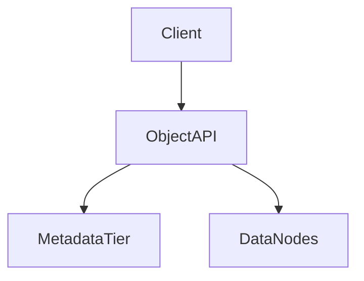

# D17-T011 — S3-style object storage

Topic ID: `D17-T011`

## A–B. Overview and requirements

**FR:** PUT/GET by key, buckets, multipart, versioning, lifecycle. **NFR:** 11-nines durability target; list after write consistency in region. **Capacity:** **1M PUT/s**, **10M GET/s**, **100 PB**; erasure coding across racks. **API:** `PUT/GET /{bucket}/{key}`, multipart, ListObjects. **Data:** bucket metadata; object metadata + data nodes.

## D. Architecture



## J. Bottlenecks / failures

Hot prefix shard; small object metadata overhead; list timeout; quorum loss; lifecycle mis-delete.

## K. Interview Preparation

### Beginner

#### Q1. Bucket vs object?

**Answer:** Bucket is namespace and policy boundary; object is key + bytes + metadata. Keys are flat, not true folders (prefix simulation only).

#### Q2. What is etag?

**Answer:** Hash fingerprint for integrity and conditional requests. Used in multipart combine.

#### Q3. Strong consistency?

**Answer:** S3 offers read-after-write consistency for new objects in modern regions; list may lag historically—state current semantics in interview.

#### Q4. Multipart?

**Answer:** Parallel upload parts; complete with etags; abort stale uploads.

#### Q5. Lifecycle?

**Answer:** Rules transition storage class or delete by age/prefix. Misrules cause data loss alerts.

### Intermediate

#### Q1. Erasure coding vs replica?

**Answer:** EC saves space vs 3x replication; repair bandwidth on failure. Choose per durability SLA.

#### Q2. Request routing?

**Answer:** Metadata service maps key to shards; data nodes serve bytes.

#### Q3. IAM evaluation?

**Answer:** Policy on bucket/key prefix; deny by default; audit public ACL mistakes.

#### Q4. Versioning costs?

**Answer:** Each overwrite retains version; lifecycle must expire old versions.

#### Q5. Cross-region replication lag?

**Answer:** Async CR; readers may see stale without failover rules.

### Advanced

#### Q1. S3 SELECT analog?

**Answer:** Pushdown compute near data for analytics; separate from hot path.

#### Q2. Inventory billing?

**Answer:** Async inventory reports for chargeback; large listings expensive.

#### Q3. Denial of wallet?

**Answer:** Rate limits; requester pays buckets; anomaly detection on egress.

#### Q4. Failure domains?

**Answer:** Rack/datacenter independence in placement groups.

#### Q5. Metadata cache coherency?

**Answer:** Invalidate on write; consistent hashing on metadata tier.

### Scenarios

#### Q1. One prefix 10k PUT/s.

**Answer:** Hash prefix salt in routing; spread shards.

#### Q2. Versioning storage explosion.

**Answer:** Lifecycle expire noncurrent versions; monitor bucket size metrics.

#### Q3. Public bucket IAM mistake.

**Answer:** Block public access account-wide; scanner CI.

#### Q4. Node dies mid-PUT.

**Answer:** Client retries new upload; garbage collect partials.

#### Q5. ListObjects timeout.

**Answer:** Pagination; inventory instead of full list; prefix design.

### Follow-ups

#### Q1. Drive metadata?

**Answer:** `D17-T010` tree atop object keys.

#### Q2. CDN origin?

**Answer:** Signed URLs; cache immutable segments.

#### Q3. Video segments?

**Answer:** `D17-T012` HLS objects.

## L. Exercises

Solutions: `EXERCISES/solutions/D17-T011.md`. Hash prefix; durability math; list consistency.

## C, E–I, M–O

Metadata tier separate from data plane; trade-off EC vs replica; completion: draw PUT path.

## Supplement for missing section letters

## A. Topic Overview

S3-style object storage continues the design already written in this file. Topic ID: `D17-T011` **FR:** PUT/GET by key, buckets, multipart, versioning, lifecycle. **NFR:** 11-nines durability target; list after write consistency in region. **Capacity:** **1M PUT/s**, **10M GET/s**, **100 PB**; erasure coding across racks. **API:** `PUT/GET /{bucket}/{key}`, multipart, ListObjects. **Data:** bucket metadata; object metadata + data nodes. ```mermaid flowchart TD client[Client] api[ObjectAPI] meta[MetadataTier] data[DataNodes] client --> api --> meta api --> data ``` Hot 

For section A, keep the same capacity numbers and API as the requirements above. Do not invent a second architecture. The completion check is whether you can still draw the original diagram and name its bottleneck.

## B. First-Principles Explanation

S3-style object storage continues the design already written in this file. Topic ID: `D17-T011` **FR:** PUT/GET by key, buckets, multipart, versioning, lifecycle. **NFR:** 11-nines durability target; list after write consistency in region. **Capacity:** **1M PUT/s**, **10M GET/s**, **100 PB**; erasure coding across racks. **API:** `PUT/GET /{bucket}/{key}`, multipart, ListObjects. **Data:** bucket metadata; object metadata + data nodes. ```mermaid flowchart TD client[Client] api[ObjectAPI] meta[MetadataTier] data[DataNodes] client --> api --> meta api --> data ``` Hot 

For section B, keep the same capacity numbers and API as the requirements above. Do not invent a second architecture. The completion check is whether you can still draw the original diagram and name its bottleneck.

## C. Internal Working and Architecture

S3-style object storage continues the design already written in this file. Topic ID: `D17-T011` **FR:** PUT/GET by key, buckets, multipart, versioning, lifecycle. **NFR:** 11-nines durability target; list after write consistency in region. **Capacity:** **1M PUT/s**, **10M GET/s**, **100 PB**; erasure coding across racks. **API:** `PUT/GET /{bucket}/{key}`, multipart, ListObjects. **Data:** bucket metadata; object metadata + data nodes. ```mermaid flowchart TD client[Client] api[ObjectAPI] meta[MetadataTier] data[DataNodes] client --> api --> meta api --> data ``` Hot 

For section C, keep the same capacity numbers and API as the requirements above. Do not invent a second architecture. The completion check is whether you can still draw the original diagram and name its bottleneck.

## E. Examples and Analogies

S3-style object storage continues the design already written in this file. Topic ID: `D17-T011` **FR:** PUT/GET by key, buckets, multipart, versioning, lifecycle. **NFR:** 11-nines durability target; list after write consistency in region. **Capacity:** **1M PUT/s**, **10M GET/s**, **100 PB**; erasure coding across racks. **API:** `PUT/GET /{bucket}/{key}`, multipart, ListObjects. **Data:** bucket metadata; object metadata + data nodes. ```mermaid flowchart TD client[Client] api[ObjectAPI] meta[MetadataTier] data[DataNodes] client --> api --> meta api --> data ``` Hot 

For section E, keep the same capacity numbers and API as the requirements above. Do not invent a second architecture. The completion check is whether you can still draw the original diagram and name its bottleneck.

## F. Code Examples

```python
# unexecuted illustration for D17-T011
def explain():
    return 'S3-style object storage'
```

## G. Practical Backend Application

S3-style object storage continues the design already written in this file. Topic ID: `D17-T011` **FR:** PUT/GET by key, buckets, multipart, versioning, lifecycle. **NFR:** 11-nines durability target; list after write consistency in region. **Capacity:** **1M PUT/s**, **10M GET/s**, **100 PB**; erasure coding across racks. **API:** `PUT/GET /{bucket}/{key}`, multipart, ListObjects. **Data:** bucket metadata; object metadata + data nodes. ```mermaid flowchart TD client[Client] api[ObjectAPI] meta[MetadataTier] data[DataNodes] client --> api --> meta api --> data ``` Hot 

For section G, keep the same capacity numbers and API as the requirements above. Do not invent a second architecture. The completion check is whether you can still draw the original diagram and name its bottleneck.

## H. Advantages, Limitations and Trade-offs

| Choice | Benefit | Cost | Choose when | Avoid when |
| --- | --- | --- | --- | --- |
| S3-style object storage | Matches the requirements in this note | More components | The bottleneck in section J is real | A single node still meets the SLO |

## I. Common Mistakes and Misconceptions

S3-style object storage continues the design already written in this file. Topic ID: `D17-T011` **FR:** PUT/GET by key, buckets, multipart, versioning, lifecycle. **NFR:** 11-nines durability target; list after write consistency in region. **Capacity:** **1M PUT/s**, **10M GET/s**, **100 PB**; erasure coding across racks. **API:** `PUT/GET /{bucket}/{key}`, multipart, ListObjects. **Data:** bucket metadata; object metadata + data nodes. ```mermaid flowchart TD client[Client] api[ObjectAPI] meta[MetadataTier] data[DataNodes] client --> api --> meta api --> data ``` Hot 

For section I, keep the same capacity numbers and API as the requirements above. Do not invent a second architecture. The completion check is whether you can still draw the original diagram and name its bottleneck.

## M. Revision Notes

S3-style object storage continues the design already written in this file. Topic ID: `D17-T011` **FR:** PUT/GET by key, buckets, multipart, versioning, lifecycle. **NFR:** 11-nines durability target; list after write consistency in region. **Capacity:** **1M PUT/s**, **10M GET/s**, **100 PB**; erasure coding across racks. **API:** `PUT/GET /{bucket}/{key}`, multipart, ListObjects. **Data:** bucket metadata; object metadata + data nodes. ```mermaid flowchart TD client[Client] api[ObjectAPI] meta[MetadataTier] data[DataNodes] client --> api --> meta api --> data ``` Hot 

For section M, keep the same capacity numbers and API as the requirements above. Do not invent a second architecture. The completion check is whether you can still draw the original diagram and name its bottleneck.

## N. Related Topics

S3-style object storage continues the design already written in this file. Topic ID: `D17-T011` **FR:** PUT/GET by key, buckets, multipart, versioning, lifecycle. **NFR:** 11-nines durability target; list after write consistency in region. **Capacity:** **1M PUT/s**, **10M GET/s**, **100 PB**; erasure coding across racks. **API:** `PUT/GET /{bucket}/{key}`, multipart, ListObjects. **Data:** bucket metadata; object metadata + data nodes. ```mermaid flowchart TD client[Client] api[ObjectAPI] meta[MetadataTier] data[DataNodes] client --> api --> meta api --> data ``` Hot 

For section N, keep the same capacity numbers and API as the requirements above. Do not invent a second architecture. The completion check is whether you can still draw the original diagram and name its bottleneck.

## O. Completion Criteria

S3-style object storage continues the design already written in this file. Topic ID: `D17-T011` **FR:** PUT/GET by key, buckets, multipart, versioning, lifecycle. **NFR:** 11-nines durability target; list after write consistency in region. **Capacity:** **1M PUT/s**, **10M GET/s**, **100 PB**; erasure coding across racks. **API:** `PUT/GET /{bucket}/{key}`, multipart, ListObjects. **Data:** bucket metadata; object metadata + data nodes. ```mermaid flowchart TD client[Client] api[ObjectAPI] meta[MetadataTier] data[DataNodes] client --> api --> meta api --> data ``` Hot 

For section O, keep the same capacity numbers and API as the requirements above. Do not invent a second architecture. The completion check is whether you can still draw the original diagram and name its bottleneck.
