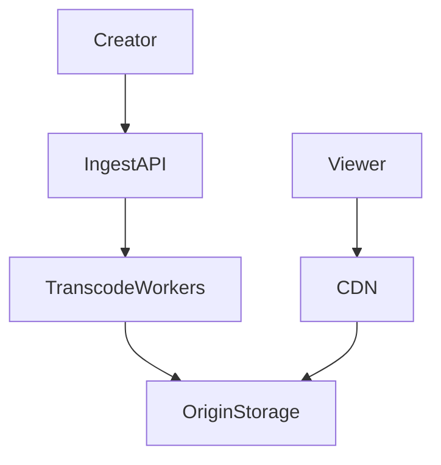

# D17-T012 — Video streaming platform

Topic ID: `D17-T012`

## B. Requirements, capacity, API, data

**FR:** VOD upload/transcode; adaptive playback; optional live. **NFR:** Startup < 2 s; low rebuffer. **Capacity:** **1M** concurrent × **5 Mbps** ≈ **5 Tbps** egress; 4s HLS segments. **API:** upload, `manifest.m3u8`, signed playback URLs. **Data:** `videos`, renditions, segments in object store.

## D. Architecture



## J. Bottlenecks / failures

Transcode backlog; origin without CDN; DRM license; stale manifest; live chunk loss.

## K. Interview Preparation

### Beginner

#### Q1. Adaptive bitrate?

**Answer:** Player switches renditions based on bandwidth. Multiple encodes per title. Improves QoE on variable networks.

#### Q2. CDN role?

**Answer:** Cache segments near viewers; shield origin. Most bytes served from edge.

#### Q3. Manifest file?

**Answer:** HLS/DASH playlists list segment URLs and bitrates. Master playlist points to variants.

#### Q4. Transcode why?

**Answer:** Normalize codecs/bitrates for devices. CPU/GPU farm async after upload.

#### Q5. Live vs VOD?

**Answer:** Live ingests short latency chunks; DVR optional. VOD pre-encoded complete.

### Intermediate

#### Q1. Per-title encoding?

**Answer:** Optimize bitrate ladder per content complexity.

#### Q2. Token auth on segments?

**Answer:** Short-lived signed URLs or cookies; balance overhead vs piracy.

#### Q3. Multi-CDN?

**Answer:** Failover and geo performance; consistent signing keys.

#### Q4. Thumbnails/sprites?

**Answer:** Generated in transcode job; stored alongside manifest.

#### Q5. QoE metrics?

**Answer:** Rebuffer ratio, startup time, bitrate switches.

### Advanced

#### Q1. P2P delivery?

**Answer:** Rare at scale due to ISP policies; CDN remains default.

#### Q2. LL-HLS?

**Answer:** Sub-second live latency with smaller parts; higher origin load.

#### Q3. Geo-blocking rights?

**Answer:** Edge geo rules; license windows per region.

#### Q4. Cost at 5 Tbps?

**Answer:** CDN commit pricing; peer private backbone; encoding cost separate.

#### Q5. Origin failover?

**Answer:** Secondary origin bucket; DNS/CDN origin group.

### Scenarios

#### Q1. Viral live 5× viewers.

**Answer:** CDN absorbs; scale encoders; reduce origin round trips.

#### Q2. Transcode stuck 10%.

**Answer:** Retry job; alert SLA; partial publish policy.

#### Q3. Rebuffer one ISP.

**Answer:** ISP peering issue; shift CDN POP; lower default bitrate.

#### Q4. Signed URL expired mid-play.

**Answer:** Refresh tokens during playback session.

#### Q5. Copyright takedown mid-stream.

**Answer:** Kill manifest propagation; revoke signed URLs.

### Follow-ups

#### Q1. Object storage?

**Answer:** Segments in `D17-T011`.

#### Q2. Search promos?

**Answer:** `D17-T013` autocomplete.

#### Q3. Bandwidth estimation?

**Answer:** Player ABR algorithm uses throughput and buffer.

## L. Exercises

Solutions: `EXERCISES/solutions/D17-T012.md`. HLS layout; live scale; segment auth.

## A, C, E–I, M–O

Ingest → transcode → origin → CDN. Code: `print('bitrate_mbps', 5)`. Completion: draw segment path.

## Supplement for missing section letters

## A. Topic Overview

Video streaming platform continues the design already written in this file. Topic ID: `D17-T012` **FR:** VOD upload/transcode; adaptive playback; optional live. **NFR:** Startup < 2 s; low rebuffer. **Capacity:** **1M** concurrent × **5 Mbps** ≈ **5 Tbps** egress; 4s HLS segments. **API:** upload, `manifest.m3u8`, signed playback URLs. **Data:** `videos`, renditions, segments in object store. ```mermaid flowchart TD creator[Creator] ingest[IngestAPI] transcode[TranscodeWorkers] origin[OriginStorage] cdn[CDN] viewer[Viewer] creator --> ingest --> transcode --> origin vie

For section A, keep the same capacity numbers and API as the requirements above. Do not invent a second architecture. The completion check is whether you can still draw the original diagram and name its bottleneck.

## C. Internal Working and Architecture

Video streaming platform continues the design already written in this file. Topic ID: `D17-T012` **FR:** VOD upload/transcode; adaptive playback; optional live. **NFR:** Startup < 2 s; low rebuffer. **Capacity:** **1M** concurrent × **5 Mbps** ≈ **5 Tbps** egress; 4s HLS segments. **API:** upload, `manifest.m3u8`, signed playback URLs. **Data:** `videos`, renditions, segments in object store. ```mermaid flowchart TD creator[Creator] ingest[IngestAPI] transcode[TranscodeWorkers] origin[OriginStorage] cdn[CDN] viewer[Viewer] creator --> ingest --> transcode --> origin vie

For section C, keep the same capacity numbers and API as the requirements above. Do not invent a second architecture. The completion check is whether you can still draw the original diagram and name its bottleneck.

## E. Examples and Analogies

Video streaming platform continues the design already written in this file. Topic ID: `D17-T012` **FR:** VOD upload/transcode; adaptive playback; optional live. **NFR:** Startup < 2 s; low rebuffer. **Capacity:** **1M** concurrent × **5 Mbps** ≈ **5 Tbps** egress; 4s HLS segments. **API:** upload, `manifest.m3u8`, signed playback URLs. **Data:** `videos`, renditions, segments in object store. ```mermaid flowchart TD creator[Creator] ingest[IngestAPI] transcode[TranscodeWorkers] origin[OriginStorage] cdn[CDN] viewer[Viewer] creator --> ingest --> transcode --> origin vie

For section E, keep the same capacity numbers and API as the requirements above. Do not invent a second architecture. The completion check is whether you can still draw the original diagram and name its bottleneck.

## F. Code Examples

```python
# unexecuted illustration for D17-T012
def explain():
    return 'Video streaming platform'
```

## G. Practical Backend Application

Video streaming platform continues the design already written in this file. Topic ID: `D17-T012` **FR:** VOD upload/transcode; adaptive playback; optional live. **NFR:** Startup < 2 s; low rebuffer. **Capacity:** **1M** concurrent × **5 Mbps** ≈ **5 Tbps** egress; 4s HLS segments. **API:** upload, `manifest.m3u8`, signed playback URLs. **Data:** `videos`, renditions, segments in object store. ```mermaid flowchart TD creator[Creator] ingest[IngestAPI] transcode[TranscodeWorkers] origin[OriginStorage] cdn[CDN] viewer[Viewer] creator --> ingest --> transcode --> origin vie

For section G, keep the same capacity numbers and API as the requirements above. Do not invent a second architecture. The completion check is whether you can still draw the original diagram and name its bottleneck.

## H. Advantages, Limitations and Trade-offs

| Choice | Benefit | Cost | Choose when | Avoid when |
| --- | --- | --- | --- | --- |
| Video streaming platform | Matches the requirements in this note | More components | The bottleneck in section J is real | A single node still meets the SLO |

## I. Common Mistakes and Misconceptions

Video streaming platform continues the design already written in this file. Topic ID: `D17-T012` **FR:** VOD upload/transcode; adaptive playback; optional live. **NFR:** Startup < 2 s; low rebuffer. **Capacity:** **1M** concurrent × **5 Mbps** ≈ **5 Tbps** egress; 4s HLS segments. **API:** upload, `manifest.m3u8`, signed playback URLs. **Data:** `videos`, renditions, segments in object store. ```mermaid flowchart TD creator[Creator] ingest[IngestAPI] transcode[TranscodeWorkers] origin[OriginStorage] cdn[CDN] viewer[Viewer] creator --> ingest --> transcode --> origin vie

For section I, keep the same capacity numbers and API as the requirements above. Do not invent a second architecture. The completion check is whether you can still draw the original diagram and name its bottleneck.

## M. Revision Notes

Video streaming platform continues the design already written in this file. Topic ID: `D17-T012` **FR:** VOD upload/transcode; adaptive playback; optional live. **NFR:** Startup < 2 s; low rebuffer. **Capacity:** **1M** concurrent × **5 Mbps** ≈ **5 Tbps** egress; 4s HLS segments. **API:** upload, `manifest.m3u8`, signed playback URLs. **Data:** `videos`, renditions, segments in object store. ```mermaid flowchart TD creator[Creator] ingest[IngestAPI] transcode[TranscodeWorkers] origin[OriginStorage] cdn[CDN] viewer[Viewer] creator --> ingest --> transcode --> origin vie

For section M, keep the same capacity numbers and API as the requirements above. Do not invent a second architecture. The completion check is whether you can still draw the original diagram and name its bottleneck.

## N. Related Topics

Video streaming platform continues the design already written in this file. Topic ID: `D17-T012` **FR:** VOD upload/transcode; adaptive playback; optional live. **NFR:** Startup < 2 s; low rebuffer. **Capacity:** **1M** concurrent × **5 Mbps** ≈ **5 Tbps** egress; 4s HLS segments. **API:** upload, `manifest.m3u8`, signed playback URLs. **Data:** `videos`, renditions, segments in object store. ```mermaid flowchart TD creator[Creator] ingest[IngestAPI] transcode[TranscodeWorkers] origin[OriginStorage] cdn[CDN] viewer[Viewer] creator --> ingest --> transcode --> origin vie

For section N, keep the same capacity numbers and API as the requirements above. Do not invent a second architecture. The completion check is whether you can still draw the original diagram and name its bottleneck.

## O. Completion Criteria

Video streaming platform continues the design already written in this file. Topic ID: `D17-T012` **FR:** VOD upload/transcode; adaptive playback; optional live. **NFR:** Startup < 2 s; low rebuffer. **Capacity:** **1M** concurrent × **5 Mbps** ≈ **5 Tbps** egress; 4s HLS segments. **API:** upload, `manifest.m3u8`, signed playback URLs. **Data:** `videos`, renditions, segments in object store. ```mermaid flowchart TD creator[Creator] ingest[IngestAPI] transcode[TranscodeWorkers] origin[OriginStorage] cdn[CDN] viewer[Viewer] creator --> ingest --> transcode --> origin vie

For section O, keep the same capacity numbers and API as the requirements above. Do not invent a second architecture. The completion check is whether you can still draw the original diagram and name its bottleneck.
