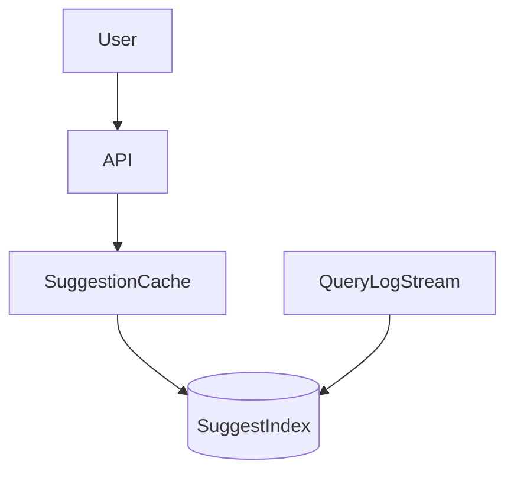

# D17-T013 — Search autocomplete

Topic ID: `D17-T013`

## B. Requirements, capacity, API, data

**FR:** Top-k suggestions as user types; optional personalization. **NFR:** p99 **< 50 ms**; fresh trends. **Capacity:** **100k RPS** suggest; **10M** prefixes; trie/ES completion. **API:** `GET /v1/suggest?q=&limit=`. **Data:** trie or completion index with `query, weight, locale`; log stream updates weights.

## D. Architecture



## J. Bottlenecks / failures

Hot prefix 'a'; index rebuild; offensive suggestions; stale trends; cache stampede.

## K. Interview Preparation

### Beginner

#### Q1. Trie vs hash for prefix?

**Answer:** Trie (or compressed trie) supports prefix traversal; hash needs secondary structure. Completion indexes optimize top-k per node.

#### Q2. Why top-k?

**Answer:** UI shows few suggestions; pre-rank offline to keep online path O(k).

#### Q3. Debounce client-side?

**Answer:** Reduces server QPS; still need server limits for bots.

#### Q4. Locale handling?

**Answer:** Separate indexes per locale; normalize unicode.

#### Q5. Ranking suggestions?

**Answer:** Weight by popularity, recency, personalization boost.

### Intermediate

#### Q1. Fuzzy match?

**Answer:** Edit distance costly online; use n-grams or offline expansions.

#### Q2. Blocklist?

**Answer:** Block phrases and continuations; human review loop.

#### Q3. Real-time trending?

**Answer:** Stream aggregations update weights; cap velocity to avoid poison.

#### Q4. Sharding trie?

**Answer:** Shard by first character or hash of prefix with routing.

#### Q5. Privacy in logs?

**Answer:** Hash queries; retention limits; GDPR delete.

### Advanced

#### Q1. ML ranking online?

**Answer:** Lightweight model on features; fallback to popularity.

#### Q2. Multi-tenant suggest?

**Answer:** Namespace per tenant in index keys.

#### Q3. Edge deployment?

**Answer:** Cache hot prefixes at CDN with short TTL.

#### Q4. A/B testing?

**Answer:** Experiment flags in ranker; measure CTR.

#### Q5. Zero-result handling?

**Answer:** Popular defaults; spelling correctors.

### Scenarios

#### Q1. Superbowl spike on team name.

**Answer:** Pre-warm cache; scale read replicas; rate limit.

#### Q2. Offensive term trends.

**Answer:** Velocity caps; blocklist; manual review queue.

#### Q3. Index 10 min behind.

**Answer:** Near-real-time pipeline; show stale watermark in admin.

#### Q4. p99 200 ms.

**Answer:** Cache miss storm; optimize trie depth; coalesce requests.

#### Q5. Cross-account personalization leak.

**Answer:** Never cache by shared key; include user id in cache key.

### Follow-ups

#### Q1. Web crawler?

**Answer:** `D17-T014` ingests corpus for suggestions.

#### Q2. News feed search?

**Answer:** Different index from autocomplete.

#### Q3. Rate limit typing bots?

**Answer:** `D17-T002` per IP/session.

## L. Exercises

Solutions: `EXERCISES/solutions/D17-T013.md`. Prefix top-k structure; block offensive; personalize safely.

## A, C, E–I, M–O

Log pipeline feeds index; analog: librarian whispers next words. Completion: 50 ms budget breakdown.

## Supplement for missing section letters

## A. Topic Overview

Search autocomplete continues the design already written in this file. Topic ID: `D17-T013` **FR:** Top-k suggestions as user types; optional personalization. **NFR:** p99 **< 50 ms**; fresh trends. **Capacity:** **100k RPS** suggest; **10M** prefixes; trie/ES completion. **API:** `GET /v1/suggest?q=&limit=`. **Data:** trie or completion index with `query, weight, locale`; log stream updates weights. ```mermaid flowchart TD user[User] edge[API] cache[SuggestionCache] index[(SuggestIndex)] logs[QueryLogStream] user --> edge --> cache --> index logs --> index ``` Hot

For section A, keep the same capacity numbers and API as the requirements above. Do not invent a second architecture. The completion check is whether you can still draw the original diagram and name its bottleneck.

## C. Internal Working and Architecture

Search autocomplete continues the design already written in this file. Topic ID: `D17-T013` **FR:** Top-k suggestions as user types; optional personalization. **NFR:** p99 **< 50 ms**; fresh trends. **Capacity:** **100k RPS** suggest; **10M** prefixes; trie/ES completion. **API:** `GET /v1/suggest?q=&limit=`. **Data:** trie or completion index with `query, weight, locale`; log stream updates weights. ```mermaid flowchart TD user[User] edge[API] cache[SuggestionCache] index[(SuggestIndex)] logs[QueryLogStream] user --> edge --> cache --> index logs --> index ``` Hot

For section C, keep the same capacity numbers and API as the requirements above. Do not invent a second architecture. The completion check is whether you can still draw the original diagram and name its bottleneck.

## E. Examples and Analogies

Search autocomplete continues the design already written in this file. Topic ID: `D17-T013` **FR:** Top-k suggestions as user types; optional personalization. **NFR:** p99 **< 50 ms**; fresh trends. **Capacity:** **100k RPS** suggest; **10M** prefixes; trie/ES completion. **API:** `GET /v1/suggest?q=&limit=`. **Data:** trie or completion index with `query, weight, locale`; log stream updates weights. ```mermaid flowchart TD user[User] edge[API] cache[SuggestionCache] index[(SuggestIndex)] logs[QueryLogStream] user --> edge --> cache --> index logs --> index ``` Hot

For section E, keep the same capacity numbers and API as the requirements above. Do not invent a second architecture. The completion check is whether you can still draw the original diagram and name its bottleneck.

## F. Code Examples

```python
# unexecuted illustration for D17-T013
def explain():
    return 'Search autocomplete'
```

## G. Practical Backend Application

Search autocomplete continues the design already written in this file. Topic ID: `D17-T013` **FR:** Top-k suggestions as user types; optional personalization. **NFR:** p99 **< 50 ms**; fresh trends. **Capacity:** **100k RPS** suggest; **10M** prefixes; trie/ES completion. **API:** `GET /v1/suggest?q=&limit=`. **Data:** trie or completion index with `query, weight, locale`; log stream updates weights. ```mermaid flowchart TD user[User] edge[API] cache[SuggestionCache] index[(SuggestIndex)] logs[QueryLogStream] user --> edge --> cache --> index logs --> index ``` Hot

For section G, keep the same capacity numbers and API as the requirements above. Do not invent a second architecture. The completion check is whether you can still draw the original diagram and name its bottleneck.

## H. Advantages, Limitations and Trade-offs

| Choice | Benefit | Cost | Choose when | Avoid when |
| --- | --- | --- | --- | --- |
| Search autocomplete | Matches the requirements in this note | More components | The bottleneck in section J is real | A single node still meets the SLO |

## I. Common Mistakes and Misconceptions

Search autocomplete continues the design already written in this file. Topic ID: `D17-T013` **FR:** Top-k suggestions as user types; optional personalization. **NFR:** p99 **< 50 ms**; fresh trends. **Capacity:** **100k RPS** suggest; **10M** prefixes; trie/ES completion. **API:** `GET /v1/suggest?q=&limit=`. **Data:** trie or completion index with `query, weight, locale`; log stream updates weights. ```mermaid flowchart TD user[User] edge[API] cache[SuggestionCache] index[(SuggestIndex)] logs[QueryLogStream] user --> edge --> cache --> index logs --> index ``` Hot

For section I, keep the same capacity numbers and API as the requirements above. Do not invent a second architecture. The completion check is whether you can still draw the original diagram and name its bottleneck.

## M. Revision Notes

Search autocomplete continues the design already written in this file. Topic ID: `D17-T013` **FR:** Top-k suggestions as user types; optional personalization. **NFR:** p99 **< 50 ms**; fresh trends. **Capacity:** **100k RPS** suggest; **10M** prefixes; trie/ES completion. **API:** `GET /v1/suggest?q=&limit=`. **Data:** trie or completion index with `query, weight, locale`; log stream updates weights. ```mermaid flowchart TD user[User] edge[API] cache[SuggestionCache] index[(SuggestIndex)] logs[QueryLogStream] user --> edge --> cache --> index logs --> index ``` Hot

For section M, keep the same capacity numbers and API as the requirements above. Do not invent a second architecture. The completion check is whether you can still draw the original diagram and name its bottleneck.

## N. Related Topics

Search autocomplete continues the design already written in this file. Topic ID: `D17-T013` **FR:** Top-k suggestions as user types; optional personalization. **NFR:** p99 **< 50 ms**; fresh trends. **Capacity:** **100k RPS** suggest; **10M** prefixes; trie/ES completion. **API:** `GET /v1/suggest?q=&limit=`. **Data:** trie or completion index with `query, weight, locale`; log stream updates weights. ```mermaid flowchart TD user[User] edge[API] cache[SuggestionCache] index[(SuggestIndex)] logs[QueryLogStream] user --> edge --> cache --> index logs --> index ``` Hot

For section N, keep the same capacity numbers and API as the requirements above. Do not invent a second architecture. The completion check is whether you can still draw the original diagram and name its bottleneck.

## O. Completion Criteria

Search autocomplete continues the design already written in this file. Topic ID: `D17-T013` **FR:** Top-k suggestions as user types; optional personalization. **NFR:** p99 **< 50 ms**; fresh trends. **Capacity:** **100k RPS** suggest; **10M** prefixes; trie/ES completion. **API:** `GET /v1/suggest?q=&limit=`. **Data:** trie or completion index with `query, weight, locale`; log stream updates weights. ```mermaid flowchart TD user[User] edge[API] cache[SuggestionCache] index[(SuggestIndex)] logs[QueryLogStream] user --> edge --> cache --> index logs --> index ``` Hot

For section O, keep the same capacity numbers and API as the requirements above. Do not invent a second architecture. The completion check is whether you can still draw the original diagram and name its bottleneck.
