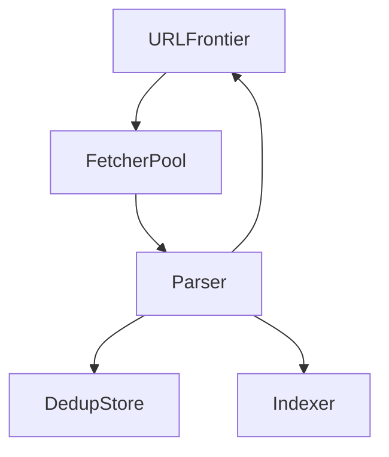

# D17-T014 — Web crawler

Topic ID: `D17-T014`

## B. Requirements, capacity, API, data

**FR:** Discover/fetch URLs; respect robots.txt; extract links; dedup. **NFR:** Politeness; billions of pages over time. **Capacity:** **10B** pages; **500 fetch QPS** avg; **50 KB**/page. **API:** internal `enqueue(url, priority)`. **Data:** `url_hash, status, last_fetch, content_hash`; per-host rate buckets; HTML blob store.

## D. Architecture



## J. Bottlenecks / failures

DNS; per-host rate limits; duplicate explosion; crawl traps; parser OOM on huge pages.

## K. Interview Preparation

### Beginner

#### Q1. What is frontier?

**Answer:** Priority queue of URLs to fetch. Schedules work fairly across hosts. Persists for restart recovery.

#### Q2. robots.txt?

**Answer:** Site policy for crawlers; legal/ethical compliance. Cache with TTL. Not authentication.

#### Q3. Politeness?

**Answer:** Token bucket per host; global max QPS. Avoid DDoS-ing sites.

#### Q4. Dedup how?

**Answer:** Canonical URL hash in dedup store; bloom filter first pass.

#### Q5. BFS vs DFS crawl?

**Answer:** BFS explores breadth; priority queue mixes PageRank/discovery depth. DFS deep traps risky.

### Intermediate

#### Q1. Priority by PageRank proxy?

**Answer:** Boost important seeds; recrawl high rank more often.

#### Q2. Canonical URL?

**Answer:** Normalize http/https, www, trailing slash, fragments.

#### Q3. JavaScript rendering?

**Answer:** Headless browser expensive; selective render queue.

#### Q4. Sitemap use?

**Answer:** Seed frontier with sitemap URLs for efficiency.

#### Q5. Per-IP blocking?

**Answer:** Rotate egress responsibly; respect blocks; backoff.

### Advanced

#### Q1. Distributed URL locking?

**Answer:** Lease URL to worker; timeout reclaim.

#### Q2. Freshness recrawl?

**Answer:** Priority by change rate and rank.

#### Q3. Geo fetchers?

**Answer:** Fetch near content for locale; respect data laws.

#### Q4. Simhash near-dup?

**Answer:** Detect similar pages to save storage.

#### Q5. GDPR compliance?

**Answer:** Robots and deletion requests; avoid PII in logs.

### Scenarios

#### Q1. Site blocks IP.

**Answer:** Slow down; contact owner; use alternate polite pool if allowed.

#### Q2. Infinite query params trap.

**Answer:** URL pattern rules; max depth; param normalization.

#### Q3. www vs non-www duplicate.

**Answer:** Canonicalization rules.

#### Q4. 50 MB page OOM.

**Answer:** Size cap; stream parse; abort.

#### Q5. Index poisoned spam.

**Answer:** Quality filters; manual review; rank demotion.

### Follow-ups

#### Q1. Autocomplete ingest?

**Answer:** `D17-T013` query logs.

#### Q2. E-commerce catalog?

**Answer:** `D17-T015` structured products.

#### Q3. CDN mistakes?

**Answer:** Do not crawl infinite CDN variants.

## L. Exercises

Solutions: `EXERCISES/solutions/D17-T014.md`. Per-host limiter; calendar trap; recrawl policy.

## A, C, E–I, M–O

Fair scheduler + dedup; polite tourist analogy. Completion: frontier design.

## Supplement for missing section letters

## A. Topic Overview

Web crawler continues the design already written in this file. Topic ID: `D17-T014` **FR:** Discover/fetch URLs; respect robots.txt; extract links; dedup. **NFR:** Politeness; billions of pages over time. **Capacity:** **10B** pages; **500 fetch QPS** avg; **50 KB**/page. **API:** internal `enqueue(url, priority)`. **Data:** `url_hash, status, last_fetch, content_hash`; per-host rate buckets; HTML blob store. ```mermaid flowchart TD frontier[URLFrontier] fetcher[FetcherPool] parser[Parser] dedup[DedupStore] index[Indexer] frontier --> fetcher --> parser par

For section A, keep the same capacity numbers and API as the requirements above. Do not invent a second architecture. The completion check is whether you can still draw the original diagram and name its bottleneck.

## C. Internal Working and Architecture

Web crawler continues the design already written in this file. Topic ID: `D17-T014` **FR:** Discover/fetch URLs; respect robots.txt; extract links; dedup. **NFR:** Politeness; billions of pages over time. **Capacity:** **10B** pages; **500 fetch QPS** avg; **50 KB**/page. **API:** internal `enqueue(url, priority)`. **Data:** `url_hash, status, last_fetch, content_hash`; per-host rate buckets; HTML blob store. ```mermaid flowchart TD frontier[URLFrontier] fetcher[FetcherPool] parser[Parser] dedup[DedupStore] index[Indexer] frontier --> fetcher --> parser par

For section C, keep the same capacity numbers and API as the requirements above. Do not invent a second architecture. The completion check is whether you can still draw the original diagram and name its bottleneck.

## E. Examples and Analogies

Web crawler continues the design already written in this file. Topic ID: `D17-T014` **FR:** Discover/fetch URLs; respect robots.txt; extract links; dedup. **NFR:** Politeness; billions of pages over time. **Capacity:** **10B** pages; **500 fetch QPS** avg; **50 KB**/page. **API:** internal `enqueue(url, priority)`. **Data:** `url_hash, status, last_fetch, content_hash`; per-host rate buckets; HTML blob store. ```mermaid flowchart TD frontier[URLFrontier] fetcher[FetcherPool] parser[Parser] dedup[DedupStore] index[Indexer] frontier --> fetcher --> parser par

For section E, keep the same capacity numbers and API as the requirements above. Do not invent a second architecture. The completion check is whether you can still draw the original diagram and name its bottleneck.

## F. Code Examples

```python
# unexecuted illustration for D17-T014
def explain():
    return 'Web crawler'
```

## G. Practical Backend Application

Web crawler continues the design already written in this file. Topic ID: `D17-T014` **FR:** Discover/fetch URLs; respect robots.txt; extract links; dedup. **NFR:** Politeness; billions of pages over time. **Capacity:** **10B** pages; **500 fetch QPS** avg; **50 KB**/page. **API:** internal `enqueue(url, priority)`. **Data:** `url_hash, status, last_fetch, content_hash`; per-host rate buckets; HTML blob store. ```mermaid flowchart TD frontier[URLFrontier] fetcher[FetcherPool] parser[Parser] dedup[DedupStore] index[Indexer] frontier --> fetcher --> parser par

For section G, keep the same capacity numbers and API as the requirements above. Do not invent a second architecture. The completion check is whether you can still draw the original diagram and name its bottleneck.

## H. Advantages, Limitations and Trade-offs

| Choice | Benefit | Cost | Choose when | Avoid when |
| --- | --- | --- | --- | --- |
| Web crawler | Matches the requirements in this note | More components | The bottleneck in section J is real | A single node still meets the SLO |

## I. Common Mistakes and Misconceptions

Web crawler continues the design already written in this file. Topic ID: `D17-T014` **FR:** Discover/fetch URLs; respect robots.txt; extract links; dedup. **NFR:** Politeness; billions of pages over time. **Capacity:** **10B** pages; **500 fetch QPS** avg; **50 KB**/page. **API:** internal `enqueue(url, priority)`. **Data:** `url_hash, status, last_fetch, content_hash`; per-host rate buckets; HTML blob store. ```mermaid flowchart TD frontier[URLFrontier] fetcher[FetcherPool] parser[Parser] dedup[DedupStore] index[Indexer] frontier --> fetcher --> parser par

For section I, keep the same capacity numbers and API as the requirements above. Do not invent a second architecture. The completion check is whether you can still draw the original diagram and name its bottleneck.

## M. Revision Notes

Web crawler continues the design already written in this file. Topic ID: `D17-T014` **FR:** Discover/fetch URLs; respect robots.txt; extract links; dedup. **NFR:** Politeness; billions of pages over time. **Capacity:** **10B** pages; **500 fetch QPS** avg; **50 KB**/page. **API:** internal `enqueue(url, priority)`. **Data:** `url_hash, status, last_fetch, content_hash`; per-host rate buckets; HTML blob store. ```mermaid flowchart TD frontier[URLFrontier] fetcher[FetcherPool] parser[Parser] dedup[DedupStore] index[Indexer] frontier --> fetcher --> parser par

For section M, keep the same capacity numbers and API as the requirements above. Do not invent a second architecture. The completion check is whether you can still draw the original diagram and name its bottleneck.

## N. Related Topics

Web crawler continues the design already written in this file. Topic ID: `D17-T014` **FR:** Discover/fetch URLs; respect robots.txt; extract links; dedup. **NFR:** Politeness; billions of pages over time. **Capacity:** **10B** pages; **500 fetch QPS** avg; **50 KB**/page. **API:** internal `enqueue(url, priority)`. **Data:** `url_hash, status, last_fetch, content_hash`; per-host rate buckets; HTML blob store. ```mermaid flowchart TD frontier[URLFrontier] fetcher[FetcherPool] parser[Parser] dedup[DedupStore] index[Indexer] frontier --> fetcher --> parser par

For section N, keep the same capacity numbers and API as the requirements above. Do not invent a second architecture. The completion check is whether you can still draw the original diagram and name its bottleneck.

## O. Completion Criteria

Web crawler continues the design already written in this file. Topic ID: `D17-T014` **FR:** Discover/fetch URLs; respect robots.txt; extract links; dedup. **NFR:** Politeness; billions of pages over time. **Capacity:** **10B** pages; **500 fetch QPS** avg; **50 KB**/page. **API:** internal `enqueue(url, priority)`. **Data:** `url_hash, status, last_fetch, content_hash`; per-host rate buckets; HTML blob store. ```mermaid flowchart TD frontier[URLFrontier] fetcher[FetcherPool] parser[Parser] dedup[DedupStore] index[Indexer] frontier --> fetcher --> parser par

For section O, keep the same capacity numbers and API as the requirements above. Do not invent a second architecture. The completion check is whether you can still draw the original diagram and name its bottleneck.
