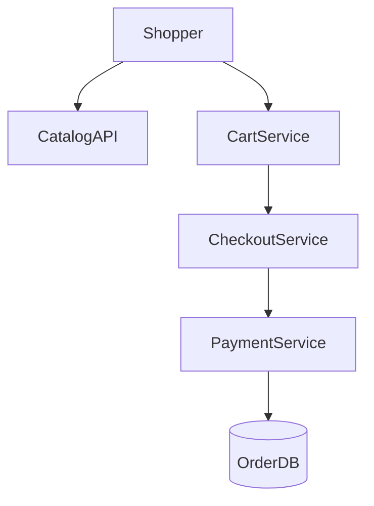

# D17-T015 — E-commerce platform

Topic ID: `D17-T015`

## B. Requirements, capacity, API, data

**FR:** Catalog, cart, checkout, orders, search/reviews. **NFR:** Browse p99 < 300 ms; checkout consistent; **10×** holiday peak. **Capacity:** **50k checkout attempts/s** peak; **1M SKU**; **100k browse RPS**. **API:** products, cart, checkout, orders. **Data:** `products`, `inventory`, `carts`, `orders`, `order_items`; search index.

## D. Architecture



## J. Bottlenecks / failures

Oversell; search lag; cart abandonment; price change mid-checkout; coupon races.

## K. Interview Preparation

### Beginner

#### Q1. Cart storage?

**Answer:** Redis or DB keyed by user/session; TTL for guests. Merge on login.

#### Q2. Inventory check when?

**Answer:** Reserve at checkout start; commit on payment success (`D17-T017`).

#### Q3. Idempotent checkout?

**Answer:** Idempotency key on `POST /checkout` prevents double orders on retry.

#### Q4. Catalog CDN?

**Answer:** Cache product pages/images; not personalized prices.

#### Q5. Session vs user cart?

**Answer:** Bind cart to account when authenticated; migrate session cart.

### Intermediate

#### Q1. Saga for checkout?

**Answer:** Reserve inventory → authorize payment → create order → capture; compensate on failure.

#### Q2. Flash sale queue?

**Answer:** Virtual waiting room or lottery; atomic inventory decr.

#### Q3. Product variants?

**Answer:** SKU per variant; inventory per SKU row.

#### Q4. Tax/shipping quotes?

**Answer:** External services with timeout; cache quotes briefly.

#### Q5. Review spam?

**Answer:** Verified purchase flag; rate limits; moderation.

### Advanced

#### Q1. Multi-currency?

**Answer:** Presentment vs settlement currency; FX at capture time.

#### Q2. Marketplace payouts?

**Answer:** Split payments; ledger per seller; delayed payout.

#### Q3. Personalization?

**Answer:** Recommendations async; do not block checkout path.

#### Q4. Fraud scoring?

**Answer:** Pre-auth scoring service; step-up 3DS.

#### Q5. Stale replica price?

**Answer:** Read primary for checkout price or version check.

### Scenarios

#### Q1. Black Friday checkout errors.

**Answer:** Scale checkout/payment; queue users; degrade recommendations.

#### Q2. Oversold last item.

**Answer:** Reservation failure returns clear error; waitlist optional.

#### Q3. Price bug $1 TVs.

**Answer:** Kill switch; manual review; honor policy decision.

#### Q4. Payment timeout fear.

**Answer:** Idempotent payment; show pending state; webhook completes.

#### Q5. Search shows OOS.

**Answer:** Index lag; hide OOS in search pipeline.

### Follow-ups

#### Q1. Order management?

**Answer:** `D17-T016` lifecycle after checkout.

#### Q2. Inventory?

**Answer:** `D17-T017` reserve/commit.

#### Q3. Payments?

**Answer:** `D17-T018` auth/capture.

## L. Exercises

Solutions: `EXERCISES/solutions/D17-T015.md`. Checkout saga; flash sale; CDN price caching.

## A, C, E–I, M–O

Mall + cashier analogy; peak checkout math. Completion: saga diagram.

## Supplement for missing section letters

## A. Topic Overview

E-commerce platform continues the design already written in this file. Topic ID: `D17-T015` **FR:** Catalog, cart, checkout, orders, search/reviews. **NFR:** Browse p99 < 300 ms; checkout consistent; **10×** holiday peak. **Capacity:** **50k checkout attempts/s** peak; **1M SKU**; **100k browse RPS**. **API:** products, cart, checkout, orders. **Data:** `products`, `inventory`, `carts`, `orders`, `order_items`; search index. ```mermaid flowchart TD user[Shopper] browse[CatalogAPI] cart[CartService] checkout[CheckoutService] pay[PaymentService] db[(OrderDB)] user --

For section A, keep the same capacity numbers and API as the requirements above. Do not invent a second architecture. The completion check is whether you can still draw the original diagram and name its bottleneck.

## C. Internal Working and Architecture

E-commerce platform continues the design already written in this file. Topic ID: `D17-T015` **FR:** Catalog, cart, checkout, orders, search/reviews. **NFR:** Browse p99 < 300 ms; checkout consistent; **10×** holiday peak. **Capacity:** **50k checkout attempts/s** peak; **1M SKU**; **100k browse RPS**. **API:** products, cart, checkout, orders. **Data:** `products`, `inventory`, `carts`, `orders`, `order_items`; search index. ```mermaid flowchart TD user[Shopper] browse[CatalogAPI] cart[CartService] checkout[CheckoutService] pay[PaymentService] db[(OrderDB)] user --

For section C, keep the same capacity numbers and API as the requirements above. Do not invent a second architecture. The completion check is whether you can still draw the original diagram and name its bottleneck.

## E. Examples and Analogies

E-commerce platform continues the design already written in this file. Topic ID: `D17-T015` **FR:** Catalog, cart, checkout, orders, search/reviews. **NFR:** Browse p99 < 300 ms; checkout consistent; **10×** holiday peak. **Capacity:** **50k checkout attempts/s** peak; **1M SKU**; **100k browse RPS**. **API:** products, cart, checkout, orders. **Data:** `products`, `inventory`, `carts`, `orders`, `order_items`; search index. ```mermaid flowchart TD user[Shopper] browse[CatalogAPI] cart[CartService] checkout[CheckoutService] pay[PaymentService] db[(OrderDB)] user --

For section E, keep the same capacity numbers and API as the requirements above. Do not invent a second architecture. The completion check is whether you can still draw the original diagram and name its bottleneck.

## F. Code Examples

```python
# unexecuted illustration for D17-T015
def explain():
    return 'E-commerce platform'
```

## G. Practical Backend Application

E-commerce platform continues the design already written in this file. Topic ID: `D17-T015` **FR:** Catalog, cart, checkout, orders, search/reviews. **NFR:** Browse p99 < 300 ms; checkout consistent; **10×** holiday peak. **Capacity:** **50k checkout attempts/s** peak; **1M SKU**; **100k browse RPS**. **API:** products, cart, checkout, orders. **Data:** `products`, `inventory`, `carts`, `orders`, `order_items`; search index. ```mermaid flowchart TD user[Shopper] browse[CatalogAPI] cart[CartService] checkout[CheckoutService] pay[PaymentService] db[(OrderDB)] user --

For section G, keep the same capacity numbers and API as the requirements above. Do not invent a second architecture. The completion check is whether you can still draw the original diagram and name its bottleneck.

## H. Advantages, Limitations and Trade-offs

| Choice | Benefit | Cost | Choose when | Avoid when |
| --- | --- | --- | --- | --- |
| E-commerce platform | Matches the requirements in this note | More components | The bottleneck in section J is real | A single node still meets the SLO |

## I. Common Mistakes and Misconceptions

E-commerce platform continues the design already written in this file. Topic ID: `D17-T015` **FR:** Catalog, cart, checkout, orders, search/reviews. **NFR:** Browse p99 < 300 ms; checkout consistent; **10×** holiday peak. **Capacity:** **50k checkout attempts/s** peak; **1M SKU**; **100k browse RPS**. **API:** products, cart, checkout, orders. **Data:** `products`, `inventory`, `carts`, `orders`, `order_items`; search index. ```mermaid flowchart TD user[Shopper] browse[CatalogAPI] cart[CartService] checkout[CheckoutService] pay[PaymentService] db[(OrderDB)] user --

For section I, keep the same capacity numbers and API as the requirements above. Do not invent a second architecture. The completion check is whether you can still draw the original diagram and name its bottleneck.

## M. Revision Notes

E-commerce platform continues the design already written in this file. Topic ID: `D17-T015` **FR:** Catalog, cart, checkout, orders, search/reviews. **NFR:** Browse p99 < 300 ms; checkout consistent; **10×** holiday peak. **Capacity:** **50k checkout attempts/s** peak; **1M SKU**; **100k browse RPS**. **API:** products, cart, checkout, orders. **Data:** `products`, `inventory`, `carts`, `orders`, `order_items`; search index. ```mermaid flowchart TD user[Shopper] browse[CatalogAPI] cart[CartService] checkout[CheckoutService] pay[PaymentService] db[(OrderDB)] user --

For section M, keep the same capacity numbers and API as the requirements above. Do not invent a second architecture. The completion check is whether you can still draw the original diagram and name its bottleneck.

## N. Related Topics

E-commerce platform continues the design already written in this file. Topic ID: `D17-T015` **FR:** Catalog, cart, checkout, orders, search/reviews. **NFR:** Browse p99 < 300 ms; checkout consistent; **10×** holiday peak. **Capacity:** **50k checkout attempts/s** peak; **1M SKU**; **100k browse RPS**. **API:** products, cart, checkout, orders. **Data:** `products`, `inventory`, `carts`, `orders`, `order_items`; search index. ```mermaid flowchart TD user[Shopper] browse[CatalogAPI] cart[CartService] checkout[CheckoutService] pay[PaymentService] db[(OrderDB)] user --

For section N, keep the same capacity numbers and API as the requirements above. Do not invent a second architecture. The completion check is whether you can still draw the original diagram and name its bottleneck.

## O. Completion Criteria

E-commerce platform continues the design already written in this file. Topic ID: `D17-T015` **FR:** Catalog, cart, checkout, orders, search/reviews. **NFR:** Browse p99 < 300 ms; checkout consistent; **10×** holiday peak. **Capacity:** **50k checkout attempts/s** peak; **1M SKU**; **100k browse RPS**. **API:** products, cart, checkout, orders. **Data:** `products`, `inventory`, `carts`, `orders`, `order_items`; search index. ```mermaid flowchart TD user[Shopper] browse[CatalogAPI] cart[CartService] checkout[CheckoutService] pay[PaymentService] db[(OrderDB)] user --

For section O, keep the same capacity numbers and API as the requirements above. Do not invent a second architecture. The completion check is whether you can still draw the original diagram and name its bottleneck.
