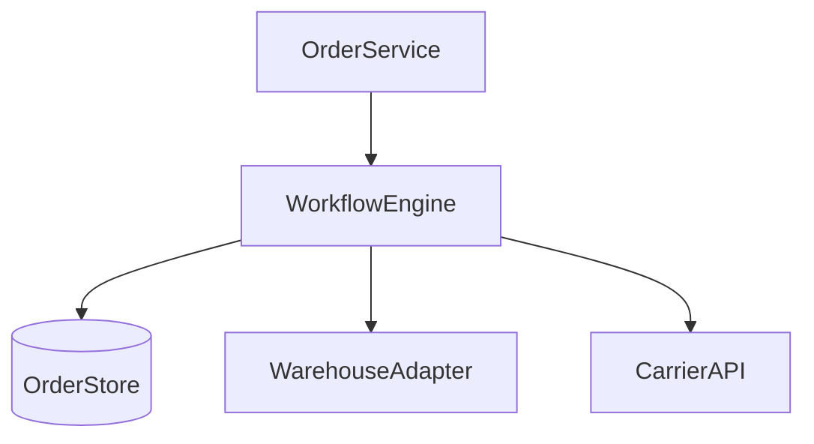

# D17-T016 — Amazon-like order management

Topic ID: `D17-T016`

## B. Requirements, capacity, API, data

**FR:** Order lifecycle placed→paid→shipped→delivered; returns; carrier tracking. **NFR:** Auditable transitions; partial shipments. **Capacity:** **200k orders/day**, **1k/s** peak creates; **5×** workflow events. **API:** `GET order`, `POST cancel`, warehouse webhooks. **Data:** `orders(status, version)`, `order_events`, `shipments`.

## D. Architecture



## J. Bottlenecks / failures

Workflow throughput; out-of-order warehouse events; double ship on retry; stuck PAID.

## K. Interview Preparation

### Beginner

#### Q1. State machine why?

**Answer:** Enforces legal transitions; prevents ship-after-cancel. Clear CS tooling.

#### Q2. Idempotent webhooks?

**Answer:** Event id unique; ignore duplicates; still ACK provider.

#### Q3. Partial ship?

**Answer:** Split order lines across shipments; multiple tracking ids.

#### Q4. Cancel rules?

**Answer:** Only before pick/pack; fees may apply after ship.

#### Q5. Audit trail?

**Answer:** Append-only `order_events` for disputes.

### Intermediate

#### Q1. Saga vs workflow engine?

**Answer:** Engine gives visibility/retries; saga pattern in code for simpler cases.

#### Q2. Optimistic locking?

**Answer:** `version` column on update; reject stale transitions.

#### Q3. Split order lines?

**Answer:** Fulfillment plans per warehouse optimization.

#### Q4. Backorder?

**Answer:** State BACKORDERED; notify customer; split shipment later.

#### Q5. CS manual fix?

**Answer:** Admin API with audit; break-glass roles.

### Advanced

#### Q1. Multi-warehouse routing?

**Answer:** Optimize ship cost/time; reserve nearest stock.

#### Q2. Global order IDs?

**Answer:** Snowflake ids; unique across regions.

#### Q3. Compliance invoices?

**Answer:** Immutable PDF generation on ship; tax details.

#### Q4. Replay events?

**Answer:** Rebuild state from event log for bug recovery.

#### Q5. Exactly-once ship signal?

**Answer:** Idempotent ship handler; outbox to carrier.

### Scenarios

#### Q1. Duplicate shipped webhook.

**Answer:** Idempotency on event id; metrics on dup rate.

#### Q2. Cancel after label printed.

**Answer:** Intercept at warehouse; return flow; fee policy.

#### Q3. Carrier API down.

**Answer:** Queue labels; retry; do not double purchase label without idempotency.

#### Q4. Split shipment confusion.

**Answer:** Customer comms per shipment; UI shows line mapping.

#### Q5. Inventory mismatch on pick.

**Answer:** Exception state; partial cancel; adjust reservation.

### Follow-ups

#### Q1. Inventory reservation?

**Answer:** `D17-T017` ties commit to payment/ship.

#### Q2. Payment capture timing?

**Answer:** `D17-T018` auth on order, capture on ship optional.

#### Q3. Notifications?

**Answer:** `D17-T004` on ship/deliver.

## L. Exercises

Solutions: `EXERCISES/solutions/D17-T016.md`. State diagram; duplicate webhook; capture timing.

## A, C, E–I, M–O

Package tracker analogy; event sourcing option. Completion: state machine whiteboard.

## Supplement for missing section letters

## A. Topic Overview

Amazon-like order management continues the design already written in this file. Topic ID: `D17-T016` **FR:** Order lifecycle placed→paid→shipped→delivered; returns; carrier tracking. **NFR:** Auditable transitions; partial shipments. **Capacity:** **200k orders/day**, **1k/s** peak creates; **5×** workflow events. **API:** `GET order`, `POST cancel`, warehouse webhooks. **Data:** `orders(status, version)`, `order_events`, `shipments`. ```mermaid flowchart TD oms[OrderService] wf[WorkflowEngine] wh[WarehouseAdapter] carrier[CarrierAPI] db[(OrderStore)] oms --> wf --> db wf -

For section A, keep the same capacity numbers and API as the requirements above. Do not invent a second architecture. The completion check is whether you can still draw the original diagram and name its bottleneck.

## C. Internal Working and Architecture

Amazon-like order management continues the design already written in this file. Topic ID: `D17-T016` **FR:** Order lifecycle placed→paid→shipped→delivered; returns; carrier tracking. **NFR:** Auditable transitions; partial shipments. **Capacity:** **200k orders/day**, **1k/s** peak creates; **5×** workflow events. **API:** `GET order`, `POST cancel`, warehouse webhooks. **Data:** `orders(status, version)`, `order_events`, `shipments`. ```mermaid flowchart TD oms[OrderService] wf[WorkflowEngine] wh[WarehouseAdapter] carrier[CarrierAPI] db[(OrderStore)] oms --> wf --> db wf -

For section C, keep the same capacity numbers and API as the requirements above. Do not invent a second architecture. The completion check is whether you can still draw the original diagram and name its bottleneck.

## E. Examples and Analogies

Amazon-like order management continues the design already written in this file. Topic ID: `D17-T016` **FR:** Order lifecycle placed→paid→shipped→delivered; returns; carrier tracking. **NFR:** Auditable transitions; partial shipments. **Capacity:** **200k orders/day**, **1k/s** peak creates; **5×** workflow events. **API:** `GET order`, `POST cancel`, warehouse webhooks. **Data:** `orders(status, version)`, `order_events`, `shipments`. ```mermaid flowchart TD oms[OrderService] wf[WorkflowEngine] wh[WarehouseAdapter] carrier[CarrierAPI] db[(OrderStore)] oms --> wf --> db wf -

For section E, keep the same capacity numbers and API as the requirements above. Do not invent a second architecture. The completion check is whether you can still draw the original diagram and name its bottleneck.

## F. Code Examples

```python
# unexecuted illustration for D17-T016
def explain():
    return 'Amazon-like order management'
```

## G. Practical Backend Application

Amazon-like order management continues the design already written in this file. Topic ID: `D17-T016` **FR:** Order lifecycle placed→paid→shipped→delivered; returns; carrier tracking. **NFR:** Auditable transitions; partial shipments. **Capacity:** **200k orders/day**, **1k/s** peak creates; **5×** workflow events. **API:** `GET order`, `POST cancel`, warehouse webhooks. **Data:** `orders(status, version)`, `order_events`, `shipments`. ```mermaid flowchart TD oms[OrderService] wf[WorkflowEngine] wh[WarehouseAdapter] carrier[CarrierAPI] db[(OrderStore)] oms --> wf --> db wf -

For section G, keep the same capacity numbers and API as the requirements above. Do not invent a second architecture. The completion check is whether you can still draw the original diagram and name its bottleneck.

## H. Advantages, Limitations and Trade-offs

| Choice | Benefit | Cost | Choose when | Avoid when |
| --- | --- | --- | --- | --- |
| Amazon-like order management | Matches the requirements in this note | More components | The bottleneck in section J is real | A single node still meets the SLO |

## I. Common Mistakes and Misconceptions

Amazon-like order management continues the design already written in this file. Topic ID: `D17-T016` **FR:** Order lifecycle placed→paid→shipped→delivered; returns; carrier tracking. **NFR:** Auditable transitions; partial shipments. **Capacity:** **200k orders/day**, **1k/s** peak creates; **5×** workflow events. **API:** `GET order`, `POST cancel`, warehouse webhooks. **Data:** `orders(status, version)`, `order_events`, `shipments`. ```mermaid flowchart TD oms[OrderService] wf[WorkflowEngine] wh[WarehouseAdapter] carrier[CarrierAPI] db[(OrderStore)] oms --> wf --> db wf -

For section I, keep the same capacity numbers and API as the requirements above. Do not invent a second architecture. The completion check is whether you can still draw the original diagram and name its bottleneck.

## M. Revision Notes

Amazon-like order management continues the design already written in this file. Topic ID: `D17-T016` **FR:** Order lifecycle placed→paid→shipped→delivered; returns; carrier tracking. **NFR:** Auditable transitions; partial shipments. **Capacity:** **200k orders/day**, **1k/s** peak creates; **5×** workflow events. **API:** `GET order`, `POST cancel`, warehouse webhooks. **Data:** `orders(status, version)`, `order_events`, `shipments`. ```mermaid flowchart TD oms[OrderService] wf[WorkflowEngine] wh[WarehouseAdapter] carrier[CarrierAPI] db[(OrderStore)] oms --> wf --> db wf -

For section M, keep the same capacity numbers and API as the requirements above. Do not invent a second architecture. The completion check is whether you can still draw the original diagram and name its bottleneck.

## N. Related Topics

Amazon-like order management continues the design already written in this file. Topic ID: `D17-T016` **FR:** Order lifecycle placed→paid→shipped→delivered; returns; carrier tracking. **NFR:** Auditable transitions; partial shipments. **Capacity:** **200k orders/day**, **1k/s** peak creates; **5×** workflow events. **API:** `GET order`, `POST cancel`, warehouse webhooks. **Data:** `orders(status, version)`, `order_events`, `shipments`. ```mermaid flowchart TD oms[OrderService] wf[WorkflowEngine] wh[WarehouseAdapter] carrier[CarrierAPI] db[(OrderStore)] oms --> wf --> db wf -

For section N, keep the same capacity numbers and API as the requirements above. Do not invent a second architecture. The completion check is whether you can still draw the original diagram and name its bottleneck.

## O. Completion Criteria

Amazon-like order management continues the design already written in this file. Topic ID: `D17-T016` **FR:** Order lifecycle placed→paid→shipped→delivered; returns; carrier tracking. **NFR:** Auditable transitions; partial shipments. **Capacity:** **200k orders/day**, **1k/s** peak creates; **5×** workflow events. **API:** `GET order`, `POST cancel`, warehouse webhooks. **Data:** `orders(status, version)`, `order_events`, `shipments`. ```mermaid flowchart TD oms[OrderService] wf[WorkflowEngine] wh[WarehouseAdapter] carrier[CarrierAPI] db[(OrderStore)] oms --> wf --> db wf -

For section O, keep the same capacity numbers and API as the requirements above. Do not invent a second architecture. The completion check is whether you can still draw the original diagram and name its bottleneck.
