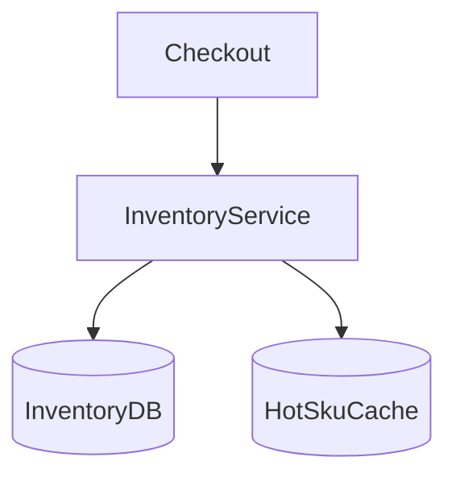

# D17-T017 — Inventory management

Topic ID: `D17-T017`

## B. Requirements, capacity, API, data

**FR:** Stock per SKU/warehouse; reserve/commit/release; replenishment signals. **NFR:** No oversell; reservation **< 50 ms**; accurate ATP. **Capacity:** **10k reservations/s** peak; **10M SKUs**; hot row contention. **API:** `POST reserve/commit/release`, `GET inventory`. **Data:** `inventory(on_hand, reserved)`; reservations with TTL; adjustment event log.

## D. Architecture



## J. Bottlenecks / failures

Hot SKU locks; cross-warehouse allocation; orphan reservations; negative on_hand races.

## K. Interview Preparation

### Beginner

#### Q1. Reserve vs commit?

**Answer:** Reserve holds stock during checkout; commit on payment success; release on timeout/cancel.

#### Q2. ATP meaning?

**Answer:** Available-to-promise = on_hand − reserved − safety stock.

#### Q3. Per warehouse stock?

**Answer:** Fulfillment chooses warehouse; ATP per location.

#### Q4. Why TTL reservation?

**Answer:** Prevents carts locking inventory forever; cron releases expired holds.

#### Q5. Cycle count?

**Answer:** Periodic physical audit adjusts on_hand with audit events.

### Intermediate

#### Q1. Optimistic vs pessimistic locking?

**Answer:** Single-row `UPDATE ... WHERE available>0` is pessimistic enough for many cases; optimistic version for low contention.

#### Q2. Distributed inventory?

**Answer:** Per-warehouse authority; aggregate ATP async for browse.

#### Q3. Event sourcing inventory?

**Answer:** Append adjustments; rebuild state; good audit trail.

#### Q4. Backorder queue?

**Answer:** Allow negative ATP flag with promise date; separate from oversell bug.

#### Q5. Flash sale patterns?

**Answer:** Pre-allocate pool; queue; shard hot SKU to dedicated service.

### Advanced

#### Q1. Global inventory view lag?

**Answer:** Browse may show approximate stock; checkout uses authoritative row.

#### Q2. Shrink/theft adjustments?

**Answer:** Signed adjustment events; investigate large deltas.

#### Q3. Multi-channel allocation?

**Answer:** Reserve pools for store vs online.

#### Q4. Buying simulation?

**Answer:** Load test reservation path separately from catalog.

#### Q5. Split brain across DCs?

**Answer:** Single writer per SKU or CRDT-style counters rare; prefer primary per SKU shard.

### Scenarios

#### Q1. Two checkouts, one item.

**Answer:** One `UPDATE` wins; other gets 409/out of stock.

#### Q2. Reservation leak.

**Answer:** TTL job; metrics on unreleased holds.

#### Q3. Warehouse feed delayed.

**Answer:** Stale ATP; safety stock buffer; disable purchase if uncertain.

#### Q4. Console launch hot SKU.

**Answer:** Dedicated shard; queue checkout; pre-warm cache carefully without stale ATP.

#### Q5. Manual adjustment no audit.

**Answer:** Compliance failure; require reason code and actor.

### Follow-ups

#### Q1. Order management?

**Answer:** `D17-T016` drives commit on state transitions.

#### Q2. Payment timing?

**Answer:** Commit inventory when payment authorized (`D17-T018`).

#### Q3. E-commerce catalog?

**Answer:** `D17-T015` displays ATP from inventory service.

## L. Exercises

Solutions: `EXERCISES/solutions/D17-T017.md`. SQL oversell prevention; TTL job; hot SKU cache.

## A, C, E–I, M–O

Theater seat hold analogy. Completion: reserve/commit API.

## Supplement for missing section letters

## A. Topic Overview

Inventory management continues the design already written in this file. Topic ID: `D17-T017` **FR:** Stock per SKU/warehouse; reserve/commit/release; replenishment signals. **NFR:** No oversell; reservation **< 50 ms**; accurate ATP. **Capacity:** **10k reservations/s** peak; **10M SKUs**; hot row contention. **API:** `POST reserve/commit/release`, `GET inventory`. **Data:** `inventory(on_hand, reserved)`; reservations with TTL; adjustment event log. ```mermaid flowchart TD checkout[Checkout] inv[InventoryService] db[(InventoryDB)] cache[(HotSkuCache)] checkout --> 

For section A, keep the same capacity numbers and API as the requirements above. Do not invent a second architecture. The completion check is whether you can still draw the original diagram and name its bottleneck.

## C. Internal Working and Architecture

Inventory management continues the design already written in this file. Topic ID: `D17-T017` **FR:** Stock per SKU/warehouse; reserve/commit/release; replenishment signals. **NFR:** No oversell; reservation **< 50 ms**; accurate ATP. **Capacity:** **10k reservations/s** peak; **10M SKUs**; hot row contention. **API:** `POST reserve/commit/release`, `GET inventory`. **Data:** `inventory(on_hand, reserved)`; reservations with TTL; adjustment event log. ```mermaid flowchart TD checkout[Checkout] inv[InventoryService] db[(InventoryDB)] cache[(HotSkuCache)] checkout --> 

For section C, keep the same capacity numbers and API as the requirements above. Do not invent a second architecture. The completion check is whether you can still draw the original diagram and name its bottleneck.

## E. Examples and Analogies

Inventory management continues the design already written in this file. Topic ID: `D17-T017` **FR:** Stock per SKU/warehouse; reserve/commit/release; replenishment signals. **NFR:** No oversell; reservation **< 50 ms**; accurate ATP. **Capacity:** **10k reservations/s** peak; **10M SKUs**; hot row contention. **API:** `POST reserve/commit/release`, `GET inventory`. **Data:** `inventory(on_hand, reserved)`; reservations with TTL; adjustment event log. ```mermaid flowchart TD checkout[Checkout] inv[InventoryService] db[(InventoryDB)] cache[(HotSkuCache)] checkout --> 

For section E, keep the same capacity numbers and API as the requirements above. Do not invent a second architecture. The completion check is whether you can still draw the original diagram and name its bottleneck.

## F. Code Examples

```python
# unexecuted illustration for D17-T017
def explain():
    return 'Inventory management'
```

## G. Practical Backend Application

Inventory management continues the design already written in this file. Topic ID: `D17-T017` **FR:** Stock per SKU/warehouse; reserve/commit/release; replenishment signals. **NFR:** No oversell; reservation **< 50 ms**; accurate ATP. **Capacity:** **10k reservations/s** peak; **10M SKUs**; hot row contention. **API:** `POST reserve/commit/release`, `GET inventory`. **Data:** `inventory(on_hand, reserved)`; reservations with TTL; adjustment event log. ```mermaid flowchart TD checkout[Checkout] inv[InventoryService] db[(InventoryDB)] cache[(HotSkuCache)] checkout --> 

For section G, keep the same capacity numbers and API as the requirements above. Do not invent a second architecture. The completion check is whether you can still draw the original diagram and name its bottleneck.

## H. Advantages, Limitations and Trade-offs

| Choice | Benefit | Cost | Choose when | Avoid when |
| --- | --- | --- | --- | --- |
| Inventory management | Matches the requirements in this note | More components | The bottleneck in section J is real | A single node still meets the SLO |

## I. Common Mistakes and Misconceptions

Inventory management continues the design already written in this file. Topic ID: `D17-T017` **FR:** Stock per SKU/warehouse; reserve/commit/release; replenishment signals. **NFR:** No oversell; reservation **< 50 ms**; accurate ATP. **Capacity:** **10k reservations/s** peak; **10M SKUs**; hot row contention. **API:** `POST reserve/commit/release`, `GET inventory`. **Data:** `inventory(on_hand, reserved)`; reservations with TTL; adjustment event log. ```mermaid flowchart TD checkout[Checkout] inv[InventoryService] db[(InventoryDB)] cache[(HotSkuCache)] checkout --> 

For section I, keep the same capacity numbers and API as the requirements above. Do not invent a second architecture. The completion check is whether you can still draw the original diagram and name its bottleneck.

## M. Revision Notes

Inventory management continues the design already written in this file. Topic ID: `D17-T017` **FR:** Stock per SKU/warehouse; reserve/commit/release; replenishment signals. **NFR:** No oversell; reservation **< 50 ms**; accurate ATP. **Capacity:** **10k reservations/s** peak; **10M SKUs**; hot row contention. **API:** `POST reserve/commit/release`, `GET inventory`. **Data:** `inventory(on_hand, reserved)`; reservations with TTL; adjustment event log. ```mermaid flowchart TD checkout[Checkout] inv[InventoryService] db[(InventoryDB)] cache[(HotSkuCache)] checkout --> 

For section M, keep the same capacity numbers and API as the requirements above. Do not invent a second architecture. The completion check is whether you can still draw the original diagram and name its bottleneck.

## N. Related Topics

Inventory management continues the design already written in this file. Topic ID: `D17-T017` **FR:** Stock per SKU/warehouse; reserve/commit/release; replenishment signals. **NFR:** No oversell; reservation **< 50 ms**; accurate ATP. **Capacity:** **10k reservations/s** peak; **10M SKUs**; hot row contention. **API:** `POST reserve/commit/release`, `GET inventory`. **Data:** `inventory(on_hand, reserved)`; reservations with TTL; adjustment event log. ```mermaid flowchart TD checkout[Checkout] inv[InventoryService] db[(InventoryDB)] cache[(HotSkuCache)] checkout --> 

For section N, keep the same capacity numbers and API as the requirements above. Do not invent a second architecture. The completion check is whether you can still draw the original diagram and name its bottleneck.

## O. Completion Criteria

Inventory management continues the design already written in this file. Topic ID: `D17-T017` **FR:** Stock per SKU/warehouse; reserve/commit/release; replenishment signals. **NFR:** No oversell; reservation **< 50 ms**; accurate ATP. **Capacity:** **10k reservations/s** peak; **10M SKUs**; hot row contention. **API:** `POST reserve/commit/release`, `GET inventory`. **Data:** `inventory(on_hand, reserved)`; reservations with TTL; adjustment event log. ```mermaid flowchart TD checkout[Checkout] inv[InventoryService] db[(InventoryDB)] cache[(HotSkuCache)] checkout --> 

For section O, keep the same capacity numbers and API as the requirements above. Do not invent a second architecture. The completion check is whether you can still draw the original diagram and name its bottleneck.
