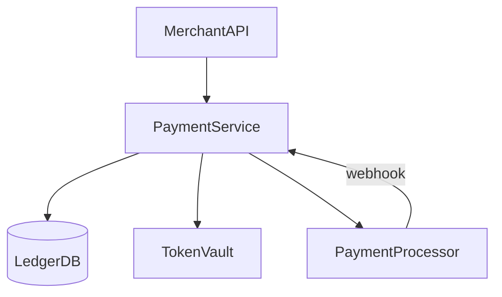

# D17-T018 — Payment processing system

Topic ID: `D17-T018`
Importance: core

## A. Topic Overview

Authorize, capture, refund, and reconcile payments with strong idempotency, ledger audit, and minimal PCI scope via tokenization.

## B. Requirements, capacity, API, data

### Functional requirements

- Create payment with idempotency key; capture, void, refund; processor webhooks.

### Non-functional requirements

- No double charge on retries; append-only audit; fraud checks within latency budget.

### Capacity sketch (explicit assumptions)

**5k TPS** peak payments; **$200** average ticket; processor latency **200–800 ms**; webhooks async.

### API sketch

`POST /v1/payments` + `Idempotency-Key`; `POST .../capture`; `POST .../refund`; signed webhooks.

### Data model

`payments(id, status, amount_cents, currency, idempotency_key)`; `ledger_entries` double-entry; PAN in external token vault only.

## C. Internal Working and Architecture

API validates → insert payment PENDING → call processor → update state; ledger records every money movement; outbox publishes events; webhook handler idempotent on processor event id.

## D. Architecture



## E. Examples and Analogies

A notary stamp: one authoritative ledger entry per intent; retries must not stamp twice.

## F. Code Examples

```python
print("payment_tps_peak", 5000)
```

## G. Practical Backend Application

Metrics: auth success rate, capture lag, webhook dup rate, reconciliation drift. Alert on ledger imbalance. PCI: network segmentation, no PAN in app logs.

## H. Advantages, Limitations and Trade-offs

| Choice | Benefit | Cost | Choose when | Avoid when |
| --- | --- | --- | --- | --- |
| Auth then capture | Flex on ship | Uncaptured exposure | Physical goods | Immediate digital delivery |
| Idempotency keys | Safe retries | Storage | All POST payments | N/A |
| Double-entry ledger | Audit | Write amplification | Money movement | Non-financial events |
| Hosted fields | Low PCI scope | UX friction | Card acceptance | Full custom UI without SAQ A |

## I. Common Mistakes and Misconceptions

- Storing PAN in application DB.
- Treating webhook as only source of truth without API reconcile.
- Missing idempotency on capture/refund.

## J. Debugging and Troubleshooting

### Bottlenecks

Processor rate limits; ledger row hot spots; fraud model latency.

### Failure modes

Duplicate capture on retry; webhook before HTTP response; AUTH without capture after partial failure.

Reconcile nightly with processor report; state machine tolerates out-of-order events.

## K. Interview Preparation

### Beginner

#### Q1. Auth vs capture?

**Answer:** Auth holds funds; capture settles them. Auth expires if not captured. Digital goods may capture immediately. Physical goods may capture on ship.

#### Q2. Idempotency key?

**Answer:** Client-supplied unique key per intent; server returns same payment on replay. Store unique constraint. Survives client timeouts.

#### Q3. PCI scope?

**Answer:** Reduce by tokenization/hosted fields; never log PAN. Segment network. SAQ level depends on integration pattern.

#### Q4. Refund vs void?

**Answer:** Void cancels uncaptured auth; refund returns captured funds. Timing rules differ by network.

#### Q5. Ledger why?

**Answer:** Double-entry proves balances sum to zero; audit and reconciliation. Application state alone is insufficient for finance.

### Intermediate

#### Q1. Double-entry bookkeeping?

**Answer:** Every debit has credit across accounts (merchant, fees, processor). Immutable entries; compensating entries for refunds.

#### Q2. Outbox for webhooks?

**Answer:** Reliable publish of payment events to bus after DB commit. Consumers idempotent.

#### Q3. 3DS flow?

**Answer:** Step-up authentication redirect; resume payment after challenge. State machine must handle abandon.

#### Q4. Multi-currency settlement?

**Answer:** Charge presentment currency; settle to merchant account currency with FX recorded.

#### Q5. Chargeback handling?

**Answer:** Dispute states linked to payment id; evidence upload; ledger holds reserve.

### Advanced

#### Q1. Exactly-once money illusion?

**Answer:** At-least-once + idempotency + reconciliation; processors also duplicate occasionally.

#### Q2. Sharding ledger?

**Answer:** Shard by merchant id; global reports via batch aggregation.

#### Q3. Active-active payments?

**Answer:** Hard due to idempotency and fraud; prefer active-passive with fast failover.

#### Q4. Reconciliation batch?

**Answer:** Compare processor settlement file to ledger daily; alert cents drift.

#### Q5. Crypto rails?

**Answer:** Different settlement finality and volatility; usually separate service with hold period.

### Scenarios

#### Q1. Client retries POST on timeout.

**Answer:** Same idempotency key returns original payment; no second processor call.

#### Q2. Duplicate webhook succeeded.

**Answer:** Dedup on processor event id; ignore second processing.

#### Q3. Capture after partial ship.

**Answer:** Partial capture amounts per shipment; OMS drives capture events.

#### Q4. Processor maintenance.

**Answer:** Queue requests; fail gracefully with retry guidance; no double charge.

#### Q5. Fraud blocks legit users.

**Answer:** Shadow mode rules; manual review queue; appeal path.

### Follow-ups

#### Q1. Inventory commit timing?

**Answer:** Commit stock on successful auth or capture per product policy (`D17-T017`).

#### Q2. Order state sync?

**Answer:** `D17-T016` updates on payment webhooks.

#### Q3. Notification on failure?

**Answer:** `D17-T004` email/push on failed payment.

## L. Practical Exercises

Solutions: `EXERCISES/solutions/D17-T018.md`.

1. Idempotent payment create flow.
2. Webhook arrives before HTTP response.
3. Minimize PCI scope.

## M. Revision Notes

Idempotency, ledger, auth/capture, webhook dedup, reconciliation.

## N. Related Topics

`D17-T017`, `D17-T015`, `D17-T016`. Do not document `D17-T019+` here.

## O. Completion Criteria

Whiteboard payment state machine + ledger; explain double-charge prevention; complete L.
