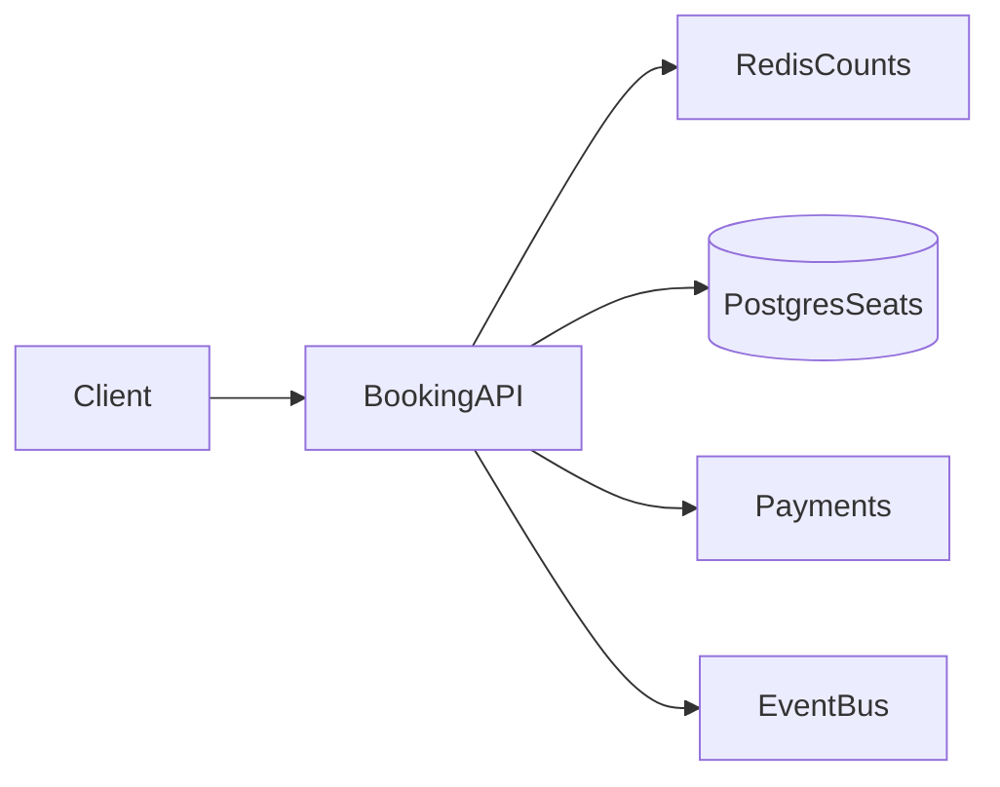

# D17-T019 — Ticket booking system

Topic ID: `D17-T019`
Domain: Common System Design Problems
Subdomain: Ticket booking system
Importance: common
Complexity: intermediate
Dependencies: `D17-T018`, `D17-T001`, `D16-T001`, `D16-T002`, `D07-T001`, `D07-T002`
Execution status of the code in section F: illustrative (not executed in CI)

## A. Topic Overview

A ticket booking system sells finite seat inventory to many concurrent buyers without overselling. Flash on-sales stress inventory writers, payment callbacks, and hold TTL hygiene. Interviewers test holds, idempotent confirm, and virtual waiting rooms. Builds on payment processing (`D17-T018`) and transactional storage.

## B. First-Principles Explanation

### Functional requirements

- Browse events, sections, and pricing with section-level availability.
- Create time-limited holds on specific seats; confirm with payment.
- Issue signed tickets and support refunds per policy.
- Waitlist and promote when inventory returns.
- Admin tools to freeze sales and audit seat maps.

### Non-functional requirements

- Zero oversell per seat; confirmed tickets ≤ capacity.
- Browse p99 < 300 ms; hold path < 2 s excluding payment.
- Idempotent booking and webhook handling.
- Withstand 50× traffic spike for ten minutes.

### Capacity assumptions

5M users; 100k concurrent on hot on-sale; ~1k hold attempts/s peak; 5k seats/event; 50M tickets/year retained seven years; CDN for static maps.

### Bottlenecks

Per-seat row locks; Redis/DB drift; payment webhook lag; CDN stale maps.

### Failure modes

Double booking; ghost holds without TTL sweeper; paid without ticket; barcode replay.

## C. Internal Working and Architecture

Gateway rate-limits on-sales. Holds lock seats in DB; Redis gives fast section rejects. Payment confirm is idempotent. Outbox publishes `BookingConfirmed`.

### API surface

| Method | Path | Purpose |
| --- | --- | --- |
| GET | `/v1/events/{id}/availability` | Section counts |
| POST | `/v1/holds` | Idempotent hold with TTL |
| POST | `/v1/bookings` | Confirm hold + payment intent |
| POST | `/v1/webhooks/payment` | Provider callbacks |
| GET | `/v1/bookings/{id}` | Ticket status |

### Data model

`Event`, `Section`, `Seat(status)`, `Hold`, `HoldSeat`, `Booking`, `Ticket(barcode)`; unique active seat in hold; transactional `FOR UPDATE` on seats.

## D. Diagrams and Visual Models



Read the diagram left to right: clients hit edge services, synchronous path touches authoritative storage, async workers handle side effects.

## E. Examples and Analogies

Theater chair metaphor: hold is standing in the aisle with a timer; sold is seated. Backend example: reject hold when section Redis counter is zero but still verify in DB transaction.

## F. Code Examples

```python
def confirm_booking(idempotency_key: str, payment_intent: str) -> Booking:
    if b := repo.by_key(idempotency_key):
        return b
    with db.transaction():
        hold = repo.lock_hold(payment_intent.hold_id)
        capture_payment(payment_intent)
        mark_seats_sold(hold)
        return repo.create_booking(hold, idempotency_key)
```

## G. Practical Backend Application

Metrics: `hold_conflict`, `booking_confirmed`, `webhook_lag`. Alert on paid-without-ticket. Run hold TTL sweeper every minute.

## H. Advantages, Limitations and Trade-offs

| Pattern | Benefit | Cost |
| --- | --- | --- |
| DB row lock | Strong safety | Contention |
| Waiting room | Protects origin | UX delay |
| Section cache | Fast browse | Stale risk |

## I. Common Mistakes and Misconceptions

- Stale per-seat cache at checkout
- No idempotency on confirm
- Infinite hold TTL
- Sequential barcodes

## J. Debugging and Troubleshooting

Oversell: reconcile `COUNT(sold)` vs capacity. Missing tickets: reconcile payments vs bookings.

## K. Interview Preparation

### Beginner

#### Q1. What problem does a ticket booking system solve?

**Answer:** A ticket booking system coordinates many clients against seats without corrupting business rules. Users expect low latency reads but no overselling of seats on the write path. The design splits fast paths from durable Postgres seat inventory. Interviewers want requirements before boxes and arrows.

#### Q2. What are functional requirements for ticket booking?

**Answer:** Core flows must create, read, update, and complete work involving seats. Administrative APIs configure policies that downstream services enforce. Integrations emit events on Kafka outbox for notifications so other systems stay consistent. List five concrete user-visible capabilities, not only infrastructure.

#### Q3. What non-functional requirements matter most?

**Answer:** Availability and correctness trade off around no overselling of seats. Latency targets differ for reads versus Postgres seat inventory. 100k users in two minutes on a single on-sale defines how much burst traffic you must absorb. State measurable SLOs such as p99 latency and error rate.

#### Q4. Where is the authoritative state stored?

**Answer:** Durable truth for seats lives in Postgres seat inventory with transactional or atomic updates. Caches and replicas may serve reads but cannot be sole writers. Reconciliation jobs fix drift between cache and store. Name the store and what happens on cache miss.

#### Q5. Why are idempotency keys common here?

**Answer:** Clients retry when gateways time out during Postgres seat inventory. Without idempotency, retries duplicate side effects on seats. Keys are stored with a unique constraint and return the same response. Mention both API and webhook deduplication.

### Intermediate

#### Q1. How would you scale reads for ticket booking?

**Answer:** Partition read models by tenant or shard key relevant to seats. Use replicas, CDNs, or materialized views for hot queries. Invalidate or TTL caches when Postgres seat inventory changes. Quantify replica lag your product tolerates.

#### Q2. How would you scale writes for ticket booking?

**Answer:** Shard Postgres seat inventory so hot keys do not share one partition. Serialize conflicting updates to the same seats instance. Offload heavy work to Kafka outbox for notifications after a small durable write. Avoid distributed transactions across vendors.

#### Q3. What goes on the critical path versus async?

**Answer:** Only steps required to no overselling of seats stay synchronous. Notifications, analytics, and enrichment run via Kafka outbox for notifications. Outbox pattern ties async work to the same DB transaction. Draw a sequence diagram with at most five sync steps.

#### Q4. How do you handle hot keys?

**Answer:** A viral event concentrates updates on one seats shard. Mitigate with partitioning, local queues, or dedicated pools. Rate limit abusive clients at the edge. Give an example hot key from 100k users in two minutes on a single on-sale.

#### Q5. What observability is mandatory?

**Answer:** Trace IDs across API, Postgres seat inventory, and Kafka outbox for notifications. Metrics: success rate, latency histograms, backlog depth, saturation. Structured logs with correlation to business ids for seats. Alert on SLO burn, not only CPU.

### Advanced

#### Q1. Active-active multi-region for ticket booking?

**Answer:** Conflicting writes to the same seats need a single primary or CRDT with domain fit. Global load balancing sends writes to the owning region. Failover uses fencing to stop stale writers. Say explicitly if multi-master is unsafe for this domain.

#### Q2. Exactly-once semantics realistic?

**Answer:** End-to-end exactly-once is expensive; aim for at-least-once with idempotent Postgres seat inventory. Dedup tables and deterministic ids make retries safe. Consumers on Kafka outbox for notifications must tolerate duplicates. Define which side effects must be unique.

#### Q3. Backpressure design?

**Answer:** When Kafka outbox for notifications or Postgres seat inventory saturates, shed load with 429 and Retry-After. Queue depth triggers autoscaling and admission control. Prefer graceful degradation over unbounded memory growth. Describe what you disable first under stress.

#### Q4. Security boundaries?

**Answer:** Authenticate callers; authorize per tenant for seats. Encrypt data in transit and at rest; audit admin changes. Validate all external callbacks with signatures. Mention threat model: fraud, replay, and privilege escalation.

#### Q5. Migration without downtime?

**Answer:** Dual-write or event replay from Postgres seat inventory to new schema. Feature flags gate read path cutover. Verify counts and checksums on seats samples. Plan rollback if error rate rises.

### Scenarios

#### Q1. Latency doubled after a release.

**Answer:** Compare canary metrics on Postgres seat inventory query plans and cache hit rate. Check N+1 regressions and connection pool exhaustion. Roll back or scale Kafka outbox for notifications consumers if backlog grew. Use distributed traces on p99 spans.

#### Q2. Duplicate records after client retries.

**Answer:** Missing idempotency on Postgres seat inventory allows two rows for one intent. Add unique constraint on business key and return 409 with existing id. Replay webhooks with same event id. Backfill dedup script before enabling constraint.

#### Q3. Regional outage during peak.

**Answer:** Fail DNS to healthy region; pause writes that cannot fence. Queue Kafka outbox for notifications safely or spill to durable log. Communicate partial feature availability. Run game days for failover quarterly.

#### Q4. Data drift between cache and database.

**Answer:** Counters for seats diverge when invalidation fails. Compare aggregates; disable optimistic rejects if drift exceeds threshold. Rebuild cache from Postgres seat inventory snapshot. Add periodic reconciliation job.

#### Q5. Compliance audit asks for proof of changes.

**Answer:** Immutable audit log of who changed seats and when. Retain tamper-evident storage with retention policy. Correlate admin API to actor identity. Separate audit from application metrics.

### Follow-ups

#### Q1. Relation to databases (`D07-T002`)?

**Answer:** Schema and isolation level choices implement no overselling of seats. Indexes match query paths on Postgres seat inventory. Migrations coordinate with Kafka outbox for notifications consumers. Mention transactions versus sagas.

#### Q2. Relation to scalability (`D17-T001`)?

**Answer:** Horizontal scale hits limits on seats hot keys. Load balancers and autoscaling follow measured RPS from 100k users in two minutes on a single on-sale. Capacity planning includes dependency fan-out. Cite bottleneck you remove first.

#### Q3. What would you prototype first?

**Answer:** Single-region Postgres seat inventory with correct no overselling of seats before optimizing latency. Scripted load test reproducing 100k users in two minutes on a single on-sale. Add Kafka outbox for notifications only after sync path is correct. Deliver vertical slice end-to-end in week one.

## L. Practical Exercises

Solutions are in `EXERCISES/solutions/D17-T019.md`. Try these before opening that file.

### Exercise 1 — design

Document seat state machine and idempotent APIs for hold/confirm.

### Exercise 2 — operations

Runbook when hold conflicts exceed 30% during on-sale.

### Exercise 3 — capacity

Size DB pool for 1k hold RPS with 50 ms transactions.

## M. Revision Notes

- No oversell
- Hold TTL
- Idempotent confirm
- Cache not authoritative at checkout
- Waiting room for spikes

Flashcards:

- What is a hold? Temporary exclusive reservation with TTL.
- Why idempotency? Retries must not double-book.

## N. Related Topics

See `D17-T018` payments, `D17-T022` hotels for different inventory shape, `D07-T002` transactions.

## O. Completion Criteria

- List requirements for on-sale
- Draw sync vs async paths
- Explain hold + confirm
- Name three failures and metrics
- Fix double-booking scenario
