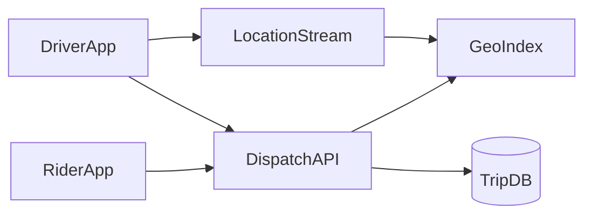

# D17-T020 — Ride-hailing service

Topic ID: `D17-T020`
Domain: Common System Design Problems
Subdomain: Ride-hailing service
Importance: common
Complexity: intermediate
Dependencies: `D17-T019`, `D17-T001`, `D16-T001`, `D16-T002`, `D07-T001`, `D07-T002`
Execution status of the code in section F: illustrative (not executed in CI)

## A. Topic Overview

Ride-hailing matches riders to nearby drivers, prices trips, and tracks lifecycle from request to drop-off. Location streams and dispatch fairness dominate the design. Interviewers focus on geospatial indexes, surge pricing, and trip state machines. Related to real-time location tracking (`D17-T031`).

## B. First-Principles Explanation

### Functional requirements

- Rider requests ride with pickup/dropoff; see ETA and price estimate.
- Dispatch assigns driver; live trip tracking.
- Payments, ratings, and support tooling.
- Driver availability and document verification.
- Surge and incentives by geofence.

### Non-functional requirements

- Match p95 < 5 s in dense cities.
- Location updates eventual < 3 s on map.
- Trip billing accurate to GPS polyline or time.
- 99.9% API availability.

### Capacity assumptions

10M riders, 500k drivers; 2M trips/day; 17k location writes/s peak; geospatial queries 5k/s; trip store 5-year retention.

### Bottlenecks

Hot geohash cells; dispatch thundering herd; GPS noise; payment disputes.

### Failure modes

Double assign; stale driver online; split-brain trip state; surge flash overload.

## C. Internal Working and Architecture

Location ingested to stream; workers update geo index. Dispatch scores drivers by distance, rating, and fairness. Trip state changes are transactional; notifications async.

### API surface

| Method | Path | Purpose |
| --- | --- | --- |
| POST | `/v1/trips/request` | Create trip request |
| POST | `/v1/trips/{id}/accept` | Driver accepts |
| PATCH | `/v1/drivers/location` | Batched GPS |
| GET | `/v1/trips/{id}` | Status + route |
| POST | `/v1/pricing/estimate` | Fare estimate |

### Data model

`Rider`, `Driver(status,location)`, `Trip(state machine)`, `Fare`, `Payment`, `GeoIndex` in Redis or specialized store; trip events append-only.

## D. Diagrams and Visual Models



Read the diagram left to right: clients hit edge services, synchronous path touches authoritative storage, async workers handle side effects.

## E. Examples and Analogies

Taxi radio dispatcher: many cars, one rider, closest eligible wins within rules. Surge multiplies base fare when demand/supply ratio in hex cell exceeds threshold.

## F. Code Examples

```python
def dispatch(trip_id: str) -> None:
    trip = repo.lock_trip(trip_id)
    candidates = geo.near(trip.pickup, radius_km=3, limit=20)
    for d in rank(candidates):
        if try_assign(trip_id, d.id):
            return
    requeue_with_backoff(trip_id)
```

## G. Practical Backend Application

Use cell-based sharding for geo index. Metrics: `dispatch_latency`, `unassigned_trips`, `location_lag`.

## H. Advantages, Limitations and Trade-offs

| Store | Use | Risk |
| --- | --- | --- |
| Redis geo | Fast nearby | Memory |
| PostGIS | Complex queries | Write load |
| Stream | Decouple GPS | Lag |

## I. Common Mistakes and Misconceptions

- Dispatch without locking driver
- Client-side fare as truth
- No offline driver detection
- Global surge without caps

## J. Debugging and Troubleshooting

Rider sees no cars: check geo index freshness and driver heartbeat. Duplicate charges: idempotent trip payment.

## K. Interview Preparation

### Beginner

#### Q1. What problem does a ride-hailing service solve?

**Answer:** A ride-hailing service coordinates many clients against drivers near a rider without corrupting business rules. Users expect low latency reads but one active assignment per driver on the write path. The design splits fast paths from durable Postgres trips and driver state. Interviewers want requirements before boxes and arrows.

#### Q2. What are functional requirements for ride-hailing?

**Answer:** Core flows must create, read, update, and complete work involving drivers near a rider. Administrative APIs configure policies that downstream services enforce. Integrations emit events on Kafka location stream so other systems stay consistent. List five concrete user-visible capabilities, not only infrastructure.

#### Q3. What non-functional requirements matter most?

**Answer:** Availability and correctness trade off around one active assignment per driver. Latency targets differ for reads versus Postgres trips and driver state. 50k concurrent drivers updating location every 3s defines how much burst traffic you must absorb. State measurable SLOs such as p99 latency and error rate.

#### Q4. Where is the authoritative state stored?

**Answer:** Durable truth for drivers near a rider lives in Postgres trips and driver state with transactional or atomic updates. Caches and replicas may serve reads but cannot be sole writers. Reconciliation jobs fix drift between cache and store. Name the store and what happens on cache miss.

#### Q5. Why are idempotency keys common here?

**Answer:** Clients retry when gateways time out during Postgres trips and driver state. Without idempotency, retries duplicate side effects on drivers near a rider. Keys are stored with a unique constraint and return the same response. Mention both API and webhook deduplication.

### Intermediate

#### Q1. How would you scale reads for ride-hailing?

**Answer:** Partition read models by tenant or shard key relevant to drivers near a rider. Use replicas, CDNs, or materialized views for hot queries. Invalidate or TTL caches when Postgres trips and driver state changes. Quantify replica lag your product tolerates.

#### Q2. How would you scale writes for ride-hailing?

**Answer:** Shard Postgres trips and driver state so hot keys do not share one partition. Serialize conflicting updates to the same drivers near a rider instance. Offload heavy work to Kafka location stream after a small durable write. Avoid distributed transactions across vendors.

#### Q3. What goes on the critical path versus async?

**Answer:** Only steps required to one active assignment per driver stay synchronous. Notifications, analytics, and enrichment run via Kafka location stream. Outbox pattern ties async work to the same DB transaction. Draw a sequence diagram with at most five sync steps.

#### Q4. How do you handle hot keys?

**Answer:** A viral event concentrates updates on one drivers near a rider shard. Mitigate with partitioning, local queues, or dedicated pools. Rate limit abusive clients at the edge. Give an example hot key from 50k concurrent drivers updating location every 3s.

#### Q5. What observability is mandatory?

**Answer:** Trace IDs across API, Postgres trips and driver state, and Kafka location stream. Metrics: success rate, latency histograms, backlog depth, saturation. Structured logs with correlation to business ids for drivers near a rider. Alert on SLO burn, not only CPU.

### Advanced

#### Q1. Active-active multi-region for ride-hailing?

**Answer:** Conflicting writes to the same drivers near a rider need a single primary or CRDT with domain fit. Global load balancing sends writes to the owning region. Failover uses fencing to stop stale writers. Say explicitly if multi-master is unsafe for this domain.

#### Q2. Exactly-once semantics realistic?

**Answer:** End-to-end exactly-once is expensive; aim for at-least-once with idempotent Postgres trips and driver state. Dedup tables and deterministic ids make retries safe. Consumers on Kafka location stream must tolerate duplicates. Define which side effects must be unique.

#### Q3. Backpressure design?

**Answer:** When Kafka location stream or Postgres trips and driver state saturates, shed load with 429 and Retry-After. Queue depth triggers autoscaling and admission control. Prefer graceful degradation over unbounded memory growth. Describe what you disable first under stress.

#### Q4. Security boundaries?

**Answer:** Authenticate callers; authorize per tenant for drivers near a rider. Encrypt data in transit and at rest; audit admin changes. Validate all external callbacks with signatures. Mention threat model: fraud, replay, and privilege escalation.

#### Q5. Migration without downtime?

**Answer:** Dual-write or event replay from Postgres trips and driver state to new schema. Feature flags gate read path cutover. Verify counts and checksums on drivers near a rider samples. Plan rollback if error rate rises.

### Scenarios

#### Q1. Latency doubled after a release.

**Answer:** Compare canary metrics on Postgres trips and driver state query plans and cache hit rate. Check N+1 regressions and connection pool exhaustion. Roll back or scale Kafka location stream consumers if backlog grew. Use distributed traces on p99 spans.

#### Q2. Duplicate records after client retries.

**Answer:** Missing idempotency on Postgres trips and driver state allows two rows for one intent. Add unique constraint on business key and return 409 with existing id. Replay webhooks with same event id. Backfill dedup script before enabling constraint.

#### Q3. Regional outage during peak.

**Answer:** Fail DNS to healthy region; pause writes that cannot fence. Queue Kafka location stream safely or spill to durable log. Communicate partial feature availability. Run game days for failover quarterly.

#### Q4. Data drift between cache and database.

**Answer:** Counters for drivers near a rider diverge when invalidation fails. Compare aggregates; disable optimistic rejects if drift exceeds threshold. Rebuild cache from Postgres trips and driver state snapshot. Add periodic reconciliation job.

#### Q5. Compliance audit asks for proof of changes.

**Answer:** Immutable audit log of who changed drivers near a rider and when. Retain tamper-evident storage with retention policy. Correlate admin API to actor identity. Separate audit from application metrics.

### Follow-ups

#### Q1. Relation to databases (`D07-T002`)?

**Answer:** Schema and isolation level choices implement one active assignment per driver. Indexes match query paths on Postgres trips and driver state. Migrations coordinate with Kafka location stream consumers. Mention transactions versus sagas.

#### Q2. Relation to scalability (`D17-T001`)?

**Answer:** Horizontal scale hits limits on drivers near a rider hot keys. Load balancers and autoscaling follow measured RPS from 50k concurrent drivers updating location every 3s. Capacity planning includes dependency fan-out. Cite bottleneck you remove first.

#### Q3. What would you prototype first?

**Answer:** Single-region Postgres trips and driver state with correct one active assignment per driver before optimizing latency. Scripted load test reproducing 50k concurrent drivers updating location every 3s. Add Kafka location stream only after sync path is correct. Deliver vertical slice end-to-end in week one.

## L. Practical Exercises

Solutions are in `EXERCISES/solutions/D17-T020.md`. Try these before opening that file.

### Exercise 1 — design

Design trip state machine and dispatch API.

### Exercise 2 — operations

Incident: dispatch latency 10×—steps?

### Exercise 3 — capacity

Estimate location write throughput.

## M. Revision Notes

- Geo index freshness
- Trip state machine
- Fair dispatch
- Surge caps
- Idempotent pay

Flashcards:

- What is dispatch? Select driver under constraints.
- Why stream GPS? Decouple write burst from API.

## N. Related Topics

Pairs with `D17-T031` location tracking and `D17-T019` idempotency for payments.

## O. Completion Criteria

- Requirements rider/driver
- Diagram with geo + stream
- Explain surge
- Failure modes
- Dispatch algorithm sketch
