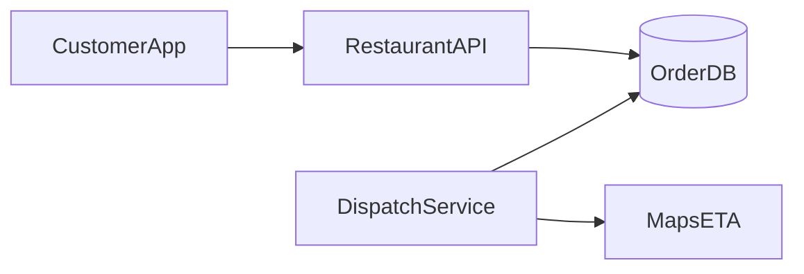

# D17-T021 — Food delivery platform

Topic ID: `D17-T021`
Domain: Common System Design Problems
Subdomain: Food delivery platform
Importance: common
Complexity: intermediate
Dependencies: `D17-T020`, `D17-T001`, `D16-T001`, `D16-T002`, `D07-T001`, `D07-T002`
Execution status of the code in section F: illustrative (not executed in CI)

## A. Topic Overview

A food delivery platform connects customers, restaurants, and couriers with uncertain kitchen prep times and last-mile routing. Peak dinner demand stresses dispatch, ETA accuracy, and order state consistency. Interviewers test marketplace workflows, geospatial dispatch, and compensation for delays. Related to ride-hailing (`D17-T020`) and location tracking (`D17-T031`).

## B. First-Principles Explanation

### Functional requirements

- Customer browses menus, places orders, tracks delivery.
- Restaurant accepts, prepares, marks ready.
- Courier assignment, pickup, drop-off, proof of delivery.
- Payments split restaurant/platform/courier; promotions.
- Support cancellations, refunds, and SLA credits.

### Non-functional requirements

- Order state must reflect kitchen and courier reality.
- ETA updates within 30 s of material events.
- 99.9% order API availability; idempotent checkout.
- Fair dispatch under courier scarcity.

### Capacity assumptions

Scale hook: dinner rush 10× lunch volume. 5M users, 200k restaurants, 300k couriers; 3M orders/day; peak 8k orders/min metro-wide; menu CDN; dispatch 2k assigns/min.

### Bottlenecks

Hot restaurant order queues; dispatch solver latency; map/ETA service; payment capture backlog.

### Failure modes

Order stuck between ready and picked up; double assignment; incorrect ETA causing churn; inventory sync errors on modifiers.

## C. Internal Working and Architecture

Order service owns canonical state machine. Dispatch workers score couriers by proximity, direction, and batching potential. ETA service combines prep model + routing graph. Events drive notifications and analytics.

### API surface

| Method | Path | Purpose |
| --- | --- | --- |
| POST | `/v1/orders` | Create order (idempotent) |
| GET | `/v1/orders/{id}` | Status + ETA |
| PATCH | `/v1/orders/{id}/status` | Restaurant/courier transitions |
| POST | `/v1/dispatch/assign` | Internal assign courier |
| GET | `/v1/restaurants/{id}/menu` | Menu (CDN backed) |

### Data model

`Order`, `OrderItem`, `Restaurant`, `Courier`, `Delivery`, `Payment`, `OutboxEvent`; shard orders by `city_id`; append-only `order_events`.

## D. Diagrams and Visual Models



Read the diagram left to right: clients hit edge services, synchronous path touches authoritative storage, async workers handle side effects.

## E. Examples and Analogies

Three clocks run: kitchen prep, courier travel, and customer hunger—state machine must show the slowest critical path honestly.

## F. Code Examples

```python
def transition(order_id: str, to_state: str, actor: str) -> Order:
    with db.transaction():
        o = repo.lock(order_id)
        if to_state not in ALLOWED[o.state]:
            raise InvalidTransition()
        o.state = to_state
        outbox.emit("OrderStateChanged", o)
        return o
```

## G. Practical Backend Application

Metrics: `dispatch_latency`, `prep_estimate_error`, `cancel_rate`. Autoscale dispatch workers on queue depth. Dark launch new ETA models.

## H. Advantages, Limitations and Trade-offs

| Pattern | Benefit | Cost |
| --- | --- | --- |
| Central order DB | Clear state | Hot cities |
| Async dispatch | Smooth spikes | Brief unassigned window |
| Cached menus | Fast browse | Stale items |

## I. Common Mistakes and Misconceptions

- Courier GPS as sole proof of pickup
- No idempotency on checkout
- Dispatch without locking courier
- Ignoring restaurant throttle

## J. Debugging and Troubleshooting

Stuck orders: inspect state timeline and dispatch queue. Bad ETAs: compare prep model version and traffic multipliers.

## K. Interview Preparation

### Beginner

#### Q1. What problem does a food delivery platform solve?

**Answer:** A food delivery platform coordinates many clients against courier capacity per restaurant slot without corrupting business rules. Users expect low latency reads but order state matches kitchen and courier reality on the write path. The design splits fast paths from durable Order OLTP. Interviewers want requirements before boxes and arrows.

#### Q2. What are functional requirements for food delivery?

**Answer:** Core flows must create, read, update, and complete work involving courier capacity per restaurant slot. Administrative APIs configure policies that downstream services enforce. Integrations emit events on delivery assignment workers so other systems stay consistent. List five concrete user-visible capabilities, not only infrastructure.

#### Q3. What non-functional requirements matter most?

**Answer:** Availability and correctness trade off around order state matches kitchen and courier reality. Latency targets differ for reads versus Order OLTP. dinner rush 10× lunch volume defines how much burst traffic you must absorb. State measurable SLOs such as p99 latency and error rate.

#### Q4. Where is the authoritative state stored?

**Answer:** Durable truth for courier capacity per restaurant slot lives in Order OLTP with transactional or atomic updates. Caches and replicas may serve reads but cannot be sole writers. Reconciliation jobs fix drift between cache and store. Name the store and what happens on cache miss.

#### Q5. Why are idempotency keys common here?

**Answer:** Clients retry when gateways time out during Order OLTP. Without idempotency, retries duplicate side effects on courier capacity per restaurant slot. Keys are stored with a unique constraint and return the same response. Mention both API and webhook deduplication.

### Intermediate

#### Q1. How would you scale reads for food delivery?

**Answer:** Partition read models by tenant or shard key relevant to courier capacity per restaurant slot. Use replicas, CDNs, or materialized views for hot queries. Invalidate or TTL caches when Order OLTP changes. Quantify replica lag your product tolerates.

#### Q2. How would you scale writes for food delivery?

**Answer:** Shard Order OLTP so hot keys do not share one partition. Serialize conflicting updates to the same courier capacity per restaurant slot instance. Offload heavy work to delivery assignment workers after a small durable write. Avoid distributed transactions across vendors.

#### Q3. What goes on the critical path versus async?

**Answer:** Only steps required to order state matches kitchen and courier reality stay synchronous. Notifications, analytics, and enrichment run via delivery assignment workers. Outbox pattern ties async work to the same DB transaction. Draw a sequence diagram with at most five sync steps.

#### Q4. How do you handle hot keys?

**Answer:** A viral event concentrates updates on one courier capacity per restaurant slot shard. Mitigate with partitioning, local queues, or dedicated pools. Rate limit abusive clients at the edge. Give an example hot key from dinner rush 10× lunch volume.

#### Q5. What observability is mandatory?

**Answer:** Trace IDs across API, Order OLTP, and delivery assignment workers. Metrics: success rate, latency histograms, backlog depth, saturation. Structured logs with correlation to business ids for courier capacity per restaurant slot. Alert on SLO burn, not only CPU.

### Advanced

#### Q1. Active-active multi-region for food delivery?

**Answer:** Conflicting writes to the same courier capacity per restaurant slot need a single primary or CRDT with domain fit. Global load balancing sends writes to the owning region. Failover uses fencing to stop stale writers. Say explicitly if multi-master is unsafe for this domain.

#### Q2. Exactly-once semantics realistic?

**Answer:** End-to-end exactly-once is expensive; aim for at-least-once with idempotent Order OLTP. Dedup tables and deterministic ids make retries safe. Consumers on delivery assignment workers must tolerate duplicates. Define which side effects must be unique.

#### Q3. Backpressure design?

**Answer:** When delivery assignment workers or Order OLTP saturates, shed load with 429 and Retry-After. Queue depth triggers autoscaling and admission control. Prefer graceful degradation over unbounded memory growth. Describe what you disable first under stress.

#### Q4. Security boundaries?

**Answer:** Authenticate callers; authorize per tenant for courier capacity per restaurant slot. Encrypt data in transit and at rest; audit admin changes. Validate all external callbacks with signatures. Mention threat model: fraud, replay, and privilege escalation.

#### Q5. Migration without downtime?

**Answer:** Dual-write or event replay from Order OLTP to new schema. Feature flags gate read path cutover. Verify counts and checksums on courier capacity per restaurant slot samples. Plan rollback if error rate rises.

### Scenarios

#### Q1. Latency doubled after a release.

**Answer:** Compare canary metrics on Order OLTP query plans and cache hit rate. Check N+1 regressions and connection pool exhaustion. Roll back or scale delivery assignment workers consumers if backlog grew. Use distributed traces on p99 spans.

#### Q2. Duplicate records after client retries.

**Answer:** Missing idempotency on Order OLTP allows two rows for one intent. Add unique constraint on business key and return 409 with existing id. Replay webhooks with same event id. Backfill dedup script before enabling constraint.

#### Q3. Regional outage during peak.

**Answer:** Fail DNS to healthy region; pause writes that cannot fence. Queue delivery assignment workers safely or spill to durable log. Communicate partial feature availability. Run game days for failover quarterly.

#### Q4. Data drift between cache and database.

**Answer:** Counters for courier capacity per restaurant slot diverge when invalidation fails. Compare aggregates; disable optimistic rejects if drift exceeds threshold. Rebuild cache from Order OLTP snapshot. Add periodic reconciliation job.

#### Q5. Compliance audit asks for proof of changes.

**Answer:** Immutable audit log of who changed courier capacity per restaurant slot and when. Retain tamper-evident storage with retention policy. Correlate admin API to actor identity. Separate audit from application metrics.

### Follow-ups

#### Q1. Relation to databases (`D07-T002`)?

**Answer:** Schema and isolation level choices implement order state matches kitchen and courier reality. Indexes match query paths on Order OLTP. Migrations coordinate with delivery assignment workers consumers. Mention transactions versus sagas.

#### Q2. Relation to scalability (`D17-T001`)?

**Answer:** Horizontal scale hits limits on courier capacity per restaurant slot hot keys. Load balancers and autoscaling follow measured RPS from dinner rush 10× lunch volume. Capacity planning includes dependency fan-out. Cite bottleneck you remove first.

#### Q3. What would you prototype first?

**Answer:** Single-region Order OLTP with correct order state matches kitchen and courier reality before optimizing latency. Scripted load test reproducing dinner rush 10× lunch volume. Add delivery assignment workers only after sync path is correct. Deliver vertical slice end-to-end in week one.

## L. Practical Exercises

Solutions are in `EXERCISES/solutions/D17-T021.md`. Try these before opening that file.

### Exercise 1 — design

Produce detailed API + ER diagram for food delivery platform.

### Exercise 2 — operations

Write failover runbook for Order OLTP.

### Exercise 3 — capacity

Capacity estimate for dinner rush 10× lunch volume.

## M. Revision Notes

- order state matches kitchen and courier reality
- dinner rush 10× lunch volume
- Order OLTP
- delivery assignment workers
- idempotency

Flashcards:

- Scarce resource? courier capacity per restaurant slot.
- Async path? delivery assignment workers.

## N. Related Topics

Links `D17-T020`, `D17-T031`, `D07-T002`.

## O. Completion Criteria

- Explain food delivery platform requirements
- Draw architecture diagram
- Describe order state matches kitchen and courier reality
- List bottlenecks and failures
- Walk idempotent retry scenario
