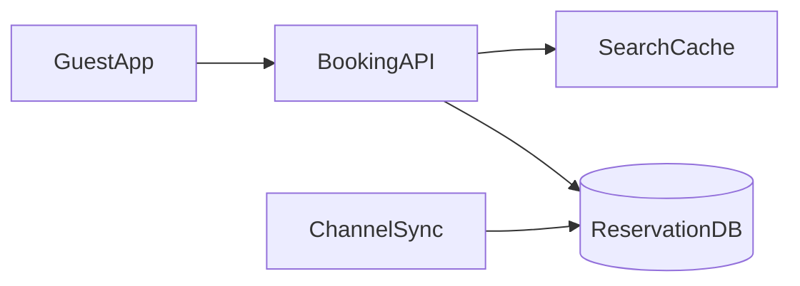

# D17-T022 — Hotel reservation system

Topic ID: `D17-T022`
Domain: Common System Design Problems
Subdomain: Hotel reservation system
Importance: common
Complexity: intermediate
Dependencies: `D17-T021`, `D17-T001`, `D16-T001`, `D16-T002`, `D07-T001`, `D07-T002`
Execution status of the code in section F: illustrative (not executed in CI)

## A. Topic Overview

A hotel reservation system sells room-nights across date ranges with channel partners (OTAs) and direct bookings. Inventory is a calendar matrix per room type, not a single seat. Interviewers test preventing double-booking room-nights, channel sync, and search under holiday load. Compare ticket booking (`D17-T019`) for seat-level locking versus night-level buckets.

## B. First-Principles Explanation

### Functional requirements

- Search availability by city, dates, guests, room type.
- Book, modify, cancel with policy windows.
- Sync inventory to channel managers (Booking.com-style).
- Hold rooms during payment; confirm with voucher.
- Admin: rate plans, overbooking rules (if allowed), blackout dates.

### Non-functional requirements

- No double-booking room-nights for the same room type and night.
- Search p95 < 500 ms on holiday weekends.
- Idempotent booking APIs and channel webhooks.
- Strong audit for rate and inventory changes.

### Capacity assumptions

Scale hook: holiday weekend 80% occupancy searches. 50k hotels, 10M room-nights indexed; 100k searches/min peak; 5k bookings/min peak; 7-year reservation retention.

### Bottlenecks

Hot city/date search indexes; row locks on `inventory_night`; channel sync backlog; rate cache invalidation.

### Failure modes

Oversell across channels; stale OTA inventory; split-brain on failover; incorrect timezone on night boundaries.

## C. Internal Working and Architecture

Reservation service decrements `rooms_remaining` per `(room_type_id, night)` in a transaction. Channel sync consumes outbox events with at-least-once delivery and idempotent apply. Search reads from read replicas or pre-aggregated availability cache with TTL.

### API surface

| Method | Path | Purpose |
| --- | --- | --- |
| GET | `/v1/search` | Availability by geo + dates |
| POST | `/v1/reservations` | Create (idempotent) |
| PATCH | `/v1/reservations/{id}` | Modify dates/guests |
| DELETE | `/v1/reservations/{id}` | Cancel per policy |
| POST | `/v1/channel/sync` | Partner inventory push/pull |

### Data model

`Hotel`, `RoomType`, `InventoryNight(room_type_id, night, rooms_remaining)`, `Reservation`, `ReservationNight`, `RatePlan`, `ChannelMapping`, `OutboxEvent`.

## D. Diagrams and Visual Models



Read the diagram left to right: clients hit edge services, synchronous path touches authoritative storage, async workers handle side effects.

## E. Examples and Analogies

Room-nights are parking spaces per day in a garage: booking Mon–Wed consumes three daily counters, not one object for the whole stay.

## F. Code Examples

```python
def book(room_type_id: str, nights: list[date], idem: str) -> Reservation:
    if r := repo.by_idem(idem):
        return r
    with db.transaction():
        for n in nights:
            row = repo.lock_inventory(room_type_id, n)
            if row.rooms_remaining < 1:
                raise SoldOut(n)
            row.rooms_remaining -= 1
        return repo.insert_reservation(...)
```

## G. Practical Backend Application

Metrics: `search_latency`, `oversell_alerts`, `channel_lag`. Reconcile channel counts nightly. Use hotel local timezone for night boundaries.

## H. Advantages, Limitations and Trade-offs

| Pattern | Benefit | Cost |
| --- | --- | --- |
| Night buckets | Simple search | Less room-level control |
| Room-level assign | Precise | Harder scale |
| Channel outbox | Reliable sync | Lag |

## I. Common Mistakes and Misconceptions

- UTC midnight for all hotels
- Cache search results without checkout lock
- Non-idempotent channel webhooks
- Ignoring modification that spans nights

## J. Debugging and Troubleshooting

Oversell: sum reservations vs capacity per night. Channel mismatch: compare last sync version id.

## K. Interview Preparation

### Beginner

#### Q1. What problem does a hotel reservation system solve?

**Answer:** A hotel reservation system coordinates many clients against room-nights without corrupting business rules. Users expect low latency reads but no double-booking room-nights on the write path. The design splits fast paths from durable Reservation DB. Interviewers want requirements before boxes and arrows.

#### Q2. What are functional requirements for hotels?

**Answer:** Core flows must create, read, update, and complete work involving room-nights. Administrative APIs configure policies that downstream services enforce. Integrations emit events on inventory sync to channel managers so other systems stay consistent. List five concrete user-visible capabilities, not only infrastructure.

#### Q3. What non-functional requirements matter most?

**Answer:** Availability and correctness trade off around no double-booking room-nights. Latency targets differ for reads versus Reservation DB. holiday weekend 80% occupancy searches defines how much burst traffic you must absorb. State measurable SLOs such as p99 latency and error rate.

#### Q4. Where is the authoritative state stored?

**Answer:** Durable truth for room-nights lives in Reservation DB with transactional or atomic updates. Caches and replicas may serve reads but cannot be sole writers. Reconciliation jobs fix drift between cache and store. Name the store and what happens on cache miss.

#### Q5. Why are idempotency keys common here?

**Answer:** Clients retry when gateways time out during Reservation DB. Without idempotency, retries duplicate side effects on room-nights. Keys are stored with a unique constraint and return the same response. Mention both API and webhook deduplication.

### Intermediate

#### Q1. How would you scale reads for hotels?

**Answer:** Partition read models by tenant or shard key relevant to room-nights. Use replicas, CDNs, or materialized views for hot queries. Invalidate or TTL caches when Reservation DB changes. Quantify replica lag your product tolerates.

#### Q2. How would you scale writes for hotels?

**Answer:** Shard Reservation DB so hot keys do not share one partition. Serialize conflicting updates to the same room-nights instance. Offload heavy work to inventory sync to channel managers after a small durable write. Avoid distributed transactions across vendors.

#### Q3. What goes on the critical path versus async?

**Answer:** Only steps required to no double-booking room-nights stay synchronous. Notifications, analytics, and enrichment run via inventory sync to channel managers. Outbox pattern ties async work to the same DB transaction. Draw a sequence diagram with at most five sync steps.

#### Q4. How do you handle hot keys?

**Answer:** A viral event concentrates updates on one room-nights shard. Mitigate with partitioning, local queues, or dedicated pools. Rate limit abusive clients at the edge. Give an example hot key from holiday weekend 80% occupancy searches.

#### Q5. What observability is mandatory?

**Answer:** Trace IDs across API, Reservation DB, and inventory sync to channel managers. Metrics: success rate, latency histograms, backlog depth, saturation. Structured logs with correlation to business ids for room-nights. Alert on SLO burn, not only CPU.

### Advanced

#### Q1. Active-active multi-region for hotels?

**Answer:** Conflicting writes to the same room-nights need a single primary or CRDT with domain fit. Global load balancing sends writes to the owning region. Failover uses fencing to stop stale writers. Say explicitly if multi-master is unsafe for this domain.

#### Q2. Exactly-once semantics realistic?

**Answer:** End-to-end exactly-once is expensive; aim for at-least-once with idempotent Reservation DB. Dedup tables and deterministic ids make retries safe. Consumers on inventory sync to channel managers must tolerate duplicates. Define which side effects must be unique.

#### Q3. Backpressure design?

**Answer:** When inventory sync to channel managers or Reservation DB saturates, shed load with 429 and Retry-After. Queue depth triggers autoscaling and admission control. Prefer graceful degradation over unbounded memory growth. Describe what you disable first under stress.

#### Q4. Security boundaries?

**Answer:** Authenticate callers; authorize per tenant for room-nights. Encrypt data in transit and at rest; audit admin changes. Validate all external callbacks with signatures. Mention threat model: fraud, replay, and privilege escalation.

#### Q5. Migration without downtime?

**Answer:** Dual-write or event replay from Reservation DB to new schema. Feature flags gate read path cutover. Verify counts and checksums on room-nights samples. Plan rollback if error rate rises.

### Scenarios

#### Q1. Latency doubled after a release.

**Answer:** Compare canary metrics on Reservation DB query plans and cache hit rate. Check N+1 regressions and connection pool exhaustion. Roll back or scale inventory sync to channel managers consumers if backlog grew. Use distributed traces on p99 spans.

#### Q2. Duplicate records after client retries.

**Answer:** Missing idempotency on Reservation DB allows two rows for one intent. Add unique constraint on business key and return 409 with existing id. Replay webhooks with same event id. Backfill dedup script before enabling constraint.

#### Q3. Regional outage during peak.

**Answer:** Fail DNS to healthy region; pause writes that cannot fence. Queue inventory sync to channel managers safely or spill to durable log. Communicate partial feature availability. Run game days for failover quarterly.

#### Q4. Data drift between cache and database.

**Answer:** Counters for room-nights diverge when invalidation fails. Compare aggregates; disable optimistic rejects if drift exceeds threshold. Rebuild cache from Reservation DB snapshot. Add periodic reconciliation job.

#### Q5. Compliance audit asks for proof of changes.

**Answer:** Immutable audit log of who changed room-nights and when. Retain tamper-evident storage with retention policy. Correlate admin API to actor identity. Separate audit from application metrics.

### Follow-ups

#### Q1. Relation to databases (`D07-T002`)?

**Answer:** Schema and isolation level choices implement no double-booking room-nights. Indexes match query paths on Reservation DB. Migrations coordinate with inventory sync to channel managers consumers. Mention transactions versus sagas.

#### Q2. Relation to scalability (`D17-T001`)?

**Answer:** Horizontal scale hits limits on room-nights hot keys. Load balancers and autoscaling follow measured RPS from holiday weekend 80% occupancy searches. Capacity planning includes dependency fan-out. Cite bottleneck you remove first.

#### Q3. What would you prototype first?

**Answer:** Single-region Reservation DB with correct no double-booking room-nights before optimizing latency. Scripted load test reproducing holiday weekend 80% occupancy searches. Add inventory sync to channel managers only after sync path is correct. Deliver vertical slice end-to-end in week one.

## L. Practical Exercises

Solutions are in `EXERCISES/solutions/D17-T022.md`. Try these before opening that file.

### Exercise 1 — design

Produce detailed API + ER diagram for hotel reservation system.

### Exercise 2 — operations

Write failover runbook for Reservation DB.

### Exercise 3 — capacity

Capacity estimate for holiday weekend 80% occupancy searches.

## M. Revision Notes

- no double-booking room-nights
- holiday weekend 80% occupancy searches
- Reservation DB
- inventory sync to channel managers
- idempotency

Flashcards:

- Scarce resource? room-nights.
- Async path? inventory sync to channel managers.

## N. Related Topics

Compare `D17-T019` seats vs night buckets; `D07-T002` transactions.

## O. Completion Criteria

- Explain hotel reservation system requirements
- Draw architecture diagram
- Describe no double-booking room-nights
- List bottlenecks and failures
- Walk idempotent retry scenario
