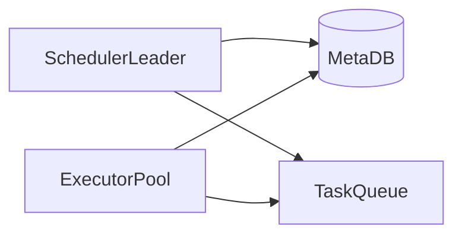

# D17-T023 — Job scheduler

Topic ID: `D17-T023`
Domain: Common System Design Problems
Subdomain: Job scheduler
Importance: common
Complexity: intermediate
Dependencies: `D17-T022`, `D17-T001`, `D16-T001`, `D16-T002`, `D07-T001`, `D07-T002`
Execution status of the code in section F: illustrative (not executed in CI)

## A. Topic Overview

A distributed job scheduler triggers work on cron or delay while guaranteeing at-most-one active run per job key across a cluster. Peak minute-aligned cron fires create thundering herds. Interviewers test leader election, leases, misfire policies, and horizontal scale of executors.

## B. First-Principles Explanation

### Functional requirements

- Define jobs: schedule, payload, retry policy, concurrency limits.
- Trigger on time or dependency completion.
- Lease-based execution; heartbeats; kill stuck workers.
- Dashboard: history, next run, failures.
- Pause/resume jobs; manual trigger.

### Non-functional requirements

- At-most-one running instance per job key (or explicit parallel shards).
- Schedule accuracy within seconds of declared cron.
- Survive scheduler leader failover < 30 s.
- Durable job definitions and run history.

### Capacity assumptions

million cron fires within one minute at global peak; 100k active job definitions; 20k executor workers; metadata store 10k writes/s during aligned minute.

### Bottlenecks

Aligned cron on minute boundary; lease table hot rows; executor pool saturation; clock skew.

### Failure modes

Double execution after lease expiry; missed fire during outage; poison job blocking shard; split-brain leaders.

## C. Internal Working and Architecture

Active scheduler leader computes due jobs and enqueues to partition queues. Executors claim tasks with lease TTL and heartbeat. Metadata store records `next_run`, `last_run`, `lease_owner`, `fence_token`.

### API surface

| Method | Path | Purpose |
| --- | --- | --- |
| POST | `/v1/jobs` | Create/update definition |
| POST | `/v1/jobs/{id}/trigger` | Manual run |
| GET | `/v1/jobs/{id}/runs` | History |
| POST | `/v1/executors/heartbeat` | Extend lease |

### Data model

`JobDefinition`, `JobRun(status, started_at, lease_until)`, `SchedulerLock`, `ExecutorPool`; shard by `job_group`.

## D. Diagrams and Visual Models



Read the diagram left to right: clients hit edge services, synchronous path touches authoritative storage, async workers handle side effects.

## E. Examples and Analogies

Cron is an alarm clock for the cluster—only one bedroom should hear it and wake the right worker.

## F. Code Examples

```python
def claim_due_jobs(limit: int) -> list[Job]:
    return db.execute(
        "UPDATE jobs SET lease_owner=$1, lease_until=now()+interval '60s' "
        "WHERE next_run <= now() AND (lease_until IS NULL OR lease_until < now()) "
        "RETURNING * LIMIT $2",
        worker_id, limit,
    )
```

## G. Practical Backend Application

Jitter cron by `hash(job_id) % 60s`. Metrics: `misfires`, `lease_expirations`, `queue_depth`. Alert on leader churn.

## H. Advantages, Limitations and Trade-offs

| Approach | Benefit | Cost |
| --- | --- | --- |
| DB leases | Simple | Hot rows |
| Dedicated scheduler | Accuracy | SPOF without HA |
| Per-job queues | Isolation | Ops overhead |

## I. Common Mistakes and Misconceptions

- No fencing token on lease renew
- Executing without idempotent handler
- Wall-clock cron without timezone clarity
- Unbounded parallel runs

## J. Debugging and Troubleshooting

Duplicate runs: compare lease logs and fence tokens. Missed runs: check leader election and `next_run` backlog.

## K. Interview Preparation

### Beginner

#### Q1. What problem does a job scheduler solve?

**Answer:** A job scheduler coordinates many clients against cluster CPU slots without corrupting business rules. Users expect low latency reads but at-most-one running instance per job key on the write path. The design splits fast paths from durable Scheduler metadata store. Interviewers want requirements before boxes and arrows.

#### Q2. What are functional requirements for scheduling?

**Answer:** Core flows must create, read, update, and complete work involving cluster CPU slots. Administrative APIs configure policies that downstream services enforce. Integrations emit events on worker executors so other systems stay consistent. List five concrete user-visible capabilities, not only infrastructure.

#### Q3. What non-functional requirements matter most?

**Answer:** Availability and correctness trade off around at-most-one running instance per job key. Latency targets differ for reads versus Scheduler metadata store. million cron fires within one minute defines how much burst traffic you must absorb. State measurable SLOs such as p99 latency and error rate.

#### Q4. Where is the authoritative state stored?

**Answer:** Durable truth for cluster CPU slots lives in Scheduler metadata store with transactional or atomic updates. Caches and replicas may serve reads but cannot be sole writers. Reconciliation jobs fix drift between cache and store. Name the store and what happens on cache miss.

#### Q5. Why are idempotency keys common here?

**Answer:** Clients retry when gateways time out during Scheduler metadata store. Without idempotency, retries duplicate side effects on cluster CPU slots. Keys are stored with a unique constraint and return the same response. Mention both API and webhook deduplication.

### Intermediate

#### Q1. How would you scale reads for job scheduling?

**Answer:** Partition read models by tenant or shard key relevant to cluster CPU slots. Use replicas, CDNs, or materialized views for hot queries. Invalidate or TTL caches when Scheduler metadata store changes. Quantify replica lag your product tolerates.

#### Q2. How would you scale writes for job scheduling?

**Answer:** Shard Scheduler metadata store so hot keys do not share one partition. Serialize conflicting updates to the same cluster CPU slots instance. Offload heavy work to worker executors after a small durable write. Avoid distributed transactions across vendors.

#### Q3. What goes on the critical path versus async?

**Answer:** Only steps required to at-most-one running instance per job key stay synchronous. Notifications, analytics, and enrichment run via worker executors. Outbox pattern ties async work to the same DB transaction. Draw a sequence diagram with at most five sync steps.

#### Q4. How do you handle hot keys?

**Answer:** A viral event concentrates updates on one cluster CPU slots shard. Mitigate with partitioning, local queues, or dedicated pools. Rate limit abusive clients at the edge. Give an example hot key from million cron fires within one minute.

#### Q5. What observability is mandatory?

**Answer:** Trace IDs across API, Scheduler metadata store, and worker executors. Metrics: success rate, latency histograms, backlog depth, saturation. Structured logs with correlation to business ids for cluster CPU slots. Alert on SLO burn, not only CPU.

### Advanced

#### Q1. Active-active multi-region for job scheduling?

**Answer:** Conflicting writes to the same cluster CPU slots need a single primary or CRDT with domain fit. Global load balancing sends writes to the owning region. Failover uses fencing to stop stale writers. Say explicitly if multi-master is unsafe for this domain.

#### Q2. Exactly-once semantics realistic?

**Answer:** End-to-end exactly-once is expensive; aim for at-least-once with idempotent Scheduler metadata store. Dedup tables and deterministic ids make retries safe. Consumers on worker executors must tolerate duplicates. Define which side effects must be unique.

#### Q3. Backpressure design?

**Answer:** When worker executors or Scheduler metadata store saturates, shed load with 429 and Retry-After. Queue depth triggers autoscaling and admission control. Prefer graceful degradation over unbounded memory growth. Describe what you disable first under stress.

#### Q4. Security boundaries?

**Answer:** Authenticate callers; authorize per tenant for cluster CPU slots. Encrypt data in transit and at rest; audit admin changes. Validate all external callbacks with signatures. Mention threat model: fraud, replay, and privilege escalation.

#### Q5. Migration without downtime?

**Answer:** Dual-write or event replay from Scheduler metadata store to new schema. Feature flags gate read path cutover. Verify counts and checksums on cluster CPU slots samples. Plan rollback if error rate rises.

### Scenarios

#### Q1. Latency doubled after a release.

**Answer:** Compare canary metrics on Scheduler metadata store query plans and cache hit rate. Check N+1 regressions and connection pool exhaustion. Roll back or scale worker executors consumers if backlog grew. Use distributed traces on p99 spans.

#### Q2. Duplicate records after client retries.

**Answer:** Missing idempotency on Scheduler metadata store allows two rows for one intent. Add unique constraint on business key and return 409 with existing id. Replay webhooks with same event id. Backfill dedup script before enabling constraint.

#### Q3. Regional outage during peak.

**Answer:** Fail DNS to healthy region; pause writes that cannot fence. Queue worker executors safely or spill to durable log. Communicate partial feature availability. Run game days for failover quarterly.

#### Q4. Data drift between cache and database.

**Answer:** Counters for cluster CPU slots diverge when invalidation fails. Compare aggregates; disable optimistic rejects if drift exceeds threshold. Rebuild cache from Scheduler metadata store snapshot. Add periodic reconciliation job.

#### Q5. Compliance audit asks for proof of changes.

**Answer:** Immutable audit log of who changed cluster CPU slots and when. Retain tamper-evident storage with retention policy. Correlate admin API to actor identity. Separate audit from application metrics.

### Follow-ups

#### Q1. Relation to databases (`D07-T002`)?

**Answer:** Schema and isolation level choices implement at-most-one running instance per job key. Indexes match query paths on Scheduler metadata store. Migrations coordinate with worker executors consumers. Mention transactions versus sagas.

#### Q2. Relation to scalability (`D17-T001`)?

**Answer:** Horizontal scale hits limits on cluster CPU slots hot keys. Load balancers and autoscaling follow measured RPS from million cron fires within one minute. Capacity planning includes dependency fan-out. Cite bottleneck you remove first.

#### Q3. What would you prototype first?

**Answer:** Single-region Scheduler metadata store with correct at-most-one running instance per job key before optimizing latency. Scripted load test reproducing million cron fires within one minute. Add worker executors only after sync path is correct. Deliver vertical slice end-to-end in week one.

## L. Practical Exercises

Solutions are in `EXERCISES/solutions/D17-T023.md`.

### Exercise 1 — design

Produce detailed API + ER diagram for job scheduler.

### Exercise 2 — operations

Write failover runbook for Scheduler metadata store.

### Exercise 3 — capacity

Capacity estimate for million cron fires within one minute.

## M. Revision Notes

- at-most-one running instance per job key
- million cron fires within one minute
- Scheduler metadata store
- worker executors
- idempotency

Flashcards:

- Scarce resource? cluster CPU slots.
- Async path? worker executors.

## N. Related Topics

`D17-T024` task queues; `D07-T002` leases and transactions.

## O. Completion Criteria

- Explain scheduler requirements
- Draw architecture diagram
- Describe at-most-one execution
- List bottlenecks and failures
- Walk idempotent retry scenario
