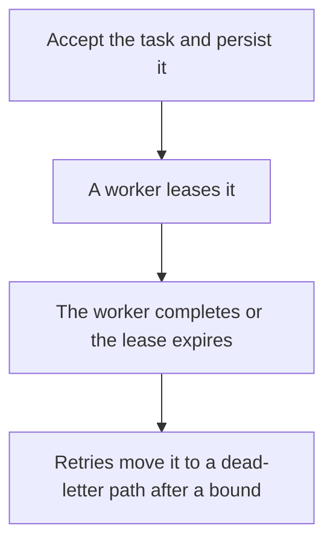

# D17-T024 — Distributed task queue

Topic ID: `D17-T024`
Domain: Common System Design Problems
Subdomain: Distributed task queue
Importance: common
Complexity: intermediate
Dependencies: `D17-T023`, `D17-T001`, `D16-T001`, `D16-T002`, `D07-T001`, `D07-T002`
Execution status of the code in section F: unexecuted

## A. Topic Overview

A distributed task queue accepts a unit of work, stores it durably, and hands it to one of many workers. The API is enqueue and status. At-least-once delivery means workers must be idempotent. A visibility timeout hides a task while a worker runs it and returns it if the worker dies. The queue depth and the age of the oldest task are the capacity signals. A single consumer process is not this design.

In production this shows up as follows: An image-processing API stores a job row, returns 202, and workers in several processes lease jobs with SELECT FOR UPDATE SKIP LOCKED. The handler upserts by job id so a second lease does not double-charge the customer.

Interviewers use Distributed task queue to see whether you can state the failure mode, not only the definition. The failure to name is: two workers running the same task because the lease expired, or a poison task blocking one partition

Prerequisites: `D17-T023`, `D17-T001`, `D16-T001`, `D16-T002`, `D07-T001`, `D07-T002`. Later notes should link here instead of repeating the mechanism.

## B. First-Principles Explanation

A distributed task queue accepts a unit of work, stores it durably, and hands it to one of many workers. The API is enqueue and status. At-least-once delivery means workers must be idempotent. A visibility timeout hides a task while a worker runs it and returns it if the worker dies. The queue depth and the age of the oldest task are the capacity signals. A single consumer process is not this design.

The useful picture is: The queue is a workshop clipboard. A lease is a mechanic writing their name next to a job. If they vanish, the name is erased after a timer and someone else can take the job.

What has to be true:

1. Accept the task and persist it
2. A worker leases it
3. The worker completes or the lease expires
4. Retries move it to a dead-letter path after a bound

It works when those steps preserve one invariant. It fails when two workers running the same task because the lease expired, or a poison task blocking one partition. The alternative is: the work is a request-scoped function that can finish before the HTTP response

## C. Internal Working and Architecture

Components involved: the caller, the state Distributed task queue mutates or reads, and the observer that reports oldest task age, lease expirations, and duplicate execution count.

Execution:

1. Accept the task and persist it
2. A worker leases it
3. The worker completes or the lease expires
4. Retries move it to a dead-letter path after a bound

Data moves only along that path. A retry re-enters at step 1, so the operation must say what a duplicate does. Memory and locks stay inside this mechanism. Callers see the result or a typed error, not a half-updated invariant.

State to remember: choose this when work must survive the API process and run on a pool of workers. Do not choose it when the work is a request-scoped function that can finish before the HTTP response.

## D. Diagrams and Visual Models



Read the diagram from top to bottom. Each box is one step of Distributed task queue. The failure mode (two workers running the same task because the lease expired, or a poison task blocking one partition) is what you look for when a later box never happens or happens twice.

## E. Examples and Analogies

Analogy: The queue is a workshop clipboard. A lease is a mechanic writing their name next to a job. If they vanish, the name is erased after a timer and someone else can take the job.

Production example: An image-processing API stores a job row, returns 202, and workers in several processes lease jobs with SELECT FOR UPDATE SKIP LOCKED. The handler upserts by job id so a second lease does not double-charge the customer.

A small counterexample is enough in an interview. Show the input, apply the steps, and show the broken outcome if someone uses the mechanism outside its rule: two workers running the same task because the lease expired, or a poison task blocking one partition.

## F. Code Examples

The snippet is labeled unexecuted. It illustrates the shape of the idea. It is not a benchmark and it embeds no secret.

```python
def enqueue(db, task):
    db.insert('tasks', id=task['id'], status='ready', payload=task)
```

After the snippet, check oldest task age, lease expirations, and duplicate execution count. If that signal moves the wrong way, the snippet is the wrong tool for the workload.

## G. Practical Backend Application

Use Distributed task queue in a service when work must survive the API process and run on a pool of workers.

A typical place is the production case already stated: An image-processing API stores a job row, returns 202, and workers in several processes lease jobs with SELECT FOR UPDATE SKIP LOCKED. The handler upserts by job id so a second lease does not double-charge the customer.

Operationally you alert on oldest task age, lease expirations, and duplicate execution count. You do not alert only on process uptime. The dashboard should show the failure mode, a success rate, and the saturation signal (queue depth, lock wait, or latency) that predicts it.

## H. Advantages, Limitations and Trade-offs

| Choice | Benefit | Cost | Choose when | Avoid when |
| --- | --- | --- | --- | --- |
| Apply Distributed task queue | work must survive the API process and run on a pool of workers | Extra moving parts and a new failure mode | The failure you are preventing is already real | the work is a request-scoped function that can finish before the HTTP response |
| Simpler alternative | Less code and fewer dependencies | two workers running the same task because the lease expired, or a poison task blocking one partition | The workload does not hit the limit | The invariant must hold under concurrency or failure |

Distributed task queue is a trade. State the benefit and the cost in the same sentence when you propose it in a design review.

## I. Common Mistakes and Misconceptions

- In-memory queues.
- No idempotency key.
- A visibility timeout shorter than the job.
- Treating a diagram of Distributed task queue as proof that the invariant holds in production.
- Copying a default configuration without naming oldest task age, lease expirations, and duplicate execution count.

## J. Debugging and Troubleshooting

Symptom: two workers running the same task because the lease expired, or a poison task blocking one partition

First check: oldest task age, lease expirations, and duplicate execution count.

Then compare one healthy instance against one unhealthy instance. Confirm whether retries are duplicating work. Confirm whether a timeout is shorter than the work. Fix the invariant, then watch the same metric for a full peak, not only for the next minute.

Useful questions: did the step order in section C actually happen, or did a caller skip a step? Did a deploy change the data shape that Distributed task queue assumes?

## K. Interview Preparation

### Beginner

#### Q1. What problem does Distributed task queue solve?

**Answer:** A distributed task queue accepts a unit of work, stores it durably, and hands it to one of many workers. The API is enqueue and status. At-least-once delivery means workers must be idempotent. A visibility timeout hides a task while a worker runs it and returns it if the worker dies. The queue depth and the age of the oldest task are the capacity signals. A single consumer process is not this design. Without it, the usual backend failure is: two workers running the same task because the lease expired, or a poison task blocking one partition.

#### Q2. Where does Distributed task queue sit on a request path?

**Answer:** Distributed task queue is not a library you sprinkle on every call. work must survive the API process and run on a pool of workers You notice it when oldest task age, lease expirations, and duplicate execution count. Name the constraint that makes this choice correct. Say what you would measure to confirm it.

#### Q3. Give a concrete example of Distributed task queue.

**Answer:** An image-processing API stores a job row, returns 202, and workers in several processes lease jobs with SELECT FOR UPDATE SKIP LOCKED. The handler upserts by job id so a second lease does not double-charge the customer. Walk the input, the state change, and the observable output. Name the constraint that makes this choice correct.

#### Q4. What is a common mix-up around Distributed task queue?

**Answer:** two workers running the same task because the lease expired, or a poison task blocking one partition The corrective check is oldest task age, lease expirations, and duplicate execution count. Name the constraint that makes this choice correct. Say what you would measure to confirm it. Say which alternative you rejected and why.

#### Q5. When would you skip Distributed task queue?

**Answer:** the work is a request-scoped function that can finish before the HTTP response Skipping is a decision with a measured cost, not a slogan. Name the constraint that makes this choice correct. Say what you would measure to confirm it. Say which alternative you rejected and why.

### Intermediate

#### Q1. What invariant makes Distributed task queue correct?

**Answer:** A distributed task queue accepts a unit of work, stores it durably, and hands it to one of many workers. The API is enqueue and status. At-least-once delivery means workers must be idempotent. A visibility timeout hides a task while a worker runs it and returns it if the worker dies. The queue depth and the age of the oldest task are the capacity signals. A single consumer process is not this design. State the invariant before you name the tool.

#### Q2. How do you test Distributed task queue?

**Answer:** Assert the failure mode directly: two workers running the same task because the lease expired, or a poison task blocking one partition. The assertion should watch oldest task age, lease expirations, and duplicate execution count. Include a concurrent or retry case if the bug only appears then. Name the constraint that makes this choice correct.

#### Q3. What signal tells you Distributed task queue is misbehaving in production?

**Answer:** Watch oldest task age, lease expirations, and duplicate execution count. The user-visible symptom is usually two workers running the same task because the lease expired, or a poison task blocking one partition. Name the constraint that makes this choice correct. Say what you would measure to confirm it.

#### Q4. How would you introduce Distributed task queue into a legacy service?

**Answer:** work must survive the API process and run on a pool of workers Ship it behind a metric so you can compare the old path. Roll back if two workers running the same task because the lease expired, or a poison task blocking one partition gets worse. Name the constraint that makes this choice correct. Say what you would measure to confirm it.

#### Q5. What do you trade away by choosing Distributed task queue?

**Answer:** work must survive the API process and run on a pool of workers the work is a request-scoped function that can finish before the HTTP response Say the cost in latency, storage, or operational load. Name the constraint that makes this choice correct. Say what you would measure to confirm it. Say which alternative you rejected and why.

### Advanced

#### Q1. What breaks if a dependency of Distributed task queue is slow or down?

**Answer:** two workers running the same task because the lease expired, or a poison task blocking one partition Degrade using the rule: the work is a request-scoped function that can finish before the HTTP response. Timeouts must be shorter than the caller's deadline. Name the constraint that makes this choice correct. Say what you would measure to confirm it.

#### Q2. How does Distributed task queue behave under retries?

**Answer:** Retries repeat work, so Distributed task queue must define what a duplicate does. two workers running the same task because the lease expired, or a poison task blocking one partition Idempotency keys or fences belong next to the write, not in a comment. Name the constraint that makes this choice correct. Say what you would measure to confirm it.

#### Q3. What is the capacity limit of Distributed task queue?

**Answer:** The limit shows up as oldest task age, lease expirations, and duplicate execution count. Add capacity only after you know whether the bottleneck is CPU, lock wait, or network. Name the constraint that makes this choice correct. Say what you would measure to confirm it.

#### Q4. How do you evolve Distributed task queue without a flag day?

**Answer:** work must survive the API process and run on a pool of workers Version the contract or the on-disk format. Readers should tolerate one old and one new shape during the rollout. Name the constraint that makes this choice correct. Say what you would measure to confirm it.

#### Q5. What security or correctness bug hides inside Distributed task queue?

**Answer:** two workers running the same task because the lease expired, or a poison task blocking one partition Check authorization and tenancy at the same boundary as the mechanism. A cache or queue must not widen who can read the data. Name the constraint that makes this choice correct. Say what you would measure to confirm it.

### Scenario

#### Q1. Incident: two workers running the same task because the lease expired, or a poison task blocking one partition. What do you check first?

**Answer:** Start with oldest task age, lease expirations, and duplicate execution count. Compare a good host and a bad host before you restart anything. A distributed task queue accepts a unit of work, stores it durably, and hands it to one of many workers. The API is enqueue and status. At-least-once delivery means workers must be idempotent. A visibility timeout hides a task while a worker runs it and returns it if the worker dies. The queue depth and the age of the oldest task are the capacity signals. A single consumer process is not this design.

#### Q2. A reviewer wants the clever version. What data settles it?

**Answer:** work must survive the API process and run on a pool of workers the work is a request-scoped function that can finish before the HTTP response Bring oldest task age, lease expirations, and duplicate execution count from a load test or from production, not a slogan. Name the constraint that makes this choice correct. Say what you would measure to confirm it. Say which alternative you rejected and why.

#### Q3. You have one hour to explain Distributed task queue at a whiteboard.

**Answer:** Draw the happy path in four boxes. Then draw the failure: two workers running the same task because the lease expired, or a poison task blocking one partition. End with the metric you would page on. Name the constraint that makes this choice correct.

#### Q4. The bug only appears under two concurrent callers.

**Answer:** two workers running the same task because the lease expired, or a poison task blocking one partition Reproduce with a barrier so both sides enter the critical window. Confirm the fix with oldest task age, lease expirations, and duplicate execution count. Name the constraint that makes this choice correct. Say what you would measure to confirm it.

#### Q5. Leadership wants this on every service next week.

**Answer:** the work is a request-scoped function that can finish before the HTTP response work must survive the API process and run on a pool of workers Roll it out where the failure mode is already hurting users. Name the constraint that makes this choice correct. Say what you would measure to confirm it. Say which alternative you rejected and why.

### Follow-up

#### Q1. What did you assume about the data size or the clock?

**Answer:** A distributed task queue accepts a unit of work, stores it durably, and hands it to one of many workers. The API is enqueue and status. At-least-once delivery means workers must be idempotent. A visibility timeout hides a task while a worker runs it and returns it if the worker dies. The queue depth and the age of the oldest task are the capacity signals. A single consumer process is not this design. Clocks are not a total order across machines. State whether the algorithm needs bounded size or a single leader.

#### Q2. What would you measure after the change ships?

**Answer:** Page on oldest task age, lease expirations, and duplicate execution count. Keep a before/after dashboard for one week. Alert on the failure mode, not only on CPU. Name the constraint that makes this choice correct.

#### Q3. Which neighboring topic did you deliberately not re-teach?

**Answer:** This note owns Distributed task queue. Related identifiers are in section N. Shared ideas are linked, not copied. Name the constraint that makes this choice correct.

## L. Practical Exercises

Solutions are in `EXERCISES/solutions/D17-T024.md`, not in this section.

1. Whiteboard the four steps of Distributed task queue and mark where `two workers running the same task because the lease expired, or a poison task blocking one partition` enters.
2. Read the snippet in section F and write the assertion that would catch that failure. The assertion must mention `oldest task age, lease expirations, and duplicate execution count`.
3. Argue for or against using Distributed task queue on a service you know. Use the choose and avoid rows from section H. Do not appeal to popularity.

## M. Revision Notes

- Mechanism: A distributed task queue accepts a unit of work, stores it durably, and hands it to one of many workers.
- Failure: two workers running the same task because the lease expired, or a poison task blocking one partition
- Metric: oldest task age, lease expirations, and duplicate execution count
- Choose when: work must survive the API process and run on a pool of workers
- Avoid when: the work is a request-scoped function that can finish before the HTTP response

## N. Related Topics

Dependencies to review first: `D17-T023`, `D17-T001`, `D16-T001`, `D16-T002`, `D07-T001`, `D07-T002`.

Shared ideas stay in those notes. This note does not restate them.

## O. Completion Criteria

- You can explain Distributed task queue without reading this note, including the failure mode.
- You can draw the diagram in section D from memory.
- You can say when not to use it, using the avoid condition in section H.
- You can name the metric you would watch after shipping it.
