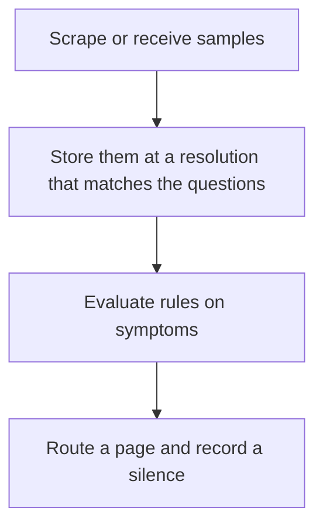

# D17-T026 — Metrics monitoring system

Topic ID: `D17-T026`
Domain: Common System Design Problems
Subdomain: Metrics monitoring system
Importance: common
Complexity: intermediate
Dependencies: `D17-T025`, `D17-T001`, `D16-T001`, `D16-T002`, `D07-T001`, `D07-T002`
Execution status of the code in section F: unexecuted

## A. Topic Overview

A metrics monitoring system stores time series and evaluates alert rules. A sample is a name, labels, a value, and a time. Alerting on symptoms that users feel, such as error rate and latency, beats alerting on causes such as CPU alone. The system needs a push or pull scrape, a retention policy, and a page route that a human will answer. A dashboard nobody alerts on is a picture.

In production this shows up as follows: The API pages when the five-minute 5xx rate and p99 latency both break the SLO for ten minutes. CPU is a chart on the same dashboard and is not a page by itself.

Interviewers use Metrics monitoring system to see whether you can state the failure mode, not only the definition. The failure to name is: a page on a noisy gauge that trains people to ignore the real outage, or a rule that fires for a single blip

Prerequisites: `D17-T025`, `D17-T001`, `D16-T001`, `D16-T002`, `D07-T001`, `D07-T002`. Later notes should link here instead of repeating the mechanism.

## B. First-Principles Explanation

A metrics monitoring system stores time series and evaluates alert rules. A sample is a name, labels, a value, and a time. Alerting on symptoms that users feel, such as error rate and latency, beats alerting on causes such as CPU alone. The system needs a push or pull scrape, a retention policy, and a page route that a human will answer. A dashboard nobody alerts on is a picture.

The useful picture is: Monitoring is a smoke alarm, not a scrapbook. It should ring when the room is filling with smoke, not every time someone strikes a match.

What has to be true:

1. Scrape or receive samples
2. Store them at a resolution that matches the questions
3. Evaluate rules on symptoms
4. Route a page and record a silence

It works when those steps preserve one invariant. It fails when a page on a noisy gauge that trains people to ignore the real outage, or a rule that fires for a single blip. The alternative is: you alert on every container restart

## C. Internal Working and Architecture

Components involved: the caller, the state Metrics monitoring system mutates or reads, and the observer that reports page precision, time to detect, and number of series.

Execution:

1. Scrape or receive samples
2. Store them at a resolution that matches the questions
3. Evaluate rules on symptoms
4. Route a page and record a silence

Data moves only along that path. A retry re-enters at step 1, so the operation must say what a duplicate does. Memory and locks stay inside this mechanism. Callers see the result or a typed error, not a half-updated invariant.

State to remember: choose this when you need to wake a human for a user-visible failure. Do not choose it when you alert on every container restart.

## D. Diagrams and Visual Models



Read the diagram from top to bottom. Each box is one step of Metrics monitoring system. The failure mode (a page on a noisy gauge that trains people to ignore the real outage, or a rule that fires for a single blip) is what you look for when a later box never happens or happens twice.

## E. Examples and Analogies

Analogy: Monitoring is a smoke alarm, not a scrapbook. It should ring when the room is filling with smoke, not every time someone strikes a match.

Production example: The API pages when the five-minute 5xx rate and p99 latency both break the SLO for ten minutes. CPU is a chart on the same dashboard and is not a page by itself.

A small counterexample is enough in an interview. Show the input, apply the steps, and show the broken outcome if someone uses the mechanism outside its rule: a page on a noisy gauge that trains people to ignore the real outage, or a rule that fires for a single blip.

## F. Code Examples

The snippet is labeled unexecuted. It illustrates the shape of the idea. It is not a benchmark and it embeds no secret.

```python
def burn(error_rate, budget):
    return error_rate > budget
```

After the snippet, check page precision, time to detect, and number of series. If that signal moves the wrong way, the snippet is the wrong tool for the workload.

## G. Practical Backend Application

Use Metrics monitoring system in a service when you need to wake a human for a user-visible failure.

A typical place is the production case already stated: The API pages when the five-minute 5xx rate and p99 latency both break the SLO for ten minutes. CPU is a chart on the same dashboard and is not a page by itself.

Operationally you alert on page precision, time to detect, and number of series. You do not alert only on process uptime. The dashboard should show the failure mode, a success rate, and the saturation signal (queue depth, lock wait, or latency) that predicts it.

## H. Advantages, Limitations and Trade-offs

| Choice | Benefit | Cost | Choose when | Avoid when |
| --- | --- | --- | --- | --- |
| Apply Metrics monitoring system | you need to wake a human for a user-visible failure | Extra moving parts and a new failure mode | The failure you are preventing is already real | you alert on every container restart |
| Simpler alternative | Less code and fewer dependencies | a page on a noisy gauge that trains people to ignore the real outage, or a rule that fires for a single blip | The workload does not hit the limit | The invariant must hold under concurrency or failure |

Metrics monitoring system is a trade. State the benefit and the cost in the same sentence when you propose it in a design review.

## I. Common Mistakes and Misconceptions

- High-cardinality labels.
- No runbook on the alert.
- Thresholds copied from another service.
- Treating a diagram of Metrics monitoring system as proof that the invariant holds in production.
- Copying a default configuration without naming page precision, time to detect, and number of series.

## J. Debugging and Troubleshooting

Symptom: a page on a noisy gauge that trains people to ignore the real outage, or a rule that fires for a single blip

First check: page precision, time to detect, and number of series.

Then compare one healthy instance against one unhealthy instance. Confirm whether retries are duplicating work. Confirm whether a timeout is shorter than the work. Fix the invariant, then watch the same metric for a full peak, not only for the next minute.

Useful questions: did the step order in section C actually happen, or did a caller skip a step? Did a deploy change the data shape that Metrics monitoring system assumes?

## K. Interview Preparation

### Beginner

#### Q1. What problem does Metrics monitoring system solve?

**Answer:** A metrics monitoring system stores time series and evaluates alert rules. A sample is a name, labels, a value, and a time. Alerting on symptoms that users feel, such as error rate and latency, beats alerting on causes such as CPU alone. The system needs a push or pull scrape, a retention policy, and a page route that a human will answer. A dashboard nobody alerts on is a picture. Without it, the usual backend failure is: a page on a noisy gauge that trains people to ignore the real outage, or a rule that fires for a single blip.

#### Q2. Where does Metrics monitoring system sit on a request path?

**Answer:** Metrics monitoring system is not a library you sprinkle on every call. you need to wake a human for a user-visible failure You notice it when page precision, time to detect, and number of series. Name the constraint that makes this choice correct. Say what you would measure to confirm it.

#### Q3. Give a concrete example of Metrics monitoring system.

**Answer:** The API pages when the five-minute 5xx rate and p99 latency both break the SLO for ten minutes. CPU is a chart on the same dashboard and is not a page by itself. Walk the input, the state change, and the observable output. Name the constraint that makes this choice correct.

#### Q4. What is a common mix-up around Metrics monitoring system?

**Answer:** a page on a noisy gauge that trains people to ignore the real outage, or a rule that fires for a single blip The corrective check is page precision, time to detect, and number of series. Name the constraint that makes this choice correct. Say what you would measure to confirm it. Say which alternative you rejected and why.

#### Q5. When would you skip Metrics monitoring system?

**Answer:** you alert on every container restart Skipping is a decision with a measured cost, not a slogan. Name the constraint that makes this choice correct. Say what you would measure to confirm it. Say which alternative you rejected and why.

### Intermediate

#### Q1. What invariant makes Metrics monitoring system correct?

**Answer:** A metrics monitoring system stores time series and evaluates alert rules. A sample is a name, labels, a value, and a time. Alerting on symptoms that users feel, such as error rate and latency, beats alerting on causes such as CPU alone. The system needs a push or pull scrape, a retention policy, and a page route that a human will answer. A dashboard nobody alerts on is a picture. State the invariant before you name the tool.

#### Q2. How do you test Metrics monitoring system?

**Answer:** Assert the failure mode directly: a page on a noisy gauge that trains people to ignore the real outage, or a rule that fires for a single blip. The assertion should watch page precision, time to detect, and number of series. Include a concurrent or retry case if the bug only appears then. Name the constraint that makes this choice correct.

#### Q3. What signal tells you Metrics monitoring system is misbehaving in production?

**Answer:** Watch page precision, time to detect, and number of series. The user-visible symptom is usually a page on a noisy gauge that trains people to ignore the real outage, or a rule that fires for a single blip. Name the constraint that makes this choice correct. Say what you would measure to confirm it.

#### Q4. How would you introduce Metrics monitoring system into a legacy service?

**Answer:** you need to wake a human for a user-visible failure Ship it behind a metric so you can compare the old path. Roll back if a page on a noisy gauge that trains people to ignore the real outage, or a rule that fires for a single blip gets worse. Name the constraint that makes this choice correct. Say what you would measure to confirm it.

#### Q5. What do you trade away by choosing Metrics monitoring system?

**Answer:** you need to wake a human for a user-visible failure you alert on every container restart Say the cost in latency, storage, or operational load. Name the constraint that makes this choice correct. Say what you would measure to confirm it. Say which alternative you rejected and why.

### Advanced

#### Q1. What breaks if a dependency of Metrics monitoring system is slow or down?

**Answer:** a page on a noisy gauge that trains people to ignore the real outage, or a rule that fires for a single blip Degrade using the rule: you alert on every container restart. Timeouts must be shorter than the caller's deadline. Name the constraint that makes this choice correct. Say what you would measure to confirm it.

#### Q2. How does Metrics monitoring system behave under retries?

**Answer:** Retries repeat work, so Metrics monitoring system must define what a duplicate does. a page on a noisy gauge that trains people to ignore the real outage, or a rule that fires for a single blip Idempotency keys or fences belong next to the write, not in a comment. Name the constraint that makes this choice correct. Say what you would measure to confirm it.

#### Q3. What is the capacity limit of Metrics monitoring system?

**Answer:** The limit shows up as page precision, time to detect, and number of series. Add capacity only after you know whether the bottleneck is CPU, lock wait, or network. Name the constraint that makes this choice correct. Say what you would measure to confirm it.

#### Q4. How do you evolve Metrics monitoring system without a flag day?

**Answer:** you need to wake a human for a user-visible failure Version the contract or the on-disk format. Readers should tolerate one old and one new shape during the rollout. Name the constraint that makes this choice correct. Say what you would measure to confirm it.

#### Q5. What security or correctness bug hides inside Metrics monitoring system?

**Answer:** a page on a noisy gauge that trains people to ignore the real outage, or a rule that fires for a single blip Check authorization and tenancy at the same boundary as the mechanism. A cache or queue must not widen who can read the data. Name the constraint that makes this choice correct. Say what you would measure to confirm it.

### Scenario

#### Q1. Incident: a page on a noisy gauge that trains people to ignore the real outage, or a rule that fires for a single blip. What do you check first?

**Answer:** Start with page precision, time to detect, and number of series. Compare a good host and a bad host before you restart anything. A metrics monitoring system stores time series and evaluates alert rules. A sample is a name, labels, a value, and a time. Alerting on symptoms that users feel, such as error rate and latency, beats alerting on causes such as CPU alone. The system needs a push or pull scrape, a retention policy, and a page route that a human will answer. A dashboard nobody alerts on is a picture.

#### Q2. A reviewer wants the clever version. What data settles it?

**Answer:** you need to wake a human for a user-visible failure you alert on every container restart Bring page precision, time to detect, and number of series from a load test or from production, not a slogan. Name the constraint that makes this choice correct. Say what you would measure to confirm it. Say which alternative you rejected and why.

#### Q3. You have one hour to explain Metrics monitoring system at a whiteboard.

**Answer:** Draw the happy path in four boxes. Then draw the failure: a page on a noisy gauge that trains people to ignore the real outage, or a rule that fires for a single blip. End with the metric you would page on. Name the constraint that makes this choice correct.

#### Q4. The bug only appears under two concurrent callers.

**Answer:** a page on a noisy gauge that trains people to ignore the real outage, or a rule that fires for a single blip Reproduce with a barrier so both sides enter the critical window. Confirm the fix with page precision, time to detect, and number of series. Name the constraint that makes this choice correct. Say what you would measure to confirm it.

#### Q5. Leadership wants this on every service next week.

**Answer:** you alert on every container restart you need to wake a human for a user-visible failure Roll it out where the failure mode is already hurting users. Name the constraint that makes this choice correct. Say what you would measure to confirm it. Say which alternative you rejected and why.

### Follow-up

#### Q1. What did you assume about the data size or the clock?

**Answer:** A metrics monitoring system stores time series and evaluates alert rules. A sample is a name, labels, a value, and a time. Alerting on symptoms that users feel, such as error rate and latency, beats alerting on causes such as CPU alone. The system needs a push or pull scrape, a retention policy, and a page route that a human will answer. A dashboard nobody alerts on is a picture. Clocks are not a total order across machines. State whether the algorithm needs bounded size or a single leader.

#### Q2. What would you measure after the change ships?

**Answer:** Page on page precision, time to detect, and number of series. Keep a before/after dashboard for one week. Alert on the failure mode, not only on CPU. Name the constraint that makes this choice correct.

#### Q3. Which neighboring topic did you deliberately not re-teach?

**Answer:** This note owns Metrics monitoring system. Related identifiers are in section N. Shared ideas are linked, not copied. Name the constraint that makes this choice correct.

## L. Practical Exercises

Solutions are in `EXERCISES/solutions/D17-T026.md`, not in this section.

1. Whiteboard the four steps of Metrics monitoring system and mark where `a page on a noisy gauge that trains people to ignore the real outage, or a rule that fires for a single blip` enters.
2. Read the snippet in section F and write the assertion that would catch that failure. The assertion must mention `page precision, time to detect, and number of series`.
3. Argue for or against using Metrics monitoring system on a service you know. Use the choose and avoid rows from section H. Do not appeal to popularity.

## M. Revision Notes

- Mechanism: A metrics monitoring system stores time series and evaluates alert rules.
- Failure: a page on a noisy gauge that trains people to ignore the real outage, or a rule that fires for a single blip
- Metric: page precision, time to detect, and number of series
- Choose when: you need to wake a human for a user-visible failure
- Avoid when: you alert on every container restart

## N. Related Topics

Dependencies to review first: `D17-T025`, `D17-T001`, `D16-T001`, `D16-T002`, `D07-T001`, `D07-T002`.

Shared ideas stay in those notes. This note does not restate them.

## O. Completion Criteria

- You can explain Metrics monitoring system without reading this note, including the failure mode.
- You can draw the diagram in section D from memory.
- You can say when not to use it, using the avoid condition in section H.
- You can name the metric you would watch after shipping it.
