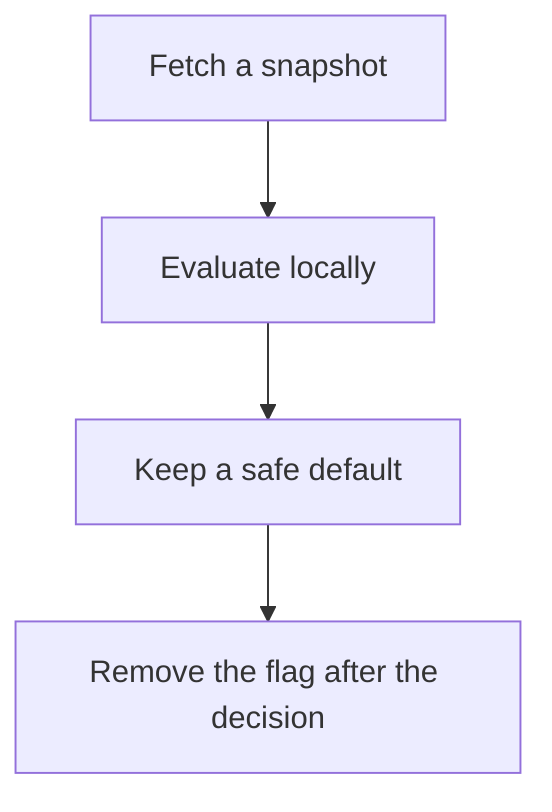

# D17-T027 — Feature flag service

Topic ID: `D17-T027`
Domain: Common System Design Problems
Subdomain: Feature flag service
Importance: common
Complexity: intermediate
Dependencies: `D17-T026`, `D17-T001`, `D16-T001`, `D16-T002`, `D07-T001`, `D07-T002`
Execution status of the code in section F: unexecuted

## A. Topic Overview

A feature flag service answers whether a subject should see a behavior. Flags have a default, a set of rules, and a kill switch. Evaluation should be local and fast after a snapshot is fetched, so a flag service outage does not become an application outage. The snapshot has a TTL. Experiments need stable assignment. Flags that stay forever are unfinished code.

In production this shows up as follows: Checkout fetches flag snapshots every 30 seconds and evaluates in process. The new payment path defaults off. A kill switch flips the snapshot. Requests do not wait on the flag service.

Interviewers use Feature flag service to see whether you can state the failure mode, not only the definition. The failure to name is: a flag check that calls the network on every request, or a default that enables a broken feature when the snapshot is missing

Prerequisites: `D17-T026`, `D17-T001`, `D16-T001`, `D16-T002`, `D07-T001`, `D07-T002`. Later notes should link here instead of repeating the mechanism.

## B. First-Principles Explanation

A feature flag service answers whether a subject should see a behavior. Flags have a default, a set of rules, and a kill switch. Evaluation should be local and fast after a snapshot is fetched, so a flag service outage does not become an application outage. The snapshot has a TTL. Experiments need stable assignment. Flags that stay forever are unfinished code.

The useful picture is: A flag is a light switch with a known off position. If the switchboard is unreachable, the light should fall to the safe position you chose in advance, not to a random one.

What has to be true:

1. Fetch a snapshot
2. Evaluate locally
3. Keep a safe default
4. Remove the flag after the decision

It works when those steps preserve one invariant. It fails when a flag check that calls the network on every request, or a default that enables a broken feature when the snapshot is missing. The alternative is: you put durable authorization or pricing in a flag with no audit

## C. Internal Working and Architecture

Components involved: the caller, the state Feature flag service mutates or reads, and the observer that reports evaluation latency, snapshot age, and flags older than the cleanup budget.

Execution:

1. Fetch a snapshot
2. Evaluate locally
3. Keep a safe default
4. Remove the flag after the decision

Data moves only along that path. A retry re-enters at step 1, so the operation must say what a duplicate does. Memory and locks stay inside this mechanism. Callers see the result or a typed error, not a half-updated invariant.

State to remember: choose this when a behavior must change without a redeploy, and the safe default is known. Do not choose it when you put durable authorization or pricing in a flag with no audit.

## D. Diagrams and Visual Models



Read the diagram from top to bottom. Each box is one step of Feature flag service. The failure mode (a flag check that calls the network on every request, or a default that enables a broken feature when the snapshot is missing) is what you look for when a later box never happens or happens twice.

## E. Examples and Analogies

Analogy: A flag is a light switch with a known off position. If the switchboard is unreachable, the light should fall to the safe position you chose in advance, not to a random one.

Production example: Checkout fetches flag snapshots every 30 seconds and evaluates in process. The new payment path defaults off. A kill switch flips the snapshot. Requests do not wait on the flag service.

A small counterexample is enough in an interview. Show the input, apply the steps, and show the broken outcome if someone uses the mechanism outside its rule: a flag check that calls the network on every request, or a default that enables a broken feature when the snapshot is missing.

## F. Code Examples

The snippet is labeled unexecuted. It illustrates the shape of the idea. It is not a benchmark and it embeds no secret.

```python
def enabled(snapshot, name, default=False):
    flag = snapshot.get(name)
    if flag is None:
        return default
    return flag['on']
```

After the snippet, check evaluation latency, snapshot age, and flags older than the cleanup budget. If that signal moves the wrong way, the snippet is the wrong tool for the workload.

## G. Practical Backend Application

Use Feature flag service in a service when a behavior must change without a redeploy, and the safe default is known.

A typical place is the production case already stated: Checkout fetches flag snapshots every 30 seconds and evaluates in process. The new payment path defaults off. A kill switch flips the snapshot. Requests do not wait on the flag service.

Operationally you alert on evaluation latency, snapshot age, and flags older than the cleanup budget. You do not alert only on process uptime. The dashboard should show the failure mode, a success rate, and the saturation signal (queue depth, lock wait, or latency) that predicts it.

## H. Advantages, Limitations and Trade-offs

| Choice | Benefit | Cost | Choose when | Avoid when |
| --- | --- | --- | --- | --- |
| Apply Feature flag service | a behavior must change without a redeploy, and the safe default is known | Extra moving parts and a new failure mode | The failure you are preventing is already real | you put durable authorization or pricing in a flag with no audit |
| Simpler alternative | Less code and fewer dependencies | a flag check that calls the network on every request, or a default that enables a broken feature when the snapshot is missing | The workload does not hit the limit | The invariant must hold under concurrency or failure |

Feature flag service is a trade. State the benefit and the cost in the same sentence when you propose it in a design review.

## I. Common Mistakes and Misconceptions

- Remote evaluation on the hot path.
- No default.
- Flags that are never deleted.
- Treating a diagram of Feature flag service as proof that the invariant holds in production.
- Copying a default configuration without naming evaluation latency, snapshot age, and flags older than the cleanup budget.

## J. Debugging and Troubleshooting

Symptom: a flag check that calls the network on every request, or a default that enables a broken feature when the snapshot is missing

First check: evaluation latency, snapshot age, and flags older than the cleanup budget.

Then compare one healthy instance against one unhealthy instance. Confirm whether retries are duplicating work. Confirm whether a timeout is shorter than the work. Fix the invariant, then watch the same metric for a full peak, not only for the next minute.

Useful questions: did the step order in section C actually happen, or did a caller skip a step? Did a deploy change the data shape that Feature flag service assumes?

## K. Interview Preparation

### Beginner

#### Q1. What problem does Feature flag service solve?

**Answer:** A feature flag service answers whether a subject should see a behavior. Flags have a default, a set of rules, and a kill switch. Evaluation should be local and fast after a snapshot is fetched, so a flag service outage does not become an application outage. The snapshot has a TTL. Experiments need stable assignment. Flags that stay forever are unfinished code. Without it, the usual backend failure is: a flag check that calls the network on every request, or a default that enables a broken feature when the snapshot is missing.

#### Q2. Where does Feature flag service sit on a request path?

**Answer:** Feature flag service is not a library you sprinkle on every call. a behavior must change without a redeploy, and the safe default is known You notice it when evaluation latency, snapshot age, and flags older than the cleanup budget. Name the constraint that makes this choice correct. Say what you would measure to confirm it.

#### Q3. Give a concrete example of Feature flag service.

**Answer:** Checkout fetches flag snapshots every 30 seconds and evaluates in process. The new payment path defaults off. A kill switch flips the snapshot. Requests do not wait on the flag service. Walk the input, the state change, and the observable output.

#### Q4. What is a common mix-up around Feature flag service?

**Answer:** a flag check that calls the network on every request, or a default that enables a broken feature when the snapshot is missing The corrective check is evaluation latency, snapshot age, and flags older than the cleanup budget. Name the constraint that makes this choice correct. Say what you would measure to confirm it. Say which alternative you rejected and why.

#### Q5. When would you skip Feature flag service?

**Answer:** you put durable authorization or pricing in a flag with no audit Skipping is a decision with a measured cost, not a slogan. Name the constraint that makes this choice correct. Say what you would measure to confirm it. Say which alternative you rejected and why.

### Intermediate

#### Q1. What invariant makes Feature flag service correct?

**Answer:** A feature flag service answers whether a subject should see a behavior. Flags have a default, a set of rules, and a kill switch. Evaluation should be local and fast after a snapshot is fetched, so a flag service outage does not become an application outage. The snapshot has a TTL. Experiments need stable assignment. Flags that stay forever are unfinished code. State the invariant before you name the tool.

#### Q2. How do you test Feature flag service?

**Answer:** Assert the failure mode directly: a flag check that calls the network on every request, or a default that enables a broken feature when the snapshot is missing. The assertion should watch evaluation latency, snapshot age, and flags older than the cleanup budget. Include a concurrent or retry case if the bug only appears then. Name the constraint that makes this choice correct.

#### Q3. What signal tells you Feature flag service is misbehaving in production?

**Answer:** Watch evaluation latency, snapshot age, and flags older than the cleanup budget. The user-visible symptom is usually a flag check that calls the network on every request, or a default that enables a broken feature when the snapshot is missing. Name the constraint that makes this choice correct. Say what you would measure to confirm it.

#### Q4. How would you introduce Feature flag service into a legacy service?

**Answer:** a behavior must change without a redeploy, and the safe default is known Ship it behind a metric so you can compare the old path. Roll back if a flag check that calls the network on every request, or a default that enables a broken feature when the snapshot is missing gets worse. Name the constraint that makes this choice correct. Say what you would measure to confirm it.

#### Q5. What do you trade away by choosing Feature flag service?

**Answer:** a behavior must change without a redeploy, and the safe default is known you put durable authorization or pricing in a flag with no audit Say the cost in latency, storage, or operational load. Name the constraint that makes this choice correct. Say what you would measure to confirm it. Say which alternative you rejected and why.

### Advanced

#### Q1. What breaks if a dependency of Feature flag service is slow or down?

**Answer:** a flag check that calls the network on every request, or a default that enables a broken feature when the snapshot is missing Degrade using the rule: you put durable authorization or pricing in a flag with no audit. Timeouts must be shorter than the caller's deadline. Name the constraint that makes this choice correct. Say what you would measure to confirm it.

#### Q2. How does Feature flag service behave under retries?

**Answer:** Retries repeat work, so Feature flag service must define what a duplicate does. a flag check that calls the network on every request, or a default that enables a broken feature when the snapshot is missing Idempotency keys or fences belong next to the write, not in a comment. Name the constraint that makes this choice correct. Say what you would measure to confirm it.

#### Q3. What is the capacity limit of Feature flag service?

**Answer:** The limit shows up as evaluation latency, snapshot age, and flags older than the cleanup budget. Add capacity only after you know whether the bottleneck is CPU, lock wait, or network. Name the constraint that makes this choice correct. Say what you would measure to confirm it.

#### Q4. How do you evolve Feature flag service without a flag day?

**Answer:** a behavior must change without a redeploy, and the safe default is known Version the contract or the on-disk format. Readers should tolerate one old and one new shape during the rollout. Name the constraint that makes this choice correct. Say what you would measure to confirm it.

#### Q5. What security or correctness bug hides inside Feature flag service?

**Answer:** a flag check that calls the network on every request, or a default that enables a broken feature when the snapshot is missing Check authorization and tenancy at the same boundary as the mechanism. A cache or queue must not widen who can read the data. Name the constraint that makes this choice correct. Say what you would measure to confirm it.

### Scenario

#### Q1. Incident: a flag check that calls the network on every request, or a default that enables a broken feature when the snapshot is missing. What do you check first?

**Answer:** Start with evaluation latency, snapshot age, and flags older than the cleanup budget. Compare a good host and a bad host before you restart anything. A feature flag service answers whether a subject should see a behavior. Flags have a default, a set of rules, and a kill switch. Evaluation should be local and fast after a snapshot is fetched, so a flag service outage does not become an application outage. The snapshot has a TTL. Experiments need stable assignment. Flags that stay forever are unfinished code.

#### Q2. A reviewer wants the clever version. What data settles it?

**Answer:** a behavior must change without a redeploy, and the safe default is known you put durable authorization or pricing in a flag with no audit Bring evaluation latency, snapshot age, and flags older than the cleanup budget from a load test or from production, not a slogan. Name the constraint that makes this choice correct. Say what you would measure to confirm it. Say which alternative you rejected and why.

#### Q3. You have one hour to explain Feature flag service at a whiteboard.

**Answer:** Draw the happy path in four boxes. Then draw the failure: a flag check that calls the network on every request, or a default that enables a broken feature when the snapshot is missing. End with the metric you would page on. Name the constraint that makes this choice correct.

#### Q4. The bug only appears under two concurrent callers.

**Answer:** a flag check that calls the network on every request, or a default that enables a broken feature when the snapshot is missing Reproduce with a barrier so both sides enter the critical window. Confirm the fix with evaluation latency, snapshot age, and flags older than the cleanup budget. Name the constraint that makes this choice correct. Say what you would measure to confirm it.

#### Q5. Leadership wants this on every service next week.

**Answer:** you put durable authorization or pricing in a flag with no audit a behavior must change without a redeploy, and the safe default is known Roll it out where the failure mode is already hurting users. Name the constraint that makes this choice correct. Say what you would measure to confirm it. Say which alternative you rejected and why.

### Follow-up

#### Q1. What did you assume about the data size or the clock?

**Answer:** A feature flag service answers whether a subject should see a behavior. Flags have a default, a set of rules, and a kill switch. Evaluation should be local and fast after a snapshot is fetched, so a flag service outage does not become an application outage. The snapshot has a TTL. Experiments need stable assignment. Flags that stay forever are unfinished code. Clocks are not a total order across machines. State whether the algorithm needs bounded size or a single leader.

#### Q2. What would you measure after the change ships?

**Answer:** Page on evaluation latency, snapshot age, and flags older than the cleanup budget. Keep a before/after dashboard for one week. Alert on the failure mode, not only on CPU. Name the constraint that makes this choice correct.

#### Q3. Which neighboring topic did you deliberately not re-teach?

**Answer:** This note owns Feature flag service. Related identifiers are in section N. Shared ideas are linked, not copied. Name the constraint that makes this choice correct.

## L. Practical Exercises

Solutions are in `EXERCISES/solutions/D17-T027.md`, not in this section.

1. Whiteboard the four steps of Feature flag service and mark where `a flag check that calls the network on every request, or a default that enables a broken feature when the snapshot is missing` enters.
2. Read the snippet in section F and write the assertion that would catch that failure. The assertion must mention `evaluation latency, snapshot age, and flags older than the cleanup budget`.
3. Argue for or against using Feature flag service on a service you know. Use the choose and avoid rows from section H. Do not appeal to popularity.

## M. Revision Notes

- Mechanism: A feature flag service answers whether a subject should see a behavior.
- Failure: a flag check that calls the network on every request, or a default that enables a broken feature when the snapshot is missing
- Metric: evaluation latency, snapshot age, and flags older than the cleanup budget
- Choose when: a behavior must change without a redeploy, and the safe default is known
- Avoid when: you put durable authorization or pricing in a flag with no audit

## N. Related Topics

Dependencies to review first: `D17-T026`, `D17-T001`, `D16-T001`, `D16-T002`, `D07-T001`, `D07-T002`.

Shared ideas stay in those notes. This note does not restate them.

## O. Completion Criteria

- You can explain Feature flag service without reading this note, including the failure mode.
- You can draw the diagram in section D from memory.
- You can say when not to use it, using the avoid condition in section H.
- You can name the metric you would watch after shipping it.
