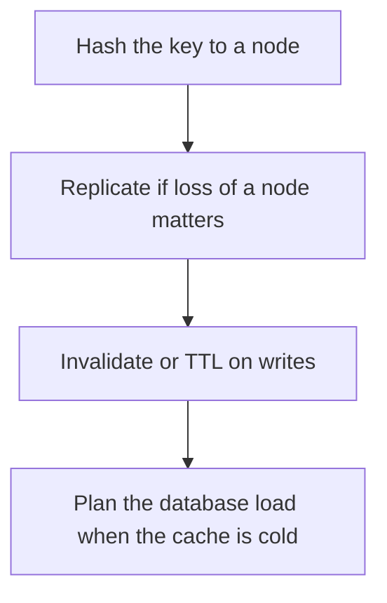

# D17-T028 — Distributed cache

Topic ID: `D17-T028`
Domain: Common System Design Problems
Subdomain: Distributed cache
Importance: core
Complexity: intermediate
Dependencies: `D17-T027`, `D17-T001`, `D16-T001`, `D16-T002`, `D07-T001`, `D07-T002`
Execution status of the code in section F: unexecuted

## A. Topic Overview

A distributed cache spreads keys across nodes so memory and throughput exceed one machine. Clients hash a key to a node. Consistent hashing or numbered slots reduce movement when a node is added. Replication covers a node failure and can serve stale reads. The hard problems are hot keys, thundering herds, and invalidation when the database changes. The cache is not the system of record.

In production this shows up as follows: Sessions and product JSON live in a sharded cache with TTLs. Prices are deleted on write. Losing the cluster hurts latency and must not lose orders, which live in the database.

Interviewers use Distributed cache to see whether you can state the failure mode, not only the definition. The failure to name is: a hot key on one node, or a cold start that melts the database

Prerequisites: `D17-T027`, `D17-T001`, `D16-T001`, `D16-T002`, `D07-T001`, `D07-T002`. Later notes should link here instead of repeating the mechanism.

## B. First-Principles Explanation

A distributed cache spreads keys across nodes so memory and throughput exceed one machine. Clients hash a key to a node. Consistent hashing or numbered slots reduce movement when a node is added. Replication covers a node failure and can serve stale reads. The hard problems are hot keys, thundering herds, and invalidation when the database changes. The cache is not the system of record.

The useful picture is: A distributed cache is a row of photocopy cabinets. The index on the door says which cabinet holds a name. If that cabinet burns, you either have a second copy or you go back to the archive.

What has to be true:

1. Hash the key to a node
2. Replicate if loss of a node matters
3. Invalidate or TTL on writes
4. Plan the database load when the cache is cold

It works when those steps preserve one invariant. It fails when a hot key on one node, or a cold start that melts the database. The alternative is: you store the only copy of a payment in the cache

## C. Internal Working and Architecture

Components involved: the caller, the state Distributed cache mutates or reads, and the observer that reports hit ratio, per-node CPU, and database QPS during a cache failure.

Execution:

1. Hash the key to a node
2. Replicate if loss of a node matters
3. Invalidate or TTL on writes
4. Plan the database load when the cache is cold

Data moves only along that path. A retry re-enters at step 1, so the operation must say what a duplicate does. Memory and locks stay inside this mechanism. Callers see the result or a typed error, not a half-updated invariant.

State to remember: choose this when a read working set is hot and larger than one cache node, and the database remains authoritative. Do not choose it when you store the only copy of a payment in the cache.

## D. Diagrams and Visual Models



Read the diagram from top to bottom. Each box is one step of Distributed cache. The failure mode (a hot key on one node, or a cold start that melts the database) is what you look for when a later box never happens or happens twice.

## E. Examples and Analogies

Analogy: A distributed cache is a row of photocopy cabinets. The index on the door says which cabinet holds a name. If that cabinet burns, you either have a second copy or you go back to the archive.

Production example: Sessions and product JSON live in a sharded cache with TTLs. Prices are deleted on write. Losing the cluster hurts latency and must not lose orders, which live in the database.

A small counterexample is enough in an interview. Show the input, apply the steps, and show the broken outcome if someone uses the mechanism outside its rule: a hot key on one node, or a cold start that melts the database.

## F. Code Examples

The snippet is labeled unexecuted. It illustrates the shape of the idea. It is not a benchmark and it embeds no secret.

```python
def node_for(key, nodes):
    return nodes[hash(key) % len(nodes)]
```

After the snippet, check hit ratio, per-node CPU, and database QPS during a cache failure. If that signal moves the wrong way, the snippet is the wrong tool for the workload.

## G. Practical Backend Application

Use Distributed cache in a service when a read working set is hot and larger than one cache node, and the database remains authoritative.

A typical place is the production case already stated: Sessions and product JSON live in a sharded cache with TTLs. Prices are deleted on write. Losing the cluster hurts latency and must not lose orders, which live in the database.

Operationally you alert on hit ratio, per-node CPU, and database QPS during a cache failure. You do not alert only on process uptime. The dashboard should show the failure mode, a success rate, and the saturation signal (queue depth, lock wait, or latency) that predicts it.

## H. Advantages, Limitations and Trade-offs

| Choice | Benefit | Cost | Choose when | Avoid when |
| --- | --- | --- | --- | --- |
| Apply Distributed cache | a read working set is hot and larger than one cache node, and the database remains authoritative | Extra moving parts and a new failure mode | The failure you are preventing is already real | you store the only copy of a payment in the cache |
| Simpler alternative | Less code and fewer dependencies | a hot key on one node, or a cold start that melts the database | The workload does not hit the limit | The invariant must hold under concurrency or failure |

Distributed cache is a trade. State the benefit and the cost in the same sentence when you propose it in a design review.

## I. Common Mistakes and Misconceptions

- No TTL and no invalidation.
- One key for a global counter.
- No capacity plan for a cold cache.
- Treating a diagram of Distributed cache as proof that the invariant holds in production.
- Copying a default configuration without naming hit ratio, per-node CPU, and database QPS during a cache failure.

## J. Debugging and Troubleshooting

Symptom: a hot key on one node, or a cold start that melts the database

First check: hit ratio, per-node CPU, and database QPS during a cache failure.

Then compare one healthy instance against one unhealthy instance. Confirm whether retries are duplicating work. Confirm whether a timeout is shorter than the work. Fix the invariant, then watch the same metric for a full peak, not only for the next minute.

Useful questions: did the step order in section C actually happen, or did a caller skip a step? Did a deploy change the data shape that Distributed cache assumes?

## K. Interview Preparation

### Beginner

#### Q1. What problem does Distributed cache solve?

**Answer:** A distributed cache spreads keys across nodes so memory and throughput exceed one machine. Clients hash a key to a node. Consistent hashing or numbered slots reduce movement when a node is added. Replication covers a node failure and can serve stale reads. The hard problems are hot keys, thundering herds, and invalidation when the database changes. The cache is not the system of record. Without it, the usual backend failure is: a hot key on one node, or a cold start that melts the database.

#### Q2. Where does Distributed cache sit on a request path?

**Answer:** Distributed cache is not a library you sprinkle on every call. a read working set is hot and larger than one cache node, and the database remains authoritative You notice it when hit ratio, per-node CPU, and database QPS during a cache failure. Name the constraint that makes this choice correct. Say what you would measure to confirm it.

#### Q3. Give a concrete example of Distributed cache.

**Answer:** Sessions and product JSON live in a sharded cache with TTLs. Prices are deleted on write. Losing the cluster hurts latency and must not lose orders, which live in the database. Walk the input, the state change, and the observable output.

#### Q4. What is a common mix-up around Distributed cache?

**Answer:** a hot key on one node, or a cold start that melts the database The corrective check is hit ratio, per-node CPU, and database QPS during a cache failure. Name the constraint that makes this choice correct. Say what you would measure to confirm it. Say which alternative you rejected and why.

#### Q5. When would you skip Distributed cache?

**Answer:** you store the only copy of a payment in the cache Skipping is a decision with a measured cost, not a slogan. Name the constraint that makes this choice correct. Say what you would measure to confirm it. Say which alternative you rejected and why.

### Intermediate

#### Q1. What invariant makes Distributed cache correct?

**Answer:** A distributed cache spreads keys across nodes so memory and throughput exceed one machine. Clients hash a key to a node. Consistent hashing or numbered slots reduce movement when a node is added. Replication covers a node failure and can serve stale reads. The hard problems are hot keys, thundering herds, and invalidation when the database changes. The cache is not the system of record. State the invariant before you name the tool.

#### Q2. How do you test Distributed cache?

**Answer:** Assert the failure mode directly: a hot key on one node, or a cold start that melts the database. The assertion should watch hit ratio, per-node CPU, and database QPS during a cache failure. Include a concurrent or retry case if the bug only appears then. Name the constraint that makes this choice correct.

#### Q3. What signal tells you Distributed cache is misbehaving in production?

**Answer:** Watch hit ratio, per-node CPU, and database QPS during a cache failure. The user-visible symptom is usually a hot key on one node, or a cold start that melts the database. Name the constraint that makes this choice correct. Say what you would measure to confirm it.

#### Q4. How would you introduce Distributed cache into a legacy service?

**Answer:** a read working set is hot and larger than one cache node, and the database remains authoritative Ship it behind a metric so you can compare the old path. Roll back if a hot key on one node, or a cold start that melts the database gets worse. Name the constraint that makes this choice correct. Say what you would measure to confirm it.

#### Q5. What do you trade away by choosing Distributed cache?

**Answer:** a read working set is hot and larger than one cache node, and the database remains authoritative you store the only copy of a payment in the cache Say the cost in latency, storage, or operational load. Name the constraint that makes this choice correct. Say what you would measure to confirm it. Say which alternative you rejected and why.

### Advanced

#### Q1. What breaks if a dependency of Distributed cache is slow or down?

**Answer:** a hot key on one node, or a cold start that melts the database Degrade using the rule: you store the only copy of a payment in the cache. Timeouts must be shorter than the caller's deadline. Name the constraint that makes this choice correct. Say what you would measure to confirm it.

#### Q2. How does Distributed cache behave under retries?

**Answer:** Retries repeat work, so Distributed cache must define what a duplicate does. a hot key on one node, or a cold start that melts the database Idempotency keys or fences belong next to the write, not in a comment. Name the constraint that makes this choice correct. Say what you would measure to confirm it.

#### Q3. What is the capacity limit of Distributed cache?

**Answer:** The limit shows up as hit ratio, per-node CPU, and database QPS during a cache failure. Add capacity only after you know whether the bottleneck is CPU, lock wait, or network. Name the constraint that makes this choice correct. Say what you would measure to confirm it.

#### Q4. How do you evolve Distributed cache without a flag day?

**Answer:** a read working set is hot and larger than one cache node, and the database remains authoritative Version the contract or the on-disk format. Readers should tolerate one old and one new shape during the rollout. Name the constraint that makes this choice correct. Say what you would measure to confirm it.

#### Q5. What security or correctness bug hides inside Distributed cache?

**Answer:** a hot key on one node, or a cold start that melts the database Check authorization and tenancy at the same boundary as the mechanism. A cache or queue must not widen who can read the data. Name the constraint that makes this choice correct. Say what you would measure to confirm it.

### Scenario

#### Q1. Incident: a hot key on one node, or a cold start that melts the database. What do you check first?

**Answer:** Start with hit ratio, per-node CPU, and database QPS during a cache failure. Compare a good host and a bad host before you restart anything. A distributed cache spreads keys across nodes so memory and throughput exceed one machine. Clients hash a key to a node. Consistent hashing or numbered slots reduce movement when a node is added. Replication covers a node failure and can serve stale reads. The hard problems are hot keys, thundering herds, and invalidation when the database changes. The cache is not the system of record.

#### Q2. A reviewer wants the clever version. What data settles it?

**Answer:** a read working set is hot and larger than one cache node, and the database remains authoritative you store the only copy of a payment in the cache Bring hit ratio, per-node CPU, and database QPS during a cache failure from a load test or from production, not a slogan. Name the constraint that makes this choice correct. Say what you would measure to confirm it. Say which alternative you rejected and why.

#### Q3. You have one hour to explain Distributed cache at a whiteboard.

**Answer:** Draw the happy path in four boxes. Then draw the failure: a hot key on one node, or a cold start that melts the database. End with the metric you would page on. Name the constraint that makes this choice correct.

#### Q4. The bug only appears under two concurrent callers.

**Answer:** a hot key on one node, or a cold start that melts the database Reproduce with a barrier so both sides enter the critical window. Confirm the fix with hit ratio, per-node CPU, and database QPS during a cache failure. Name the constraint that makes this choice correct. Say what you would measure to confirm it.

#### Q5. Leadership wants this on every service next week.

**Answer:** you store the only copy of a payment in the cache a read working set is hot and larger than one cache node, and the database remains authoritative Roll it out where the failure mode is already hurting users. Name the constraint that makes this choice correct. Say what you would measure to confirm it. Say which alternative you rejected and why.

### Follow-up

#### Q1. What did you assume about the data size or the clock?

**Answer:** A distributed cache spreads keys across nodes so memory and throughput exceed one machine. Clients hash a key to a node. Consistent hashing or numbered slots reduce movement when a node is added. Replication covers a node failure and can serve stale reads. The hard problems are hot keys, thundering herds, and invalidation when the database changes. The cache is not the system of record. Clocks are not a total order across machines. State whether the algorithm needs bounded size or a single leader.

#### Q2. What would you measure after the change ships?

**Answer:** Page on hit ratio, per-node CPU, and database QPS during a cache failure. Keep a before/after dashboard for one week. Alert on the failure mode, not only on CPU. Name the constraint that makes this choice correct.

#### Q3. Which neighboring topic did you deliberately not re-teach?

**Answer:** This note owns Distributed cache. Related identifiers are in section N. Shared ideas are linked, not copied. Name the constraint that makes this choice correct.

## L. Practical Exercises

Solutions are in `EXERCISES/solutions/D17-T028.md`, not in this section.

1. Whiteboard the four steps of Distributed cache and mark where `a hot key on one node, or a cold start that melts the database` enters.
2. Read the snippet in section F and write the assertion that would catch that failure. The assertion must mention `hit ratio, per-node CPU, and database QPS during a cache failure`.
3. Argue for or against using Distributed cache on a service you know. Use the choose and avoid rows from section H. Do not appeal to popularity.

## M. Revision Notes

- Mechanism: A distributed cache spreads keys across nodes so memory and throughput exceed one machine.
- Failure: a hot key on one node, or a cold start that melts the database
- Metric: hit ratio, per-node CPU, and database QPS during a cache failure
- Choose when: a read working set is hot and larger than one cache node, and the database remains authoritative
- Avoid when: you store the only copy of a payment in the cache

## N. Related Topics

Dependencies to review first: `D17-T027`, `D17-T001`, `D16-T001`, `D16-T002`, `D07-T001`, `D07-T002`.

Shared ideas stay in those notes. This note does not restate them.

## O. Completion Criteria

- You can explain Distributed cache without reading this note, including the failure mode.
- You can draw the diagram in section D from memory.
- You can say when not to use it, using the avoid condition in section H.
- You can name the metric you would watch after shipping it.
