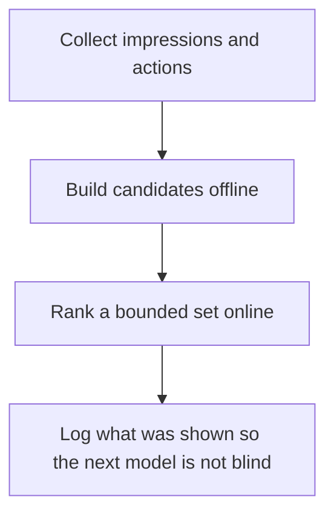

# D17-T029 — Recommendation system

Topic ID: `D17-T029`
Domain: Common System Design Problems
Subdomain: Recommendation system
Importance: common
Complexity: intermediate
Dependencies: `D17-T028`, `D17-T001`, `D16-T001`, `D16-T002`, `D07-T001`, `D07-T002`
Execution status of the code in section F: unexecuted

## A. Topic Overview

A recommendation system generates a ranked list of items for a user from signals such as clicks and purchases. Online serving must meet a latency budget, so it reads precomputed candidates and features, then ranks a small set. Offline jobs train models and build those candidates. The feedback loop is biased by what you already showed. A cold start has no history.

In production this shows up as follows: The home page reads a precomputed candidate list from a cache and applies a lightweight ranker. A nightly job rebuilds candidates. A brand-new user gets a popularity list. The service logs impressions.

Interviewers use Recommendation system to see whether you can state the failure mode, not only the definition. The failure to name is: serving a model that reads the live database for every candidate and misses the latency SLO, or training only on clicked items and ignoring what was not shown

Prerequisites: `D17-T028`, `D17-T001`, `D16-T001`, `D16-T002`, `D07-T001`, `D07-T002`. Later notes should link here instead of repeating the mechanism.

## B. First-Principles Explanation

A recommendation system generates a ranked list of items for a user from signals such as clicks and purchases. Online serving must meet a latency budget, so it reads precomputed candidates and features, then ranks a small set. Offline jobs train models and build those candidates. The feedback loop is biased by what you already showed. A cold start has no history.

The useful picture is: Recommendations are a short list prepared before the guest arrives, not a librarian running into the stacks after the guest asks. The list is only as honest as the notes about what the guest ignored.

What has to be true:

1. Collect impressions and actions
2. Build candidates offline
3. Rank a bounded set online
4. Log what was shown so the next model is not blind

It works when those steps preserve one invariant. It fails when serving a model that reads the live database for every candidate and misses the latency SLO, or training only on clicked items and ignoring what was not shown. The alternative is: you compute a huge model inside the user request

## C. Internal Working and Architecture

Components involved: the caller, the state Recommendation system mutates or reads, and the observer that reports serving p99, candidate count, and online metric movement after a model deploy.

Execution:

1. Collect impressions and actions
2. Build candidates offline
3. Rank a bounded set online
4. Log what was shown so the next model is not blind

Data moves only along that path. A retry re-enters at step 1, so the operation must say what a duplicate does. Memory and locks stay inside this mechanism. Callers see the result or a typed error, not a half-updated invariant.

State to remember: choose this when you need a ranked list and you can precompute. Do not choose it when you compute a huge model inside the user request.

## D. Diagrams and Visual Models



Read the diagram from top to bottom. Each box is one step of Recommendation system. The failure mode (serving a model that reads the live database for every candidate and misses the latency SLO, or training only on clicked items and ignoring what was not shown) is what you look for when a later box never happens or happens twice.

## E. Examples and Analogies

Analogy: Recommendations are a short list prepared before the guest arrives, not a librarian running into the stacks after the guest asks. The list is only as honest as the notes about what the guest ignored.

Production example: The home page reads a precomputed candidate list from a cache and applies a lightweight ranker. A nightly job rebuilds candidates. A brand-new user gets a popularity list. The service logs impressions.

A small counterexample is enough in an interview. Show the input, apply the steps, and show the broken outcome if someone uses the mechanism outside its rule: serving a model that reads the live database for every candidate and misses the latency SLO, or training only on clicked items and ignoring what was not shown.

## F. Code Examples

The snippet is labeled unexecuted. It illustrates the shape of the idea. It is not a benchmark and it embeds no secret.

```python
def rank(candidates, limit):
    return sorted(candidates, key=lambda c: c['score'], reverse=True)[:limit]
```

After the snippet, check serving p99, candidate count, and online metric movement after a model deploy. If that signal moves the wrong way, the snippet is the wrong tool for the workload.

## G. Practical Backend Application

Use Recommendation system in a service when you need a ranked list and you can precompute.

A typical place is the production case already stated: The home page reads a precomputed candidate list from a cache and applies a lightweight ranker. A nightly job rebuilds candidates. A brand-new user gets a popularity list. The service logs impressions.

Operationally you alert on serving p99, candidate count, and online metric movement after a model deploy. You do not alert only on process uptime. The dashboard should show the failure mode, a success rate, and the saturation signal (queue depth, lock wait, or latency) that predicts it.

## H. Advantages, Limitations and Trade-offs

| Choice | Benefit | Cost | Choose when | Avoid when |
| --- | --- | --- | --- | --- |
| Apply Recommendation system | you need a ranked list and you can precompute | Extra moving parts and a new failure mode | The failure you are preventing is already real | you compute a huge model inside the user request |
| Simpler alternative | Less code and fewer dependencies | serving a model that reads the live database for every candidate and misses the latency SLO, or training only on clicked items and ignoring what was not shown | The workload does not hit the limit | The invariant must hold under concurrency or failure |

Recommendation system is a trade. State the benefit and the cost in the same sentence when you propose it in a design review.

## I. Common Mistakes and Misconceptions

- No impression log.
- No cold-start path.
- An unbounded candidate set on the request.
- Treating a diagram of Recommendation system as proof that the invariant holds in production.
- Copying a default configuration without naming serving p99, candidate count, and online metric movement after a model deploy.

## J. Debugging and Troubleshooting

Symptom: serving a model that reads the live database for every candidate and misses the latency SLO, or training only on clicked items and ignoring what was not shown

First check: serving p99, candidate count, and online metric movement after a model deploy.

Then compare one healthy instance against one unhealthy instance. Confirm whether retries are duplicating work. Confirm whether a timeout is shorter than the work. Fix the invariant, then watch the same metric for a full peak, not only for the next minute.

Useful questions: did the step order in section C actually happen, or did a caller skip a step? Did a deploy change the data shape that Recommendation system assumes?

## K. Interview Preparation

### Beginner

#### Q1. What problem does Recommendation system solve?

**Answer:** A recommendation system generates a ranked list of items for a user from signals such as clicks and purchases. Online serving must meet a latency budget, so it reads precomputed candidates and features, then ranks a small set. Offline jobs train models and build those candidates. The feedback loop is biased by what you already showed. A cold start has no history. Without it, the usual backend failure is: serving a model that reads the live database for every candidate and misses the latency SLO, or training only on clicked items and ignoring what was not shown.

#### Q2. Where does Recommendation system sit on a request path?

**Answer:** Recommendation system is not a library you sprinkle on every call. you need a ranked list and you can precompute You notice it when serving p99, candidate count, and online metric movement after a model deploy. Name the constraint that makes this choice correct. Say what you would measure to confirm it.

#### Q3. Give a concrete example of Recommendation system.

**Answer:** The home page reads a precomputed candidate list from a cache and applies a lightweight ranker. A nightly job rebuilds candidates. A brand-new user gets a popularity list. The service logs impressions. Walk the input, the state change, and the observable output.

#### Q4. What is a common mix-up around Recommendation system?

**Answer:** serving a model that reads the live database for every candidate and misses the latency SLO, or training only on clicked items and ignoring what was not shown The corrective check is serving p99, candidate count, and online metric movement after a model deploy. Name the constraint that makes this choice correct. Say what you would measure to confirm it. Say which alternative you rejected and why.

#### Q5. When would you skip Recommendation system?

**Answer:** you compute a huge model inside the user request Skipping is a decision with a measured cost, not a slogan. Name the constraint that makes this choice correct. Say what you would measure to confirm it. Say which alternative you rejected and why.

### Intermediate

#### Q1. What invariant makes Recommendation system correct?

**Answer:** A recommendation system generates a ranked list of items for a user from signals such as clicks and purchases. Online serving must meet a latency budget, so it reads precomputed candidates and features, then ranks a small set. Offline jobs train models and build those candidates. The feedback loop is biased by what you already showed. A cold start has no history. State the invariant before you name the tool.

#### Q2. How do you test Recommendation system?

**Answer:** Assert the failure mode directly: serving a model that reads the live database for every candidate and misses the latency SLO, or training only on clicked items and ignoring what was not shown. The assertion should watch serving p99, candidate count, and online metric movement after a model deploy. Include a concurrent or retry case if the bug only appears then. Name the constraint that makes this choice correct.

#### Q3. What signal tells you Recommendation system is misbehaving in production?

**Answer:** Watch serving p99, candidate count, and online metric movement after a model deploy. The user-visible symptom is usually serving a model that reads the live database for every candidate and misses the latency SLO, or training only on clicked items and ignoring what was not shown. Name the constraint that makes this choice correct. Say what you would measure to confirm it.

#### Q4. How would you introduce Recommendation system into a legacy service?

**Answer:** you need a ranked list and you can precompute Ship it behind a metric so you can compare the old path. Roll back if serving a model that reads the live database for every candidate and misses the latency SLO, or training only on clicked items and ignoring what was not shown gets worse. Name the constraint that makes this choice correct. Say what you would measure to confirm it.

#### Q5. What do you trade away by choosing Recommendation system?

**Answer:** you need a ranked list and you can precompute you compute a huge model inside the user request Say the cost in latency, storage, or operational load. Name the constraint that makes this choice correct. Say what you would measure to confirm it. Say which alternative you rejected and why.

### Advanced

#### Q1. What breaks if a dependency of Recommendation system is slow or down?

**Answer:** serving a model that reads the live database for every candidate and misses the latency SLO, or training only on clicked items and ignoring what was not shown Degrade using the rule: you compute a huge model inside the user request. Timeouts must be shorter than the caller's deadline. Name the constraint that makes this choice correct. Say what you would measure to confirm it.

#### Q2. How does Recommendation system behave under retries?

**Answer:** Retries repeat work, so Recommendation system must define what a duplicate does. serving a model that reads the live database for every candidate and misses the latency SLO, or training only on clicked items and ignoring what was not shown Idempotency keys or fences belong next to the write, not in a comment. Name the constraint that makes this choice correct. Say what you would measure to confirm it.

#### Q3. What is the capacity limit of Recommendation system?

**Answer:** The limit shows up as serving p99, candidate count, and online metric movement after a model deploy. Add capacity only after you know whether the bottleneck is CPU, lock wait, or network. Name the constraint that makes this choice correct. Say what you would measure to confirm it.

#### Q4. How do you evolve Recommendation system without a flag day?

**Answer:** you need a ranked list and you can precompute Version the contract or the on-disk format. Readers should tolerate one old and one new shape during the rollout. Name the constraint that makes this choice correct. Say what you would measure to confirm it.

#### Q5. What security or correctness bug hides inside Recommendation system?

**Answer:** serving a model that reads the live database for every candidate and misses the latency SLO, or training only on clicked items and ignoring what was not shown Check authorization and tenancy at the same boundary as the mechanism. A cache or queue must not widen who can read the data. Name the constraint that makes this choice correct. Say what you would measure to confirm it.

### Scenario

#### Q1. Incident: serving a model that reads the live database for every candidate and misses the latency SLO, or training only on clicked items and ignoring what was not shown. What do you check first?

**Answer:** Start with serving p99, candidate count, and online metric movement after a model deploy. Compare a good host and a bad host before you restart anything. A recommendation system generates a ranked list of items for a user from signals such as clicks and purchases. Online serving must meet a latency budget, so it reads precomputed candidates and features, then ranks a small set. Offline jobs train models and build those candidates. The feedback loop is biased by what you already showed. A cold start has no history.

#### Q2. A reviewer wants the clever version. What data settles it?

**Answer:** you need a ranked list and you can precompute you compute a huge model inside the user request Bring serving p99, candidate count, and online metric movement after a model deploy from a load test or from production, not a slogan. Name the constraint that makes this choice correct. Say what you would measure to confirm it. Say which alternative you rejected and why.

#### Q3. You have one hour to explain Recommendation system at a whiteboard.

**Answer:** Draw the happy path in four boxes. Then draw the failure: serving a model that reads the live database for every candidate and misses the latency SLO, or training only on clicked items and ignoring what was not shown. End with the metric you would page on. Name the constraint that makes this choice correct.

#### Q4. The bug only appears under two concurrent callers.

**Answer:** serving a model that reads the live database for every candidate and misses the latency SLO, or training only on clicked items and ignoring what was not shown Reproduce with a barrier so both sides enter the critical window. Confirm the fix with serving p99, candidate count, and online metric movement after a model deploy. Name the constraint that makes this choice correct. Say what you would measure to confirm it.

#### Q5. Leadership wants this on every service next week.

**Answer:** you compute a huge model inside the user request you need a ranked list and you can precompute Roll it out where the failure mode is already hurting users. Name the constraint that makes this choice correct. Say what you would measure to confirm it. Say which alternative you rejected and why.

### Follow-up

#### Q1. What did you assume about the data size or the clock?

**Answer:** A recommendation system generates a ranked list of items for a user from signals such as clicks and purchases. Online serving must meet a latency budget, so it reads precomputed candidates and features, then ranks a small set. Offline jobs train models and build those candidates. The feedback loop is biased by what you already showed. A cold start has no history. Clocks are not a total order across machines. State whether the algorithm needs bounded size or a single leader.

#### Q2. What would you measure after the change ships?

**Answer:** Page on serving p99, candidate count, and online metric movement after a model deploy. Keep a before/after dashboard for one week. Alert on the failure mode, not only on CPU. Name the constraint that makes this choice correct.

#### Q3. Which neighboring topic did you deliberately not re-teach?

**Answer:** This note owns Recommendation system. Related identifiers are in section N. Shared ideas are linked, not copied. Name the constraint that makes this choice correct.

## L. Practical Exercises

Solutions are in `EXERCISES/solutions/D17-T029.md`, not in this section.

1. Whiteboard the four steps of Recommendation system and mark where `serving a model that reads the live database for every candidate and misses the latency SLO, or training only on clicked items and ignoring what was not shown` enters.
2. Read the snippet in section F and write the assertion that would catch that failure. The assertion must mention `serving p99, candidate count, and online metric movement after a model deploy`.
3. Argue for or against using Recommendation system on a service you know. Use the choose and avoid rows from section H. Do not appeal to popularity.

## M. Revision Notes

- Mechanism: A recommendation system generates a ranked list of items for a user from signals such as clicks and purchases.
- Failure: serving a model that reads the live database for every candidate and misses the latency SLO, or training only on clicked items and ignoring what was not shown
- Metric: serving p99, candidate count, and online metric movement after a model deploy
- Choose when: you need a ranked list and you can precompute
- Avoid when: you compute a huge model inside the user request

## N. Related Topics

Dependencies to review first: `D17-T028`, `D17-T001`, `D16-T001`, `D16-T002`, `D07-T001`, `D07-T002`.

Shared ideas stay in those notes. This note does not restate them.

## O. Completion Criteria

- You can explain Recommendation system without reading this note, including the failure mode.
- You can draw the diagram in section D from memory.
- You can say when not to use it, using the avoid condition in section H.
- You can name the metric you would watch after shipping it.
