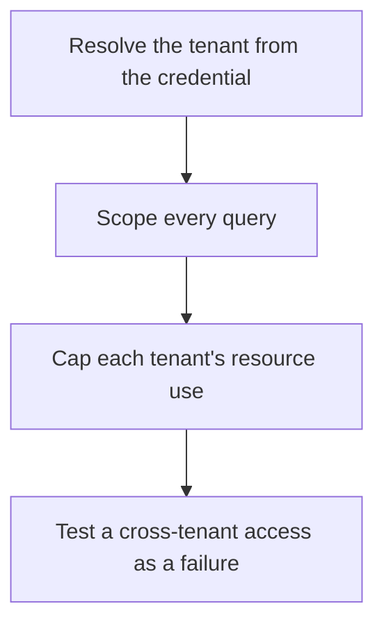

# D17-T030 — Multi-tenant SaaS platform

Topic ID: `D17-T030`
Domain: Common System Design Problems
Subdomain: Multi-tenant SaaS platform
Importance: common
Complexity: intermediate
Dependencies: `D17-T029`, `D17-T001`, `D16-T001`, `D16-T002`, `D07-T001`, `D07-T002`
Execution status of the code in section F: unexecuted

## A. Topic Overview

A multi-tenant SaaS platform serves many customers from shared software. Isolation is the design: a tenant must not read another's rows, exhaust the database, or see another's cache entries. Models range from a shared schema with a tenant id, to a schema per tenant, to a database per tenant. Noisy-neighbor controls cap a tenant's rate and pool usage. Authorization checks the tenant on every request, not only at login.

In production this shows up as follows: Every order row carries tenant_id and every repository method requires it. A load test runs a noisy tenant beside a quiet one. The noisy tenant is rate-limited before the quiet tenant's p99 moves.

Interviewers use Multi-tenant SaaS platform to see whether you can state the failure mode, not only the definition. The failure to name is: a missing tenant predicate that returns another customer's rows, or one tenant's batch job saturating the shared pool

Prerequisites: `D17-T029`, `D17-T001`, `D16-T001`, `D16-T002`, `D07-T001`, `D07-T002`. Later notes should link here instead of repeating the mechanism.

## B. First-Principles Explanation

A multi-tenant SaaS platform serves many customers from shared software. Isolation is the design: a tenant must not read another's rows, exhaust the database, or see another's cache entries. Models range from a shared schema with a tenant id, to a schema per tenant, to a database per tenant. Noisy-neighbor controls cap a tenant's rate and pool usage. Authorization checks the tenant on every request, not only at login.

The useful picture is: Multi-tenancy is one apartment building. Shared plumbing is cheaper. The locks and the fuse boxes are what stop one apartment from opening another's door or tripping the whole block.

What has to be true:

1. Resolve the tenant from the credential
2. Scope every query
3. Cap each tenant's resource use
4. Test a cross-tenant access as a failure

It works when those steps preserve one invariant. It fails when a missing tenant predicate that returns another customer's rows, or one tenant's batch job saturating the shared pool. The alternative is: you bolt on a tenant id in the UI and not in the queries and caches

## C. Internal Working and Architecture

Components involved: the caller, the state Multi-tenant SaaS platform mutates or reads, and the observer that reports cross-tenant test results, per-tenant rate, and pool wait time.

Execution:

1. Resolve the tenant from the credential
2. Scope every query
3. Cap each tenant's resource use
4. Test a cross-tenant access as a failure

Data moves only along that path. A retry re-enters at step 1, so the operation must say what a duplicate does. Memory and locks stay inside this mechanism. Callers see the result or a typed error, not a half-updated invariant.

State to remember: choose this when many customers share a deployment. Do not choose it when you bolt on a tenant id in the UI and not in the queries and caches.

## D. Diagrams and Visual Models



Read the diagram from top to bottom. Each box is one step of Multi-tenant SaaS platform. The failure mode (a missing tenant predicate that returns another customer's rows, or one tenant's batch job saturating the shared pool) is what you look for when a later box never happens or happens twice.

## E. Examples and Analogies

Analogy: Multi-tenancy is one apartment building. Shared plumbing is cheaper. The locks and the fuse boxes are what stop one apartment from opening another's door or tripping the whole block.

Production example: Every order row carries tenant_id and every repository method requires it. A load test runs a noisy tenant beside a quiet one. The noisy tenant is rate-limited before the quiet tenant's p99 moves.

A small counterexample is enough in an interview. Show the input, apply the steps, and show the broken outcome if someone uses the mechanism outside its rule: a missing tenant predicate that returns another customer's rows, or one tenant's batch job saturating the shared pool.

## F. Code Examples

The snippet is labeled unexecuted. It illustrates the shape of the idea. It is not a benchmark and it embeds no secret.

```python
def scope(query, tenant_id):
    query['tenant_id'] = tenant_id
    return query
```

After the snippet, check cross-tenant test results, per-tenant rate, and pool wait time. If that signal moves the wrong way, the snippet is the wrong tool for the workload.

## G. Practical Backend Application

Use Multi-tenant SaaS platform in a service when many customers share a deployment.

A typical place is the production case already stated: Every order row carries tenant_id and every repository method requires it. A load test runs a noisy tenant beside a quiet one. The noisy tenant is rate-limited before the quiet tenant's p99 moves.

Operationally you alert on cross-tenant test results, per-tenant rate, and pool wait time. You do not alert only on process uptime. The dashboard should show the failure mode, a success rate, and the saturation signal (queue depth, lock wait, or latency) that predicts it.

## H. Advantages, Limitations and Trade-offs

| Choice | Benefit | Cost | Choose when | Avoid when |
| --- | --- | --- | --- | --- |
| Apply Multi-tenant SaaS platform | many customers share a deployment | Extra moving parts and a new failure mode | The failure you are preventing is already real | you bolt on a tenant id in the UI and not in the queries and caches |
| Simpler alternative | Less code and fewer dependencies | a missing tenant predicate that returns another customer's rows, or one tenant's batch job saturating the shared pool | The workload does not hit the limit | The invariant must hold under concurrency or failure |

Multi-tenant SaaS platform is a trade. State the benefit and the cost in the same sentence when you propose it in a design review.

## I. Common Mistakes and Misconceptions

- Trusting a tenant id from the body.
- A shared cache key with no tenant prefix.
- No per-tenant quota.
- Treating a diagram of Multi-tenant SaaS platform as proof that the invariant holds in production.
- Copying a default configuration without naming cross-tenant test results, per-tenant rate, and pool wait time.

## J. Debugging and Troubleshooting

Symptom: a missing tenant predicate that returns another customer's rows, or one tenant's batch job saturating the shared pool

First check: cross-tenant test results, per-tenant rate, and pool wait time.

Then compare one healthy instance against one unhealthy instance. Confirm whether retries are duplicating work. Confirm whether a timeout is shorter than the work. Fix the invariant, then watch the same metric for a full peak, not only for the next minute.

Useful questions: did the step order in section C actually happen, or did a caller skip a step? Did a deploy change the data shape that Multi-tenant SaaS platform assumes?

## K. Interview Preparation

### Beginner

#### Q1. What problem does Multi-tenant SaaS platform solve?

**Answer:** A multi-tenant SaaS platform serves many customers from shared software. Isolation is the design: a tenant must not read another's rows, exhaust the database, or see another's cache entries. Models range from a shared schema with a tenant id, to a schema per tenant, to a database per tenant. Noisy-neighbor controls cap a tenant's rate and pool usage. Authorization checks the tenant on every request, not only at login. Without it, the usual backend failure is: a missing tenant predicate that returns another customer's rows, or one tenant's batch job saturating the shared pool.

#### Q2. Where does Multi-tenant SaaS platform sit on a request path?

**Answer:** Multi-tenant SaaS platform is not a library you sprinkle on every call. many customers share a deployment You notice it when cross-tenant test results, per-tenant rate, and pool wait time. Name the constraint that makes this choice correct. Say what you would measure to confirm it.

#### Q3. Give a concrete example of Multi-tenant SaaS platform.

**Answer:** Every order row carries tenant_id and every repository method requires it. A load test runs a noisy tenant beside a quiet one. The noisy tenant is rate-limited before the quiet tenant's p99 moves. Walk the input, the state change, and the observable output.

#### Q4. What is a common mix-up around Multi-tenant SaaS platform?

**Answer:** a missing tenant predicate that returns another customer's rows, or one tenant's batch job saturating the shared pool The corrective check is cross-tenant test results, per-tenant rate, and pool wait time. Name the constraint that makes this choice correct. Say what you would measure to confirm it. Say which alternative you rejected and why.

#### Q5. When would you skip Multi-tenant SaaS platform?

**Answer:** you bolt on a tenant id in the UI and not in the queries and caches Skipping is a decision with a measured cost, not a slogan. Name the constraint that makes this choice correct. Say what you would measure to confirm it. Say which alternative you rejected and why.

### Intermediate

#### Q1. What invariant makes Multi-tenant SaaS platform correct?

**Answer:** A multi-tenant SaaS platform serves many customers from shared software. Isolation is the design: a tenant must not read another's rows, exhaust the database, or see another's cache entries. Models range from a shared schema with a tenant id, to a schema per tenant, to a database per tenant. Noisy-neighbor controls cap a tenant's rate and pool usage. Authorization checks the tenant on every request, not only at login. State the invariant before you name the tool.

#### Q2. How do you test Multi-tenant SaaS platform?

**Answer:** Assert the failure mode directly: a missing tenant predicate that returns another customer's rows, or one tenant's batch job saturating the shared pool. The assertion should watch cross-tenant test results, per-tenant rate, and pool wait time. Include a concurrent or retry case if the bug only appears then. Name the constraint that makes this choice correct.

#### Q3. What signal tells you Multi-tenant SaaS platform is misbehaving in production?

**Answer:** Watch cross-tenant test results, per-tenant rate, and pool wait time. The user-visible symptom is usually a missing tenant predicate that returns another customer's rows, or one tenant's batch job saturating the shared pool. Name the constraint that makes this choice correct. Say what you would measure to confirm it.

#### Q4. How would you introduce Multi-tenant SaaS platform into a legacy service?

**Answer:** many customers share a deployment Ship it behind a metric so you can compare the old path. Roll back if a missing tenant predicate that returns another customer's rows, or one tenant's batch job saturating the shared pool gets worse. Name the constraint that makes this choice correct. Say what you would measure to confirm it.

#### Q5. What do you trade away by choosing Multi-tenant SaaS platform?

**Answer:** many customers share a deployment you bolt on a tenant id in the UI and not in the queries and caches Say the cost in latency, storage, or operational load. Name the constraint that makes this choice correct. Say what you would measure to confirm it. Say which alternative you rejected and why.

### Advanced

#### Q1. What breaks if a dependency of Multi-tenant SaaS platform is slow or down?

**Answer:** a missing tenant predicate that returns another customer's rows, or one tenant's batch job saturating the shared pool Degrade using the rule: you bolt on a tenant id in the UI and not in the queries and caches. Timeouts must be shorter than the caller's deadline. Name the constraint that makes this choice correct. Say what you would measure to confirm it.

#### Q2. How does Multi-tenant SaaS platform behave under retries?

**Answer:** Retries repeat work, so Multi-tenant SaaS platform must define what a duplicate does. a missing tenant predicate that returns another customer's rows, or one tenant's batch job saturating the shared pool Idempotency keys or fences belong next to the write, not in a comment. Name the constraint that makes this choice correct. Say what you would measure to confirm it.

#### Q3. What is the capacity limit of Multi-tenant SaaS platform?

**Answer:** The limit shows up as cross-tenant test results, per-tenant rate, and pool wait time. Add capacity only after you know whether the bottleneck is CPU, lock wait, or network. Name the constraint that makes this choice correct. Say what you would measure to confirm it.

#### Q4. How do you evolve Multi-tenant SaaS platform without a flag day?

**Answer:** many customers share a deployment Version the contract or the on-disk format. Readers should tolerate one old and one new shape during the rollout. Name the constraint that makes this choice correct. Say what you would measure to confirm it.

#### Q5. What security or correctness bug hides inside Multi-tenant SaaS platform?

**Answer:** a missing tenant predicate that returns another customer's rows, or one tenant's batch job saturating the shared pool Check authorization and tenancy at the same boundary as the mechanism. A cache or queue must not widen who can read the data. Name the constraint that makes this choice correct. Say what you would measure to confirm it.

### Scenario

#### Q1. Incident: a missing tenant predicate that returns another customer's rows, or one tenant's batch job saturating the shared pool. What do you check first?

**Answer:** Start with cross-tenant test results, per-tenant rate, and pool wait time. Compare a good host and a bad host before you restart anything. A multi-tenant SaaS platform serves many customers from shared software. Isolation is the design: a tenant must not read another's rows, exhaust the database, or see another's cache entries. Models range from a shared schema with a tenant id, to a schema per tenant, to a database per tenant. Noisy-neighbor controls cap a tenant's rate and pool usage. Authorization checks the tenant on every request, not only at login.

#### Q2. A reviewer wants the clever version. What data settles it?

**Answer:** many customers share a deployment you bolt on a tenant id in the UI and not in the queries and caches Bring cross-tenant test results, per-tenant rate, and pool wait time from a load test or from production, not a slogan. Name the constraint that makes this choice correct. Say what you would measure to confirm it. Say which alternative you rejected and why.

#### Q3. You have one hour to explain Multi-tenant SaaS platform at a whiteboard.

**Answer:** Draw the happy path in four boxes. Then draw the failure: a missing tenant predicate that returns another customer's rows, or one tenant's batch job saturating the shared pool. End with the metric you would page on. Name the constraint that makes this choice correct.

#### Q4. The bug only appears under two concurrent callers.

**Answer:** a missing tenant predicate that returns another customer's rows, or one tenant's batch job saturating the shared pool Reproduce with a barrier so both sides enter the critical window. Confirm the fix with cross-tenant test results, per-tenant rate, and pool wait time. Name the constraint that makes this choice correct. Say what you would measure to confirm it.

#### Q5. Leadership wants this on every service next week.

**Answer:** you bolt on a tenant id in the UI and not in the queries and caches many customers share a deployment Roll it out where the failure mode is already hurting users. Name the constraint that makes this choice correct. Say what you would measure to confirm it. Say which alternative you rejected and why.

### Follow-up

#### Q1. What did you assume about the data size or the clock?

**Answer:** A multi-tenant SaaS platform serves many customers from shared software. Isolation is the design: a tenant must not read another's rows, exhaust the database, or see another's cache entries. Models range from a shared schema with a tenant id, to a schema per tenant, to a database per tenant. Noisy-neighbor controls cap a tenant's rate and pool usage. Authorization checks the tenant on every request, not only at login. Clocks are not a total order across machines. State whether the algorithm needs bounded size or a single leader.

#### Q2. What would you measure after the change ships?

**Answer:** Page on cross-tenant test results, per-tenant rate, and pool wait time. Keep a before/after dashboard for one week. Alert on the failure mode, not only on CPU. Name the constraint that makes this choice correct.

#### Q3. Which neighboring topic did you deliberately not re-teach?

**Answer:** This note owns Multi-tenant SaaS platform. Related identifiers are in section N. Shared ideas are linked, not copied. Name the constraint that makes this choice correct.

## L. Practical Exercises

Solutions are in `EXERCISES/solutions/D17-T030.md`, not in this section.

1. Whiteboard the four steps of Multi-tenant SaaS platform and mark where `a missing tenant predicate that returns another customer's rows, or one tenant's batch job saturating the shared pool` enters.
2. Read the snippet in section F and write the assertion that would catch that failure. The assertion must mention `cross-tenant test results, per-tenant rate, and pool wait time`.
3. Argue for or against using Multi-tenant SaaS platform on a service you know. Use the choose and avoid rows from section H. Do not appeal to popularity.

## M. Revision Notes

- Mechanism: A multi-tenant SaaS platform serves many customers from shared software.
- Failure: a missing tenant predicate that returns another customer's rows, or one tenant's batch job saturating the shared pool
- Metric: cross-tenant test results, per-tenant rate, and pool wait time
- Choose when: many customers share a deployment
- Avoid when: you bolt on a tenant id in the UI and not in the queries and caches

## N. Related Topics

Dependencies to review first: `D17-T029`, `D17-T001`, `D16-T001`, `D16-T002`, `D07-T001`, `D07-T002`.

Shared ideas stay in those notes. This note does not restate them.

## O. Completion Criteria

- You can explain Multi-tenant SaaS platform without reading this note, including the failure mode.
- You can draw the diagram in section D from memory.
- You can say when not to use it, using the avoid condition in section H.
- You can name the metric you would watch after shipping it.
