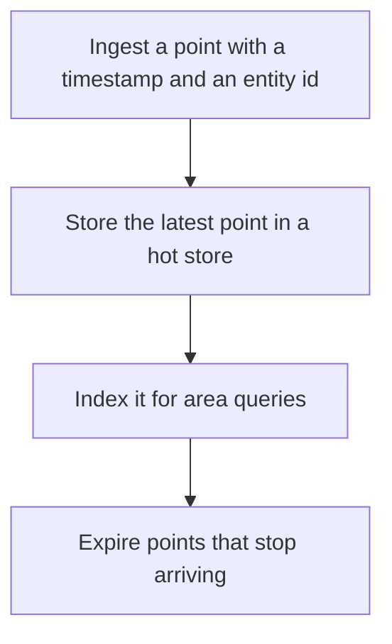

# D17-T031 — Real-time location tracking

Topic ID: `D17-T031`
Domain: Common System Design Problems
Subdomain: Real-time location tracking
Importance: common
Complexity: intermediate
Dependencies: `D17-T030`, `D17-T001`, `D16-T001`, `D16-T002`, `D07-T001`, `D07-T002`
Execution status of the code in section F: unexecuted

## A. Topic Overview

Real-time location tracking ingests frequent position updates and answers 'where is this entity now' and sometimes 'which entities are in this area.' The write rate is the design. A durable history is separate from the hot latest-point store. Geospatial indexes answer area queries. Clients interpolate between updates. Stale points must expire so a parked device does not look live.

In production this shows up as follows: Drivers send a point every few seconds to a partitioned hot store keyed by driver id, with a geohash index for nearby search. The full trail is batched to cheap storage. A driver who goes silent drops off the live map after the TTL.

Interviewers use Real-time location tracking to see whether you can state the failure mode, not only the definition. The failure to name is: writing every point through a transactional database at high frequency and falling behind, or an area query that scans every entity

Prerequisites: `D17-T030`, `D17-T001`, `D16-T001`, `D16-T002`, `D07-T001`, `D07-T002`. Later notes should link here instead of repeating the mechanism.

## B. First-Principles Explanation

Real-time location tracking ingests frequent position updates and answers 'where is this entity now' and sometimes 'which entities are in this area.' The write rate is the design. A durable history is separate from the hot latest-point store. Geospatial indexes answer area queries. Clients interpolate between updates. Stale points must expire so a parked device does not look live.

The useful picture is: Tracking is a pegboard of last-known pins, not a filing cabinet of every step. The cabinet can exist, but the pegboard is what the dispatcher looks at.

What has to be true:

1. Ingest a point with a timestamp and an entity id
2. Store the latest point in a hot store
3. Index it for area queries
4. Expire points that stop arriving

It works when those steps preserve one invariant. It fails when writing every point through a transactional database at high frequency and falling behind, or an area query that scans every entity. The alternative is: you store every raw point in the same transactional table you use for payments

## C. Internal Working and Architecture

Components involved: the caller, the state Real-time location tracking mutates or reads, and the observer that reports ingest lag, points per second per partition, and area-query p99.

Execution:

1. Ingest a point with a timestamp and an entity id
2. Store the latest point in a hot store
3. Index it for area queries
4. Expire points that stop arriving

Data moves only along that path. A retry re-enters at step 1, so the operation must say what a duplicate does. Memory and locks stay inside this mechanism. Callers see the result or a typed error, not a half-updated invariant.

State to remember: choose this when the product needs current positions at a high write rate. Do not choose it when you store every raw point in the same transactional table you use for payments.

## D. Diagrams and Visual Models



Read the diagram from top to bottom. Each box is one step of Real-time location tracking. The failure mode (writing every point through a transactional database at high frequency and falling behind, or an area query that scans every entity) is what you look for when a later box never happens or happens twice.

## E. Examples and Analogies

Analogy: Tracking is a pegboard of last-known pins, not a filing cabinet of every step. The cabinet can exist, but the pegboard is what the dispatcher looks at.

Production example: Drivers send a point every few seconds to a partitioned hot store keyed by driver id, with a geohash index for nearby search. The full trail is batched to cheap storage. A driver who goes silent drops off the live map after the TTL.

A small counterexample is enough in an interview. Show the input, apply the steps, and show the broken outcome if someone uses the mechanism outside its rule: writing every point through a transactional database at high frequency and falling behind, or an area query that scans every entity.

## F. Code Examples

The snippet is labeled unexecuted. It illustrates the shape of the idea. It is not a benchmark and it embeds no secret.

```python
def accept(point, now, max_age):
    return now - point['ts'] <= max_age
```

After the snippet, check ingest lag, points per second per partition, and area-query p99. If that signal moves the wrong way, the snippet is the wrong tool for the workload.

## G. Practical Backend Application

Use Real-time location tracking in a service when the product needs current positions at a high write rate.

A typical place is the production case already stated: Drivers send a point every few seconds to a partitioned hot store keyed by driver id, with a geohash index for nearby search. The full trail is batched to cheap storage. A driver who goes silent drops off the live map after the TTL.

Operationally you alert on ingest lag, points per second per partition, and area-query p99. You do not alert only on process uptime. The dashboard should show the failure mode, a success rate, and the saturation signal (queue depth, lock wait, or latency) that predicts it.

## H. Advantages, Limitations and Trade-offs

| Choice | Benefit | Cost | Choose when | Avoid when |
| --- | --- | --- | --- | --- |
| Apply Real-time location tracking | the product needs current positions at a high write rate | Extra moving parts and a new failure mode | The failure you are preventing is already real | you store every raw point in the same transactional table you use for payments |
| Simpler alternative | Less code and fewer dependencies | writing every point through a transactional database at high frequency and falling behind, or an area query that scans every entity | The workload does not hit the limit | The invariant must hold under concurrency or failure |

Real-time location tracking is a trade. State the benefit and the cost in the same sentence when you propose it in a design review.

## I. Common Mistakes and Misconceptions

- No expiry.
- A global lock on the map.
- Area queries that scan all drivers.
- Treating a diagram of Real-time location tracking as proof that the invariant holds in production.
- Copying a default configuration without naming ingest lag, points per second per partition, and area-query p99.

## J. Debugging and Troubleshooting

Symptom: writing every point through a transactional database at high frequency and falling behind, or an area query that scans every entity

First check: ingest lag, points per second per partition, and area-query p99.

Then compare one healthy instance against one unhealthy instance. Confirm whether retries are duplicating work. Confirm whether a timeout is shorter than the work. Fix the invariant, then watch the same metric for a full peak, not only for the next minute.

Useful questions: did the step order in section C actually happen, or did a caller skip a step? Did a deploy change the data shape that Real-time location tracking assumes?

## K. Interview Preparation

### Beginner

#### Q1. What problem does Real-time location tracking solve?

**Answer:** Real-time location tracking ingests frequent position updates and answers 'where is this entity now' and sometimes 'which entities are in this area.' The write rate is the design. A durable history is separate from the hot latest-point store. Geospatial indexes answer area queries. Clients interpolate between updates. Stale points must expire so a parked device does not look live. Without it, the usual backend failure is: writing every point through a transactional database at high frequency and falling behind, or an area query that scans every entity.

#### Q2. Where does Real-time location tracking sit on a request path?

**Answer:** Real-time location tracking is not a library you sprinkle on every call. the product needs current positions at a high write rate You notice it when ingest lag, points per second per partition, and area-query p99. Name the constraint that makes this choice correct. Say what you would measure to confirm it.

#### Q3. Give a concrete example of Real-time location tracking.

**Answer:** Drivers send a point every few seconds to a partitioned hot store keyed by driver id, with a geohash index for nearby search. The full trail is batched to cheap storage. A driver who goes silent drops off the live map after the TTL. Walk the input, the state change, and the observable output.

#### Q4. What is a common mix-up around Real-time location tracking?

**Answer:** writing every point through a transactional database at high frequency and falling behind, or an area query that scans every entity The corrective check is ingest lag, points per second per partition, and area-query p99. Name the constraint that makes this choice correct. Say what you would measure to confirm it. Say which alternative you rejected and why.

#### Q5. When would you skip Real-time location tracking?

**Answer:** you store every raw point in the same transactional table you use for payments Skipping is a decision with a measured cost, not a slogan. Name the constraint that makes this choice correct. Say what you would measure to confirm it. Say which alternative you rejected and why.

### Intermediate

#### Q1. What invariant makes Real-time location tracking correct?

**Answer:** Real-time location tracking ingests frequent position updates and answers 'where is this entity now' and sometimes 'which entities are in this area.' The write rate is the design. A durable history is separate from the hot latest-point store. Geospatial indexes answer area queries. Clients interpolate between updates. Stale points must expire so a parked device does not look live. State the invariant before you name the tool.

#### Q2. How do you test Real-time location tracking?

**Answer:** Assert the failure mode directly: writing every point through a transactional database at high frequency and falling behind, or an area query that scans every entity. The assertion should watch ingest lag, points per second per partition, and area-query p99. Include a concurrent or retry case if the bug only appears then. Name the constraint that makes this choice correct.

#### Q3. What signal tells you Real-time location tracking is misbehaving in production?

**Answer:** Watch ingest lag, points per second per partition, and area-query p99. The user-visible symptom is usually writing every point through a transactional database at high frequency and falling behind, or an area query that scans every entity. Name the constraint that makes this choice correct. Say what you would measure to confirm it.

#### Q4. How would you introduce Real-time location tracking into a legacy service?

**Answer:** the product needs current positions at a high write rate Ship it behind a metric so you can compare the old path. Roll back if writing every point through a transactional database at high frequency and falling behind, or an area query that scans every entity gets worse. Name the constraint that makes this choice correct. Say what you would measure to confirm it.

#### Q5. What do you trade away by choosing Real-time location tracking?

**Answer:** the product needs current positions at a high write rate you store every raw point in the same transactional table you use for payments Say the cost in latency, storage, or operational load. Name the constraint that makes this choice correct. Say what you would measure to confirm it. Say which alternative you rejected and why.

### Advanced

#### Q1. What breaks if a dependency of Real-time location tracking is slow or down?

**Answer:** writing every point through a transactional database at high frequency and falling behind, or an area query that scans every entity Degrade using the rule: you store every raw point in the same transactional table you use for payments. Timeouts must be shorter than the caller's deadline. Name the constraint that makes this choice correct. Say what you would measure to confirm it.

#### Q2. How does Real-time location tracking behave under retries?

**Answer:** Retries repeat work, so Real-time location tracking must define what a duplicate does. writing every point through a transactional database at high frequency and falling behind, or an area query that scans every entity Idempotency keys or fences belong next to the write, not in a comment. Name the constraint that makes this choice correct. Say what you would measure to confirm it.

#### Q3. What is the capacity limit of Real-time location tracking?

**Answer:** The limit shows up as ingest lag, points per second per partition, and area-query p99. Add capacity only after you know whether the bottleneck is CPU, lock wait, or network. Name the constraint that makes this choice correct. Say what you would measure to confirm it.

#### Q4. How do you evolve Real-time location tracking without a flag day?

**Answer:** the product needs current positions at a high write rate Version the contract or the on-disk format. Readers should tolerate one old and one new shape during the rollout. Name the constraint that makes this choice correct. Say what you would measure to confirm it.

#### Q5. What security or correctness bug hides inside Real-time location tracking?

**Answer:** writing every point through a transactional database at high frequency and falling behind, or an area query that scans every entity Check authorization and tenancy at the same boundary as the mechanism. A cache or queue must not widen who can read the data. Name the constraint that makes this choice correct. Say what you would measure to confirm it.

### Scenario

#### Q1. Incident: writing every point through a transactional database at high frequency and falling behind, or an area query that scans every entity. What do you check first?

**Answer:** Start with ingest lag, points per second per partition, and area-query p99. Compare a good host and a bad host before you restart anything. Real-time location tracking ingests frequent position updates and answers 'where is this entity now' and sometimes 'which entities are in this area.' The write rate is the design. A durable history is separate from the hot latest-point store. Geospatial indexes answer area queries. Clients interpolate between updates. Stale points must expire so a parked device does not look live.

#### Q2. A reviewer wants the clever version. What data settles it?

**Answer:** the product needs current positions at a high write rate you store every raw point in the same transactional table you use for payments Bring ingest lag, points per second per partition, and area-query p99 from a load test or from production, not a slogan. Name the constraint that makes this choice correct. Say what you would measure to confirm it. Say which alternative you rejected and why.

#### Q3. You have one hour to explain Real-time location tracking at a whiteboard.

**Answer:** Draw the happy path in four boxes. Then draw the failure: writing every point through a transactional database at high frequency and falling behind, or an area query that scans every entity. End with the metric you would page on. Name the constraint that makes this choice correct.

#### Q4. The bug only appears under two concurrent callers.

**Answer:** writing every point through a transactional database at high frequency and falling behind, or an area query that scans every entity Reproduce with a barrier so both sides enter the critical window. Confirm the fix with ingest lag, points per second per partition, and area-query p99. Name the constraint that makes this choice correct. Say what you would measure to confirm it.

#### Q5. Leadership wants this on every service next week.

**Answer:** you store every raw point in the same transactional table you use for payments the product needs current positions at a high write rate Roll it out where the failure mode is already hurting users. Name the constraint that makes this choice correct. Say what you would measure to confirm it. Say which alternative you rejected and why.

### Follow-up

#### Q1. What did you assume about the data size or the clock?

**Answer:** Real-time location tracking ingests frequent position updates and answers 'where is this entity now' and sometimes 'which entities are in this area.' The write rate is the design. A durable history is separate from the hot latest-point store. Geospatial indexes answer area queries. Clients interpolate between updates. Stale points must expire so a parked device does not look live. Clocks are not a total order across machines. State whether the algorithm needs bounded size or a single leader.

#### Q2. What would you measure after the change ships?

**Answer:** Page on ingest lag, points per second per partition, and area-query p99. Keep a before/after dashboard for one week. Alert on the failure mode, not only on CPU. Name the constraint that makes this choice correct.

#### Q3. Which neighboring topic did you deliberately not re-teach?

**Answer:** This note owns Real-time location tracking. Related identifiers are in section N. Shared ideas are linked, not copied. Name the constraint that makes this choice correct.

## L. Practical Exercises

Solutions are in `EXERCISES/solutions/D17-T031.md`, not in this section.

1. Whiteboard the four steps of Real-time location tracking and mark where `writing every point through a transactional database at high frequency and falling behind, or an area query that scans every entity` enters.
2. Read the snippet in section F and write the assertion that would catch that failure. The assertion must mention `ingest lag, points per second per partition, and area-query p99`.
3. Argue for or against using Real-time location tracking on a service you know. Use the choose and avoid rows from section H. Do not appeal to popularity.

## M. Revision Notes

- Mechanism: Real-time location tracking ingests frequent position updates and answers 'where is this entity now' and sometimes 'which entities are in this area.
- Failure: writing every point through a transactional database at high frequency and falling behind, or an area query that scans every entity
- Metric: ingest lag, points per second per partition, and area-query p99
- Choose when: the product needs current positions at a high write rate
- Avoid when: you store every raw point in the same transactional table you use for payments

## N. Related Topics

Dependencies to review first: `D17-T030`, `D17-T001`, `D16-T001`, `D16-T002`, `D07-T001`, `D07-T002`.

Shared ideas stay in those notes. This note does not restate them.

## O. Completion Criteria

- You can explain Real-time location tracking without reading this note, including the failure mode.
- You can draw the diagram in section D from memory.
- You can say when not to use it, using the avoid condition in section H.
- You can name the metric you would watch after shipping it.
