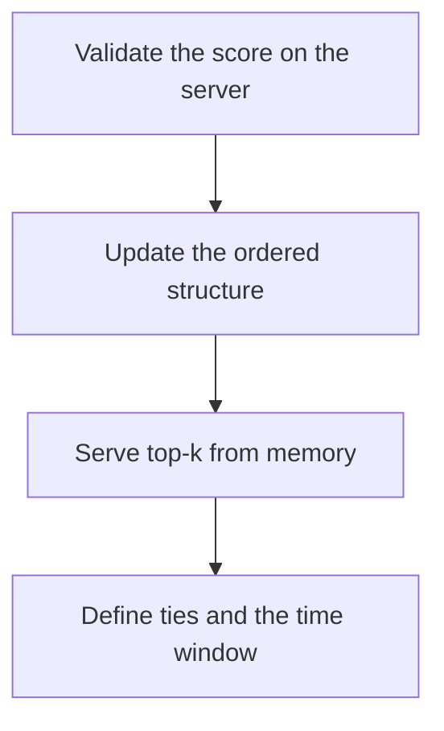

# D17-T032 — Leaderboard service

Topic ID: `D17-T032`
Domain: Common System Design Problems
Subdomain: Leaderboard service
Importance: common
Complexity: intermediate
Dependencies: `D17-T031`, `D17-T001`, `D16-T001`, `D16-T002`, `D07-T001`, `D07-T002`
Execution status of the code in section F: unexecuted

## A. Topic Overview

A leaderboard service updates a score and returns a rank or a top-k list. Updates are frequent. Exact global rank for a huge population is expensive. Approximate ranks, windows by time, and sharded boards are the usual escapes. Ties need a rule. A read of the top ten should not lock the writers. Cheating is a product problem: the server, not the client, computes the score.

In production this shows up as follows: A game submits match results. The server adds the delta. Daily regional sorted sets answer the top 100. A player's own rank can be approximate. One global key is avoided.

Interviewers use Leaderboard service to see whether you can state the failure mode, not only the definition. The failure to name is: a single hot key for the whole world, or a client-supplied score that a cheater sets to infinity

Prerequisites: `D17-T031`, `D17-T001`, `D16-T001`, `D16-T002`, `D07-T001`, `D07-T002`. Later notes should link here instead of repeating the mechanism.

## B. First-Principles Explanation

A leaderboard service updates a score and returns a rank or a top-k list. Updates are frequent. Exact global rank for a huge population is expensive. Approximate ranks, windows by time, and sharded boards are the usual escapes. Ties need a rule. A read of the top ten should not lock the writers. Cheating is a product problem: the server, not the client, computes the score.

The useful picture is: A leaderboard is a ranked board on a wall. The top of the board is easy to read. Numbering every person in the stadium is a different, heavier job.

What has to be true:

1. Validate the score on the server
2. Update the ordered structure
3. Serve top-k from memory
4. Define ties and the time window

It works when those steps preserve one invariant. It fails when a single hot key for the whole world, or a client-supplied score that a cheater sets to infinity. The alternative is: you need arbitrary analytics, which is a warehouse query

## C. Internal Working and Architecture

Components involved: the caller, the state Leaderboard service mutates or reads, and the observer that reports update QPS per shard and top-k latency.

Execution:

1. Validate the score on the server
2. Update the ordered structure
3. Serve top-k from memory
4. Define ties and the time window

Data moves only along that path. A retry re-enters at step 1, so the operation must say what a duplicate does. Memory and locks stay inside this mechanism. Callers see the result or a typed error, not a half-updated invariant.

State to remember: choose this when you need ordered scores and top-k at interactive latency. Do not choose it when you need arbitrary analytics, which is a warehouse query.

## D. Diagrams and Visual Models



Read the diagram from top to bottom. Each box is one step of Leaderboard service. The failure mode (a single hot key for the whole world, or a client-supplied score that a cheater sets to infinity) is what you look for when a later box never happens or happens twice.

## E. Examples and Analogies

Analogy: A leaderboard is a ranked board on a wall. The top of the board is easy to read. Numbering every person in the stadium is a different, heavier job.

Production example: A game submits match results. The server adds the delta. Daily regional sorted sets answer the top 100. A player's own rank can be approximate. One global key is avoided.

A small counterexample is enough in an interview. Show the input, apply the steps, and show the broken outcome if someone uses the mechanism outside its rule: a single hot key for the whole world, or a client-supplied score that a cheater sets to infinity.

## F. Code Examples

The snippet is labeled unexecuted. It illustrates the shape of the idea. It is not a benchmark and it embeds no secret.

```python
def better(a, b):
    return a['score'] > b['score'] or (a['score'] == b['score'] and a['id'] < b['id'])
```

After the snippet, check update QPS per shard and top-k latency. If that signal moves the wrong way, the snippet is the wrong tool for the workload.

## G. Practical Backend Application

Use Leaderboard service in a service when you need ordered scores and top-k at interactive latency.

A typical place is the production case already stated: A game submits match results. The server adds the delta. Daily regional sorted sets answer the top 100. A player's own rank can be approximate. One global key is avoided.

Operationally you alert on update QPS per shard and top-k latency. You do not alert only on process uptime. The dashboard should show the failure mode, a success rate, and the saturation signal (queue depth, lock wait, or latency) that predicts it.

## H. Advantages, Limitations and Trade-offs

| Choice | Benefit | Cost | Choose when | Avoid when |
| --- | --- | --- | --- | --- |
| Apply Leaderboard service | you need ordered scores and top-k at interactive latency | Extra moving parts and a new failure mode | The failure you are preventing is already real | you need arbitrary analytics, which is a warehouse query |
| Simpler alternative | Less code and fewer dependencies | a single hot key for the whole world, or a client-supplied score that a cheater sets to infinity | The workload does not hit the limit | The invariant must hold under concurrency or failure |

Leaderboard service is a trade. State the benefit and the cost in the same sentence when you propose it in a design review.

## I. Common Mistakes and Misconceptions

- Client-authoritative scores.
- One key for every player.
- An unstable tie break.
- Treating a diagram of Leaderboard service as proof that the invariant holds in production.
- Copying a default configuration without naming update QPS per shard and top-k latency.

## J. Debugging and Troubleshooting

Symptom: a single hot key for the whole world, or a client-supplied score that a cheater sets to infinity

First check: update QPS per shard and top-k latency.

Then compare one healthy instance against one unhealthy instance. Confirm whether retries are duplicating work. Confirm whether a timeout is shorter than the work. Fix the invariant, then watch the same metric for a full peak, not only for the next minute.

Useful questions: did the step order in section C actually happen, or did a caller skip a step? Did a deploy change the data shape that Leaderboard service assumes?

## K. Interview Preparation

### Beginner

#### Q1. What problem does Leaderboard service solve?

**Answer:** A leaderboard service updates a score and returns a rank or a top-k list. Updates are frequent. Exact global rank for a huge population is expensive. Approximate ranks, windows by time, and sharded boards are the usual escapes. Ties need a rule. A read of the top ten should not lock the writers. Cheating is a product problem: the server, not the client, computes the score. Without it, the usual backend failure is: a single hot key for the whole world, or a client-supplied score that a cheater sets to infinity.

#### Q2. Where does Leaderboard service sit on a request path?

**Answer:** Leaderboard service is not a library you sprinkle on every call. you need ordered scores and top-k at interactive latency You notice it when update QPS per shard and top-k latency. Name the constraint that makes this choice correct. Say what you would measure to confirm it.

#### Q3. Give a concrete example of Leaderboard service.

**Answer:** A game submits match results. The server adds the delta. Daily regional sorted sets answer the top 100. A player's own rank can be approximate. One global key is avoided. Walk the input, the state change, and the observable output.

#### Q4. What is a common mix-up around Leaderboard service?

**Answer:** a single hot key for the whole world, or a client-supplied score that a cheater sets to infinity The corrective check is update QPS per shard and top-k latency. Name the constraint that makes this choice correct. Say what you would measure to confirm it. Say which alternative you rejected and why.

#### Q5. When would you skip Leaderboard service?

**Answer:** you need arbitrary analytics, which is a warehouse query Skipping is a decision with a measured cost, not a slogan. Name the constraint that makes this choice correct. Say what you would measure to confirm it. Say which alternative you rejected and why.

### Intermediate

#### Q1. What invariant makes Leaderboard service correct?

**Answer:** A leaderboard service updates a score and returns a rank or a top-k list. Updates are frequent. Exact global rank for a huge population is expensive. Approximate ranks, windows by time, and sharded boards are the usual escapes. Ties need a rule. A read of the top ten should not lock the writers. Cheating is a product problem: the server, not the client, computes the score. State the invariant before you name the tool.

#### Q2. How do you test Leaderboard service?

**Answer:** Assert the failure mode directly: a single hot key for the whole world, or a client-supplied score that a cheater sets to infinity. The assertion should watch update QPS per shard and top-k latency. Include a concurrent or retry case if the bug only appears then. Name the constraint that makes this choice correct.

#### Q3. What signal tells you Leaderboard service is misbehaving in production?

**Answer:** Watch update QPS per shard and top-k latency. The user-visible symptom is usually a single hot key for the whole world, or a client-supplied score that a cheater sets to infinity. Name the constraint that makes this choice correct. Say what you would measure to confirm it.

#### Q4. How would you introduce Leaderboard service into a legacy service?

**Answer:** you need ordered scores and top-k at interactive latency Ship it behind a metric so you can compare the old path. Roll back if a single hot key for the whole world, or a client-supplied score that a cheater sets to infinity gets worse. Name the constraint that makes this choice correct. Say what you would measure to confirm it.

#### Q5. What do you trade away by choosing Leaderboard service?

**Answer:** you need ordered scores and top-k at interactive latency you need arbitrary analytics, which is a warehouse query Say the cost in latency, storage, or operational load. Name the constraint that makes this choice correct. Say what you would measure to confirm it. Say which alternative you rejected and why.

### Advanced

#### Q1. What breaks if a dependency of Leaderboard service is slow or down?

**Answer:** a single hot key for the whole world, or a client-supplied score that a cheater sets to infinity Degrade using the rule: you need arbitrary analytics, which is a warehouse query. Timeouts must be shorter than the caller's deadline. Name the constraint that makes this choice correct. Say what you would measure to confirm it.

#### Q2. How does Leaderboard service behave under retries?

**Answer:** Retries repeat work, so Leaderboard service must define what a duplicate does. a single hot key for the whole world, or a client-supplied score that a cheater sets to infinity Idempotency keys or fences belong next to the write, not in a comment. Name the constraint that makes this choice correct. Say what you would measure to confirm it.

#### Q3. What is the capacity limit of Leaderboard service?

**Answer:** The limit shows up as update QPS per shard and top-k latency. Add capacity only after you know whether the bottleneck is CPU, lock wait, or network. Name the constraint that makes this choice correct. Say what you would measure to confirm it.

#### Q4. How do you evolve Leaderboard service without a flag day?

**Answer:** you need ordered scores and top-k at interactive latency Version the contract or the on-disk format. Readers should tolerate one old and one new shape during the rollout. Name the constraint that makes this choice correct. Say what you would measure to confirm it.

#### Q5. What security or correctness bug hides inside Leaderboard service?

**Answer:** a single hot key for the whole world, or a client-supplied score that a cheater sets to infinity Check authorization and tenancy at the same boundary as the mechanism. A cache or queue must not widen who can read the data. Name the constraint that makes this choice correct. Say what you would measure to confirm it.

### Scenario

#### Q1. Incident: a single hot key for the whole world, or a client-supplied score that a cheater sets to infinity. What do you check first?

**Answer:** Start with update QPS per shard and top-k latency. Compare a good host and a bad host before you restart anything. A leaderboard service updates a score and returns a rank or a top-k list. Updates are frequent. Exact global rank for a huge population is expensive. Approximate ranks, windows by time, and sharded boards are the usual escapes. Ties need a rule. A read of the top ten should not lock the writers. Cheating is a product problem: the server, not the client, computes the score.

#### Q2. A reviewer wants the clever version. What data settles it?

**Answer:** you need ordered scores and top-k at interactive latency you need arbitrary analytics, which is a warehouse query Bring update QPS per shard and top-k latency from a load test or from production, not a slogan. Name the constraint that makes this choice correct. Say what you would measure to confirm it. Say which alternative you rejected and why.

#### Q3. You have one hour to explain Leaderboard service at a whiteboard.

**Answer:** Draw the happy path in four boxes. Then draw the failure: a single hot key for the whole world, or a client-supplied score that a cheater sets to infinity. End with the metric you would page on. Name the constraint that makes this choice correct.

#### Q4. The bug only appears under two concurrent callers.

**Answer:** a single hot key for the whole world, or a client-supplied score that a cheater sets to infinity Reproduce with a barrier so both sides enter the critical window. Confirm the fix with update QPS per shard and top-k latency. Name the constraint that makes this choice correct. Say what you would measure to confirm it.

#### Q5. Leadership wants this on every service next week.

**Answer:** you need arbitrary analytics, which is a warehouse query you need ordered scores and top-k at interactive latency Roll it out where the failure mode is already hurting users. Name the constraint that makes this choice correct. Say what you would measure to confirm it. Say which alternative you rejected and why.

### Follow-up

#### Q1. What did you assume about the data size or the clock?

**Answer:** A leaderboard service updates a score and returns a rank or a top-k list. Updates are frequent. Exact global rank for a huge population is expensive. Approximate ranks, windows by time, and sharded boards are the usual escapes. Ties need a rule. A read of the top ten should not lock the writers. Cheating is a product problem: the server, not the client, computes the score. Clocks are not a total order across machines. State whether the algorithm needs bounded size or a single leader.

#### Q2. What would you measure after the change ships?

**Answer:** Page on update QPS per shard and top-k latency. Keep a before/after dashboard for one week. Alert on the failure mode, not only on CPU. Name the constraint that makes this choice correct.

#### Q3. Which neighboring topic did you deliberately not re-teach?

**Answer:** This note owns Leaderboard service. Related identifiers are in section N. Shared ideas are linked, not copied. Name the constraint that makes this choice correct.

## L. Practical Exercises

Solutions are in `EXERCISES/solutions/D17-T032.md`, not in this section.

1. Whiteboard the four steps of Leaderboard service and mark where `a single hot key for the whole world, or a client-supplied score that a cheater sets to infinity` enters.
2. Read the snippet in section F and write the assertion that would catch that failure. The assertion must mention `update QPS per shard and top-k latency`.
3. Argue for or against using Leaderboard service on a service you know. Use the choose and avoid rows from section H. Do not appeal to popularity.

## M. Revision Notes

- Mechanism: A leaderboard service updates a score and returns a rank or a top-k list.
- Failure: a single hot key for the whole world, or a client-supplied score that a cheater sets to infinity
- Metric: update QPS per shard and top-k latency
- Choose when: you need ordered scores and top-k at interactive latency
- Avoid when: you need arbitrary analytics, which is a warehouse query

## N. Related Topics

Dependencies to review first: `D17-T031`, `D17-T001`, `D16-T001`, `D16-T002`, `D07-T001`, `D07-T002`.

Shared ideas stay in those notes. This note does not restate them.

## O. Completion Criteria

- You can explain Leaderboard service without reading this note, including the failure mode.
- You can draw the diagram in section D from memory.
- You can say when not to use it, using the avoid condition in section H.
- You can name the metric you would watch after shipping it.
