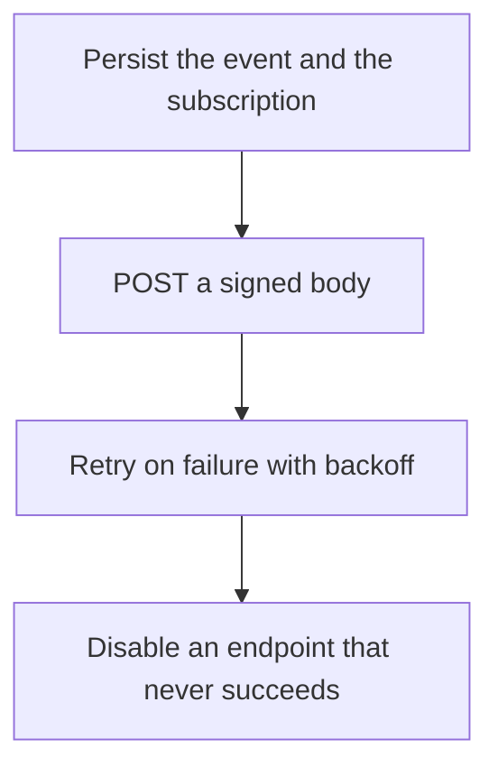

# D17-T033 — Webhook delivery platform

Topic ID: `D17-T033`
Domain: Common System Design Problems
Subdomain: Webhook delivery platform
Importance: common
Complexity: intermediate
Dependencies: `D17-T032`, `D17-T001`, `D16-T001`, `D16-T002`, `D07-T001`, `D07-T002`
Execution status of the code in section F: unexecuted

## A. Topic Overview

A webhook delivery platform sends an HTTP callback to a customer's URL when an event happens. Delivery is at-least-once. The receiver must be idempotent. The platform signs the body, retries with backoff, and stops after a bound. A slow receiver must not block other tenants. Endpoints are verified before they receive production traffic. Secrets rotate.

In production this shows up as follows: The platform stores an outbox per endpoint, signs the payload, and retries for a day. Each endpoint has a concurrency limit. Customers dedupe on the event id. A failing endpoint is automatically paused and emailed.

Interviewers use Webhook delivery platform to see whether you can state the failure mode, not only the definition. The failure to name is: one tenant's slow URL occupying every worker, or a retry that the receiver treats as a second order

Prerequisites: `D17-T032`, `D17-T001`, `D16-T001`, `D16-T002`, `D07-T001`, `D07-T002`. Later notes should link here instead of repeating the mechanism.

## B. First-Principles Explanation

A webhook delivery platform sends an HTTP callback to a customer's URL when an event happens. Delivery is at-least-once. The receiver must be idempotent. The platform signs the body, retries with backoff, and stops after a bound. A slow receiver must not block other tenants. Endpoints are verified before they receive production traffic. Secrets rotate.

The useful picture is: A webhook is a promised phone call to a number the customer gave you. You keep a log of attempts. You do not let one number that never answers tie up every phone in the office.

What has to be true:

1. Persist the event and the subscription
2. POST a signed body
3. Retry on failure with backoff
4. Disable an endpoint that never succeeds

It works when those steps preserve one invariant. It fails when one tenant's slow URL occupying every worker, or a retry that the receiver treats as a second order. The alternative is: you call the URL inside the user request and ignore failures

## C. Internal Working and Architecture

Components involved: the caller, the state Webhook delivery platform mutates or reads, and the observer that reports delivery success rate, oldest undelivered event, and per-endpoint concurrency.

Execution:

1. Persist the event and the subscription
2. POST a signed body
3. Retry on failure with backoff
4. Disable an endpoint that never succeeds

Data moves only along that path. A retry re-enters at step 1, so the operation must say what a duplicate does. Memory and locks stay inside this mechanism. Callers see the result or a typed error, not a half-updated invariant.

State to remember: choose this when customers must be told about events on their own HTTP server. Do not choose it when you call the URL inside the user request and ignore failures.

## D. Diagrams and Visual Models



Read the diagram from top to bottom. Each box is one step of Webhook delivery platform. The failure mode (one tenant's slow URL occupying every worker, or a retry that the receiver treats as a second order) is what you look for when a later box never happens or happens twice.

## E. Examples and Analogies

Analogy: A webhook is a promised phone call to a number the customer gave you. You keep a log of attempts. You do not let one number that never answers tie up every phone in the office.

Production example: The platform stores an outbox per endpoint, signs the payload, and retries for a day. Each endpoint has a concurrency limit. Customers dedupe on the event id. A failing endpoint is automatically paused and emailed.

A small counterexample is enough in an interview. Show the input, apply the steps, and show the broken outcome if someone uses the mechanism outside its rule: one tenant's slow URL occupying every worker, or a retry that the receiver treats as a second order.

## F. Code Examples

The snippet is labeled unexecuted. It illustrates the shape of the idea. It is not a benchmark and it embeds no secret.

```python
def signature(secret, body):
    import hmac, hashlib
    return hmac.new(secret, body, hashlib.sha256).hexdigest()
```

After the snippet, check delivery success rate, oldest undelivered event, and per-endpoint concurrency. If that signal moves the wrong way, the snippet is the wrong tool for the workload.

## G. Practical Backend Application

Use Webhook delivery platform in a service when customers must be told about events on their own HTTP server.

A typical place is the production case already stated: The platform stores an outbox per endpoint, signs the payload, and retries for a day. Each endpoint has a concurrency limit. Customers dedupe on the event id. A failing endpoint is automatically paused and emailed.

Operationally you alert on delivery success rate, oldest undelivered event, and per-endpoint concurrency. You do not alert only on process uptime. The dashboard should show the failure mode, a success rate, and the saturation signal (queue depth, lock wait, or latency) that predicts it.

## H. Advantages, Limitations and Trade-offs

| Choice | Benefit | Cost | Choose when | Avoid when |
| --- | --- | --- | --- | --- |
| Apply Webhook delivery platform | customers must be told about events on their own HTTP server | Extra moving parts and a new failure mode | The failure you are preventing is already real | you call the URL inside the user request and ignore failures |
| Simpler alternative | Less code and fewer dependencies | one tenant's slow URL occupying every worker, or a retry that the receiver treats as a second order | The workload does not hit the limit | The invariant must hold under concurrency or failure |

Webhook delivery platform is a trade. State the benefit and the cost in the same sentence when you propose it in a design review.

## I. Common Mistakes and Misconceptions

- No signature.
- Unbounded retries.
- A shared worker pool with no per-endpoint limit.
- Treating a diagram of Webhook delivery platform as proof that the invariant holds in production.
- Copying a default configuration without naming delivery success rate, oldest undelivered event, and per-endpoint concurrency.

## J. Debugging and Troubleshooting

Symptom: one tenant's slow URL occupying every worker, or a retry that the receiver treats as a second order

First check: delivery success rate, oldest undelivered event, and per-endpoint concurrency.

Then compare one healthy instance against one unhealthy instance. Confirm whether retries are duplicating work. Confirm whether a timeout is shorter than the work. Fix the invariant, then watch the same metric for a full peak, not only for the next minute.

Useful questions: did the step order in section C actually happen, or did a caller skip a step? Did a deploy change the data shape that Webhook delivery platform assumes?

## K. Interview Preparation

### Beginner

#### Q1. What problem does Webhook delivery platform solve?

**Answer:** A webhook delivery platform sends an HTTP callback to a customer's URL when an event happens. Delivery is at-least-once. The receiver must be idempotent. The platform signs the body, retries with backoff, and stops after a bound. A slow receiver must not block other tenants. Endpoints are verified before they receive production traffic. Secrets rotate. Without it, the usual backend failure is: one tenant's slow URL occupying every worker, or a retry that the receiver treats as a second order.

#### Q2. Where does Webhook delivery platform sit on a request path?

**Answer:** Webhook delivery platform is not a library you sprinkle on every call. customers must be told about events on their own HTTP server You notice it when delivery success rate, oldest undelivered event, and per-endpoint concurrency. Name the constraint that makes this choice correct. Say what you would measure to confirm it.

#### Q3. Give a concrete example of Webhook delivery platform.

**Answer:** The platform stores an outbox per endpoint, signs the payload, and retries for a day. Each endpoint has a concurrency limit. Customers dedupe on the event id. A failing endpoint is automatically paused and emailed. Walk the input, the state change, and the observable output.

#### Q4. What is a common mix-up around Webhook delivery platform?

**Answer:** one tenant's slow URL occupying every worker, or a retry that the receiver treats as a second order The corrective check is delivery success rate, oldest undelivered event, and per-endpoint concurrency. Name the constraint that makes this choice correct. Say what you would measure to confirm it. Say which alternative you rejected and why.

#### Q5. When would you skip Webhook delivery platform?

**Answer:** you call the URL inside the user request and ignore failures Skipping is a decision with a measured cost, not a slogan. Name the constraint that makes this choice correct. Say what you would measure to confirm it. Say which alternative you rejected and why.

### Intermediate

#### Q1. What invariant makes Webhook delivery platform correct?

**Answer:** A webhook delivery platform sends an HTTP callback to a customer's URL when an event happens. Delivery is at-least-once. The receiver must be idempotent. The platform signs the body, retries with backoff, and stops after a bound. A slow receiver must not block other tenants. Endpoints are verified before they receive production traffic. Secrets rotate. State the invariant before you name the tool.

#### Q2. How do you test Webhook delivery platform?

**Answer:** Assert the failure mode directly: one tenant's slow URL occupying every worker, or a retry that the receiver treats as a second order. The assertion should watch delivery success rate, oldest undelivered event, and per-endpoint concurrency. Include a concurrent or retry case if the bug only appears then. Name the constraint that makes this choice correct.

#### Q3. What signal tells you Webhook delivery platform is misbehaving in production?

**Answer:** Watch delivery success rate, oldest undelivered event, and per-endpoint concurrency. The user-visible symptom is usually one tenant's slow URL occupying every worker, or a retry that the receiver treats as a second order. Name the constraint that makes this choice correct. Say what you would measure to confirm it.

#### Q4. How would you introduce Webhook delivery platform into a legacy service?

**Answer:** customers must be told about events on their own HTTP server Ship it behind a metric so you can compare the old path. Roll back if one tenant's slow URL occupying every worker, or a retry that the receiver treats as a second order gets worse. Name the constraint that makes this choice correct. Say what you would measure to confirm it.

#### Q5. What do you trade away by choosing Webhook delivery platform?

**Answer:** customers must be told about events on their own HTTP server you call the URL inside the user request and ignore failures Say the cost in latency, storage, or operational load. Name the constraint that makes this choice correct. Say what you would measure to confirm it. Say which alternative you rejected and why.

### Advanced

#### Q1. What breaks if a dependency of Webhook delivery platform is slow or down?

**Answer:** one tenant's slow URL occupying every worker, or a retry that the receiver treats as a second order Degrade using the rule: you call the URL inside the user request and ignore failures. Timeouts must be shorter than the caller's deadline. Name the constraint that makes this choice correct. Say what you would measure to confirm it.

#### Q2. How does Webhook delivery platform behave under retries?

**Answer:** Retries repeat work, so Webhook delivery platform must define what a duplicate does. one tenant's slow URL occupying every worker, or a retry that the receiver treats as a second order Idempotency keys or fences belong next to the write, not in a comment. Name the constraint that makes this choice correct. Say what you would measure to confirm it.

#### Q3. What is the capacity limit of Webhook delivery platform?

**Answer:** The limit shows up as delivery success rate, oldest undelivered event, and per-endpoint concurrency. Add capacity only after you know whether the bottleneck is CPU, lock wait, or network. Name the constraint that makes this choice correct. Say what you would measure to confirm it.

#### Q4. How do you evolve Webhook delivery platform without a flag day?

**Answer:** customers must be told about events on their own HTTP server Version the contract or the on-disk format. Readers should tolerate one old and one new shape during the rollout. Name the constraint that makes this choice correct. Say what you would measure to confirm it.

#### Q5. What security or correctness bug hides inside Webhook delivery platform?

**Answer:** one tenant's slow URL occupying every worker, or a retry that the receiver treats as a second order Check authorization and tenancy at the same boundary as the mechanism. A cache or queue must not widen who can read the data. Name the constraint that makes this choice correct. Say what you would measure to confirm it.

### Scenario

#### Q1. Incident: one tenant's slow URL occupying every worker, or a retry that the receiver treats as a second order. What do you check first?

**Answer:** Start with delivery success rate, oldest undelivered event, and per-endpoint concurrency. Compare a good host and a bad host before you restart anything. A webhook delivery platform sends an HTTP callback to a customer's URL when an event happens. Delivery is at-least-once. The receiver must be idempotent. The platform signs the body, retries with backoff, and stops after a bound. A slow receiver must not block other tenants. Endpoints are verified before they receive production traffic. Secrets rotate.

#### Q2. A reviewer wants the clever version. What data settles it?

**Answer:** customers must be told about events on their own HTTP server you call the URL inside the user request and ignore failures Bring delivery success rate, oldest undelivered event, and per-endpoint concurrency from a load test or from production, not a slogan. Name the constraint that makes this choice correct. Say what you would measure to confirm it. Say which alternative you rejected and why.

#### Q3. You have one hour to explain Webhook delivery platform at a whiteboard.

**Answer:** Draw the happy path in four boxes. Then draw the failure: one tenant's slow URL occupying every worker, or a retry that the receiver treats as a second order. End with the metric you would page on. Name the constraint that makes this choice correct.

#### Q4. The bug only appears under two concurrent callers.

**Answer:** one tenant's slow URL occupying every worker, or a retry that the receiver treats as a second order Reproduce with a barrier so both sides enter the critical window. Confirm the fix with delivery success rate, oldest undelivered event, and per-endpoint concurrency. Name the constraint that makes this choice correct. Say what you would measure to confirm it.

#### Q5. Leadership wants this on every service next week.

**Answer:** you call the URL inside the user request and ignore failures customers must be told about events on their own HTTP server Roll it out where the failure mode is already hurting users. Name the constraint that makes this choice correct. Say what you would measure to confirm it. Say which alternative you rejected and why.

### Follow-up

#### Q1. What did you assume about the data size or the clock?

**Answer:** A webhook delivery platform sends an HTTP callback to a customer's URL when an event happens. Delivery is at-least-once. The receiver must be idempotent. The platform signs the body, retries with backoff, and stops after a bound. A slow receiver must not block other tenants. Endpoints are verified before they receive production traffic. Secrets rotate. Clocks are not a total order across machines. State whether the algorithm needs bounded size or a single leader.

#### Q2. What would you measure after the change ships?

**Answer:** Page on delivery success rate, oldest undelivered event, and per-endpoint concurrency. Keep a before/after dashboard for one week. Alert on the failure mode, not only on CPU. Name the constraint that makes this choice correct.

#### Q3. Which neighboring topic did you deliberately not re-teach?

**Answer:** This note owns Webhook delivery platform. Related identifiers are in section N. Shared ideas are linked, not copied. Name the constraint that makes this choice correct.

## L. Practical Exercises

Solutions are in `EXERCISES/solutions/D17-T033.md`, not in this section.

1. Whiteboard the four steps of Webhook delivery platform and mark where `one tenant's slow URL occupying every worker, or a retry that the receiver treats as a second order` enters.
2. Read the snippet in section F and write the assertion that would catch that failure. The assertion must mention `delivery success rate, oldest undelivered event, and per-endpoint concurrency`.
3. Argue for or against using Webhook delivery platform on a service you know. Use the choose and avoid rows from section H. Do not appeal to popularity.

## M. Revision Notes

- Mechanism: A webhook delivery platform sends an HTTP callback to a customer's URL when an event happens.
- Failure: one tenant's slow URL occupying every worker, or a retry that the receiver treats as a second order
- Metric: delivery success rate, oldest undelivered event, and per-endpoint concurrency
- Choose when: customers must be told about events on their own HTTP server
- Avoid when: you call the URL inside the user request and ignore failures

## N. Related Topics

Dependencies to review first: `D17-T032`, `D17-T001`, `D16-T001`, `D16-T002`, `D07-T001`, `D07-T002`.

Shared ideas stay in those notes. This note does not restate them.

## O. Completion Criteria

- You can explain Webhook delivery platform without reading this note, including the failure mode.
- You can draw the diagram in section D from memory.
- You can say when not to use it, using the avoid condition in section H.
- You can name the metric you would watch after shipping it.
