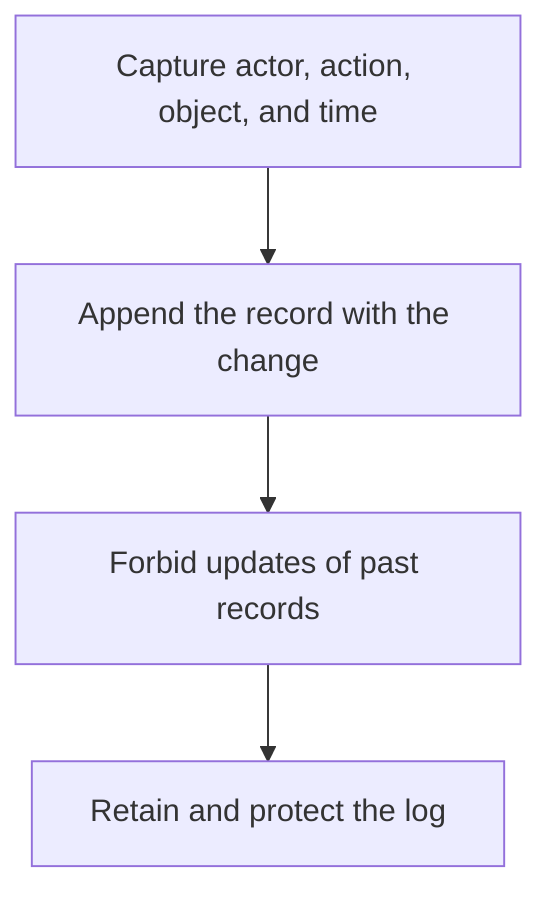

# D17-T034 — Audit log service

Topic ID: `D17-T034`
Domain: Common System Design Problems
Subdomain: Audit log service
Importance: common
Complexity: intermediate
Dependencies: `D17-T033`, `D17-T001`, `D16-T001`, `D16-T002`, `D07-T001`, `D07-T002`
Execution status of the code in section F: unexecuted

## A. Topic Overview

An audit log service records who did what to which object, and when, in a form that is append-only for investigators. It is not the debug log. Entries are written in the same transaction as the change when the answer must not diverge, or via an outbox. Queries are by actor, object, and time. Retention is a legal requirement. The log itself needs access control.

In production this shows up as follows: Changing a role inserts the membership row and the audit row in one transaction, including the actor from the token. Support searches by user id. The log is retained for the contractual period and is tenant-scoped.

Interviewers use Audit log service to see whether you can state the failure mode, not only the definition. The failure to name is: an audit row written only after a later request succeeds, so a crash leaves a change with no record, or an audit API that leaks other tenants

Prerequisites: `D17-T033`, `D17-T001`, `D16-T001`, `D16-T002`, `D07-T001`, `D07-T002`. Later notes should link here instead of repeating the mechanism.

## B. First-Principles Explanation

An audit log service records who did what to which object, and when, in a form that is append-only for investigators. It is not the debug log. Entries are written in the same transaction as the change when the answer must not diverge, or via an outbox. Queries are by actor, object, and time. Retention is a legal requirement. The log itself needs access control.

The useful picture is: An audit log is a bound book written in ink. A debug log is a whiteboard. Investigators will not accept the whiteboard, and they will notice a torn-out page.

What has to be true:

1. Capture actor, action, object, and time
2. Append the record with the change
3. Forbid updates of past records
4. Retain and protect the log

It works when those steps preserve one invariant. It fails when an audit row written only after a later request succeeds, so a crash leaves a change with no record, or an audit API that leaks other tenants. The alternative is: you grep application logs and call that an audit

## C. Internal Working and Architecture

Components involved: the caller, the state Audit log service mutates or reads, and the observer that reports gaps between commits and audit rows, and unauthorized audit reads.

Execution:

1. Capture actor, action, object, and time
2. Append the record with the change
3. Forbid updates of past records
4. Retain and protect the log

Data moves only along that path. A retry re-enters at step 1, so the operation must say what a duplicate does. Memory and locks stay inside this mechanism. Callers see the result or a typed error, not a half-updated invariant.

State to remember: choose this when a later investigation must reconstruct a privileged change. Do not choose it when you grep application logs and call that an audit.

## D. Diagrams and Visual Models



Read the diagram from top to bottom. Each box is one step of Audit log service. The failure mode (an audit row written only after a later request succeeds, so a crash leaves a change with no record, or an audit API that leaks other tenants) is what you look for when a later box never happens or happens twice.

## E. Examples and Analogies

Analogy: An audit log is a bound book written in ink. A debug log is a whiteboard. Investigators will not accept the whiteboard, and they will notice a torn-out page.

Production example: Changing a role inserts the membership row and the audit row in one transaction, including the actor from the token. Support searches by user id. The log is retained for the contractual period and is tenant-scoped.

A small counterexample is enough in an interview. Show the input, apply the steps, and show the broken outcome if someone uses the mechanism outside its rule: an audit row written only after a later request succeeds, so a crash leaves a change with no record, or an audit API that leaks other tenants.

## F. Code Examples

The snippet is labeled unexecuted. It illustrates the shape of the idea. It is not a benchmark and it embeds no secret.

```python
def entry(actor, action, object_id):
    return {'actor': actor, 'action': action, 'object_id': object_id}
```

After the snippet, check gaps between commits and audit rows, and unauthorized audit reads. If that signal moves the wrong way, the snippet is the wrong tool for the workload.

## G. Practical Backend Application

Use Audit log service in a service when a later investigation must reconstruct a privileged change.

A typical place is the production case already stated: Changing a role inserts the membership row and the audit row in one transaction, including the actor from the token. Support searches by user id. The log is retained for the contractual period and is tenant-scoped.

Operationally you alert on gaps between commits and audit rows, and unauthorized audit reads. You do not alert only on process uptime. The dashboard should show the failure mode, a success rate, and the saturation signal (queue depth, lock wait, or latency) that predicts it.

## H. Advantages, Limitations and Trade-offs

| Choice | Benefit | Cost | Choose when | Avoid when |
| --- | --- | --- | --- | --- |
| Apply Audit log service | a later investigation must reconstruct a privileged change | Extra moving parts and a new failure mode | The failure you are preventing is already real | you grep application logs and call that an audit |
| Simpler alternative | Less code and fewer dependencies | an audit row written only after a later request succeeds, so a crash leaves a change with no record, or an audit API that leaks other tenants | The workload does not hit the limit | The invariant must hold under concurrency or failure |

Audit log service is a trade. State the benefit and the cost in the same sentence when you propose it in a design review.

## I. Common Mistakes and Misconceptions

- Mutable audit rows.
- Missing tenant scope.
- Writing the audit only from the UI.
- Treating a diagram of Audit log service as proof that the invariant holds in production.
- Copying a default configuration without naming gaps between commits and audit rows, and unauthorized audit reads.

## J. Debugging and Troubleshooting

Symptom: an audit row written only after a later request succeeds, so a crash leaves a change with no record, or an audit API that leaks other tenants

First check: gaps between commits and audit rows, and unauthorized audit reads.

Then compare one healthy instance against one unhealthy instance. Confirm whether retries are duplicating work. Confirm whether a timeout is shorter than the work. Fix the invariant, then watch the same metric for a full peak, not only for the next minute.

Useful questions: did the step order in section C actually happen, or did a caller skip a step? Did a deploy change the data shape that Audit log service assumes?

## K. Interview Preparation

### Beginner

#### Q1. What problem does Audit log service solve?

**Answer:** An audit log service records who did what to which object, and when, in a form that is append-only for investigators. It is not the debug log. Entries are written in the same transaction as the change when the answer must not diverge, or via an outbox. Queries are by actor, object, and time. Retention is a legal requirement. The log itself needs access control. Without it, the usual backend failure is: an audit row written only after a later request succeeds, so a crash leaves a change with no record, or an audit API that leaks other tenants.

#### Q2. Where does Audit log service sit on a request path?

**Answer:** Audit log service is not a library you sprinkle on every call. a later investigation must reconstruct a privileged change You notice it when gaps between commits and audit rows, and unauthorized audit reads. Name the constraint that makes this choice correct. Say what you would measure to confirm it.

#### Q3. Give a concrete example of Audit log service.

**Answer:** Changing a role inserts the membership row and the audit row in one transaction, including the actor from the token. Support searches by user id. The log is retained for the contractual period and is tenant-scoped. Walk the input, the state change, and the observable output.

#### Q4. What is a common mix-up around Audit log service?

**Answer:** an audit row written only after a later request succeeds, so a crash leaves a change with no record, or an audit API that leaks other tenants The corrective check is gaps between commits and audit rows, and unauthorized audit reads. Name the constraint that makes this choice correct. Say what you would measure to confirm it. Say which alternative you rejected and why.

#### Q5. When would you skip Audit log service?

**Answer:** you grep application logs and call that an audit Skipping is a decision with a measured cost, not a slogan. Name the constraint that makes this choice correct. Say what you would measure to confirm it. Say which alternative you rejected and why.

### Intermediate

#### Q1. What invariant makes Audit log service correct?

**Answer:** An audit log service records who did what to which object, and when, in a form that is append-only for investigators. It is not the debug log. Entries are written in the same transaction as the change when the answer must not diverge, or via an outbox. Queries are by actor, object, and time. Retention is a legal requirement. The log itself needs access control. State the invariant before you name the tool.

#### Q2. How do you test Audit log service?

**Answer:** Assert the failure mode directly: an audit row written only after a later request succeeds, so a crash leaves a change with no record, or an audit API that leaks other tenants. The assertion should watch gaps between commits and audit rows, and unauthorized audit reads. Include a concurrent or retry case if the bug only appears then. Name the constraint that makes this choice correct.

#### Q3. What signal tells you Audit log service is misbehaving in production?

**Answer:** Watch gaps between commits and audit rows, and unauthorized audit reads. The user-visible symptom is usually an audit row written only after a later request succeeds, so a crash leaves a change with no record, or an audit API that leaks other tenants. Name the constraint that makes this choice correct. Say what you would measure to confirm it.

#### Q4. How would you introduce Audit log service into a legacy service?

**Answer:** a later investigation must reconstruct a privileged change Ship it behind a metric so you can compare the old path. Roll back if an audit row written only after a later request succeeds, so a crash leaves a change with no record, or an audit API that leaks other tenants gets worse. Name the constraint that makes this choice correct. Say what you would measure to confirm it.

#### Q5. What do you trade away by choosing Audit log service?

**Answer:** a later investigation must reconstruct a privileged change you grep application logs and call that an audit Say the cost in latency, storage, or operational load. Name the constraint that makes this choice correct. Say what you would measure to confirm it. Say which alternative you rejected and why.

### Advanced

#### Q1. What breaks if a dependency of Audit log service is slow or down?

**Answer:** an audit row written only after a later request succeeds, so a crash leaves a change with no record, or an audit API that leaks other tenants Degrade using the rule: you grep application logs and call that an audit. Timeouts must be shorter than the caller's deadline. Name the constraint that makes this choice correct. Say what you would measure to confirm it.

#### Q2. How does Audit log service behave under retries?

**Answer:** Retries repeat work, so Audit log service must define what a duplicate does. an audit row written only after a later request succeeds, so a crash leaves a change with no record, or an audit API that leaks other tenants Idempotency keys or fences belong next to the write, not in a comment. Name the constraint that makes this choice correct. Say what you would measure to confirm it.

#### Q3. What is the capacity limit of Audit log service?

**Answer:** The limit shows up as gaps between commits and audit rows, and unauthorized audit reads. Add capacity only after you know whether the bottleneck is CPU, lock wait, or network. Name the constraint that makes this choice correct. Say what you would measure to confirm it.

#### Q4. How do you evolve Audit log service without a flag day?

**Answer:** a later investigation must reconstruct a privileged change Version the contract or the on-disk format. Readers should tolerate one old and one new shape during the rollout. Name the constraint that makes this choice correct. Say what you would measure to confirm it.

#### Q5. What security or correctness bug hides inside Audit log service?

**Answer:** an audit row written only after a later request succeeds, so a crash leaves a change with no record, or an audit API that leaks other tenants Check authorization and tenancy at the same boundary as the mechanism. A cache or queue must not widen who can read the data. Name the constraint that makes this choice correct. Say what you would measure to confirm it.

### Scenario

#### Q1. Incident: an audit row written only after a later request succeeds, so a crash leaves a change with no record, or an audit API that leaks other tenants. What do you check first?

**Answer:** Start with gaps between commits and audit rows, and unauthorized audit reads. Compare a good host and a bad host before you restart anything. An audit log service records who did what to which object, and when, in a form that is append-only for investigators. It is not the debug log. Entries are written in the same transaction as the change when the answer must not diverge, or via an outbox. Queries are by actor, object, and time. Retention is a legal requirement. The log itself needs access control.

#### Q2. A reviewer wants the clever version. What data settles it?

**Answer:** a later investigation must reconstruct a privileged change you grep application logs and call that an audit Bring gaps between commits and audit rows, and unauthorized audit reads from a load test or from production, not a slogan. Name the constraint that makes this choice correct. Say what you would measure to confirm it. Say which alternative you rejected and why.

#### Q3. You have one hour to explain Audit log service at a whiteboard.

**Answer:** Draw the happy path in four boxes. Then draw the failure: an audit row written only after a later request succeeds, so a crash leaves a change with no record, or an audit API that leaks other tenants. End with the metric you would page on. Name the constraint that makes this choice correct.

#### Q4. The bug only appears under two concurrent callers.

**Answer:** an audit row written only after a later request succeeds, so a crash leaves a change with no record, or an audit API that leaks other tenants Reproduce with a barrier so both sides enter the critical window. Confirm the fix with gaps between commits and audit rows, and unauthorized audit reads. Name the constraint that makes this choice correct. Say what you would measure to confirm it.

#### Q5. Leadership wants this on every service next week.

**Answer:** you grep application logs and call that an audit a later investigation must reconstruct a privileged change Roll it out where the failure mode is already hurting users. Name the constraint that makes this choice correct. Say what you would measure to confirm it. Say which alternative you rejected and why.

### Follow-up

#### Q1. What did you assume about the data size or the clock?

**Answer:** An audit log service records who did what to which object, and when, in a form that is append-only for investigators. It is not the debug log. Entries are written in the same transaction as the change when the answer must not diverge, or via an outbox. Queries are by actor, object, and time. Retention is a legal requirement. The log itself needs access control. Clocks are not a total order across machines. State whether the algorithm needs bounded size or a single leader.

#### Q2. What would you measure after the change ships?

**Answer:** Page on gaps between commits and audit rows, and unauthorized audit reads. Keep a before/after dashboard for one week. Alert on the failure mode, not only on CPU. Name the constraint that makes this choice correct.

#### Q3. Which neighboring topic did you deliberately not re-teach?

**Answer:** This note owns Audit log service. Related identifiers are in section N. Shared ideas are linked, not copied. Name the constraint that makes this choice correct.

## L. Practical Exercises

Solutions are in `EXERCISES/solutions/D17-T034.md`, not in this section.

1. Whiteboard the four steps of Audit log service and mark where `an audit row written only after a later request succeeds, so a crash leaves a change with no record, or an audit API that leaks other tenants` enters.
2. Read the snippet in section F and write the assertion that would catch that failure. The assertion must mention `gaps between commits and audit rows, and unauthorized audit reads`.
3. Argue for or against using Audit log service on a service you know. Use the choose and avoid rows from section H. Do not appeal to popularity.

## M. Revision Notes

- Mechanism: An audit log service records who did what to which object, and when, in a form that is append-only for investigators.
- Failure: an audit row written only after a later request succeeds, so a crash leaves a change with no record, or an audit API that leaks other tenants
- Metric: gaps between commits and audit rows, and unauthorized audit reads
- Choose when: a later investigation must reconstruct a privileged change
- Avoid when: you grep application logs and call that an audit

## N. Related Topics

Dependencies to review first: `D17-T033`, `D17-T001`, `D16-T001`, `D16-T002`, `D07-T001`, `D07-T002`.

Shared ideas stay in those notes. This note does not restate them.

## O. Completion Criteria

- You can explain Audit log service without reading this note, including the failure mode.
- You can draw the diagram in section D from memory.
- You can say when not to use it, using the avoid condition in section H.
- You can name the metric you would watch after shipping it.
