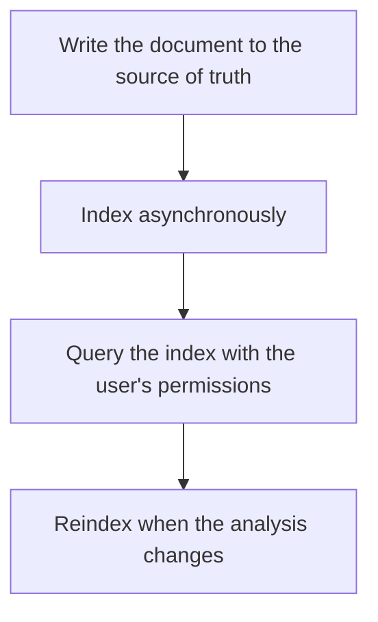

# D17-T035 — Search engine

Topic ID: `D17-T035`
Domain: Common System Design Problems
Subdomain: Search engine
Importance: common
Complexity: intermediate
Dependencies: `D17-T034`, `D17-T001`, `D16-T001`, `D16-T002`, `D07-T001`, `D07-T002`
Execution status of the code in section F: unexecuted

## A. Topic Overview

A search engine indexes documents into inverted structures so a text query does not scan the source of truth. Indexing is asynchronous, so search can lag writes. Analyzers decide tokens. Relevance ranks matches. Filters and permissions must be in the query, not applied only in the UI. Reindexing is how you change an analyzer. The database remains the source of document truth.

In production this shows up as follows: Products are stored in PostgreSQL and indexed into a search cluster. The query includes tenant and ACL filters. A user who just created a product may not see it in search for a second and the UI says so. Changing the analyzer is a reindex, not a config hope.

Interviewers use Search engine to see whether you can state the failure mode, not only the definition. The failure to name is: a search result that includes a document the user must not see, or a new product that is unsearchable and looks lost

Prerequisites: `D17-T034`, `D17-T001`, `D16-T001`, `D16-T002`, `D07-T001`, `D07-T002`. Later notes should link here instead of repeating the mechanism.

## B. First-Principles Explanation

A search engine indexes documents into inverted structures so a text query does not scan the source of truth. Indexing is asynchronous, so search can lag writes. Analyzers decide tokens. Relevance ranks matches. Filters and permissions must be in the query, not applied only in the UI. Reindexing is how you change an analyzer. The database remains the source of document truth.

The useful picture is: A search engine is the index at the back of a book. It is built after the pages exist. If you reprint the pages with a new hyphenation rule, you rebuild the index or the entries point at the wrong words.

What has to be true:

1. Write the document to the source of truth
2. Index asynchronously
3. Query the index with the user's permissions
4. Reindex when the analysis changes

It works when those steps preserve one invariant. It fails when a search result that includes a document the user must not see, or a new product that is unsearchable and looks lost. The alternative is: you make the search index the only copy of the product

## C. Internal Working and Architecture

Components involved: the caller, the state Search engine mutates or reads, and the observer that reports index lag, query p99, and permission-filter misses in tests.

Execution:

1. Write the document to the source of truth
2. Index asynchronously
3. Query the index with the user's permissions
4. Reindex when the analysis changes

Data moves only along that path. A retry re-enters at step 1, so the operation must say what a duplicate does. Memory and locks stay inside this mechanism. Callers see the result or a typed error, not a half-updated invariant.

State to remember: choose this when users need text or ranked retrieval beyond what a B-tree does well. Do not choose it when you make the search index the only copy of the product.

## D. Diagrams and Visual Models



Read the diagram from top to bottom. Each box is one step of Search engine. The failure mode (a search result that includes a document the user must not see, or a new product that is unsearchable and looks lost) is what you look for when a later box never happens or happens twice.

## E. Examples and Analogies

Analogy: A search engine is the index at the back of a book. It is built after the pages exist. If you reprint the pages with a new hyphenation rule, you rebuild the index or the entries point at the wrong words.

Production example: Products are stored in PostgreSQL and indexed into a search cluster. The query includes tenant and ACL filters. A user who just created a product may not see it in search for a second and the UI says so. Changing the analyzer is a reindex, not a config hope.

A small counterexample is enough in an interview. Show the input, apply the steps, and show the broken outcome if someone uses the mechanism outside its rule: a search result that includes a document the user must not see, or a new product that is unsearchable and looks lost.

## F. Code Examples

The snippet is labeled unexecuted. It illustrates the shape of the idea. It is not a benchmark and it embeds no secret.

```python
def visible(hit, tenant_id):
    return hit['tenant_id'] == tenant_id
```

After the snippet, check index lag, query p99, and permission-filter misses in tests. If that signal moves the wrong way, the snippet is the wrong tool for the workload.

## G. Practical Backend Application

Use Search engine in a service when users need text or ranked retrieval beyond what a B-tree does well.

A typical place is the production case already stated: Products are stored in PostgreSQL and indexed into a search cluster. The query includes tenant and ACL filters. A user who just created a product may not see it in search for a second and the UI says so. Changing the analyzer is a reindex, not a config hope.

Operationally you alert on index lag, query p99, and permission-filter misses in tests. You do not alert only on process uptime. The dashboard should show the failure mode, a success rate, and the saturation signal (queue depth, lock wait, or latency) that predicts it.

## H. Advantages, Limitations and Trade-offs

| Choice | Benefit | Cost | Choose when | Avoid when |
| --- | --- | --- | --- | --- |
| Apply Search engine | users need text or ranked retrieval beyond what a B-tree does well | Extra moving parts and a new failure mode | The failure you are preventing is already real | you make the search index the only copy of the product |
| Simpler alternative | Less code and fewer dependencies | a search result that includes a document the user must not see, or a new product that is unsearchable and looks lost | The workload does not hit the limit | The invariant must hold under concurrency or failure |

Search engine is a trade. State the benefit and the cost in the same sentence when you propose it in a design review.

## I. Common Mistakes and Misconceptions

- No permission filter.
- Synchronous indexing on the user request with no timeout story.
- No reindex plan.
- Treating a diagram of Search engine as proof that the invariant holds in production.
- Copying a default configuration without naming index lag, query p99, and permission-filter misses in tests.

## J. Debugging and Troubleshooting

Symptom: a search result that includes a document the user must not see, or a new product that is unsearchable and looks lost

First check: index lag, query p99, and permission-filter misses in tests.

Then compare one healthy instance against one unhealthy instance. Confirm whether retries are duplicating work. Confirm whether a timeout is shorter than the work. Fix the invariant, then watch the same metric for a full peak, not only for the next minute.

Useful questions: did the step order in section C actually happen, or did a caller skip a step? Did a deploy change the data shape that Search engine assumes?

## K. Interview Preparation

### Beginner

#### Q1. What problem does Search engine solve?

**Answer:** A search engine indexes documents into inverted structures so a text query does not scan the source of truth. Indexing is asynchronous, so search can lag writes. Analyzers decide tokens. Relevance ranks matches. Filters and permissions must be in the query, not applied only in the UI. Reindexing is how you change an analyzer. The database remains the source of document truth. Without it, the usual backend failure is: a search result that includes a document the user must not see, or a new product that is unsearchable and looks lost.

#### Q2. Where does Search engine sit on a request path?

**Answer:** Search engine is not a library you sprinkle on every call. users need text or ranked retrieval beyond what a B-tree does well You notice it when index lag, query p99, and permission-filter misses in tests. Name the constraint that makes this choice correct. Say what you would measure to confirm it.

#### Q3. Give a concrete example of Search engine.

**Answer:** Products are stored in PostgreSQL and indexed into a search cluster. The query includes tenant and ACL filters. A user who just created a product may not see it in search for a second and the UI says so. Changing the analyzer is a reindex, not a config hope. Walk the input, the state change, and the observable output.

#### Q4. What is a common mix-up around Search engine?

**Answer:** a search result that includes a document the user must not see, or a new product that is unsearchable and looks lost The corrective check is index lag, query p99, and permission-filter misses in tests. Name the constraint that makes this choice correct. Say what you would measure to confirm it. Say which alternative you rejected and why.

#### Q5. When would you skip Search engine?

**Answer:** you make the search index the only copy of the product Skipping is a decision with a measured cost, not a slogan. Name the constraint that makes this choice correct. Say what you would measure to confirm it. Say which alternative you rejected and why.

### Intermediate

#### Q1. What invariant makes Search engine correct?

**Answer:** A search engine indexes documents into inverted structures so a text query does not scan the source of truth. Indexing is asynchronous, so search can lag writes. Analyzers decide tokens. Relevance ranks matches. Filters and permissions must be in the query, not applied only in the UI. Reindexing is how you change an analyzer. The database remains the source of document truth. State the invariant before you name the tool.

#### Q2. How do you test Search engine?

**Answer:** Assert the failure mode directly: a search result that includes a document the user must not see, or a new product that is unsearchable and looks lost. The assertion should watch index lag, query p99, and permission-filter misses in tests. Include a concurrent or retry case if the bug only appears then. Name the constraint that makes this choice correct.

#### Q3. What signal tells you Search engine is misbehaving in production?

**Answer:** Watch index lag, query p99, and permission-filter misses in tests. The user-visible symptom is usually a search result that includes a document the user must not see, or a new product that is unsearchable and looks lost. Name the constraint that makes this choice correct. Say what you would measure to confirm it.

#### Q4. How would you introduce Search engine into a legacy service?

**Answer:** users need text or ranked retrieval beyond what a B-tree does well Ship it behind a metric so you can compare the old path. Roll back if a search result that includes a document the user must not see, or a new product that is unsearchable and looks lost gets worse. Name the constraint that makes this choice correct. Say what you would measure to confirm it.

#### Q5. What do you trade away by choosing Search engine?

**Answer:** users need text or ranked retrieval beyond what a B-tree does well you make the search index the only copy of the product Say the cost in latency, storage, or operational load. Name the constraint that makes this choice correct. Say what you would measure to confirm it. Say which alternative you rejected and why.

### Advanced

#### Q1. What breaks if a dependency of Search engine is slow or down?

**Answer:** a search result that includes a document the user must not see, or a new product that is unsearchable and looks lost Degrade using the rule: you make the search index the only copy of the product. Timeouts must be shorter than the caller's deadline. Name the constraint that makes this choice correct. Say what you would measure to confirm it.

#### Q2. How does Search engine behave under retries?

**Answer:** Retries repeat work, so Search engine must define what a duplicate does. a search result that includes a document the user must not see, or a new product that is unsearchable and looks lost Idempotency keys or fences belong next to the write, not in a comment. Name the constraint that makes this choice correct. Say what you would measure to confirm it.

#### Q3. What is the capacity limit of Search engine?

**Answer:** The limit shows up as index lag, query p99, and permission-filter misses in tests. Add capacity only after you know whether the bottleneck is CPU, lock wait, or network. Name the constraint that makes this choice correct. Say what you would measure to confirm it.

#### Q4. How do you evolve Search engine without a flag day?

**Answer:** users need text or ranked retrieval beyond what a B-tree does well Version the contract or the on-disk format. Readers should tolerate one old and one new shape during the rollout. Name the constraint that makes this choice correct. Say what you would measure to confirm it.

#### Q5. What security or correctness bug hides inside Search engine?

**Answer:** a search result that includes a document the user must not see, or a new product that is unsearchable and looks lost Check authorization and tenancy at the same boundary as the mechanism. A cache or queue must not widen who can read the data. Name the constraint that makes this choice correct. Say what you would measure to confirm it.

### Scenario

#### Q1. Incident: a search result that includes a document the user must not see, or a new product that is unsearchable and looks lost. What do you check first?

**Answer:** Start with index lag, query p99, and permission-filter misses in tests. Compare a good host and a bad host before you restart anything. A search engine indexes documents into inverted structures so a text query does not scan the source of truth. Indexing is asynchronous, so search can lag writes. Analyzers decide tokens. Relevance ranks matches. Filters and permissions must be in the query, not applied only in the UI. Reindexing is how you change an analyzer. The database remains the source of document truth.

#### Q2. A reviewer wants the clever version. What data settles it?

**Answer:** users need text or ranked retrieval beyond what a B-tree does well you make the search index the only copy of the product Bring index lag, query p99, and permission-filter misses in tests from a load test or from production, not a slogan. Name the constraint that makes this choice correct. Say what you would measure to confirm it. Say which alternative you rejected and why.

#### Q3. You have one hour to explain Search engine at a whiteboard.

**Answer:** Draw the happy path in four boxes. Then draw the failure: a search result that includes a document the user must not see, or a new product that is unsearchable and looks lost. End with the metric you would page on. Name the constraint that makes this choice correct.

#### Q4. The bug only appears under two concurrent callers.

**Answer:** a search result that includes a document the user must not see, or a new product that is unsearchable and looks lost Reproduce with a barrier so both sides enter the critical window. Confirm the fix with index lag, query p99, and permission-filter misses in tests. Name the constraint that makes this choice correct. Say what you would measure to confirm it.

#### Q5. Leadership wants this on every service next week.

**Answer:** you make the search index the only copy of the product users need text or ranked retrieval beyond what a B-tree does well Roll it out where the failure mode is already hurting users. Name the constraint that makes this choice correct. Say what you would measure to confirm it. Say which alternative you rejected and why.

### Follow-up

#### Q1. What did you assume about the data size or the clock?

**Answer:** A search engine indexes documents into inverted structures so a text query does not scan the source of truth. Indexing is asynchronous, so search can lag writes. Analyzers decide tokens. Relevance ranks matches. Filters and permissions must be in the query, not applied only in the UI. Reindexing is how you change an analyzer. The database remains the source of document truth. Clocks are not a total order across machines. State whether the algorithm needs bounded size or a single leader.

#### Q2. What would you measure after the change ships?

**Answer:** Page on index lag, query p99, and permission-filter misses in tests. Keep a before/after dashboard for one week. Alert on the failure mode, not only on CPU. Name the constraint that makes this choice correct.

#### Q3. Which neighboring topic did you deliberately not re-teach?

**Answer:** This note owns Search engine. Related identifiers are in section N. Shared ideas are linked, not copied. Name the constraint that makes this choice correct.

## L. Practical Exercises

Solutions are in `EXERCISES/solutions/D17-T035.md`, not in this section.

1. Whiteboard the four steps of Search engine and mark where `a search result that includes a document the user must not see, or a new product that is unsearchable and looks lost` enters.
2. Read the snippet in section F and write the assertion that would catch that failure. The assertion must mention `index lag, query p99, and permission-filter misses in tests`.
3. Argue for or against using Search engine on a service you know. Use the choose and avoid rows from section H. Do not appeal to popularity.

## M. Revision Notes

- Mechanism: A search engine indexes documents into inverted structures so a text query does not scan the source of truth.
- Failure: a search result that includes a document the user must not see, or a new product that is unsearchable and looks lost
- Metric: index lag, query p99, and permission-filter misses in tests
- Choose when: users need text or ranked retrieval beyond what a B-tree does well
- Avoid when: you make the search index the only copy of the product

## N. Related Topics

Dependencies to review first: `D17-T034`, `D17-T001`, `D16-T001`, `D16-T002`, `D07-T001`, `D07-T002`.

Shared ideas stay in those notes. This note does not restate them.

## O. Completion Criteria

- You can explain Search engine without reading this note, including the failure mode.
- You can draw the diagram in section D from memory.
- You can say when not to use it, using the avoid condition in section H.
- You can name the metric you would watch after shipping it.
