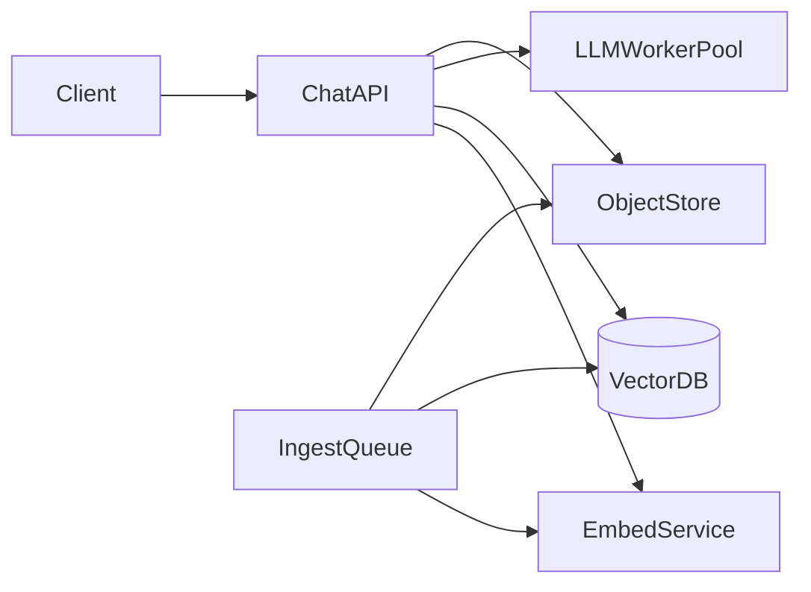

# D17-T036 — AI/RAG inference service

Topic ID: `D17-T036`
Domain: Common System Design Problems
Subdomain: AI/RAG inference service
Importance: common
Complexity: intermediate
Dependencies: `D17-T035`, `D17-T001`, `D16-T001`, `D16-T002`, `D07-T001`, `D07-T002`
Execution status of the code in section F: illustrative (not executed in CI)

## A. Topic Overview

An AI/RAG inference service answers user queries by retrieving relevant document chunks and conditioning a large language model on that evidence. The design balances GPU cost, latency SLOs, grounding (citations), and safety guardrails. Interviewers test retrieval quality, caching, queueing under burst, and PII handling in prompts. Builds on search/index concepts (`D17-T035`) and platform scalability (`D17-T001`).

## B. First-Principles Explanation

### Functional requirements

- `POST /v1/chat` with session id, user message, optional filters (tenant, collection).
- Ingestion pipeline: chunk documents, embed, upsert vector index with metadata.
- Retrieval: top-k similarity + optional rerank; attach citations to response.
- Model routing: fast vs quality tiers; fallback when GPU saturated.
- Admin: collection CRUD, re-embed on model change, eval datasets.

### Non-functional requirements

- p95 end-to-end latency ≤ 2 s for default tier at target RPS.
- Grounded answers: every factual claim traceable to chunk id.
- Tenant isolation for embeddings and prompts.
- Rate limits and token budgets per user/tenant.

### Capacity assumptions

500 RPS chat peak; 8 chunks × 512 tokens context average; embedding 50 ms; vector search 30 ms; LLM 800 ms–1.5 s; 20–40 GPU workers; 10M chunks per large tenant; object store for raw docs.

### Bottlenecks

GPU inference queue; vector index hot partitions; embedding service during reindex; prompt token bloat; reranker CPU.

### Failure modes

Hallucination when retrieval empty; stale index after doc update; prompt injection via user content; GPU OOM on long contexts; cost runaway without token caps.

## C. Internal Working and Architecture

API gateway authenticates and enforces quota. Chat orchestrator embeds query, queries vector DB with metadata filters, reranks, builds prompt with citation markers, calls LLM worker pool asynchronously with timeout. Responses stream tokens to client; log prompt hash and chunk ids for audit. Ingestion is async via queue; versioning on collections.

### API surface

| Method | Path | Purpose |
| --- | --- | --- |
| POST | `/v1/chat` | RAG completion (sync or SSE stream) |
| POST | `/v1/collections/{id}/documents` | Upload / register doc |
| POST | `/v1/collections/{id}/reindex` | Re-embed job |
| GET | `/v1/collections/{id}/chunks/{chunkId}` | Citation fetch |
| GET | `/v1/health` | Liveness |
| GET | `/v1/ready` | GPU + index readiness |

### Data model

`Tenant`, `Collection`, `Document`, `Chunk(chunk_id, embedding_id, text, metadata)`, `ChatSession`, `Message`, `RetrievalTrace(chunk_ids, scores)`, `ModelRoute(tier, model_id)`; object store for blobs; vector index per collection or shared with partition key.

## D. Diagrams and Visual Models



Read the diagram left to right: clients hit edge services, synchronous path touches authoritative storage, async workers handle side effects.

## E. Examples and Analogies

RAG is an open-book exam: retrieval picks pages; the model must quote those pages, not invent new facts. If the book lacks the answer, the system should abstain.

## F. Code Examples

```python
def chat(session_id: str, message: str, collection_id: str) -> Answer:
    q_vec = embed(message)
    chunks = vector_search(collection_id, q_vec, k=8, filters=tenant_filter())
    chunks = rerank(message, chunks)[:5]
    prompt = build_grounded_prompt(message, chunks)
    text = llm.generate(prompt, max_tokens=512, timeout_s=3)
    return Answer(text=text, citations=[c.id for c in chunks])
```

## G. Practical Backend Application

Cache query embeddings 5–15 min; cache retrieval for identical queries. Metrics: `rag_retrieval_hit`, `llm_queue_depth`, `tokens_in/out`, `hallucination_reports`. Autoscale GPU pool on queue latency. Shadow traffic for model upgrades.

## H. Advantages, Limitations and Trade-offs

| Choice | Benefit | Cost |
| --- | --- | --- |
| Larger k | Better recall | Latency + tokens |
| Reranker | Precision | CPU ms |
| Streaming SSE | UX | Harder timeouts |
| Shared GPU pool | Utilization | Noisy neighbors |

## I. Common Mistakes and Misconceptions

- Skipping metadata filters (cross-tenant leak)
- No abstain path when max score low
- Logging full prompts with PII
- Reindex without blue/green index alias

## J. Debugging and Troubleshooting

Bad answers: inspect retrieval scores and chunk text; verify collection version. Latency spikes: GPU queue, long prompts, cold embed cache. Cost spikes: token limits, top-k, model tier misuse.

## K. Interview Preparation

### Beginner

#### Q1. What problem does an AI/RAG inference service solve?

**Answer:** An AI/RAG inference service coordinates many clients against GPU inference slots without corrupting business rules. Users expect low latency reads but grounded answers with citation metadata on the write path. The design splits fast paths from durable vector index + object store for chunks. Interviewers want requirements before boxes and arrows.

#### Q2. What are functional requirements for RAG?

**Answer:** Core flows must create, read, update, and complete work involving GPU inference slots. Administrative APIs configure policies that downstream services enforce. Integrations emit events on embedding and rerank workers so other systems stay consistent. List five concrete user-visible capabilities, not only infrastructure.

#### Q3. What non-functional requirements matter most?

**Answer:** Availability and correctness trade off around grounded answers with citation metadata. Latency targets differ for reads versus vector index + object store for chunks. 500 RPS chat with 2s p95 defines how much burst traffic you must absorb. State measurable SLOs such as p99 latency and error rate.

#### Q4. Where is the authoritative state stored?

**Answer:** Durable truth for GPU inference slots lives in vector index + object store for chunks with transactional or atomic updates. Caches and replicas may serve reads but cannot be sole writers. Reconciliation jobs fix drift between cache and store. Name the store and what happens on cache miss.

#### Q5. Why are idempotency keys common here?

**Answer:** Clients retry when gateways time out during vector index + object store for chunks. Without idempotency, retries duplicate side effects on GPU inference slots. Keys are stored with a unique constraint and return the same response. Mention both API and webhook deduplication.

### Intermediate

#### Q1. How would you scale reads for RAG?

**Answer:** Partition read models by tenant or shard key relevant to GPU inference slots. Use replicas, CDNs, or materialized views for hot queries. Invalidate or TTL caches when vector index + object store for chunks changes. Quantify replica lag your product tolerates.

#### Q2. How would you scale writes for RAG?

**Answer:** Shard vector index + object store for chunks so hot keys do not share one partition. Serialize conflicting updates to the same GPU inference slots instance. Offload heavy work to embedding and rerank workers after a small durable write. Avoid distributed transactions across vendors.

#### Q3. What goes on the critical path versus async?

**Answer:** Only steps required to grounded answers with citation metadata stay synchronous. Notifications, analytics, and enrichment run via embedding and rerank workers. Outbox pattern ties async work to the same DB transaction. Draw a sequence diagram with at most five sync steps.

#### Q4. How do you handle hot keys?

**Answer:** A viral event concentrates updates on one GPU inference slots shard. Mitigate with partitioning, local queues, or dedicated pools. Rate limit abusive clients at the edge. Give an example hot key from 500 RPS chat with 2s p95.

#### Q5. What observability is mandatory?

**Answer:** Trace IDs across API, vector index + object store for chunks, and embedding and rerank workers. Metrics: success rate, latency histograms, backlog depth, saturation. Structured logs with correlation to business ids for GPU inference slots. Alert on SLO burn, not only CPU.

### Advanced

#### Q1. Active-active multi-region for RAG?

**Answer:** Conflicting writes to the same GPU inference slots need a single primary or CRDT with domain fit. Global load balancing sends writes to the owning region. Failover uses fencing to stop stale writers. Say explicitly if multi-master is unsafe for this domain.

#### Q2. Exactly-once semantics realistic?

**Answer:** End-to-end exactly-once is expensive; aim for at-least-once with idempotent vector index + object store for chunks. Dedup tables and deterministic ids make retries safe. Consumers on embedding and rerank workers must tolerate duplicates. Define which side effects must be unique.

#### Q3. Backpressure design?

**Answer:** When embedding and rerank workers or vector index + object store for chunks saturates, shed load with 429 and Retry-After. Queue depth triggers autoscaling and admission control. Prefer graceful degradation over unbounded memory growth. Describe what you disable first under stress.

#### Q4. Security boundaries?

**Answer:** Authenticate callers; authorize per tenant for GPU inference slots. Encrypt data in transit and at rest; audit admin changes. Validate all external callbacks with signatures. Mention threat model: fraud, replay, and privilege escalation.

#### Q5. Migration without downtime?

**Answer:** Dual-write or event replay from vector index + object store for chunks to new schema. Feature flags gate read path cutover. Verify counts and checksums on GPU inference slots samples. Plan rollback if error rate rises.

### Scenarios

#### Q1. Latency doubled after a release.

**Answer:** Compare canary metrics on vector index + object store for chunks query plans and cache hit rate. Check N+1 regressions and connection pool exhaustion. Roll back or scale embedding and rerank workers consumers if backlog grew. Use distributed traces on p99 spans.

#### Q2. Duplicate records after client retries.

**Answer:** Missing idempotency on vector index + object store for chunks allows two rows for one intent. Add unique constraint on business key and return 409 with existing id. Replay webhooks with same event id. Backfill dedup script before enabling constraint.

#### Q3. Regional outage during peak.

**Answer:** Fail DNS to healthy region; pause writes that cannot fence. Queue embedding and rerank workers safely or spill to durable log. Communicate partial feature availability. Run game days for failover quarterly.

#### Q4. Data drift between cache and database.

**Answer:** Counters for GPU inference slots diverge when invalidation fails. Compare aggregates; disable optimistic rejects if drift exceeds threshold. Rebuild cache from vector index + object store for chunks snapshot. Add periodic reconciliation job.

#### Q5. Compliance audit asks for proof of changes.

**Answer:** Immutable audit log of who changed GPU inference slots and when. Retain tamper-evident storage with retention policy. Correlate admin API to actor identity. Separate audit from application metrics.

### Follow-ups

#### Q1. Relation to databases (`D07-T002`)?

**Answer:** Schema and isolation level choices implement grounded answers with citation metadata. Indexes match query paths on vector index + object store for chunks. Migrations coordinate with embedding and rerank workers consumers. Mention transactions versus sagas.

#### Q2. Relation to scalability (`D17-T001`)?

**Answer:** Horizontal scale hits limits on GPU inference slots hot keys. Load balancers and autoscaling follow measured RPS from 500 RPS chat with 2s p95. Capacity planning includes dependency fan-out. Cite bottleneck you remove first.

#### Q3. What would you prototype first?

**Answer:** Single-region vector index + object store for chunks with correct grounded answers with citation metadata before optimizing latency. Scripted load test reproducing 500 RPS chat with 2s p95. Add embedding and rerank workers only after sync path is correct. Deliver vertical slice end-to-end in week one.

## L. Practical Exercises

Solutions are in `EXERCISES/solutions/D17-T036.md`. Try these before opening that file.

### Exercise 1 — design

Produce detailed API + ER diagram for AI/RAG inference service.

### Exercise 2 — operations

Write failover runbook for vector index + object store for chunks.

### Exercise 3 — capacity

Capacity estimate for 500 RPS chat with 2s p95.

## M. Revision Notes

- grounded answers with citation metadata
- 500 RPS chat with 2s p95
- vector index + object store for chunks
- embedding and rerank workers
- idempotency

Flashcards:

- Scarce resource? GPU inference slots.
- Async path? embedding and rerank workers.

## N. Related Topics

Links `D17-T035` search, `D17-T001` scale, `D07-T002` metadata stores; compare `D17-T029` recommendations for ranking overlap.

## O. Completion Criteria

- Explain AI/RAG inference service requirements
- Draw architecture diagram
- Describe grounded answers with citation metadata
- List bottlenecks and failures
- Walk idempotent retry scenario
