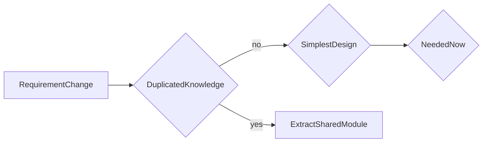

# D18-T002 — DRY, KISS and YAGNI

Topic ID: `D18-T002`
Domain: Low-Level Design (LLD) and Object-Oriented Design
Subdomain: DRY, KISS and YAGNI
Importance: core
Complexity: intermediate
Dependencies: `D18-T001`, `D01-T001`, `D01-T002`
Execution status of the code in section F: unexecuted

## A. Topic Overview

DRY (Don't Repeat Yourself), KISS (Keep It Simple, Stupid), and YAGNI (You Aren't Gonna Need It) are simplicity disciplines
that balance reuse against premature abstraction. They keep backend services understandable under on-call pressure.
They complement SOLID: SOLID shapes modules; DRY/KISS/YAGNI decide how much structure to add today.

## B. First-Principles Explanation

Duplication is not only copy-paste—it is knowledge repeated in two places that can diverge (validation in API and DB trigger).
KISS prefers the design a new engineer can modify at 3 a.m. without a pattern catalog.
YAGNI delays speculative frameworks until a second use case proves the abstraction.

## C. Internal Working and Architecture

Apply DRY at the right level: shared libraries for true invariants, not forced base classes for cosmetic similarity.
KISS shows up in flat service methods versus deep inheritance.
YAGNI gates feature flags for hypothetical multi-tenant modes.

## D. Diagrams and Visual Models



Decision flow when a new requirement arrives.

## E. Examples and Analogies

Copy-paste twice is a signal; copy-paste once is fine. KISS rejects cleverness without measured pain.

## F. Code Examples

File: examples/d18_t002_dry.py (unexecuted).

```java
# unexecuted
def validate_email(value: str) -> str:
    if "@" not in value:
        raise ValueError("email")
    return value.strip().lower()

# DRY: one validator used by CLI and HTTP layer, not two regex copies.
```

Single validator imported by multiple entry points prevents diverging rules.

## G. Practical Backend Application

Extract shared validation and pricing rules; avoid abstract factories until a second payment provider ships.

## H. Advantages, Limitations and Trade-offs

| Rule | Benefit | Cost | Choose when | Avoid when |
| --- | --- | --- | --- | --- |
| DRY | One source of truth | Wrong abstraction | Identical business rule | Superficial similarity |
| KISS | Readable code | Less 'elegant' | On-call heavy services | Performance-critical hot path needing tuning |
| YAGNI | Faster ship | Rework later | Uncertain roadmap | Compliance mandated early |

## I. Common Mistakes and Misconceptions

- DRYing accidental duplication into a wrong abstraction.
- KISS as excuse for no tests.
- YAGNI ignoring known roadmap items.
- Shared utils god package.
- Premature plugin architecture.

## J. Debugging and Troubleshooting

Incident: two validators disagree—search for duplicated regex and consolidate.

## K. Interview Preparation

### Beginner

#### Q1. What is DRY, KISS and YAGNI in one sentence?

**Answer:** DRY, KISS and YAGNI is three simplicity rules that prevent speculative abstraction. Interviewers want a concrete backend example, not a glossary quote. Tie the definition to a change you would make in a service class or module boundary. Mention testability or deploy isolation as the payoff.

#### Q2. Why does DRY, KISS and YAGNI matter in backend code?

**Answer:** Backend code lives for years and is changed under incident pressure. DRY, KISS and YAGNI reduces the blast radius when requirements shift. Services integrate databases, queues, and third parties; rigid designs break at those seams. Strong answers name a bug class prevented, not only 'clean code'.

#### Q3. Give a small example of DRY, KISS and YAGNI.

**Answer:** Pick one class in a payment or auth flow and show how three simplicity rules that prevent speculative abstraction applies. Keep the example to three types so the whiteboard stays readable. State inputs, outputs, and who calls whom. End with how you would unit-test the seam.

#### Q4. When would you skip DRY, KISS and YAGNI?

**Answer:** Skips are valid for throwaway scripts and one-off migrations. Over-applying DRY, KISS and YAGNI adds indirection that obscures a 50-line feature. If the variation never appears in requirements, do not build the abstraction early. YAGNI still applies inside OOD.

#### Q5. How is DRY, KISS and YAGNI different from a random utility class?

**Answer:** Utilities are stateless bags of functions without a modeled responsibility. DRY, KISS and YAGNI encodes a deliberate collaboration contract between roles. The difference shows up when you mock one side in tests. If you cannot draw the roles, it is probably not intentional design.

### Intermediate

#### Q1. How does DRY, KISS and YAGNI interact with SOLID?

**Answer:** SOLID is the constraint system; patterns are recurring shapes that satisfy it. DRY, KISS and YAGNI often supports dependency inversion and open-closed goals. Violations of single responsibility usually break the pattern silently. In reviews, map each class to one principle before naming a pattern.

#### Q2. How do you test code structured with DRY, KISS and YAGNI?

**Answer:** Replace slow or external collaborators with fakes at the abstraction introduced by the design. For DRY, KISS and YAGNI, tests should exercise the public contract, not private construction details. Use contract tests at integration boundaries. Avoid testing the pattern itself; test behavior.

#### Q3. What metrics or smells suggest missing DRY, KISS and YAGNI?

**Answer:** God classes, long switch statements, and copy-pasted integration code are common smells. When every new feature edits the same method, DRY, KISS and YAGNI may help. Rising cyclomatic complexity in one class is a signal. Also watch for duplicate error handling across adapters.

#### Q4. How would you introduce DRY, KISS and YAGNI in a legacy service?

**Answer:** Strangler approach: extract one seam behind an interface without rewriting the world. Keep old entry points until callers migrate to the DRY, KISS and YAGNI shape. Add characterization tests before moving code. Ship behind a feature flag if behavior could diverge.

#### Q5. Compare DRY, KISS and YAGNI with composition.

**Answer:** Composition favors has-a wiring; patterns often compose multiple objects. DRY, KISS and YAGNI does not replace composition; it structures it. Prefer composition when inheritance depth grows. Patterns should make collaboration explicit, not magical.

### Advanced

#### Q1. Thread-safety concerns with DRY, KISS and YAGNI?

**Answer:** Shared mutable singletons and registries are the usual hazard. If DRY, KISS and YAGNI caches state, document visibility and locking. In web apps, prefer request-scoped objects over global caches. Load tests expose races that unit tests miss.

#### Q2. Performance cost of DRY, KISS and YAGNI?

**Answer:** Indirection adds allocation and virtual dispatch; usually negligible in I/O bound services. DRY, KISS and YAGNI shines when variation is rare compared to steady-state requests. Profile before collapsing abstractions for micro-optimizations. Watch N+1 calls hidden inside facades.

#### Q3. How does DRY, KISS and YAGNI appear in frameworks (Spring, Django)?

**Answer:** Frameworks often embed the pattern in lifecycle hooks you override. Recognize DRY, KISS and YAGNI in template methods of middleware stacks. Do not fight the framework with a second parallel pattern. Document where your code plugs in.

#### Q4. Versioning APIs while using DRY, KISS and YAGNI?

**Answer:** Keep DTOs stable at the boundary; vary behavior behind the pattern. DRY, KISS and YAGNI lets you add a new strategy without breaking old clients. Publish which implementations are supported per API version. Deprecation is a product policy, not a pattern feature.

#### Q5. Security implications of DRY, KISS and YAGNI?

**Answer:** Proxies and decorators are natural choke points for authz logging. Do not let DRY, KISS and YAGNI bypass central validation. Command objects should not carry secrets in logs. Audit who can register implementations at runtime.

### Scenarios

#### Q1. Production bug: behavior differs only in staging. How does DRY, KISS and YAGNI help debug?

**Answer:** Swap the implementation in staging with a recording fake. With DRY, KISS and YAGNI, compare traces per collaborator. Check configuration wiring first. Replay the command or event that triggered the path.

#### Q2. Team debate: pattern vs inline code. What data decides?

**Answer:** Count variation points expected in the next two quarters. If only one implementation exists, DRY, KISS and YAGNI is speculative. Measure test pain when mocking is hard. Choose the design that reduces coordinated releases.

#### Q3. Interview design: parking lot / LLD. Where DRY, KISS and YAGNI?

**Answer:** Identify entities and lifecycles before patterns. Apply DRY, KISS and YAGNI at the variation point the interviewer highlights. Explain trade-offs aloud while drawing. Start simple; refactor to pattern when second variant appears.

#### Q4. Refactor deadline tomorrow. Minimal DRY, KISS and YAGNI slice?

**Answer:** Extract interface plus one alternate implementation behind factory. Move only the volatile code path into DRY, KISS and YAGNI. Leave data classes dumb. Add one integration test on the critical path.

#### Q5. Observability: what to log with DRY, KISS and YAGNI?

**Answer:** Log correlation id, chosen implementation name, and latency per collaborator. Avoid logging payloads that DRY, KISS and YAGNI transforms secretly. Metrics per strategy help detect misconfiguration. Trace spans should cross the abstraction boundary.

### Follow-ups

#### Q1. Related topic after DRY, KISS and YAGNI?

**Answer:** See the next D18 topic in the learning path for the adjacent pattern or principle. DDD and microservice boundaries reuse the same collaboration thinking. Link to dependency injection containers when wiring appears. Return to SOLID if reviews feel subjective.

#### Q2. How does DRY, KISS and YAGNI relate to microservices?

**Answer:** Patterns are in-process; services are deployment boundaries. Do not distribute a DRY, KISS and YAGNI graph without a compelling scaling reason. Use events between services; use patterns inside a service. Watch for duplicated pattern layers in every microservice.

#### Q3. Books vs code review for learning DRY, KISS and YAGNI?

**Answer:** Books teach vocabulary; reviews teach local conventions. After reading DRY, KISS and YAGNI, find it in your repo's framework integration. Keep a personal catalog of smells that triggered each pattern. Teach juniors with before-and-after diffs, not slides only.


## L. Practical Exercises

Solutions are in `EXERCISES/solutions/D18-T002.md`. Try these before opening that file.

### Exercise 1 — implementation

Find duplicated pagination parsing in two controllers; extract one function.

### Exercise 2 — debugging

Team added strategy pattern for one tax rate—argue YAGNI.

### Exercise 3 — trade-off

When is duplication safer than the wrong abstraction?

## M. Revision Notes

- DRY is about knowledge, not characters.
- KISS favors boring code.
- YAGNI delays speculative layers.

## N. Related Topics

After `D18-T001`. Leads to `D18-T003`.

## O. Completion Criteria

- Apply DRY/KISS/YAGNI to a sample PR.
- Name a harmful DRY refactor.
- Defend YAGNI to a stakeholder.
