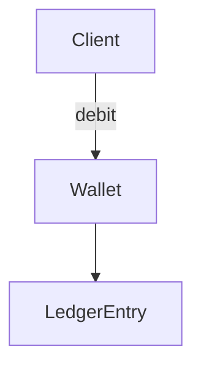

# D18-T003 — Encapsulation and composition

Topic ID: `D18-T003`
Domain: Low-Level Design (LLD) and Object-Oriented Design
Subdomain: Encapsulation and composition
Importance: core
Complexity: intermediate
Dependencies: `D18-T002`, `D18-T001`, `D01-T001`, `D01-T002`
Execution status of the code in section F: unexecuted

## A. Topic Overview

Encapsulation hides invariants behind a public API; composition builds behavior by wiring objects instead of deep inheritance. Backend domains (money, inventory) need strong invariants.

## B. First-Principles Explanation

Data structures alone do not protect rules—methods enforce them. Composition `has-a` avoids fragile base classes when behaviors mix.

## C. Internal Working and Architecture

Entities expose intent-revealing methods (`debit`, `reserve`) not raw setters. Services compose repositories, clocks, and policies.

## D. Diagrams and Visual Models



Clients call behavior; internal ledger structure stays private.

## E. Examples and Analogies

Wallet composes ledger entries instead of subclassing Account for every feature.

## F. Code Examples

examples/d18_t003_wallet.java (unexecuted).

```java
// unexecuted
final class Wallet {
  private long balanceCents;
  void debit(long cents) {
    if (cents > balanceCents) throw new IllegalStateException("insufficient");
    balanceCents -= cents;
  }
  long balanceCents() { return balanceCents; }
}
```

Private balance with checked debit preserves invariant.

## G. Practical Backend Application

Domain models in services should not leak ORM entities to controllers.

## H. Advantages, Limitations and Trade-offs

| Approach | Benefit | Cost | Choose when | Avoid when |
| --- | --- | --- | --- | --- |
| Encapsulation | Invariants enforced | Boilerplate getters | Money, auth tokens | Pure DTO transport |
| Composition | Flexible mixing | More wiring | Multiple behaviors | Single tiny struct |
| Inheritance | Reuse by is-a | Fragile overrides | True subtype LSP | Behavior mashups |

## I. Common Mistakes and Misconceptions

- Anemic domain models with all logic in services.
- Public mutable collections.
- Inheritance for code reuse only.
- Leaking ORM session into entities.
- Composition without clear ownership.

## J. Debugging and Troubleshooting

Bug: negative balance—search for setter bypassing debit.

## K. Interview Preparation

### Beginner

#### Q1. What is Encapsulation and composition in one sentence?

**Answer:** Encapsulation and composition is hide state enforce invariants compose behaviors. Interviewers want a concrete backend example, not a glossary quote. Tie the definition to a change you would make in a service class or module boundary. Mention testability or deploy isolation as the payoff.

#### Q2. Why does Encapsulation and composition matter in backend code?

**Answer:** Backend code lives for years and is changed under incident pressure. Encapsulation and composition reduces the blast radius when requirements shift. Services integrate databases, queues, and third parties; rigid designs break at those seams. Strong answers name a bug class prevented, not only 'clean code'.

#### Q3. Give a small example of Encapsulation and composition.

**Answer:** Pick one class in a payment or auth flow and show how hide state enforce invariants compose behaviors applies. Keep the example to three types so the whiteboard stays readable. State inputs, outputs, and who calls whom. End with how you would unit-test the seam.

#### Q4. When would you skip Encapsulation and composition?

**Answer:** Skips are valid for throwaway scripts and one-off migrations. Over-applying Encapsulation and composition adds indirection that obscures a 50-line feature. If the variation never appears in requirements, do not build the abstraction early. YAGNI still applies inside OOD.

#### Q5. How is Encapsulation and composition different from a random utility class?

**Answer:** Utilities are stateless bags of functions without a modeled responsibility. Encapsulation and composition encodes a deliberate collaboration contract between roles. The difference shows up when you mock one side in tests. If you cannot draw the roles, it is probably not intentional design.

### Intermediate

#### Q1. How does Encapsulation and composition interact with SOLID?

**Answer:** SOLID is the constraint system; patterns are recurring shapes that satisfy it. Encapsulation and composition often supports dependency inversion and open-closed goals. Violations of single responsibility usually break the pattern silently. In reviews, map each class to one principle before naming a pattern.

#### Q2. How do you test code structured with Encapsulation and composition?

**Answer:** Replace slow or external collaborators with fakes at the abstraction introduced by the design. For Encapsulation and composition, tests should exercise the public contract, not private construction details. Use contract tests at integration boundaries. Avoid testing the pattern itself; test behavior.

#### Q3. What metrics or smells suggest missing Encapsulation and composition?

**Answer:** God classes, long switch statements, and copy-pasted integration code are common smells. When every new feature edits the same method, Encapsulation and composition may help. Rising cyclomatic complexity in one class is a signal. Also watch for duplicate error handling across adapters.

#### Q4. How would you introduce Encapsulation and composition in a legacy service?

**Answer:** Strangler approach: extract one seam behind an interface without rewriting the world. Keep old entry points until callers migrate to the Encapsulation and composition shape. Add characterization tests before moving code. Ship behind a feature flag if behavior could diverge.

#### Q5. Compare Encapsulation and composition with composition.

**Answer:** Composition favors has-a wiring; patterns often compose multiple objects. Encapsulation and composition does not replace composition; it structures it. Prefer composition when inheritance depth grows. Patterns should make collaboration explicit, not magical.

### Advanced

#### Q1. Thread-safety concerns with Encapsulation and composition?

**Answer:** Shared mutable singletons and registries are the usual hazard. If Encapsulation and composition caches state, document visibility and locking. In web apps, prefer request-scoped objects over global caches. Load tests expose races that unit tests miss.

#### Q2. Performance cost of Encapsulation and composition?

**Answer:** Indirection adds allocation and virtual dispatch; usually negligible in I/O bound services. Encapsulation and composition shines when variation is rare compared to steady-state requests. Profile before collapsing abstractions for micro-optimizations. Watch N+1 calls hidden inside facades.

#### Q3. How does Encapsulation and composition appear in frameworks (Spring, Django)?

**Answer:** Frameworks often embed the pattern in lifecycle hooks you override. Recognize Encapsulation and composition in template methods of middleware stacks. Do not fight the framework with a second parallel pattern. Document where your code plugs in.

#### Q4. Versioning APIs while using Encapsulation and composition?

**Answer:** Keep DTOs stable at the boundary; vary behavior behind the pattern. Encapsulation and composition lets you add a new strategy without breaking old clients. Publish which implementations are supported per API version. Deprecation is a product policy, not a pattern feature.

#### Q5. Security implications of Encapsulation and composition?

**Answer:** Proxies and decorators are natural choke points for authz logging. Do not let Encapsulation and composition bypass central validation. Command objects should not carry secrets in logs. Audit who can register implementations at runtime.

### Scenarios

#### Q1. Production bug: behavior differs only in staging. How does Encapsulation and composition help debug?

**Answer:** Swap the implementation in staging with a recording fake. With Encapsulation and composition, compare traces per collaborator. Check configuration wiring first. Replay the command or event that triggered the path.

#### Q2. Team debate: pattern vs inline code. What data decides?

**Answer:** Count variation points expected in the next two quarters. If only one implementation exists, Encapsulation and composition is speculative. Measure test pain when mocking is hard. Choose the design that reduces coordinated releases.

#### Q3. Interview design: parking lot / LLD. Where Encapsulation and composition?

**Answer:** Identify entities and lifecycles before patterns. Apply Encapsulation and composition at the variation point the interviewer highlights. Explain trade-offs aloud while drawing. Start simple; refactor to pattern when second variant appears.

#### Q4. Refactor deadline tomorrow. Minimal Encapsulation and composition slice?

**Answer:** Extract interface plus one alternate implementation behind factory. Move only the volatile code path into Encapsulation and composition. Leave data classes dumb. Add one integration test on the critical path.

#### Q5. Observability: what to log with Encapsulation and composition?

**Answer:** Log correlation id, chosen implementation name, and latency per collaborator. Avoid logging payloads that Encapsulation and composition transforms secretly. Metrics per strategy help detect misconfiguration. Trace spans should cross the abstraction boundary.

### Follow-ups

#### Q1. Related topic after Encapsulation and composition?

**Answer:** See the next D18 topic in the learning path for the adjacent pattern or principle. DDD and microservice boundaries reuse the same collaboration thinking. Link to dependency injection containers when wiring appears. Return to SOLID if reviews feel subjective.

#### Q2. How does Encapsulation and composition relate to microservices?

**Answer:** Patterns are in-process; services are deployment boundaries. Do not distribute a Encapsulation and composition graph without a compelling scaling reason. Use events between services; use patterns inside a service. Watch for duplicated pattern layers in every microservice.

#### Q3. Books vs code review for learning Encapsulation and composition?

**Answer:** Books teach vocabulary; reviews teach local conventions. After reading Encapsulation and composition, find it in your repo's framework integration. Keep a personal catalog of smells that triggered each pattern. Teach juniors with before-and-after diffs, not slides only.


## L. Practical Exercises

Solutions are in `EXERCISES/solutions/D18-T003.md`. Try these before opening that file.

### Exercise 1 — implementation

Add `reserve` to encapsulated inventory object.

### Exercise 2 — debugging

Subclass stack for features—refactor to composition.

### Exercise 3 — trade-off

Trade encapsulation vs performance for hot counters.

## M. Revision Notes

- Encapsulation guards invariants.
- Composition over inheritance.
- Tell, don't ask.

## N. Related Topics

`D18-T002`, `D18-T004`.

## O. Completion Criteria

- Implement invariant-preserving method.
- Refactor inheritance to composition.
- Explain anemic model risk.
