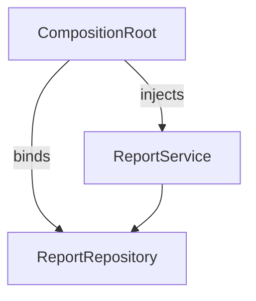

# D18-T005 — Dependency inversion and injection

Topic ID: `D18-T005`
Domain: Low-Level Design (LLD) and Object-Oriented Design
Subdomain: Dependency inversion and injection
Importance: core
Complexity: intermediate
Dependencies: `D18-T004`, `D18-T001`, `D01-T001`, `D01-T002`
Execution status of the code in section F: unexecuted

## A. Topic Overview

Dependency inversion says high-level modules should not depend on low-level details. Injection supplies implementations from outside rather than hard-coding `new`.

## B. First-Principles Explanation

Inversion flips import direction: infrastructure implements interfaces defined by application code. Injection is constructor, setter, or framework-managed.

## C. Internal Working and Architecture

Composition root (main or Spring config) wires the graph. Request scope vs singleton affects thread safety.

## D. Diagrams and Visual Models



Root builds object graph; services receive dependencies.

## E. Examples and Analogies

Spring `@Bean` methods are a composition root.

## F. Code Examples

examples/d18_t005_di.java (unexecuted).

```java
// unexecuted
record ReportService(ReportRepository repo) {
  String monthly() { return repo.loadSummary(); }
}
```

Constructor injection makes dependencies explicit and immutable.

## G. Practical Backend Application

Use DI for DB, HTTP clients, clocks; avoid service locator hidden globals.

## H. Advantages, Limitations and Trade-offs

| Style | Benefit | Cost | Choose when | Avoid when |
| --- | --- | --- | --- | --- |
| Constructor injection | Clear required deps | Long ctor lists | Default in services | Optional rarely-used deps |
| Setter injection | Optional deps | Mutable object | Legacy frameworks | Immutable domain |
| Framework DI | Consistent wiring | Magic to newcomers | Spring/Guice apps | 50-line scripts |

## I. Common Mistakes and Misconceptions

- Service locator anti-pattern.
- Field injection in tests.
- Cyclic dependencies.
- Injecting concrete classes everywhere.
- God module wiring 200 beans manually.

## J. Debugging and Troubleshooting

Bean not found at startup—trace composition root and profile.

## K. Interview Preparation

### Beginner

#### Q1. What is Dependency inversion and injection in one sentence?

**Answer:** Dependency inversion and injection is depend on abstractions inject implementations at the edge. Interviewers want a concrete backend example, not a glossary quote. Tie the definition to a change you would make in a service class or module boundary. Mention testability or deploy isolation as the payoff.

#### Q2. Why does Dependency inversion and injection matter in backend code?

**Answer:** Backend code lives for years and is changed under incident pressure. Dependency inversion and injection reduces the blast radius when requirements shift. Services integrate databases, queues, and third parties; rigid designs break at those seams. Strong answers name a bug class prevented, not only 'clean code'.

#### Q3. Give a small example of Dependency inversion and injection.

**Answer:** Pick one class in a payment or auth flow and show how depend on abstractions inject implementations at the edge applies. Keep the example to three types so the whiteboard stays readable. State inputs, outputs, and who calls whom. End with how you would unit-test the seam.

#### Q4. When would you skip Dependency inversion and injection?

**Answer:** Skips are valid for throwaway scripts and one-off migrations. Over-applying Dependency inversion and injection adds indirection that obscures a 50-line feature. If the variation never appears in requirements, do not build the abstraction early. YAGNI still applies inside OOD.

#### Q5. How is Dependency inversion and injection different from a random utility class?

**Answer:** Utilities are stateless bags of functions without a modeled responsibility. Dependency inversion and injection encodes a deliberate collaboration contract between roles. The difference shows up when you mock one side in tests. If you cannot draw the roles, it is probably not intentional design.

### Intermediate

#### Q1. How does Dependency inversion and injection interact with SOLID?

**Answer:** SOLID is the constraint system; patterns are recurring shapes that satisfy it. Dependency inversion and injection often supports dependency inversion and open-closed goals. Violations of single responsibility usually break the pattern silently. In reviews, map each class to one principle before naming a pattern.

#### Q2. How do you test code structured with Dependency inversion and injection?

**Answer:** Replace slow or external collaborators with fakes at the abstraction introduced by the design. For Dependency inversion and injection, tests should exercise the public contract, not private construction details. Use contract tests at integration boundaries. Avoid testing the pattern itself; test behavior.

#### Q3. What metrics or smells suggest missing Dependency inversion and injection?

**Answer:** God classes, long switch statements, and copy-pasted integration code are common smells. When every new feature edits the same method, Dependency inversion and injection may help. Rising cyclomatic complexity in one class is a signal. Also watch for duplicate error handling across adapters.

#### Q4. How would you introduce Dependency inversion and injection in a legacy service?

**Answer:** Strangler approach: extract one seam behind an interface without rewriting the world. Keep old entry points until callers migrate to the Dependency inversion and injection shape. Add characterization tests before moving code. Ship behind a feature flag if behavior could diverge.

#### Q5. Compare Dependency inversion and injection with composition.

**Answer:** Composition favors has-a wiring; patterns often compose multiple objects. Dependency inversion and injection does not replace composition; it structures it. Prefer composition when inheritance depth grows. Patterns should make collaboration explicit, not magical.

### Advanced

#### Q1. Thread-safety concerns with Dependency inversion and injection?

**Answer:** Shared mutable singletons and registries are the usual hazard. If Dependency inversion and injection caches state, document visibility and locking. In web apps, prefer request-scoped objects over global caches. Load tests expose races that unit tests miss.

#### Q2. Performance cost of Dependency inversion and injection?

**Answer:** Indirection adds allocation and virtual dispatch; usually negligible in I/O bound services. Dependency inversion and injection shines when variation is rare compared to steady-state requests. Profile before collapsing abstractions for micro-optimizations. Watch N+1 calls hidden inside facades.

#### Q3. How does Dependency inversion and injection appear in frameworks (Spring, Django)?

**Answer:** Frameworks often embed the pattern in lifecycle hooks you override. Recognize Dependency inversion and injection in template methods of middleware stacks. Do not fight the framework with a second parallel pattern. Document where your code plugs in.

#### Q4. Versioning APIs while using Dependency inversion and injection?

**Answer:** Keep DTOs stable at the boundary; vary behavior behind the pattern. Dependency inversion and injection lets you add a new strategy without breaking old clients. Publish which implementations are supported per API version. Deprecation is a product policy, not a pattern feature.

#### Q5. Security implications of Dependency inversion and injection?

**Answer:** Proxies and decorators are natural choke points for authz logging. Do not let Dependency inversion and injection bypass central validation. Command objects should not carry secrets in logs. Audit who can register implementations at runtime.

### Scenarios

#### Q1. Production bug: behavior differs only in staging. How does Dependency inversion and injection help debug?

**Answer:** Swap the implementation in staging with a recording fake. With Dependency inversion and injection, compare traces per collaborator. Check configuration wiring first. Replay the command or event that triggered the path.

#### Q2. Team debate: pattern vs inline code. What data decides?

**Answer:** Count variation points expected in the next two quarters. If only one implementation exists, Dependency inversion and injection is speculative. Measure test pain when mocking is hard. Choose the design that reduces coordinated releases.

#### Q3. Interview design: parking lot / LLD. Where Dependency inversion and injection?

**Answer:** Identify entities and lifecycles before patterns. Apply Dependency inversion and injection at the variation point the interviewer highlights. Explain trade-offs aloud while drawing. Start simple; refactor to pattern when second variant appears.

#### Q4. Refactor deadline tomorrow. Minimal Dependency inversion and injection slice?

**Answer:** Extract interface plus one alternate implementation behind factory. Move only the volatile code path into Dependency inversion and injection. Leave data classes dumb. Add one integration test on the critical path.

#### Q5. Observability: what to log with Dependency inversion and injection?

**Answer:** Log correlation id, chosen implementation name, and latency per collaborator. Avoid logging payloads that Dependency inversion and injection transforms secretly. Metrics per strategy help detect misconfiguration. Trace spans should cross the abstraction boundary.

### Follow-ups

#### Q1. Related topic after Dependency inversion and injection?

**Answer:** See the next D18 topic in the learning path for the adjacent pattern or principle. DDD and microservice boundaries reuse the same collaboration thinking. Link to dependency injection containers when wiring appears. Return to SOLID if reviews feel subjective.

#### Q2. How does Dependency inversion and injection relate to microservices?

**Answer:** Patterns are in-process; services are deployment boundaries. Do not distribute a Dependency inversion and injection graph without a compelling scaling reason. Use events between services; use patterns inside a service. Watch for duplicated pattern layers in every microservice.

#### Q3. Books vs code review for learning Dependency inversion and injection?

**Answer:** Books teach vocabulary; reviews teach local conventions. After reading Dependency inversion and injection, find it in your repo's framework integration. Keep a personal catalog of smells that triggered each pattern. Teach juniors with before-and-after diffs, not slides only.


## L. Practical Exercises

Solutions are in `EXERCISES/solutions/D18-T005.md`. Try these before opening that file.

### Exercise 1 — implementation

Wire `Clock` port for testable time-based billing.

### Exercise 2 — debugging

Circular dependency between two services—fix design.

### Exercise 3 — trade-off

Constructor vs field injection in Spring.

## M. Revision Notes

- Inversion owns interface direction.
- Injection at composition root.
- Avoid service locator.

## N. Related Topics

`D18-T004`, `D18-T024`.

## O. Completion Criteria

- Draw composition root.
- Break a dependency cycle.
- Test with injected fake clock.
