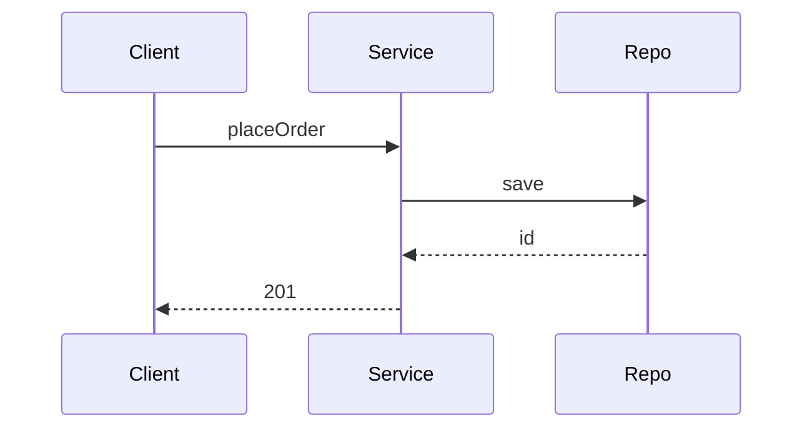

# D18-T006 — UML class and sequence diagrams

Topic ID: `D18-T006`
Domain: Low-Level Design (LLD) and Object-Oriented Design
Subdomain: UML class and sequence diagrams
Importance: core
Complexity: intermediate
Dependencies: `D18-T005`, `D18-T001`, `D01-T001`, `D01-T002`
Execution status of the code in section F: unexecuted

## A. Topic Overview

UML class diagrams show types, fields, and relationships; sequence diagrams show message order over time. They are communication tools for LLD interviews and design reviews.

## B. First-Principles Explanation

Class diagrams capture structure; sequence diagrams capture behavior for one scenario. Neither replaces code—they align teams before implementation.

## C. Internal Working and Architecture

Use minimal notation: associations, implements, extends. Sequence: lifelines, synchronous calls, return dashed lines.

## D. Diagrams and Visual Models



Sequence for one happy-path request.

## E. Examples and Analogies

Whiteboard class diagram for order service collaborators.

## F. Code Examples

examples/d18_t006_notes.md — diagram only (unexecuted).

```java
# Diagrams are not executed code; they guide implementation and reviews.
```

Keep diagrams at the abstraction level reviewers care about—omit every private helper.

## G. Practical Backend Application

Attach sequence diagram to RFC for new endpoints; update when async steps added.

## H. Advantages, Limitations and Trade-offs

| Diagram | Benefit | Cost | Choose when | Avoid when |
| --- | --- | --- | --- | --- |
| Class | Structure at a glance | Stale quickly | LLD interview | Auto-generated dumps |
| Sequence | Ordering clarity | Tedious for many paths | One critical flow | Whole system map |

## I. Common Mistakes and Misconceptions

- Over-modeling every class.
- Diagrams diverging from code.
- Using UML when a short paragraph suffices.
- Hiding async in synchronous sequence.
- Too many stereotypes.

## J. Debugging and Troubleshooting

Review mismatch—compare diagram to actual call stack trace.

## K. Interview Preparation

### Beginner

#### Q1. What is UML class and sequence diagrams in one sentence?

**Answer:** UML class and sequence diagrams is visual contracts for structure and message order. Interviewers want a concrete backend example, not a glossary quote. Tie the definition to a change you would make in a service class or module boundary. Mention testability or deploy isolation as the payoff.

#### Q2. Why does UML class and sequence diagrams matter in backend code?

**Answer:** Backend code lives for years and is changed under incident pressure. UML class and sequence diagrams reduces the blast radius when requirements shift. Services integrate databases, queues, and third parties; rigid designs break at those seams. Strong answers name a bug class prevented, not only 'clean code'.

#### Q3. Give a small example of UML class and sequence diagrams.

**Answer:** Pick one class in a payment or auth flow and show how visual contracts for structure and message order applies. Keep the example to three types so the whiteboard stays readable. State inputs, outputs, and who calls whom. End with how you would unit-test the seam.

#### Q4. When would you skip UML class and sequence diagrams?

**Answer:** Skips are valid for throwaway scripts and one-off migrations. Over-applying UML class and sequence diagrams adds indirection that obscures a 50-line feature. If the variation never appears in requirements, do not build the abstraction early. YAGNI still applies inside OOD.

#### Q5. How is UML class and sequence diagrams different from a random utility class?

**Answer:** Utilities are stateless bags of functions without a modeled responsibility. UML class and sequence diagrams encodes a deliberate collaboration contract between roles. The difference shows up when you mock one side in tests. If you cannot draw the roles, it is probably not intentional design.

### Intermediate

#### Q1. How does UML class and sequence diagrams interact with SOLID?

**Answer:** SOLID is the constraint system; patterns are recurring shapes that satisfy it. UML class and sequence diagrams often supports dependency inversion and open-closed goals. Violations of single responsibility usually break the pattern silently. In reviews, map each class to one principle before naming a pattern.

#### Q2. How do you test code structured with UML class and sequence diagrams?

**Answer:** Replace slow or external collaborators with fakes at the abstraction introduced by the design. For UML class and sequence diagrams, tests should exercise the public contract, not private construction details. Use contract tests at integration boundaries. Avoid testing the pattern itself; test behavior.

#### Q3. What metrics or smells suggest missing UML class and sequence diagrams?

**Answer:** God classes, long switch statements, and copy-pasted integration code are common smells. When every new feature edits the same method, UML class and sequence diagrams may help. Rising cyclomatic complexity in one class is a signal. Also watch for duplicate error handling across adapters.

#### Q4. How would you introduce UML class and sequence diagrams in a legacy service?

**Answer:** Strangler approach: extract one seam behind an interface without rewriting the world. Keep old entry points until callers migrate to the UML class and sequence diagrams shape. Add characterization tests before moving code. Ship behind a feature flag if behavior could diverge.

#### Q5. Compare UML class and sequence diagrams with composition.

**Answer:** Composition favors has-a wiring; patterns often compose multiple objects. UML class and sequence diagrams does not replace composition; it structures it. Prefer composition when inheritance depth grows. Patterns should make collaboration explicit, not magical.

### Advanced

#### Q1. Thread-safety concerns with UML class and sequence diagrams?

**Answer:** Shared mutable singletons and registries are the usual hazard. If UML class and sequence diagrams caches state, document visibility and locking. In web apps, prefer request-scoped objects over global caches. Load tests expose races that unit tests miss.

#### Q2. Performance cost of UML class and sequence diagrams?

**Answer:** Indirection adds allocation and virtual dispatch; usually negligible in I/O bound services. UML class and sequence diagrams shines when variation is rare compared to steady-state requests. Profile before collapsing abstractions for micro-optimizations. Watch N+1 calls hidden inside facades.

#### Q3. How does UML class and sequence diagrams appear in frameworks (Spring, Django)?

**Answer:** Frameworks often embed the pattern in lifecycle hooks you override. Recognize UML class and sequence diagrams in template methods of middleware stacks. Do not fight the framework with a second parallel pattern. Document where your code plugs in.

#### Q4. Versioning APIs while using UML class and sequence diagrams?

**Answer:** Keep DTOs stable at the boundary; vary behavior behind the pattern. UML class and sequence diagrams lets you add a new strategy without breaking old clients. Publish which implementations are supported per API version. Deprecation is a product policy, not a pattern feature.

#### Q5. Security implications of UML class and sequence diagrams?

**Answer:** Proxies and decorators are natural choke points for authz logging. Do not let UML class and sequence diagrams bypass central validation. Command objects should not carry secrets in logs. Audit who can register implementations at runtime.

### Scenarios

#### Q1. Production bug: behavior differs only in staging. How does UML class and sequence diagrams help debug?

**Answer:** Swap the implementation in staging with a recording fake. With UML class and sequence diagrams, compare traces per collaborator. Check configuration wiring first. Replay the command or event that triggered the path.

#### Q2. Team debate: pattern vs inline code. What data decides?

**Answer:** Count variation points expected in the next two quarters. If only one implementation exists, UML class and sequence diagrams is speculative. Measure test pain when mocking is hard. Choose the design that reduces coordinated releases.

#### Q3. Interview design: parking lot / LLD. Where UML class and sequence diagrams?

**Answer:** Identify entities and lifecycles before patterns. Apply UML class and sequence diagrams at the variation point the interviewer highlights. Explain trade-offs aloud while drawing. Start simple; refactor to pattern when second variant appears.

#### Q4. Refactor deadline tomorrow. Minimal UML class and sequence diagrams slice?

**Answer:** Extract interface plus one alternate implementation behind factory. Move only the volatile code path into UML class and sequence diagrams. Leave data classes dumb. Add one integration test on the critical path.

#### Q5. Observability: what to log with UML class and sequence diagrams?

**Answer:** Log correlation id, chosen implementation name, and latency per collaborator. Avoid logging payloads that UML class and sequence diagrams transforms secretly. Metrics per strategy help detect misconfiguration. Trace spans should cross the abstraction boundary.

### Follow-ups

#### Q1. Related topic after UML class and sequence diagrams?

**Answer:** See the next D18 topic in the learning path for the adjacent pattern or principle. DDD and microservice boundaries reuse the same collaboration thinking. Link to dependency injection containers when wiring appears. Return to SOLID if reviews feel subjective.

#### Q2. How does UML class and sequence diagrams relate to microservices?

**Answer:** Patterns are in-process; services are deployment boundaries. Do not distribute a UML class and sequence diagrams graph without a compelling scaling reason. Use events between services; use patterns inside a service. Watch for duplicated pattern layers in every microservice.

#### Q3. Books vs code review for learning UML class and sequence diagrams?

**Answer:** Books teach vocabulary; reviews teach local conventions. After reading UML class and sequence diagrams, find it in your repo's framework integration. Keep a personal catalog of smells that triggered each pattern. Teach juniors with before-and-after diffs, not slides only.


## L. Practical Exercises

Solutions are in `EXERCISES/solutions/D18-T006.md`. Try these before opening that file.

### Exercise 1 — implementation

Draw class diagram for checkout module.

### Exercise 2 — debugging

Sequence missing async callback—fix diagram.

### Exercise 3 — trade-off

When is a diagram waste?

## M. Revision Notes

- Class = structure.
- Sequence = time.
- Keep minimal.

## N. Related Topics

`D18-T005`, `D18-T007`.

## O. Completion Criteria

- Draw sequence for login.
- Read associations on a sample diagram.
- Know when to skip UML.
