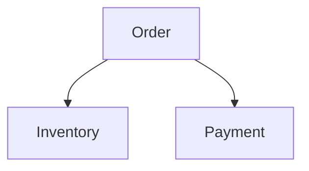

# D18-T007 — Class responsibility and collaboration

Topic ID: `D18-T007`
Domain: Low-Level Design (LLD) and Object-Oriented Design
Subdomain: Class responsibility and collaboration
Importance: core
Complexity: intermediate
Dependencies: `D18-T006`, `D18-T001`, `D01-T001`, `D01-T002`
Execution status of the code in section F: unexecuted

## A. Topic Overview

CRC cards list Class, Responsibilities, and Collaborators—a lightweight way to assign OOD roles before coding. They prevent god services in LLD sessions.

## B. First-Principles Explanation

Responsibility is a reason to exist; collaborator is another class this one talks to. One card should fit a sticky note.

## C. Internal Working and Architecture

Walk scenarios: place order touches Order, Inventory, Payment, Notification. Split when responsibilities argue.

## D. Diagrams and Visual Models



Collaborators for one scenario.

## E. Examples and Analogies

CRC for `RefundService`: calculate eligibility, call payment port, emit audit event.

## F. Code Examples

examples/d18_t007_crc.txt (unexecuted).

```java
Order: R: validate lines; C: Inventory, Pricing.
```

Run CRC session before sprint for new bounded context.

## G. Practical Backend Application

Use Class responsibility and collaboration when a backend module is about to grow a second variation.

## H. Advantages, Limitations and Trade-offs

| Technique | Benefit | Cost | Choose when | Avoid when |
| --- | --- | --- | --- | --- |
| CRC cards | Fast role split | Subjective | LLD interview | Post-hoc documentation only |
| SRP check | Clear ownership | Debates | Code review | Nitpicking tiny classes |

## I. Common Mistakes and Misconceptions

- Everything on one card.
- Confusing data class with responsibility.
- Collaborator list as implementation spec.
- Skipping scenarios.
- Cards never updated after refactor.

## J. Debugging and Troubleshooting

New feature touches five classes—revisit CRC for scattered responsibility.

## K. Interview Preparation

### Beginner

#### Q1. What is Class responsibility and collaboration in one sentence?

**Answer:** Class responsibility and collaboration is assign responsibilities before writing classes. Interviewers want a concrete backend example, not a glossary quote. Tie the definition to a change you would make in a service class or module boundary. Mention testability or deploy isolation as the payoff.

#### Q2. Why does Class responsibility and collaboration matter in backend code?

**Answer:** Backend code lives for years and is changed under incident pressure. Class responsibility and collaboration reduces the blast radius when requirements shift. Services integrate databases, queues, and third parties; rigid designs break at those seams. Strong answers name a bug class prevented, not only 'clean code'.

#### Q3. Give a small example of Class responsibility and collaboration.

**Answer:** Pick one class in a payment or auth flow and show how assign responsibilities before writing classes applies. Keep the example to three types so the whiteboard stays readable. State inputs, outputs, and who calls whom. End with how you would unit-test the seam.

#### Q4. When would you skip Class responsibility and collaboration?

**Answer:** Skips are valid for throwaway scripts and one-off migrations. Over-applying Class responsibility and collaboration adds indirection that obscures a 50-line feature. If the variation never appears in requirements, do not build the abstraction early. YAGNI still applies inside OOD.

#### Q5. How is Class responsibility and collaboration different from a random utility class?

**Answer:** Utilities are stateless bags of functions without a modeled responsibility. Class responsibility and collaboration encodes a deliberate collaboration contract between roles. The difference shows up when you mock one side in tests. If you cannot draw the roles, it is probably not intentional design.

### Intermediate

#### Q1. How does Class responsibility and collaboration interact with SOLID?

**Answer:** SOLID is the constraint system; patterns are recurring shapes that satisfy it. Class responsibility and collaboration often supports dependency inversion and open-closed goals. Violations of single responsibility usually break the pattern silently. In reviews, map each class to one principle before naming a pattern.

#### Q2. How do you test code structured with Class responsibility and collaboration?

**Answer:** Replace slow or external collaborators with fakes at the abstraction introduced by the design. For Class responsibility and collaboration, tests should exercise the public contract, not private construction details. Use contract tests at integration boundaries. Avoid testing the pattern itself; test behavior.

#### Q3. What metrics or smells suggest missing Class responsibility and collaboration?

**Answer:** God classes, long switch statements, and copy-pasted integration code are common smells. When every new feature edits the same method, Class responsibility and collaboration may help. Rising cyclomatic complexity in one class is a signal. Also watch for duplicate error handling across adapters.

#### Q4. How would you introduce Class responsibility and collaboration in a legacy service?

**Answer:** Strangler approach: extract one seam behind an interface without rewriting the world. Keep old entry points until callers migrate to the Class responsibility and collaboration shape. Add characterization tests before moving code. Ship behind a feature flag if behavior could diverge.

#### Q5. Compare Class responsibility and collaboration with composition.

**Answer:** Composition favors has-a wiring; patterns often compose multiple objects. Class responsibility and collaboration does not replace composition; it structures it. Prefer composition when inheritance depth grows. Patterns should make collaboration explicit, not magical.

### Advanced

#### Q1. Thread-safety concerns with Class responsibility and collaboration?

**Answer:** Shared mutable singletons and registries are the usual hazard. If Class responsibility and collaboration caches state, document visibility and locking. In web apps, prefer request-scoped objects over global caches. Load tests expose races that unit tests miss.

#### Q2. Performance cost of Class responsibility and collaboration?

**Answer:** Indirection adds allocation and virtual dispatch; usually negligible in I/O bound services. Class responsibility and collaboration shines when variation is rare compared to steady-state requests. Profile before collapsing abstractions for micro-optimizations. Watch N+1 calls hidden inside facades.

#### Q3. How does Class responsibility and collaboration appear in frameworks (Spring, Django)?

**Answer:** Frameworks often embed the pattern in lifecycle hooks you override. Recognize Class responsibility and collaboration in template methods of middleware stacks. Do not fight the framework with a second parallel pattern. Document where your code plugs in.

#### Q4. Versioning APIs while using Class responsibility and collaboration?

**Answer:** Keep DTOs stable at the boundary; vary behavior behind the pattern. Class responsibility and collaboration lets you add a new strategy without breaking old clients. Publish which implementations are supported per API version. Deprecation is a product policy, not a pattern feature.

#### Q5. Security implications of Class responsibility and collaboration?

**Answer:** Proxies and decorators are natural choke points for authz logging. Do not let Class responsibility and collaboration bypass central validation. Command objects should not carry secrets in logs. Audit who can register implementations at runtime.

### Scenarios

#### Q1. Production bug: behavior differs only in staging. How does Class responsibility and collaboration help debug?

**Answer:** Swap the implementation in staging with a recording fake. With Class responsibility and collaboration, compare traces per collaborator. Check configuration wiring first. Replay the command or event that triggered the path.

#### Q2. Team debate: pattern vs inline code. What data decides?

**Answer:** Count variation points expected in the next two quarters. If only one implementation exists, Class responsibility and collaboration is speculative. Measure test pain when mocking is hard. Choose the design that reduces coordinated releases.

#### Q3. Interview design: parking lot / LLD. Where Class responsibility and collaboration?

**Answer:** Identify entities and lifecycles before patterns. Apply Class responsibility and collaboration at the variation point the interviewer highlights. Explain trade-offs aloud while drawing. Start simple; refactor to pattern when second variant appears.

#### Q4. Refactor deadline tomorrow. Minimal Class responsibility and collaboration slice?

**Answer:** Extract interface plus one alternate implementation behind factory. Move only the volatile code path into Class responsibility and collaboration. Leave data classes dumb. Add one integration test on the critical path.

#### Q5. Observability: what to log with Class responsibility and collaboration?

**Answer:** Log correlation id, chosen implementation name, and latency per collaborator. Avoid logging payloads that Class responsibility and collaboration transforms secretly. Metrics per strategy help detect misconfiguration. Trace spans should cross the abstraction boundary.

### Follow-ups

#### Q1. Related topic after Class responsibility and collaboration?

**Answer:** See the next D18 topic in the learning path for the adjacent pattern or principle. DDD and microservice boundaries reuse the same collaboration thinking. Link to dependency injection containers when wiring appears. Return to SOLID if reviews feel subjective.

#### Q2. How does Class responsibility and collaboration relate to microservices?

**Answer:** Patterns are in-process; services are deployment boundaries. Do not distribute a Class responsibility and collaboration graph without a compelling scaling reason. Use events between services; use patterns inside a service. Watch for duplicated pattern layers in every microservice.

#### Q3. Books vs code review for learning Class responsibility and collaboration?

**Answer:** Books teach vocabulary; reviews teach local conventions. After reading Class responsibility and collaboration, find it in your repo's framework integration. Keep a personal catalog of smells that triggered each pattern. Teach juniors with before-and-after diffs, not slides only.


## L. Practical Exercises

Solutions are in `EXERCISES/solutions/D18-T007.md`. Try these before opening that file.

### Exercise 1 — implementation

Write CRC cards for library checkout LLD.

### Exercise 2 — debugging

God class discovered—map CRC to split.

### Exercise 3 — trade-off

CRC vs full UML timebox.

## M. Revision Notes

- One primary responsibility per class.
- Collaborators are peers.
- Scenario walk first.

## N. Related Topics

`D18-T006`, `D18-T008`.

## O. Completion Criteria

- Produce CRC for parking lot.
- Split god class using CRC.
- Facilitate a 15-minute CRC session.
