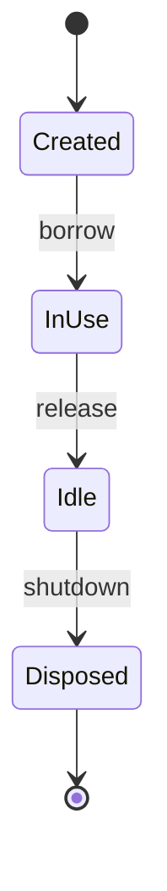

# D18-T008 — Object lifecycle and ownership

Topic ID: `D18-T008`
Domain: Low-Level Design (LLD) and Object-Oriented Design
Subdomain: Object lifecycle and ownership
Importance: core
Complexity: intermediate
Dependencies: `D18-T007`, `D18-T001`, `D01-T001`, `D01-T002`
Execution status of the code in section F: unexecuted

## A. Topic Overview

Lifecycle covers creation, use, and disposal of objects; ownership defines who may mutate or destroy shared state. Critical for connection pools, caches, and domain aggregates.

## B. First-Principles Explanation

RAII in C++; GC in Java/Python; scope rules still matter for resources (files, sockets). Clear ownership prevents use-after-free and double-close bugs.

## C. Internal Working and Architecture

Factory creates; aggregate root owns children; container owns singletons. Document transfer of ownership when passing references.

## D. Diagrams and Visual Models



Typical pooled resource lifecycle.

## E. Examples and Analogies

Who closes the HTTP response body—the caller or the wrapper?

## F. Code Examples

examples/d18_t008_lifecycle.java (unexecuted).

```java
// unexecuted
try (Connection c = dataSource.getConnection()) {
  // caller owns scope; pool owns physical connection
}
```

Try-with-resources expresses lexical ownership.

## G. Practical Backend Application

Per-request objects vs singleton caches—document thread safety.

## H. Advantages, Limitations and Trade-offs

| Ownership | Benefit | Cost | Choose when | Avoid when |
| --- | --- | --- | --- | --- |
| Caller closes | Explicit | Easy to forget | Streams, connections | Framework-managed |
| Container owns | Central shutdown | Hidden rules | DataSource beans | Quick scripts |
| Aggregate owns children | Consistent invariants | Careful graph | DDD aggregates | Flat DTO graphs |

## I. Common Mistakes and Misconceptions

- Returning owned resource to caller without docs.
- Shared mutable singleton.
- Closing twice.
- Leak on exception path.
- Wrong scope (request bean holding user session in singleton).

## J. Debugging and Troubleshooting

Connection leak—heap dump or pool metrics; check missing close in finally.

## K. Interview Preparation

### Beginner

#### Q1. What is Object lifecycle and ownership in one sentence?

**Answer:** Object lifecycle and ownership is clear creation use disposal and who mutates. Interviewers want a concrete backend example, not a glossary quote. Tie the definition to a change you would make in a service class or module boundary. Mention testability or deploy isolation as the payoff.

#### Q2. Why does Object lifecycle and ownership matter in backend code?

**Answer:** Backend code lives for years and is changed under incident pressure. Object lifecycle and ownership reduces the blast radius when requirements shift. Services integrate databases, queues, and third parties; rigid designs break at those seams. Strong answers name a bug class prevented, not only 'clean code'.

#### Q3. Give a small example of Object lifecycle and ownership.

**Answer:** Pick one class in a payment or auth flow and show how clear creation use disposal and who mutates applies. Keep the example to three types so the whiteboard stays readable. State inputs, outputs, and who calls whom. End with how you would unit-test the seam.

#### Q4. When would you skip Object lifecycle and ownership?

**Answer:** Skips are valid for throwaway scripts and one-off migrations. Over-applying Object lifecycle and ownership adds indirection that obscures a 50-line feature. If the variation never appears in requirements, do not build the abstraction early. YAGNI still applies inside OOD.

#### Q5. How is Object lifecycle and ownership different from a random utility class?

**Answer:** Utilities are stateless bags of functions without a modeled responsibility. Object lifecycle and ownership encodes a deliberate collaboration contract between roles. The difference shows up when you mock one side in tests. If you cannot draw the roles, it is probably not intentional design.

### Intermediate

#### Q1. How does Object lifecycle and ownership interact with SOLID?

**Answer:** SOLID is the constraint system; patterns are recurring shapes that satisfy it. Object lifecycle and ownership often supports dependency inversion and open-closed goals. Violations of single responsibility usually break the pattern silently. In reviews, map each class to one principle before naming a pattern.

#### Q2. How do you test code structured with Object lifecycle and ownership?

**Answer:** Replace slow or external collaborators with fakes at the abstraction introduced by the design. For Object lifecycle and ownership, tests should exercise the public contract, not private construction details. Use contract tests at integration boundaries. Avoid testing the pattern itself; test behavior.

#### Q3. What metrics or smells suggest missing Object lifecycle and ownership?

**Answer:** God classes, long switch statements, and copy-pasted integration code are common smells. When every new feature edits the same method, Object lifecycle and ownership may help. Rising cyclomatic complexity in one class is a signal. Also watch for duplicate error handling across adapters.

#### Q4. How would you introduce Object lifecycle and ownership in a legacy service?

**Answer:** Strangler approach: extract one seam behind an interface without rewriting the world. Keep old entry points until callers migrate to the Object lifecycle and ownership shape. Add characterization tests before moving code. Ship behind a feature flag if behavior could diverge.

#### Q5. Compare Object lifecycle and ownership with composition.

**Answer:** Composition favors has-a wiring; patterns often compose multiple objects. Object lifecycle and ownership does not replace composition; it structures it. Prefer composition when inheritance depth grows. Patterns should make collaboration explicit, not magical.

### Advanced

#### Q1. Thread-safety concerns with Object lifecycle and ownership?

**Answer:** Shared mutable singletons and registries are the usual hazard. If Object lifecycle and ownership caches state, document visibility and locking. In web apps, prefer request-scoped objects over global caches. Load tests expose races that unit tests miss.

#### Q2. Performance cost of Object lifecycle and ownership?

**Answer:** Indirection adds allocation and virtual dispatch; usually negligible in I/O bound services. Object lifecycle and ownership shines when variation is rare compared to steady-state requests. Profile before collapsing abstractions for micro-optimizations. Watch N+1 calls hidden inside facades.

#### Q3. How does Object lifecycle and ownership appear in frameworks (Spring, Django)?

**Answer:** Frameworks often embed the pattern in lifecycle hooks you override. Recognize Object lifecycle and ownership in template methods of middleware stacks. Do not fight the framework with a second parallel pattern. Document where your code plugs in.

#### Q4. Versioning APIs while using Object lifecycle and ownership?

**Answer:** Keep DTOs stable at the boundary; vary behavior behind the pattern. Object lifecycle and ownership lets you add a new strategy without breaking old clients. Publish which implementations are supported per API version. Deprecation is a product policy, not a pattern feature.

#### Q5. Security implications of Object lifecycle and ownership?

**Answer:** Proxies and decorators are natural choke points for authz logging. Do not let Object lifecycle and ownership bypass central validation. Command objects should not carry secrets in logs. Audit who can register implementations at runtime.

### Scenarios

#### Q1. Production bug: behavior differs only in staging. How does Object lifecycle and ownership help debug?

**Answer:** Swap the implementation in staging with a recording fake. With Object lifecycle and ownership, compare traces per collaborator. Check configuration wiring first. Replay the command or event that triggered the path.

#### Q2. Team debate: pattern vs inline code. What data decides?

**Answer:** Count variation points expected in the next two quarters. If only one implementation exists, Object lifecycle and ownership is speculative. Measure test pain when mocking is hard. Choose the design that reduces coordinated releases.

#### Q3. Interview design: parking lot / LLD. Where Object lifecycle and ownership?

**Answer:** Identify entities and lifecycles before patterns. Apply Object lifecycle and ownership at the variation point the interviewer highlights. Explain trade-offs aloud while drawing. Start simple; refactor to pattern when second variant appears.

#### Q4. Refactor deadline tomorrow. Minimal Object lifecycle and ownership slice?

**Answer:** Extract interface plus one alternate implementation behind factory. Move only the volatile code path into Object lifecycle and ownership. Leave data classes dumb. Add one integration test on the critical path.

#### Q5. Observability: what to log with Object lifecycle and ownership?

**Answer:** Log correlation id, chosen implementation name, and latency per collaborator. Avoid logging payloads that Object lifecycle and ownership transforms secretly. Metrics per strategy help detect misconfiguration. Trace spans should cross the abstraction boundary.

### Follow-ups

#### Q1. Related topic after Object lifecycle and ownership?

**Answer:** See the next D18 topic in the learning path for the adjacent pattern or principle. DDD and microservice boundaries reuse the same collaboration thinking. Link to dependency injection containers when wiring appears. Return to SOLID if reviews feel subjective.

#### Q2. How does Object lifecycle and ownership relate to microservices?

**Answer:** Patterns are in-process; services are deployment boundaries. Do not distribute a Object lifecycle and ownership graph without a compelling scaling reason. Use events between services; use patterns inside a service. Watch for duplicated pattern layers in every microservice.

#### Q3. Books vs code review for learning Object lifecycle and ownership?

**Answer:** Books teach vocabulary; reviews teach local conventions. After reading Object lifecycle and ownership, find it in your repo's framework integration. Keep a personal catalog of smells that triggered each pattern. Teach juniors with before-and-after diffs, not slides only.


## L. Practical Exercises

Solutions are in `EXERCISES/solutions/D18-T008.md`. Try these before opening that file.

### Exercise 1 — implementation

Design lifecycle for connection pool wrapper.

### Exercise 2 — debugging

Memory leak from thread-local cache—fix ownership.

### Exercise 3 — trade-off

Singleton vs prototype scope trade-off.

## M. Revision Notes

- Own resources explicitly.
- Pools recycle, callers borrow.
- Match scope to thread safety.

## N. Related Topics

`D18-T007`, creational patterns `D18-T009`+.

## O. Completion Criteria

- Explain try-with-resources ownership.
- Pick Spring bean scope.
- Find a leak scenario.
