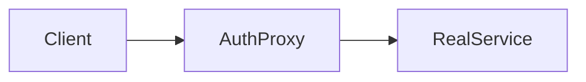

# D18-T018 — Proxy

Topic ID: `D18-T018`
Domain: Low-Level Design (LLD) and Object-Oriented Design
Subdomain: Proxy
Importance: core
Complexity: intermediate
Dependencies: `D18-T017`, `D18-T001`, `D01-T001`, `D01-T002`
Execution status of the code in section F: unexecuted

## A. Topic Overview

The **Proxy** pattern is a recurring object collaboration that solves a specific design force in backend services.
Provide a surrogate or placeholder for another object to control access.
Interviewers use it to see whether you can separate variation from stable contracts instead of growing conditional logic.
Prerequisites: `D18-T001` (SOLID) and encapsulation topics through `D18-T008` help you place the pattern correctly.

## B. First-Principles Explanation

Object-oriented design is about assigning responsibilities so that change localizes.
The Proxy pattern names a small set of roles and how messages pass between them.
At runtime, the graph is ordinary method calls; the pattern is the intentional shape that keeps those calls maintainable.
Alternatives include inline switches, inheritance towers, or framework magic—each trades explicitness for brevity.

## C. Internal Working and Architecture

Components are the roles in the structure diagram: clients depend on abstractions, creators/builders/proxies hide construction or cross-cutting steps.
Execution begins at the entry point (client, invoker, or facade) and flows along the composed objects until the domain operation completes.
State is owned by the object that mutates domain data; collaborators should be stateless or document their shared state.
In a Spring or similar stack, the same graph is often assembled by a container rather than `new` calls in application code.

## D. Diagrams and Visual Models



Flow for Proxy: client code depends on the abstraction, not the concrete variant.

## E. Examples and Analogies

### Pattern intent

          Provide a surrogate or placeholder for another object to control access.

          ### Structure

          ```mermaid
          classDiagram
class Subject
class Proxy
class RealSubject
Subject <|.. RealSubject
Subject <|.. Proxy
Proxy --> RealSubject
          ```

          ### When not to use this pattern

          Skip when transparent pass-through adds no value.

Backend analogy: Authorization wrapper before delegating to core service.
Analogy: the pattern is like a interchangeable lens on a camera—body stays, lens changes the behavior without rewiring the shutter button.
Do not confuse the pattern name with every class named `*Factory` in a codebase; verify the collaboration matches the intent.

## F. Code Examples

File: `examples/d18-t018-proxy.java` (illustrative, not executed in CI).

```java
// unexecuted
class SecuredOrderService implements OrderService {
  private final OrderService delegate;
  public void cancel(String id) { authz.check(); delegate.cancel(id); }
}
```

This example is labeled unexecuted unless you compile it locally. Focus on role names and dependency direction.

## G. Practical Backend Application

In HTTP handlers, keep Proxy behind a service interface so controllers stay thin.
Wire implementations in the composition root (module config or DI container).
Log which implementation handled a request when multiple strategies exist.
Feature flags can select implementations without rewriting business rules.

## H. Advantages, Limitations and Trade-offs

| Choice | Benefit | Cost | Choose when | Avoid when |
| --- | --- | --- | --- | --- |
| Apply the pattern | Clear seams, easier tests | More types and wiring | Second variant is real | One implementation forever |
| Inline logic | Fast to read initially | Switch statements grow | Prototype only | Variation is production-critical |
| Framework default | Less custom code | Hidden behavior | Framework matches need | You need explicit contracts |
| Composition root | Central wiring | Bootstrap complexity | Many implementations | Tiny CLI tools |

## I. Common Mistakes and Misconceptions

- Using Proxy when only one implementation will ever exist.
- Letting concrete types leak into controllers or repositories.
- Forgetting to document lifecycle (singleton vs per-request).
- Testing the wiring instead of behavior.
- Creating circular dependencies between pattern roles.

## J. Debugging and Troubleshooting

Symptom: behavior changes when you add a second implementation—usually a missing interface binding.
Check: composition root, profile-specific beans, and environment variables selecting variants.
Mitigation: add a contract test that asserts the expected implementation is active per environment.

## K. Interview Preparation

### Beginner

#### Q1. What is Proxy in one sentence?

**Answer:** Proxy is control access lazy load caching remote calls. Interviewers want a concrete backend example, not a glossary quote. Tie the definition to a change you would make in a service class or module boundary. Mention testability or deploy isolation as the payoff.

#### Q2. Why does Proxy matter in backend code?

**Answer:** Backend code lives for years and is changed under incident pressure. Proxy reduces the blast radius when requirements shift. Services integrate databases, queues, and third parties; rigid designs break at those seams. Strong answers name a bug class prevented, not only 'clean code'.

#### Q3. Give a small example of Proxy.

**Answer:** Pick one class in a payment or auth flow and show how control access lazy load caching remote calls applies. Keep the example to three types so the whiteboard stays readable. State inputs, outputs, and who calls whom. End with how you would unit-test the seam.

#### Q4. When would you skip Proxy?

**Answer:** Skips are valid for throwaway scripts and one-off migrations. Over-applying Proxy adds indirection that obscures a 50-line feature. If the variation never appears in requirements, do not build the abstraction early. YAGNI still applies inside OOD.

#### Q5. How is Proxy different from a random utility class?

**Answer:** Utilities are stateless bags of functions without a modeled responsibility. Proxy encodes a deliberate collaboration contract between roles. The difference shows up when you mock one side in tests. If you cannot draw the roles, it is probably not intentional design.

### Intermediate

#### Q1. How does Proxy interact with SOLID?

**Answer:** SOLID is the constraint system; patterns are recurring shapes that satisfy it. Proxy often supports dependency inversion and open-closed goals. Violations of single responsibility usually break the pattern silently. In reviews, map each class to one principle before naming a pattern.

#### Q2. How do you test code structured with Proxy?

**Answer:** Replace slow or external collaborators with fakes at the abstraction introduced by the design. For Proxy, tests should exercise the public contract, not private construction details. Use contract tests at integration boundaries. Avoid testing the pattern itself; test behavior.

#### Q3. What metrics or smells suggest missing Proxy?

**Answer:** God classes, long switch statements, and copy-pasted integration code are common smells. When every new feature edits the same method, Proxy may help. Rising cyclomatic complexity in one class is a signal. Also watch for duplicate error handling across adapters.

#### Q4. How would you introduce Proxy in a legacy service?

**Answer:** Strangler approach: extract one seam behind an interface without rewriting the world. Keep old entry points until callers migrate to the Proxy shape. Add characterization tests before moving code. Ship behind a feature flag if behavior could diverge.

#### Q5. Compare Proxy with composition.

**Answer:** Composition favors has-a wiring; patterns often compose multiple objects. Proxy does not replace composition; it structures it. Prefer composition when inheritance depth grows. Patterns should make collaboration explicit, not magical.

### Advanced

#### Q1. Thread-safety concerns with Proxy?

**Answer:** Shared mutable singletons and registries are the usual hazard. If Proxy caches state, document visibility and locking. In web apps, prefer request-scoped objects over global caches. Load tests expose races that unit tests miss.

#### Q2. Performance cost of Proxy?

**Answer:** Indirection adds allocation and virtual dispatch; usually negligible in I/O bound services. Proxy shines when variation is rare compared to steady-state requests. Profile before collapsing abstractions for micro-optimizations. Watch N+1 calls hidden inside facades.

#### Q3. How does Proxy appear in frameworks (Spring, Django)?

**Answer:** Frameworks often embed the pattern in lifecycle hooks you override. Recognize Proxy in template methods of middleware stacks. Do not fight the framework with a second parallel pattern. Document where your code plugs in.

#### Q4. Versioning APIs while using Proxy?

**Answer:** Keep DTOs stable at the boundary; vary behavior behind the pattern. Proxy lets you add a new strategy without breaking old clients. Publish which implementations are supported per API version. Deprecation is a product policy, not a pattern feature.

#### Q5. Security implications of Proxy?

**Answer:** Proxies and decorators are natural choke points for authz logging. Do not let Proxy bypass central validation. Command objects should not carry secrets in logs. Audit who can register implementations at runtime.

### Scenarios

#### Q1. Production bug: behavior differs only in staging. How does Proxy help debug?

**Answer:** Swap the implementation in staging with a recording fake. With Proxy, compare traces per collaborator. Check configuration wiring first. Replay the command or event that triggered the path.

#### Q2. Team debate: pattern vs inline code. What data decides?

**Answer:** Count variation points expected in the next two quarters. If only one implementation exists, Proxy is speculative. Measure test pain when mocking is hard. Choose the design that reduces coordinated releases.

#### Q3. Interview design: parking lot / LLD. Where Proxy?

**Answer:** Identify entities and lifecycles before patterns. Apply Proxy at the variation point the interviewer highlights. Explain trade-offs aloud while drawing. Start simple; refactor to pattern when second variant appears.

#### Q4. Refactor deadline tomorrow. Minimal Proxy slice?

**Answer:** Extract interface plus one alternate implementation behind factory. Move only the volatile code path into Proxy. Leave data classes dumb. Add one integration test on the critical path.

#### Q5. Observability: what to log with Proxy?

**Answer:** Log correlation id, chosen implementation name, and latency per collaborator. Avoid logging payloads that Proxy transforms secretly. Metrics per strategy help detect misconfiguration. Trace spans should cross the abstraction boundary.

### Follow-ups

#### Q1. Related topic after Proxy?

**Answer:** See the next D18 topic in the learning path for the adjacent pattern or principle. DDD and microservice boundaries reuse the same collaboration thinking. Link to dependency injection containers when wiring appears. Return to SOLID if reviews feel subjective.

#### Q2. How does Proxy relate to microservices?

**Answer:** Patterns are in-process; services are deployment boundaries. Do not distribute a Proxy graph without a compelling scaling reason. Use events between services; use patterns inside a service. Watch for duplicated pattern layers in every microservice.

#### Q3. Books vs code review for learning Proxy?

**Answer:** Books teach vocabulary; reviews teach local conventions. After reading Proxy, find it in your repo's framework integration. Keep a personal catalog of smells that triggered each pattern. Teach juniors with before-and-after diffs, not slides only.


## L. Practical Exercises

Solutions are in `EXERCISES/solutions/D18-T018.md`. Try these before opening that file.

### Exercise 1 — implementation

Proxy adding caching to read repository.

### Exercise 2 — debugging

Stale cache in proxy—invalidate strategy.

### Exercise 3 — trade-off

Proxy vs decorator intent.

## M. Revision Notes

- Proxy: intent in one sentence.
- Draw structure with client on the left.
- Name when not to use it.
- Map to a backend integration example.

## N. Related Topics

`D18-T019` Command.

## O. Completion Criteria

- Explain Proxy intent without reading notes.
- Draw the structure mermaid from memory.
- Implement a minimal example in Java or Python.
- State two smells that suggest the pattern.
- Describe how you would test the collaboration.
